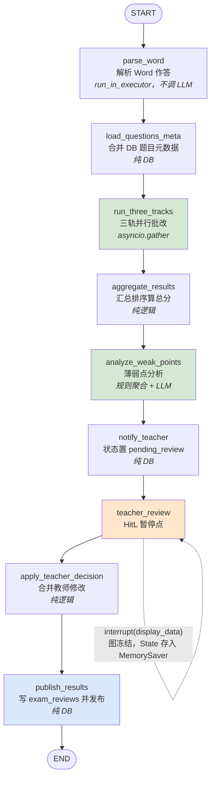
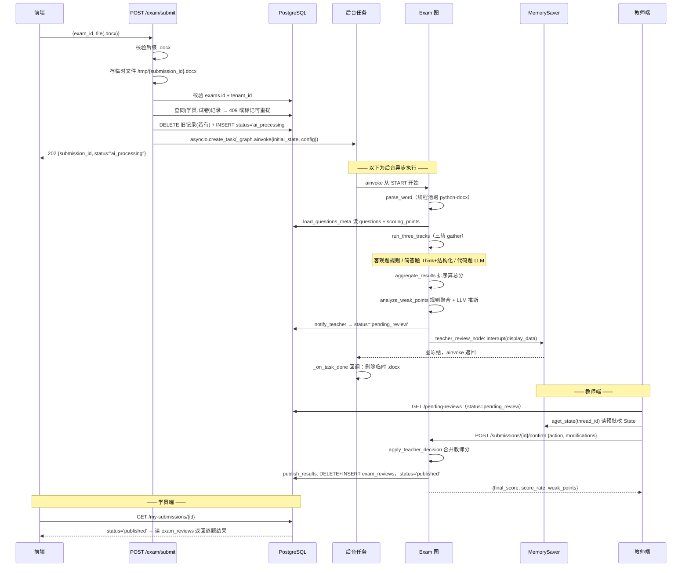

# 试卷批改 Agent（Exam）架构与实现详解

> 代码位置：`backend/agents/exam/` + `backend/api/v1/exam.py`
> 关联数据表：`exams` / `questions` / `scoring_points` / `exam_submissions` / `exam_reviews`
> 文档版本：基于当前 `dev` 分支代码（对应课件第六章）

---

## 一、一句话定位

把学员提交的一份 **Word 作答文件**，交给一条 **9 节点线性 LangGraph** 跑完「解析 → 三轨并行批改 → 汇总 → 薄弱点分析 → 通知教师 → **`interrupt()` 冻结等教师确认** → 合并教师决策 → 发布落库」的全流程。

与另外三个 Agent 相比，它有两个独一无二之处：

1. **唯一的纯线性链** —— 9 个节点首尾相连，**没有任何 `add_conditional_edges`**；唯一的「分支」藏在 `teacher_review_node` 内部的 `interrupt()`，用「暂停 / 恢复」代替了「条件路由」。
2. **唯一的 Human-in-the-Loop Agent** —— 教师不是旁观者，而是流程必经环节；AI 只产出「预批改结果」，最终分数须教师确认后才发布给学员。

---

## 二、文件职责

| 文件 | 行数 | 职责 |
|------|------|------|
| `state.py` | 89 | `ExamState`（TypedDict，19 字段）+ 5 个 Pydantic 模型 |
| `graph.py` | 69 | 组装 `StateGraph`：**9 节点 + 10 条固定边**（无条件边），编译挂 `MemorySaver` |
| `nodes.py` | 1193 | 全部业务逻辑：9 个节点函数 + 三轨子函数 + Word 解析器 + 工具函数（**本项目最大的 nodes.py**） |
| `prompts.py` | 115 | 5 个提示词常量（系统人设 / 简答评分 / 简答推理 / 代码评分 / 薄弱点分析） |
| `review_hitl.py` | 94 | 非生产代码：用「只含 `teacher_review_node` 的最小图」单独验证 HitL 的 approve / modify |
| `backend/api/v1/exam.py` | 501 | 6 个 HTTP 端点（学员端 3 + 教师端 3）+ 后台任务编排 + 失败回滚 + `_get_thread_id` |

---

## 三、State 数据契约（19 个字段）

定义在 `state.py:52-89`。跨请求由 `MemorySaver` 持久化：图暂停时存档，教师 `/confirm` 时恢复。除 `messages` 外**没有带 reducer 的字段**。

### 3.1 请求上下文

| 字段 | 类型 | 说明 |
|------|------|------|
| `messages` | `Annotated[list[BaseMessage], add_messages]` | 唯一带 reducer 的字段，但 Exam **从不写它**，`initial_state` 传空列表（`exam.py:122`）——占位 |
| `student_id` | `str` | 学员 ID（来自 JWT） |
| `tenant_id` | `str` | 租户 ID（多租户隔离） |
| `session_id` | `str` | **在 Exam 里被复用为 `submission_id`**（`exam.py:125`），不是独立会话概念 |
| `exam_id` | `str` | 试卷 ID（`exams` 主键） |
| `submission_id` | `str` | 本次提交记录 ID（`exam_submissions` 主键，API 层 `uuid4()` 生成） |
| `word_file_path` | `str` | 学员作答 Word 的**本地临时路径**：`tempfile.gettempdir()/{submission_id}.docx` |

### 3.2 解析与三轨结果

| 字段 | 类型 | 说明 |
|------|------|------|
| `parsed_questions` | `list[dict]` | **被二次覆盖**：先是 `parse_word_node` 的解析结果，再被 `load_questions_meta_node` 换成「DB 题目元数据 + 学员答案」 |
| `objective_results` | `list[dict]` | 第一轨：客观题规则批改结果 |
| `subjective_results` | `list[dict]` | 第二轨：简答题 LLM 批改结果 |
| `code_results` | `list[dict]` | 第三轨：代码题 LLM 批改结果 |

### 3.3 汇总与薄弱点

| 字段 | 类型 | 说明 |
|------|------|------|
| `pre_review_summary` | `dict` | 三轨合并 + 按题号排序，形如 `{total_score, full_score, score_rate, needs_review_count, by_question:[...]}`，**HitL 展示给教师的核心结构** |
| `weak_points` | `list[dict]` | 薄弱点列表（规则聚合 + LLM 推断合并去重后） |
| `weak_points_summary` | `str` | 整体评价（LLM 产出，失败时有兜底文案） |

### 3.4 HitL 与最终结果

| 字段 | 类型 | 说明 |
|------|------|------|
| `teacher_notified` | `bool` | 是否已把提交推进到 `pending_review` |
| `teacher_decision` | `Optional[dict]` | 教师决策，**就是 `interrupt()` 的返回值**，形如 `{action, modifications, teacher_id}` |
| `final_results` | `list[dict]` | 合并教师决策后的逐题最终结果（每项多 `final_score`，可选 `teacher_score`/`teacher_comment`/`reviewed_by`） |
| `published` | `bool` | 是否已发布 |
| `fallback_used` | `bool` | **死字段**：只在 `exam.py:139` 初始化为 `False`，无任何节点写入（见 14.4） |
| `structured_output` | `Optional[dict]` | 给 API 层直接读的发布摘要（`publish_results_node` 写） |

### 3.5 全部 Pydantic 模型（`state.py`）

**① `ScoringPointResult`（`state.py:10-17`）—— 单个得分点的评分结果**

| 字段 | 类型 | 用途 |
|------|------|------|
| `point_id` | `str` | 得分点 ID（Prompt 要求「若无则填空字符串」） |
| `point_desc` | `str` | 得分点描述 |
| `point_score` | `int` | 该得分点满分 |
| `earned` | `bool` | 是否得分 |
| `evidence` | `str` | `earned=True` 时填学员答案中对应原文 |
| `missing` | `str` | `earned=False` 时填未得分原因 |

**② `SubjectiveReviewResult`（`state.py:20-28`）—— 简答题批改结果（LLM 结构化输出）**

| 字段 | 类型 | 用途 |
|------|------|------|
| `question_id` | `str` | 题目 ID |
| `student_answer` | `str` | 学员答案（回显） |
| `total_score` | `int` | 总得分 |
| `full_score` | `int` | 满分 |
| `confidence` | `float` | 评分把握度 `[0,1]`，**低于 0.7 标记需复核** |
| `point_results` | `list[ScoringPointResult]` | 逐得分点结果 |
| `overall_comment` | `str` | 1-2 句整体评语 |

**③ `WeakPoint`（`state.py:31-37`）—— 单个知识薄弱点**

| 字段 | 类型 | 用途 |
|------|------|------|
| `tag` | `str` | 知识点标签，如 "Spring IOC"、"Redis缓存穿透" |
| `wrong_count` | `int` | 该知识点下错题数 |
| `total_count` | `int` | 该知识点下总题数 |
| `question_nos` | `list[int]` | 涉及题目序号列表 |
| `suggestion` | `str` | 复习建议 |

**④ `WeakPointsReport`（`state.py:40-43`）—— 薄弱点分析报告（LLM 结构化输出）**

| 字段 | 类型 | 用途 |
|------|------|------|
| `weak_points` | `list[WeakPoint]` | 薄弱点列表 |
| `overall_summary` | `str` | 整体评价（≤50 字） |

**⑤ `TeacherDecision`（`state.py:46-49`）—— 教师确认决策**

| 字段 | 类型 | 用途 |
|------|------|------|
| `action` | `str` | `"approve"` / `"modify"` |
| `modifications` | `list[dict]` | `[{question_id, new_score, comment}, ...]` |
| `teacher_id` | `str` | 教师 ID |

> ⚠️ **`TeacherDecision` 定义了但全项目从未被 import 或使用**（`grep TeacherDecision backend/` 只命中 `state.py:46`）。`interrupt()` 的恢复值走的是 `exam.py:468-472` 手工拼的普通 dict。见 14.9。

---

## 四、图拓扑

### 4.1 节点与边（`graph.py:30-53`）



- **9 个节点**（`graph.py:33-41`）：`parse_word` / `load_questions_meta` / `run_three_tracks` / `aggregate_results` / `analyze_weak_points` / `notify_teacher` / `teacher_review` / `apply_teacher_decision` / `publish_results`
- **10 条固定边**（`graph.py:44-53`）：从 `START` 一路 `add_edge` 到 `END`，**一条条件边都没有**

### 4.2 为什么没有条件路由

| Agent | 分支方式 | 原因 |
|-------|---------|------|
| Interview | `add_conditional_edges` 判 `current_stage == finished` | 每轮在「对话 / 出报告」间二选一 |
| QA | 3 组条件边 | 意图分类决定走哪条检索链 |
| Exam | **零条件边** | **流程对每份试卷都是同一套动作**：解析→批改→汇总→分析→等教师→发布，没有「跳过某步」的需求 |

Exam 里唯一的「分叉」是**时间维度上的分叉**，不是拓扑维度上的：`teacher_review_node` 执行到 `interrupt(display_data)`（`nodes.py:836`）时，LangGraph 抛出一个内部暂停信号，把图冻结在当前节点、State 落盘到 checkpointer；教师的 `/confirm` 再用 `Command(resume=decision)` 把**同一个节点**从暂停点「续上」。所以图结构上 `teacher_review` 前后都是固定边，但**运行时执行被切成两段**（学员提交时跑前半段，教师确认时跑后半段）。

> 推论：**图必须在编译时挂 checkpointer**，否则 `interrupt()` 暂停后没有任何地方能恢复它。

### 4.3 编译与 checkpointer

```python
# graph.py:55-57
checkpointer = get_memory_saver("exam")   # 按 Agent 隔离的 MemorySaver 单例
return builder.compile(checkpointer=checkpointer)
```

```python
# api/v1/exam.py:22
_graph = build_exam_graph()   # 模块级单例：导入时编译一次，所有请求共用
```

要点：

1. **必须用 `"exam"` 这个 key**。`get_memory_saver`（`memory.py:17-33`）按 agent_type 缓存不同 `MemorySaver` 实例，注释明确「不同 Agent 的 State schema 不同，共用会导致 msgpack 序列化时 schema 字段冲突」。ExamState 有 19 个独有字段，绝不能与别的 Agent 共用。
2. **`MemorySaver` 是进程内内存**（`memory.py:22-24`）—— 这是 Exam 最大的架构风险来源：暂停态只存在于「执行那次 `ainvoke` 的进程」的内存里，后端一重启全丢。见 14.3。
3. **注意 `_graph` 是模块级单例，不是 `threading.local`** —— 交接文档 §6.2 把 Resume 的 `threading.local()` 写法误写到了 Exam 身上，见 14.11。

---

## 五、核心机制一：三轨并行批改（重头）

对应 `run_three_tracks_node`（`nodes.py:565-618`）及其三个子模块。

### 5.1 分桶（`nodes.py:576-581`）

```python
questions = state["parsed_questions"]
objective_qs  = [q for q in questions if q["question_type"] in
                 ("single_choice", "multi_choice", "judge")]     # 第一轨
subjective_qs = [q for q in questions if q["question_type"] == "short_answer"]  # 第二轨
code_qs       = [q for q in questions if q["question_type"] == "code"]          # 第三轨
```

分桶依据是 `question_type`，取值受 DB 约束限制（`_03_init_db.sql:68-69`）：`single_choice` / `multi_choice` / `judge` / `short_answer` / `code`。**分桶必须覆盖全部 5 种**，否则该题会被静默丢弃（见 14.10）。

### 5.2 并发（`nodes.py:591-600`）

```python
# 三轨并行启动，任何一轨失败不影响其他轨
raw = await asyncio.gather(
    _run_objective_track(objective_qs),
    _run_subjective_track(subjective_qs),
    _run_code_track(code_qs),
    return_exceptions=True,
)
objective_results  = raw[0] if not isinstance(raw[0], Exception) else []
subjective_results = raw[1] if not isinstance(raw[1], Exception) else []
code_results       = raw[2] if not isinstance(raw[2], Exception) else []
```

- `return_exceptions=True` 是关键：**任一轨抛异常，`gather` 不会取消其他轨**，而是把异常对象当作该轨的「返回值」放进 `raw`。结果顺序与传入顺序一致。
- 失败的轨降级为 `[]`，其余轨照常写入 State（`nodes.py:598-600`），并在 `nodes.py:603-605` 记 error 日志。

> ⚠️ **「三轨并行」只对了一半**。`gather` 把三个协程各包成一个 `Task` 调度，但**第一轨内部没有任何 `await`**（见 5.3），它在事件循环里会一口气跑到结束、期间不让出控制权；只有第二、三轨因内部有 `await`（LLM 调用）才会彼此交错。也就是说：**真正并发的是第二轨与第三轨；第一轨是一条同步循环，只是恰好被 `gather` 调度在第一个跑**。由于它是纯 CPU 逻辑、耗时微秒级，实际影响可忽略，但概念上「三轨并行」名不副实。见 14.5。

### 5.3 第一轨：客观题 —— 纯规则引擎（`nodes.py:313-339`）

```python
async def _run_objective_track(questions: list[dict]) -> list[dict]:
    """
    客观题规则批改。虽然声明为 async，内部没有 await，
    但保持 async 统一接口方便在 asyncio.gather 中与其他两轨并行。
    """
```

docstring 自认「没有 await」。它就是一个 `for q in questions` 的同步循环，逐题：对学员答案与标准答案分别标准化 → 全等判定 → 对就满分、错就 0 分（**没有部分分**），`needs_review` 恒 `False`，`ai_feedback` 是「正确」或「正确答案：X」（`nodes.py:335-336`）。

#### `_normalize_answer` 的标准化算法（`nodes.py:297-309`）

```python
def _normalize_answer(answer: str) -> str:
    cleaned = answer.upper().replace(" ", "").replace("，", "").replace(",", "")
    return "".join(sorted(cleaned))
```

| 步骤 | 代码 | 消除的差异 | 例子 |
|------|------|-----------|------|
| ① 统一大写 | `.upper()` | 大小写 | `"a"` → `"A"` |
| ② 去空格与中英文逗号 | `.replace(" ","").replace("，","").replace(",","")` | 分隔符书写习惯 | `"A, B, C"` / `"A，B，C"` → `"ABC"` |
| ③ 字符排序后拼接 | `"".join(sorted(cleaned))` | **选项顺序** | `"BA"` → `"AB"` |

**为什么第 ③ 步能让多选题顺序无关？** 因为 `sorted()` 输出的是「同一多重集合（multiset）的唯一规范排列（canonical form）」。只要两份答案包含的字符**种类与个数完全相同**（`{A,B,C}` 无论写成 `ABC`、`BCA` 还是 `CBA`），排序后必然落到同一个字符串 `"ABC"`。于是「全等比较」就等价于「（多重）集合相等比较」。

**边界（务必知道）**：

- 它是**多重集合**比较而非集合比较：`"AAB"` ≠ `"AB"`（重复字符保留）。
- **不认识中文同义**：判定题标准答案据种子数据存的是 `"正确"`（`_05_seed_standard_exam.py:42`），若学员写 `"对"`/`"T"`/`"√"`，标准化后与 `"正确"` 不等 → **判错**。规则引擎只做字符串等价，不理解语义。
- **不处理全角字母**（`"Ａ"` 不会变成 `"A"`）、不处理除空格/逗号外的分隔符（如 `"A/B"`）。

> 这一轨设计成纯规则的理由很硬：客观题答案唯一，用 LLM 反而引入不确定性、浪费 token、还可能幻觉给分。规则引擎零成本、100% 可复现。

### 5.4 第二轨：简答题 —— Think Tool 两步 + 分组并发

#### 5.4.1 单题两步（`_review_one_subjective`，`nodes.py:343-401`）

**第一步 Think Tool 推理（`nodes.py:354-368`）**：

```python
reasoning_trace = ""
try:
    think_prompt = SUBJECTIVE_THINK_PROMPT.format(...)
    think_llm = get_llm("exam_subjective", temperature=0)
    think_resp = await think_llm.ainvoke([HumanMessage(content=think_prompt)])
    reasoning_trace = _get_message_content(think_resp).strip()
except Exception as e:
    logger.warning("subjective_think.failed", error=str(e))   # 推理失败不影响主评分
```

`SUBJECTIVE_THINK_PROMPT`（`prompts.py:42-59`）要求模型用 5-8 句分析：①是否理解核心概念 ②逐一核对每个得分点是否覆盖（含「换了表述但实质正确」）③有没有「表述模糊但实质正确、不该扣分」的内容 ④有没有概念错误。输出是**自由文本、不约束格式**——模型「内心独白」，不直接面向学员。

**第二步 结构化评分（`nodes.py:370-401`）**：

```python
think_context = f"\n\n【批改前分析】\n{reasoning_trace}" if reasoning_trace else ""
review_prompt = SUBJECTIVE_REVIEW_PROMPT.format(...) + think_context

structured_llm = get_structured_llm("exam_subjective", SubjectiveReviewResult)
result: SubjectiveReviewResult = await structured_llm.ainvoke([
    SystemMessage(content=SYSTEM_PROMPT), HumanMessage(content=review_prompt),
])
```

把第一步推理结论**拼到评分 Prompt 末尾**，再走 `get_structured_llm(..., SubjectiveReviewResult)`——DeepSeek 走 `function_calling` 直接拿回 Pydantic 对象（`llm_factory.py:123-134`），**无需手工 `json.loads`**（这正是与第三轨的差别）。

> **Think Tool 的意义**：先让模型把判断依据「写出来」再下结论，能明显降低拍脑袋打分；推理结论还可用作评语素材。代价是每题多一次 LLM 调用。

产出（`nodes.py:388-401`）：`needs_review = result.confidence < 0.7`（`nodes.py:397`），`point_results` 经 `[p.model_dump() ...]` 转 dict。

#### 5.4.2 分组并发：`GROUP_SIZE=3`（`_run_subjective_track`，`nodes.py:402-447`）

```python
GROUP_SIZE = 3
groups = [questions[i:i + GROUP_SIZE] for i in range(0, len(questions), GROUP_SIZE)]
all_results = []
for group in groups:                              # ← 组间：串行
    group_results = await asyncio.gather(         # ← 组内：并行
        *[_review_one_subjective(q) for q in group], return_exceptions=True)
    for q, result in zip(group, group_results):
        if isinstance(result, Exception):
            ...   # 单题失败降级
```

**为什么要分组？** 一道简答题至少 2 次 LLM 调用（Think + 结构化评分）。若 30 道简答题一次性 `gather`，会**同时**打出 60 个并发请求，DeepSeek 侧大概率触发 429 限速，结果大面积失败、整体更慢。切成每组 3 题、组间串行后，**同时在飞的请求数被钳制在 6 个以内**——这是用最朴素的分组实现「并发度限流」，替代 `asyncio.Semaphore`。

**单题失败降级（`nodes.py:422-443`）**：失败题被替换成占位结果——`score=0`、`confidence=0.0`、`needs_review=True`、`ai_feedback="AI 评分失败，已标记需教师人工批改"`。**是「0 分 + 强制复核」而不是「跳过」**：题号仍在，教师会在待复核列表看到并手批。

### 5.5 第三轨：代码题 —— 顺序执行 + 手工 JSON 解析

#### 5.5.1 为什么顺序执行（`nodes.py:453-466`）

```python
for q in questions:
    results.append(await _review_one_code(q))   # await 逐题等结果
```

理由「代码题一般数量少」——一份卷子通常 1-2 道代码题，为它引入分组并发不划算。顺序执行还有个隐性好处：代码题 Prompt 很长（题目 + 参考实现 + 学员代码），顺序发请求天然不撞限速。

#### 5.5.2 Prompt 组成（`_llm_code_review`，`nodes.py:513-556`）

`CODE_REVIEW_PROMPT`（`prompts.py:61-90`）占 4 个坑，缺一填兜底语：

| 占位符 | 来源 | 缺省兜底 |
|--------|------|---------|
| `{question}` | `q["content"]` | 无（必填） |
| `{reference_solution}` | `q["correct_answer"]` | `"（无参考实现，仅按代码本身评估）"`（`nodes.py:530`） |
| `{code}` | `q["student_answer"]` | `"（未提交代码）"`（`nodes.py:531`） |
| `{full_score}` | `q["full_score"]` | 无（必填） |

Prompt 要求输出 5 条固定维度评语（功能正确性 / 规范性 / 算法效率 / 边界异常 / 可读性），并给四档参考：功能全对且规范 → `×0.9~1.0`；功能对但可优化 → `×0.7`；部分正确 → `×0.4`；未提交或全错 → 0。模型 `get_llm("exam_code")`（`nodes.py:535`），**默认 `temperature=0`**，且**未用结构化输出**。

#### 5.5.3 JSON 手工解析与围栏剥离（`nodes.py:542-554`）

```python
raw = _get_message_content(response).strip().replace("```json", "").replace("```", "").strip()
try:
    data       = json.loads(raw)
    feedback   = data.get("feedback", [])
    score      = min(int(data.get("score", 0)), full_score)  # 分数封顶到满分
    confidence = float(data.get("confidence", 0))
except Exception:
    feedback, score, confidence = ["代码评估结果解析失败，请教师人工复核"], 0, 0.0
```

- **围栏剥离用最粗暴的两步 `replace`**：先删 ` ```json `、再删 ` ``` `。Prompt 已要求「直接输出，不要加代码块标记」，这里是防御性处理；**若围栏带别的语言标记（如 ` ```javascript `）或围栏前有解释性文字，`json.loads` 仍会失败**，落到 `except`。
- **`score` 用 `min(int(...), full_score)` 封顶**，防止超满分。
- **降级保守**：解析失败 → 0 分 + `confidence=0.0` → `needs_review = confidence < 0.7` 必 `True`（`nodes.py:507`）→ 必进教师复核。

#### 5.5.4 结果组装（`_review_one_code`，`nodes.py:469-510`）

比另两轨多两个字段：`confidence` 与 `quality_feedback`（`list[str]` 逐条评语）；`ai_feedback` 是 `"\n".join(feedback)` 拼成的单串便于展示。

---

## 六、核心机制二：HitL 教师确认环（重头）

它**用的是 LangGraph 原生 `interrupt()` + `Command(resume=...)`，不是「数据库标记 + 重新调用图」**。

### 6.1 暂停点（`teacher_review_node`，`nodes.py:815-844`）

```python
async def teacher_review_node(state: ExamState) -> dict:
    display_data = {
        "submission_id": state["submission_id"], "student_id": state["student_id"],
        "pre_review_summary": state.get("pre_review_summary", {}),
        "weak_points": state.get("weak_points", []),
        "weak_points_summary": state.get("weak_points_summary", ""),
        "message": "请检查 AI 预批改结果和知识薄弱点分析，确认无误后点击发布。",
    }
    teacher_decision = interrupt(display_data)   # ← 在此暂停
    logger.info("teacher_review.resumed", ...)
    return {"teacher_decision": teacher_decision}
```

- `interrupt(display_data)`（`nodes.py:836`）做两件事：**① 把 `display_data` 抛出图外**（成为 checkpointer 的中断值，教师端可读）；**② 冻结图执行**——LangGraph 保存当前 checkpoint 并让 `ainvoke` **正常返回**（不抛异常给调用方）。
- 关键语义：**恢复后，`interrupt(...)` 这一行的返回值就是 `decision`**。所以它在「第一次执行」时不赋值（图停在这里），只有「恢复执行」才拿到教师的 `decision`——这不是「调用两次函数」，而是**同一节点函数被重放，`interrupt()` 这次直接返回恢复值**。

### 6.2 State 如何存入 MemorySaver

暂停时，LangGraph 把**当前完整的 `ExamState`**（含 `parsed_questions`、三轨结果、`pre_review_summary`、`weak_points` 等）序列化写入该 `thread_id` 的 checkpoint，落点就是 `graph.py:56` 绑定的 `get_memory_saver("exam")`。

需要留意：checkpoint 存的是「`teacher_review` 节点的**输入 State**」，而 `display_data` 是 `interrupt()` 的中断值。二者内容高度重叠（`pre_review_summary` 等本就在 State 里），所以教师端既可从 `aget_state` 读完整 State，也能从中断值读 `display_data`——本项目用前者。

### 6.3 教师端如何读暂停态（`get_submission_review`，`exam.py:338-363`）

```python
config = {"configurable": {"thread_id": await _get_thread_id(submission_id)}}
try:
    state_snapshot = await _graph.aget_state(config)
except Exception as e:
    raise HTTPException(status_code=404, detail=f"找不到该提交记录的批改状态：{e}")
if not state_snapshot or not state_snapshot.values:
    raise HTTPException(status_code=404, detail="批改尚未完成或记录不存在")
sv = state_snapshot.values
return {"submission_id": submission_id, "student_id": sv.get("student_id", ""),
        "pre_review_summary": sv.get("pre_review_summary", {}), ...}
```

`aget_state(config)` 是 LangGraph 的**只读**检查点查询接口——不推进图，只返回该 `thread_id` 最新 checkpoint 的 State 快照。教师列表 `get_pending_reviews` 用同样手法，但**用 try/except 包住**（`exam.py:416-431`）：读不到 State 时不报错，只把预批改摘要降级成全 0（`exam.py:412`），这样「进程重启导致 checkpoint 丢失」时教师列表**仍能显示这条待确认记录**，只是分数显示为 0。

### 6.4 `Command(resume=decision)` 如何恢复（`confirm_review`，`exam.py:450-501`）

```python
thread_id = await _get_thread_id(submission_id)
config    = {"configurable": {"thread_id": thread_id}}
decision  = {"action": req.action, "modifications": req.modifications,
             "teacher_id": current_user["user_id"]}
try:
    # Command(resume=decision) 让图从 teacher_review_node 的 interrupt() 处继续
    result = await _graph.ainvoke(Command(resume=decision), config=config)
except Exception as e:
    logger.error("exam.confirm_failed", ...)
    raise HTTPException(status_code=500, detail=f"发布失败：{e}")
structured = result.get("structured_output", {}) or {}
```

- **同一个 `thread_id`** 是恢复前提：`ainvoke` 带 `Command(resume=...)` 和 `thread_id`，LangGraph 找到该线程的暂停点，把 `decision` 喂给 `interrupt()`，然后**从 `teacher_review` 往下续跑** `apply_teacher_decision` → `publish_results`。
- 返回值是**跑到 `END` 后的完整 State**，其中 `structured_output` 就是 `publish_results_node` 写的发布摘要（`nodes.py:997-1008`）。
- **`/confirm` 是同步 `await` 的**（不像 `/submit` 是后台任务）：教师点「发布」要等两步 DB 写完成才拿到响应。这两步无 LLM 调用，通常很快。

### 6.5 `apply_teacher_decision` 的合并逻辑（`nodes.py:859-901`）

```python
decision      = state.get("teacher_decision", {})
action        = decision.get("action", "approve")
modifications = decision.get("modifications", [])
all_results   = list(state.get("pre_review_summary", {}).get("by_question", []))

for r in all_results:                       # 每道题先用 AI 分数初始化 final_score
    r["final_score"] = r.get("score", 0)

if action == "modify" and modifications:
    id_to_idx = {r["question_id"]: i for i, r in enumerate(all_results)}
    for mod in modifications:
        qid = mod.get("question_id")
        if qid in id_to_idx:
            idx = id_to_idx[qid]
            if "new_score" in mod:
                all_results[idx]["teacher_score"] = mod["new_score"]
                all_results[idx]["final_score"]   = mod["new_score"]   # 教师分覆盖 AI 分
            if "comment" in mod:
                all_results[idx]["teacher_comment"] = mod["comment"]
            all_results[idx]["reviewed_by"] = decision.get("teacher_id", "")
```

两条路径逐字段对照：

| 路径 | 触发 | `final_score` | `teacher_score` | `teacher_comment` | `reviewed_by` |
|------|------|--------------|----------------|------------------|--------------|
| **approve** | `action != "modify"`（含缺省） | AI 的 `score` | 不写（NULL） | 不写（NULL） | 不写（NULL，DB 列另由 `publish_results` 取 `teacher_id` 写入） |
| **modify** | `action == "modify"` 且有 `modifications` | 被 `new_score` 覆盖 | 写 `new_score` | 写 `comment`（仅当传入） | 写 `teacher_id` |

边界：

- **按 `question_id` 精确定位**：`id_to_idx` 是「题目 ID → 下标」映射，`modifications` 的 `question_id` 必须与批改结果里的完全一致（都是 `questions.id` 的字符串形式）。**给不存在的 ID 会被 `if qid in id_to_idx` 静默忽略**。
- **`new_score` 与 `comment` 独立可选**：只改分或只改评语都支持。
- **approve 不给单题写 `reviewed_by`**，但发布时 `publish_results_node` 用 `state["teacher_decision"]["teacher_id"]` 作为整份提交的 `reviewed_by` 写进每条 `exam_reviews`（`nodes.py:917`、`nodes.py:964`），所以 approve 场景「谁审的」信息不丢。
- ⚠️ **`all_results` 只是 `list(...)` 浅拷贝**：列表元素 dict 与 checkpoint 里 `pre_review_summary.by_question` 是同一批对象，`r["final_score"] = ...` 会**就地修改 checkpoint 内的原 dict**。见 14.8。

### 6.6 thread_id 怎么拼（用 submission_id，不是 session_id）

```python
# api/v1/exam.py:118（学员提交时）
config = build_config(current_user["user_id"], submission_id)
# api/v1/exam.py:367-381（教师端反查）
return build_thread_id(str(row[0]), submission_id)
```

`build_thread_id(student_id, session_id)`（`memory.py:36-47`）格式是 `student_{student_id}_session_{session_id}`。Exam 把**第二个参数传成 `submission_id`**，于是实际 thread_id 是 `student_{student_id}_session_{submission_id}`。

**为什么必须用 submission_id 而不是 session_id？** 因为 Exam 的「一次批改」粒度就是一次提交。学员对同一试卷重新提交会生成**新 `submission_id`** → **新 thread_id** → 新 checkpoint，与上一次暂停态天然隔离。若用固定的 `session_id`/`exam_id`，两次提交会互相覆盖 checkpoint。

`_get_thread_id` 兜底（`exam.py:379-381`）：DB 查询失败时返回 `f"student_unknown_session_{submission_id}"` —— 会导致教师端读不到正确 checkpoint，但至少不 500。它是**按 `submission_id` 反查 `student_id` 再拼**，因为教师端只知道 `submission_id`。

---

## 七、核心机制三：薄弱点分析（`analyze_weak_points_node`，`nodes.py:665-782`）

### 7.1 先筛「失分题」（`nodes.py:673-688`）

```python
all_results = state.get("pre_review_summary", {}).get("by_question", [])
wrong_questions = [r for r in all_results if r.get("score", 0) < r.get("full_score", 1)]
if not wrong_questions:
    return {"weak_points": [], "weak_points_summary": "本次试卷全部答对，表现优秀！"}
```

判据是 `score < full_score`（**不是** `is_correct == False`），这样才能把「简答部分得分」「代码扣 3 分」也算进去。全对时直接短路，连 LLM 都不调。

### 7.2 路径 1：有 `knowledge_tag` → 规则聚合（`nodes.py:690-710`）

```python
tagged   = [r for r in wrong_questions if r.get("knowledge_tag")]
untagged = [r for r in wrong_questions if not r.get("knowledge_tag")]

tagged_weak: dict[str, dict] = {}
for r in tagged:
    tag = r["knowledge_tag"]
    if tag not in tagged_weak:
        tagged_weak[tag] = {"tag": tag, "wrong_count": 0, "total_count": 0,
                            "question_nos": [], "suggestion": ""}
    tagged_weak[tag]["wrong_count"]  += 1
    tagged_weak[tag]["total_count"]  += 1
    tagged_weak[tag]["question_nos"].append(r["question_no"])
```

纯字典聚合：以 `knowledge_tag` 为键累计错题数、收集题号，`suggestion` 暂空等 LLM 补。注意 `wrong_count` 与 `total_count` 在这里**被赋成同一个值**（都 +1）——规则路径只看得到「错题」，看不到「该知识点一共几道题」，这解释了 `WeakPoint.total_count` 的 Prompt 注释「若不确定填与 `wrong_count` 相同」（`prompts.py:109`）。

### 7.3 路径 2：全量失分题交 LLM（`nodes.py:712-738`）

```python
questions_for_llm = tagged + untagged       # ← 全部失分题，不只是无标签的
if questions_for_llm:
    wrong_desc = "\n".join([
        f"第{r['question_no']}题（{r['question_type']}，{r['score']}/{r['full_score']}分）："
        f"\n  题目：{r.get('content', r.get('ai_feedback', ''))[:200]}"
        f"\n  AI反馈：{r.get('ai_feedback', '')[:150]}" for r in questions_for_llm])
    prompt = WEAK_POINTS_ANALYSIS_PROMPT.format(wrong_questions=wrong_desc)
    structured_llm = get_structured_llm("exam_subjective", WeakPointsReport)
    try:
        report: WeakPointsReport = await structured_llm.ainvoke([...])
        llm_weak_points = [wp.model_dump() for wp in report.weak_points]
        llm_summary = report.overall_summary
    except Exception as e:
        logger.warning("analyze_weak_points.llm_failed", error=str(e))
        llm_summary = "薄弱点分析失败，请教师根据错题情况人工判断。"
```

- **送进 LLM 的是 `tagged + untagged`（全部失分题），不是只送 `untagged`**。这是刻意的：LLM 除给「无标签题」推断知识点外，还要为「有标签题」生成 `suggestion`。代价是重复加工有标签的题。
- 题目内容截断 200 字、AI 反馈截断 150 字（`nodes.py:720-721`）控制 Prompt 长度。
- **`get_structured_llm("exam_subjective", WeakPointsReport)`**（`nodes.py:726`）—— agent_type 复用了简答批改的 `"exam_subjective"`，不是专门类型。当前路由下同模型无差异，但语义不精确。
- LLM 失败 → `llm_summary` 降级为固定文案、`llm_weak_points=[]`，最终只剩规则聚合结果。

### 7.4 两路去重合并（`nodes.py:744-771`）

```python
merged_tags = set(tagged_weak.keys())
final_weak_points = []
for llm_wp in llm_weak_points:
    tag = llm_wp.get("tag", "")
    if tag in tagged_weak:
        tagged_weak[tag]["suggestion"] = llm_wp.get("suggestion", "")   # 只借 suggestion
    elif tag not in merged_tags:
        final_weak_points.append(llm_wp)                                # 纯 LLM 推断
        merged_tags.add(tag)
for wp in tagged_weak.values():                                         # 规则项入列
    if not wp["suggestion"]:
        wp["suggestion"] = f"建议重点复习 {wp['tag']} 相关知识点。"
    final_weak_points.append(wp)
final_weak_points.sort(key=lambda x: x.get("wrong_count", 0), reverse=True)
```

合并三条规则：

1. **同 tag 两边都有 → 以规则聚合的计数为准，只借用 LLM 的 `suggestion`**（LLM 的 `wrong_count`/`question_nos` 被丢弃）。理由：规则统计是**确定的事实**，LLM 数出来的可能是幻觉。
2. **只有 LLM 有的 tag → 直接采纳**（无标签题的推断结果）。
3. **规则 tag 没拿到 `suggestion` → 补模板文案**「建议重点复习 X 相关知识点。」

**排序**按 `wrong_count` 降序 —— 错最多的排最前。隐含问题：规则项有真实计数，纯 LLM 项的数字来自模型自报（`prompts.py:108`），混排时 LLM 报虚高会排到规则项前面；影响有限，因为 LLM 推断的是无标签题、通常数量少。

---

## 八、单次批改完整时序



**关键顺序点**：

- `notify_teacher` 在 `teacher_review` **之前**执行（`graph.py:50-51`），所以图暂停时 DB 里 `status` 已是 `pending_review` —— 教师列表立刻能查到，无需等 `/confirm`。
- 后台任务 done callback 在「图暂停返回」时就触发（`ainvoke` 此时正常返回），**临时 Word 文件在批改一结束就被删**；`/confirm` 阶段不再需要它（解析早已完成）。
- 教师 `/confirm` 是**同步**的（`exam.py:476`），学员查结果是**独立轮询**（`exam.py:243-334`）。

---

## 九、9 个节点逐一详解

> 三轨内部细节见第五章、HitL 细节见第六章，此处聚焦每个节点的契约与实现要点。

### 9.1 `parse_word_node`（`nodes.py:172-200`）

| ①②③⑥⑦ | 内容 |
|------|------|
| ① 职责 | 解析学员作答 Word（`.docx`），抽取每题作答内容 |
| ② 读 | `word_file_path` |
| ③ 写 | `parsed_questions`（解析结果，后续被覆盖） |
| ⑥ LLM | **不调**，纯文本解析 |
| ⑦ 降级 | 异常时记 error 并返回 `{"parsed_questions": []}`（`nodes.py:195-200`） |

**④ 步骤**：① `loop.run_in_executor(None, _sync_parse_word, word_path)`（`nodes.py:184-185`）把**同步** `python-docx` 解析丢进默认线程池，避免阻塞事件循环；② `_sync_parse_word`（`nodes.py:61-170`）逐段落扫描，用正则识别题头；③ 遇 ` ``` ` 段落切换「代码块」开关（`nodes.py:121-128`），闭合时存 `student_answer` 并打 `is_code=True`；④ 非代码块内识别 `答：`/`答:`/`Answer:` 前缀只取冒号后内容（`nodes.py:144-156`），跳过「作答区」「请在此处」等模板行（`nodes.py:139-141`）；⑤ 遇到下一题头先把上一题落盘，循环结束后补存最后一题（`nodes.py:163-168`）。

**⑤ 关键代码**：

```python
# nodes.py:90-94 —— 题头正则，支持「第1题」「题目2」「第三题」「Q.5」
is_question_header = re.match(
    r"^(第?\s*[一二三四五六七八九十\d]+\s*[题、。.]|Q\.?\s*\d+|题目\s*\d+)",
    para_text, re.IGNORECASE)
# nodes.py:184-185 —— 线程池执行
parsed_questions = await loop.run_in_executor(None, _sync_parse_word, word_path)
```

> **实测**：样例 `backend/agents/exam/student_answer.docx` 能被正确解析为 5 道题（题号 1-5，第 5 题 `is_code=True`）。但**题号解析对「十一」及以上的中文数字有 bug**，见 14.6。

### 9.2 `load_questions_meta_node`（`nodes.py:203-293`）

| ①②③⑥⑦ | 内容 |
|------|------|
| ① 职责 | 从 DB 读题目元数据 + 得分点，与解析出的学员答案合并，**覆盖写入** `parsed_questions` |
| ② 读 | `exam_id`、`parsed_questions` |
| ③ 写 | `parsed_questions`（覆盖为合并结果） |
| ⑥ LLM | **不调**，纯 DB |
| ⑦ 降级 | 无 try/except —— **DB 异常直接抛出**，被后台 done callback 捕获并把状态回滚为 `submitted` |

**④ 步骤**：① 读题目（`nodes.py:213-222`）：`SELECT id, question_no, question_type, content, correct_answer, score, knowledge_tag FROM questions WHERE exam_id=:exam_id ORDER BY question_no`；② 读得分点（`nodes.py:241-248`），用**动态拼 `IN` 子句**而非 `ANY(:qids)`（注释：避开 asyncpg 的 `ANY(:qids::uuid[])` 类型不兼容，`nodes.py:234`）；③ 按 `question_id` 聚合得分点（`nodes.py:255-262`）；④ **以 DB 题目为主**循环合并（`nodes.py:270-285`），`student_answer` 按 `question_no` 取、取不到给空串。

**⑤ 关键代码**：

```python
# nodes.py:275-285 —— 合并：DB 题目元数据 + 解析出的学员答案
merged_questions.append({
    "question_id": str(q["id"]), "question_no": q_no,
    "question_type": q["question_type"], "content": q["content"],
    "student_answer": parsed_by_no.get(q_no, {}).get("student_answer", ""),
    "correct_answer": q["correct_answer"] or "",
    "scoring_points": sp_by_question.get(str(q["id"]), []),
    "full_score": q["score"], "knowledge_tag": q["knowledge_tag"] or "", })
```

> **「以 DB 为主」的深意**：题目数量、满分、标准答案、得分点全部以 DB 为准，Word **只提供学员答案**——学员伪造题号也改不了评分标准。反过来，若某题作答没解析出来，`student_answer` 为空串仍会走完批改。**Word 解析整体失败返回 `[]` 也被这里「救回来」**：题目还在，只是答案全空。

### 9.3 `run_three_tracks_node`（`nodes.py:565-618`）

| ①②③⑥⑦ | 内容 |
|------|------|
| ① 职责 | 按题型分三桶，`asyncio.gather` 并发跑三轨 |
| ② 读 | `parsed_questions` |
| ③ 写 | `objective_results` / `subjective_results` / `code_results` |
| ⑥ LLM | 第二轨 `get_structured_llm("exam_subjective")`；第三轨 `get_llm("exam_code")`；第一轨不调 |
| ⑦ 降级 | 单轨抛异常 → 该轨置 `[]`，其余照常（`nodes.py:598-600`）；单题抛异常在轨内处理 |

细节见第五章。

### 9.4 `aggregate_results_node`（`nodes.py:627-659`）

| ①②③⑥⑦ | 内容 |
|------|------|
| ① 职责 | 合并三轨结果，按题号排序，算总分 / 得分率 / 需复核题数 |
| ② 读 | 三个 `*_results` |
| ③ 写 | `pre_review_summary` |
| ⑥ LLM | **不调**，纯逻辑 |
| ⑦ 降级 | 无（纯内存计算，不会失败） |

**④⑤**：

```python
# nodes.py:633-651
all_results = (state.get("objective_results", []) + state.get("subjective_results", [])
               + state.get("code_results", []))
all_results.sort(key=lambda x: x.get("question_no", 0))
total_score = sum(r.get("score", 0) for r in all_results)
full_score  = sum(r.get("full_score", 0) for r in all_results)
score_rate  = round(total_score / full_score, 4) if full_score > 0 else 0.0
needs_review_count = sum(1 for r in all_results if r.get("needs_review", False))
summary = {"total_score": total_score, "full_score": full_score, "score_rate": score_rate,
           "needs_review_count": needs_review_count, "by_question": all_results}
```

排序补足三轨的「乱序」问题（三轨独立产出，顺序是客观→简答→代码）。注意 `full_score` 被重定义为「**所有已批改题目**满分之和」——漏批的题不会让 `full_score` 变小，得分率看起来仍正常，**无任何告警**（见 14.10）。

### 9.5 `analyze_weak_points_node`（`nodes.py:665-782`）

| ①②③⑥⑦ | 内容 |
|------|------|
| ① 职责 | 规则聚合有标签失分题 + LLM 推断无标签失分题，合并去重排序 |
| ② 读 | `pre_review_summary`、`submission_id` |
| ③ 写 | `weak_points`、`weak_points_summary` |
| ⑥ LLM | `get_structured_llm("exam_subjective", WeakPointsReport)`，仅当有失分题时调 |
| ⑦ 降级 | 全对 → 直接返回「全部答对」；LLM 失败 → `llm_summary` 固定文案、`llm_weak_points=[]` |

细节见第七章。

### 9.6 `notify_teacher_node`（`nodes.py:789-809`）

| ①②③⑥⑦ | 内容 |
|------|------|
| ① 职责 | 把 `exam_submissions.status` 推进到 `pending_review` |
| ② 读 | `submission_id` |
| ③ 写 | `teacher_notified=True` |
| ⑥ LLM | **不调**，纯 DB |
| ⑦ 降级 | 无 try/except，DB 异常抛出 → 后台 done callback 回滚为 `submitted` |

```python
# nodes.py:797-806
async with AsyncSessionLocal() as session:
    async with session.begin():
        await session.execute(
            text("""UPDATE exam_submissions SET status = 'pending_review', updated_at = NOW()
                    WHERE id = :submission_id"""), {"submission_id": state["submission_id"]})
```

> 这一步是「状态推进」与「图暂停」的衔接点：**它先于 `interrupt` 执行**，所以教师列表能在图暂停的瞬间就查到记录。

### 9.7 `teacher_review_node`（`nodes.py:815-844`）

| ①②③⑥⑦ | 内容 |
|------|------|
| ① 职责 | HitL 暂停点：抛出 `display_data` 给教师端，冻结图 |
| ② 读 | `submission_id` / `student_id` / `pre_review_summary` / `weak_points` / `weak_points_summary` |
| ③ 写 | `teacher_decision`（**仅恢复执行时写**） |
| ⑥ LLM | **不调** |
| ⑦ 降级 | 无——`interrupt()` 是设计上的暂停，不是异常 |

关键代码 `teacher_decision = interrupt(display_data)`（`nodes.py:836`）。细节见第六章。

### 9.8 `apply_teacher_decision_node`（`nodes.py:859-901`）

| ①②③⑥⑦ | 内容 |
|------|------|
| ① 职责 | 把教师决策合并进 `pre_review_summary.by_question`，产出 `final_results` |
| ② 读 | `teacher_decision`、`pre_review_summary` |
| ③ 写 | `final_results` |
| ⑥ LLM | **不调**，纯逻辑 |
| ⑦ 降级 | 无——`teacher_decision` 缺失时 `action` 缺省 `approve`，等价「原样发布 AI 结果」 |

细节见 6.5。

### 9.9 `publish_results_node`（`nodes.py:907-1008`）

| ①②③⑥⑦ | 内容 |
|------|------|
| ① 职责 | 把最终结果写入 `exam_reviews`，更新 `exam_submissions` 为 `published`，产出发布摘要 |
| ② 读 | `final_results`、`submission_id`、`teacher_decision`、`weak_points`、`weak_points_summary` |
| ③ 写 | `published=True`、`structured_output` |
| ⑥ LLM | **不调**，纯 DB |
| ⑦ 降级 | 无内层 try/except —— DB 异常抛到 `/confirm` → 500「发布失败」 |

**④ 步骤**：① `teacher_id = state.get("teacher_decision", {}).get("teacher_id", "") or None`（`nodes.py:917`，空串转 `None` 避免 UUID 外键报错）；② 一个事务内**逐题「先删后插」**（`nodes.py:924-966`），重复发布不产生重复行；③ 更新 `exam_submissions`（`nodes.py:969-984`）：`status='published'`、`published_at=NOW()`、`weak_points`、`weak_points_summary`；④ 组装 `structured_output`（`nodes.py:997-1008`）供 `/confirm` 直接返回。

**⑤ 关键代码**：

```python
# nodes.py:959-964
"ai_raw_result":   json.dumps(r),           # 完整原始结果存 JSON
"teacher_score":   r.get("teacher_score"),  # None 表示未修改
"teacher_comment": r.get("teacher_comment"),
"final_score":     r.get("final_score", r.get("score", 0)),  # 三级兜底
"needs_review":    r.get("needs_review", False),
"reviewed_by":     teacher_id,
```

---

## 十、Prompt 清单（`prompts.py`）

| 常量 | 行号 | 用途 | 使用位置 |
|------|------|------|---------|
| `SYSTEM_PROMPT` | `3-9` | 批改人设：严谨公正、按得分点评分、给出明确依据、「有争议保守评分，宁可偏低并标记复核」 | `nodes.py:383`、`nodes.py:537`、`nodes.py:730` |
| `SUBJECTIVE_REVIEW_PROMPT` | `11-40` | 简答题结构化评分，要求输出 `SubjectiveReviewResult` JSON（含 `confidence`、逐得分点 `point_results`） | `nodes.py:374` |
| `SUBJECTIVE_THINK_PROMPT` | `42-59` | 简答题 Think Tool 推理，要求 5-8 句分析核心概念 / 得分点覆盖 / 模糊但正确内容 / 概念错误 | `nodes.py:357` |
| `CODE_REVIEW_PROMPT` | `61-90` | 代码题评分：功能正确性 + 4 个质量维度，输出 `{score, confidence, feedback[5]}`，给四档参考 | `nodes.py:528` |
| `WEAK_POINTS_ANALYSIS_PROMPT` | `94-115` | 薄弱点分析：把错题归纳成知识点，输出 `WeakPointsReport` JSON | `nodes.py:725` |

> 全部 5 个常量**都被引用**，没有未使用项（比 Interview Agent 干净）。`CODE_REVIEW_PROMPT` 是唯一「手工 JSON 解析」的 JSON Prompt（其余两个 JSON Prompt 都走 `with_structured_output`）。

---

## 十一、API 层（`backend/api/v1/exam.py`，6 个端点）

路由注册在 `backend/api/router.py:13`，前缀 `/exam`，即全部挂在 `/api/v1/exam` 下。

| 方法 | 路径 | 角色 | 说明 |
|------|------|------|------|
| POST | `/submit` | 学员 | 上传 Word，**202**，后台异步批改 |
| GET | `/my-submissions` | 学员 | 列出自己最近 20 条提交 |
| GET | `/my-submissions/{id}` | 学员 | 查状态 / 查结果（未发布只返回 status） |
| GET | `/submissions/{id}/review` | 教师 | 读 MemorySaver 里的预批改 State |
| GET | `/pending-reviews` | 教师 | 列出待确认提交（`status=pending_review`） |
| POST | `/submissions/{id}/confirm` | 教师 | 提交决策，恢复图并发布 |

> ⚠️ **三个「教师端」端点没有任何角色校验** —— 代码里从未使用 `current_user["role"]`（`grep role exam.py` 无命中）。任何登录用户都能调这三个端点。见 14.7。

### 11.1 `POST /submit`（`exam.py:28-206`）

**流程**：

1. **后缀校验**（`:38-42`）：非 `.docx` → 400。
2. **落临时文件**（`:44-51`）：`submission_id` 先生成，路径 `tempfile.gettempdir()/{submission_id}.docx`。
3. **校验试卷存在**（`:54-69`）：`WHERE id AND tenant_id`，不存在则删临时文件 + 400。
4. **重复提交判定**（`:71-93`）：

| 旧状态 | 处理 |
|--------|------|
| `pending_review` / `reviewed` / `published` | **409 CONFLICT**，删临时文件，拒绝重提 |
| `ai_processing` / `submitted` | 允许重提，记下 `existing_id` 后续删旧记录 |

5. **写入提交记录**（`:96-116`）：有 `existing_id` 先 `DELETE`，再 `INSERT` 新记录，`status='ai_processing'`。
6. **构造 `config`**（`:118-119`）：`build_config(user_id, submission_id)`。此处有残留 `print(f'config: {config}')`（`:119`）。
7. **构造全量 `initial_state`**（`:121-142`）：19 字段一个不落 —— 首轮 MemorySaver 里没有存档，**必须传全量**，否则 TypedDict 字段缺失。
8. **注册 done callback 并启动后台任务**（`:145-193`）。

**done callback 的失败回滚与临时文件清理**（`:145-186`）—— 本端点最核心的设计：

```python
def _on_task_done(t: asyncio.Task):
    _background_tasks.discard(t)                       # 从 set 移除，允许 GC
    task_failed = not t.cancelled() and t.exception() is not None
    if task_failed:
        logger.error("exam.background_task_failed", ...)
    async def _cleanup():
        if task_failed:
            try:   # 批改失败时把状态回滚为 submitted，允许学员重新提交
                async with AsyncSessionLocal() as db_sess:
                    async with db_sess.begin():
                        await db_sess.execute(
                            text("""UPDATE exam_submissions SET status = 'submitted', updated_at = NOW()
                                    WHERE id = :sid AND status = 'ai_processing'"""),
                            {"sid": submission_id})
            except Exception as db_err:
                logger.warning("exam.status_reset_failed", ...)
        if os.path.exists(tmp_path):   # 无论成败都清理临时文件
            try: os.remove(tmp_path)
            except OSError: pass
    cleanup_task = asyncio.ensure_future(_cleanup())
    _background_tasks.add(cleanup_task)
    cleanup_task.add_done_callback(_background_tasks.discard)
```

逐条要点：

- **`_background_tasks: set[asyncio.Task]`（`:25`）持强引用**，防止 `asyncio.create_task` 创建的任务被 GC 提前回收（Python 官方文档明确警告）。
- **回滚 SQL 带 `AND status = 'ai_processing'`**（`:167`）是**幂等保护**：若图已跑到 `notify_teacher` 把状态改成 `pending_review`，即使此时抛异常，这条 UPDATE 也不会改回去。
- **图在 `interrupt` 处正常暂停时 `t.exception()` 为 `None`** → `task_failed=False` → **不回滚，但照样删临时文件**（暂停不是失败，且解析早已完成、临时文件不再需要）。
- **清理逻辑本身又套 try/except**，DB 回滚失败只记 warning —— 契合项目「外部依赖失败不向上抛」的风格。

```python
# exam.py:191-193 —— 启动后台任务
task = asyncio.create_task(_graph.ainvoke(initial_state, config=config))
_background_tasks.add(task)
task.add_done_callback(_on_task_done)
```

**响应**：`202 {submission_id, status:"ai_processing", message}`。前端拿 `submission_id` 后轮询 `/my-submissions/{id}`。

### 11.2 `GET /my-submissions`（`exam.py:209-240`）

```sql
SELECT es.id, e.title AS exam_title, es.exam_id, es.status, es.submitted_at
FROM exam_submissions es LEFT JOIN exams e ON e.id = es.exam_id
WHERE es.student_id = :student_id ORDER BY es.submitted_at DESC LIMIT 20
```

`LEFT JOIN` 保证试卷被删也能列出记录；`LIMIT 20` 取最近 20 条。

### 11.3 `GET /my-submissions/{id}`（`exam.py:243-334`）

**「未发布时只返回 status 供轮询」设计的落点**：

```python
# exam.py:268-269
if row["status"] != "published":
    return {"submission_id": submission_id, "status": row["status"]}
```

- 未发布（`ai_processing` / `pending_review`）→ 只返回 `{submission_id, status}`，**不查 `exam_reviews`、不返回任何批改内容**，前端据此决定是否继续轮询。
- 已发布 → 查 `exam_reviews JOIN questions`（`:273-287`），逐题组装，并**把 `ai_raw_result` 里的 `point_results`（简答逐得分点）与 `quality_feedback`（代码逐条评语）回填进响应**（`:314-315`）——这两项没单独建列，只存在 `ai_raw_result` JSONB 里。
- 总分 / 满分**在 Python 里累加**（`:317-318`）而非 SQL `SUM`，因为 `final_score` 可能为 NULL（要回退到 `ai_score`）。
- 双重归属校验：`WHERE id = :sid AND student_id = :student_id`（`:258`），学员查不到别人的提交。

### 11.4 `GET /submissions/{id}/review`（`exam.py:338-363`，教师端）

从 MemorySaver 读暂停态，见 6.3。两处残留 `print`（`:348-349`）。

### 11.5 `GET /pending-reviews`（`exam.py:384-442`，教师端）

```sql
SELECT es.id, es.student_id, u.username AS student_name, e.title AS exam_title, es.submitted_at
FROM exam_submissions es JOIN users u ON u.id = es.student_id JOIN exams e ON e.id = es.exam_id
WHERE es.tenant_id = :tenant_id AND es.status = 'pending_review' ORDER BY es.submitted_at DESC
```

**教师端如何从 MemorySaver 读预批改数据**（`:410-431`）：

```python
pre_review = {"total_score": 0, "full_score": 0, "needs_review_count": 0}
weak_points = []
try:
    thread_id = await _get_thread_id(submission_id)
    snapshot  = await _graph.aget_state({"configurable": {"thread_id": thread_id}})
    if snapshot and snapshot.values:
        sv = snapshot.values; summary = sv.get("pre_review_summary", {})
        pre_review = {"total_score": summary.get("total_score", 0),
                      "full_score": summary.get("full_score", 0),
                      "needs_review_count": summary.get("needs_review_count", 0)}
        weak_points = sv.get("weak_points", [])
except Exception as _e:
    logger.warning("exam.pending_review_state_read_failed", ...)
```

注意这是**在循环里逐条 `aget_state`**（每条一次读取），不是批量。`weak_points[:3]`（`:439`）列表只展示前 3 条。读不到 State 时预批改降级为全 0，列表仍能列出记录 —— 保证「进程重启后列表不空」。

### 11.6 `POST /submissions/{id}/confirm`（`exam.py:450-501`，教师端）

```python
class ConfirmRequest(BaseModel):
    action:        str
    modifications: list[dict] = []

@router.post("/submissions/{submission_id}/confirm")
async def confirm_review(submission_id, req, current_user):
    if req.action not in ("approve", "modify"):
        raise HTTPException(400, "action 只能为 approve 或 modify")
    thread_id = await _get_thread_id(submission_id)
    decision  = {"action": req.action, "modifications": req.modifications,
                 "teacher_id": current_user["user_id"]}
    try:
        result = await _graph.ainvoke(Command(resume=decision),
                                      config={"configurable": {"thread_id": thread_id}})
    except Exception as e:
        logger.error("exam.confirm_failed", ...)
        raise HTTPException(500, f"发布失败：{e}")
    structured = result.get("structured_output", {}) or {}
    return {"submission_id": submission_id, "status": "published",
            "final_score": structured.get("final_score", 0), ...}
```

- `action` 白名单校验（`:459-463`）；`modifications` 用 `list[dict]` **无字段约束**——任意 dict 都会被传下去，非法字段静默忽略。这正是 `TeacherDecision` 校验模型形同虚设的原因（见 14.9）。
- `teacher_id` 来自 JWT（`current_user["user_id"]`），**不能由前端伪造**。
- **失败返回 500 而非降级**：与 `/submit` 风格不同——发布失败必须让教师知道，否则会误以为已发布。
- 返回值 `final_score` 等取自 `structured_output`；`full_score` 是 `publish_results_node` 对 `final_results` 求和得到的。

---

## 十二、数据库表

### `exams`（`_03_init_db.sql:50-61`）

| 列 | 类型 | 说明 |
|----|------|------|
| `id` | UUID PK | |
| `tenant_id` | VARCHAR(64) | 默认 `tenant_default` |
| `title` | VARCHAR(256) | 试卷标题 |
| `description` | TEXT | |
| `due_date` | TIMESTAMPTZ | 截止时间 |
| `created_by` | UUID → users(id) | |
| `is_active` | BOOLEAN | 软删除标记 |
| `created_at` / `updated_at` | TIMESTAMPTZ | |

### `questions`（`_03_init_db.sql:63-77`）

| 列 | 类型 | 说明 |
|----|------|------|
| `id` | UUID PK | |
| `tenant_id` | VARCHAR(64) | |
| `exam_id` | UUID → exams(id) **ON DELETE CASCADE** | |
| `question_no` | INT | 题号（合并时按它匹配学员答案） |
| `question_type` | VARCHAR(16) | **CHECK 限定 5 种**：`single_choice`/`multi_choice`/`judge`/`short_answer`/`code` |
| `content` | TEXT | 题干 |
| `correct_answer` | TEXT | 标准答案；代码题按约定存 JSON 测试用例（**从不执行**，见 14.1） |
| `score` | INT | 满分，默认 10 |
| `knowledge_tag` | VARCHAR(128) | 知识点标签（薄弱点规则聚合的键） |

索引：`exam_id`、`knowledge_tag`。

### `scoring_points`（`_03_init_db.sql:79-89`）

| 列 | 类型 | 说明 |
|----|------|------|
| `id` | UUID PK | |
| `question_id` | UUID → questions(id) **ON DELETE CASCADE** | |
| `point_desc` | TEXT | 得分点描述 |
| `point_score` | INT | 该点分值 |
| `is_active` | BOOLEAN | 软删除，加载时过滤 `AND is_active = TRUE`（`nodes.py:246`） |
| `confirmed_by` / `confirmed_at` | UUID / TIMESTAMPTZ | 得分点确认人（**当前未被写入**） |

> 加载时 `ORDER BY question_id, id`（`nodes.py:247`），保证得分点在 Prompt 里的顺序稳定。

### `exam_submissions`（`_03_init_db.sql:91-112`）

| 列 | 类型 | 说明 |
|----|------|------|
| `id` | UUID PK | |
| `tenant_id` | VARCHAR(64) | |
| `exam_id` | UUID → exams(id) | |
| `student_id` | UUID → users(id) | |
| `source` | VARCHAR(16) | `word`/`online`/`miniapp` |
| `word_minio_path` | VARCHAR(512) | MinIO 路径（**从未被写入**，Word 走本地临时文件） |
| `status` | VARCHAR(16) | CHECK：`submitted`/`ai_processing`/`pending_review`/`reviewed`/`published`（代码只用到前四者，`reviewed` 从未写入） |
| `submitted_at` / `published_at` | TIMESTAMPTZ | |
| **`weak_points`** | JSONB | **migrations 补丁加列**（`migrations.py:17-20`） |
| **`weak_points_summary`** | TEXT | **migrations 补丁加列**（`migrations.py:25-28`） |
| `created_at` / `updated_at` | TIMESTAMPTZ | |
| — | **UNIQUE (exam_id, student_id)** | 同一学员同一试卷只能有一份提交（`:107`） |

### `exam_reviews`（`_03_init_db.sql:114-135`）

| 列 | 类型 | 说明 |
|----|------|------|
| `id` | UUID PK | |
| `submission_id` | UUID → exam_submissions(id) **ON DELETE CASCADE** | |
| `question_id` | UUID → questions(id) | |
| `question_type` | VARCHAR(16) | |
| **`knowledge_tag`** | VARCHAR(128) | **migrations 补丁加列**（`migrations.py:21-24`） |
| `student_answer` | TEXT | |
| `ai_score` / `ai_feedback` / `ai_raw_result` | INT / TEXT / JSONB | AI 批改结果；`ai_raw_result` 存完整原始 dict |
| `teacher_score` / `teacher_comment` | INT / TEXT | 教师修改（approve 时为 NULL） |
| `final_score` | INT | 最终分（教师分优先） |
| `needs_review` | BOOLEAN | 是否需复核（默认 FALSE） |
| `reviewed_by` | UUID → users(id) | 教师 ID（approve 时也由 `publish_results` 统一写入） |
| `reviewed_at` | TIMESTAMPTZ | 发布时置 `NOW()` |

> **migrations 补丁说明**：`migrations.py:16-44` 的 `_MIGRATIONS` 中与本 Agent 相关的是 3 条 `ADD COLUMN IF NOT EXISTS`（`exam_submissions.weak_points`、`exam_submissions.weak_points_summary`、`exam_reviews.knowledge_tag`）+ 1 条索引 `idx_exam_submissions_student_created`，启动时由 `run_migrations()` 幂等执行。**注意 `_03_init_db.sql` 里这些列已被内联进建表语句**（`weak_points`/`weak_points_summary` 在 `:103-104`、`knowledge_tag` 在 `:119`），所以 migration 对**新建库**是空操作，对**老库**才真正补列。

---

## 十三、降级与容错

| # | 环节 | 失败场景 | 兜底行为 | 代码位置 |
|---|------|---------|---------|---------|
| 1 | Word 解析 | 文件损坏 / 格式不符 | 记 error，返回空列表；题目仍在、答案全空，交人工补批 | `nodes.py:195-200` |
| 2 | 题号解析 | 中文数字「十一」及以上 | 静默退化为题号 1（**bug**，见 14.6） | `nodes.py:46-54` |
| 3 | 读题目/得分点 | DB 异常 | **不兜底**，整图失败 → done callback 回滚状态为 `submitted` | `nodes.py:211-251`；`exam.py:157-176` |
| 4 | 简答题 Think 推理 | LLM 异常 | 记 warning，`reasoning_trace=""`，评分照常（少一层上下文） | `nodes.py:366-368` |
| 5 | 简答题结构化评分 | 单题 LLM 异常 | 该题 0 分 + `confidence=0` + `needs_review=True`，同组其他题不受影响 | `nodes.py:422-443` |
| 6 | 代码题评分 | LLM 异常 | `return_exceptions=True` → 该轨整体置 `[]`（**整轨丢失**） | `nodes.py:591-600` |
| 7 | 代码题 JSON 解析 | 模型没返回合法 JSON | 0 分 + `confidence=0` → 强制复核，评语提示人工 | `nodes.py:550-554` |
| 8 | 代码题分数越界 | LLM 给超满分 | `min(score, full_score)` 封顶 | `nodes.py:548` |
| 9 | 某轨整体异常 | 任一轨抛异常 | 该轨置 `[]`，其余轨正常写入 State | `nodes.py:598-600` |
| 10 | 薄弱点 LLM | LLM 异常 | `llm_summary` 用固定文案、`llm_weak_points=[]`，保留规则聚合 | `nodes.py:736-738` |
| 11 | 薄弱点全对 | 无失分题 | 直接返回「本次试卷全部答对，表现优秀！」，不调 LLM | `nodes.py:683-688` |
| 12 | 通知教师 | DB 异常 | **不兜底**，整图失败 → 状态回滚为 `submitted` | `nodes.py:797-806` |
| 13 | 教师端读暂停态 | checkpoint 丢失（进程重启） | `GET /review` 返回 404；`GET /pending-reviews` 摘要降级为全 0 但仍列出 | `exam.py:350-354`、`:429-431` |
| 14 | 发布落库 | DB 异常 | 抛到 `/confirm` → 500「发布失败」 | `nodes.py:920-984`；`exam.py:477-482` |
| 15 | 后台任务失败 | 图在 `notify_teacher` 前抛异常 | done callback 回滚 `status='submitted'`，允许重提，删临时文件 | `exam.py:145-186` |

> **一句话总结**：**LLM 相关失败几乎全部能降级**并最终交到教师手里（最差是「0 分 + 强制复核」）；**DB 相关失败基本不降级**，要么整图失败回滚、要么 500——因为 DB 不通时确实没有可产出结果的地方。

---

## 十四、已知问题与风险点（逐一核实）

> 所有结论基于当前 `dev` 分支代码**逐行核对**。「已确认」= 代码逻辑可直接证实；「待验证」= 需运行/环境才能完全确认。

### 14.1 Judge0 代码沙箱确实完全未实现 —— 已确认 🔴

全仓库搜 `judge0`（不区分大小写）只命中 3 处，**没有一处执行代码**：`README.md:264`（降级描述）、`backend/core/retry.py:8`（注释「**已去掉** Judge0 的 Sandbox 异常」）、`scripts/_05_seed_standard_exam.py:46`（注释「Judge0 跳过，当前不执行」）。

`nodes.py` 中**没有任何沙箱调用、进程执行、`subprocess`、HTTP 评测请求**。`_run_code_track` → `_review_one_code` → `_llm_code_review` 三步只做一件事：把题目、参考实现、学员代码拼进 Prompt 交给 `get_llm("exam_code")` 静态阅读（`nodes.py:528-539`）。

**风险**：代码题得分完全依赖 LLM 静态判断。`correct_answer` 存的 JSON 测试用例（如 `[{"input":"10","expected_output":"55"}]`）**从未被执行**，只作为「参考实现」塞进 Prompt（`nodes.py:530`）。学员交一段「看起来对但一跑就错」的代码（死循环、错误边界、指数级 fib 等），LLM 大概率给高分。**代码题目前不具备「可验证」的批改能力。**

### 14.2 HitL 用的是原生 `interrupt()` + `Command(resume=)` —— 已确认 ✅

| 环节 | 证据 | 位置 |
|------|------|------|
| 暂停 | `from langgraph.types import interrupt`；`teacher_decision = interrupt(display_data)` | `nodes.py:12`；`nodes.py:836` |
| 恢复 | `from langgraph.types import Command`；`await _graph.ainvoke(Command(resume=decision), config=config)` | `exam.py:10`；`exam.py:476` |
| 读暂停态 | `await _graph.aget_state(config)`（只读，不推进图） | `exam.py:347`、`:419` |
| 编译绑定 | `builder.compile(checkpointer=get_memory_saver("exam"))` | `graph.py:56-57` |

`review_hitl.py` 独立佐证：构造「只含 `teacher_review_node` 的最小图」，用 `graph.ainvoke(Command(resume=decision))` 验证 approve / modify（`review_hitl.py:43-52`、`:69-83`）。

**没有任何「数据库 status 标记 + 重新跑图」的逻辑**：`/confirm` 不重跑前 6 个节点，只从 `teacher_review` 暂停点续跑后 3 个。DB 里的 `status='pending_review'` 只是**给教师列表查询用的状态标记**，不承担「恢复」职责。

### 14.3 多 worker 部署下 HitL 会失效，会话可能永久卡住 —— 已确认 🔴

机理：① `MemorySaver` 是**进程内内存**（`memory.py:22-24`），Exam 的 checkpointer 就是 `get_memory_saver("exam")`（`graph.py:56`）；② 提交时 `asyncio.create_task(_graph.ainvoke(...))`（`exam.py:191`）在**某个 worker** 执行，暂停后的 checkpoint 只存在于**那一个进程**内存；③ 教师 `/confirm` 是新请求，可能被负载均衡/`uvicorn --workers N` 路由到**另一个进程**。

**具体表现**（路由到错误进程）：`_get_thread_id` 正常返回（它只查 DB，`exam.py:367-381`），但 `_graph.ainvoke(Command(resume=decision), ...)` 在那个进程的 checkpointer 里**找不到该 thread 的 checkpoint** → 抛异常 → 被捕获 → 返回 **500「发布失败：...」**（`exam.py:477-482`）。同时教师列表仍显示该记录为 `pending_review`（`status` 写在 **DB** 里，与进程无关，`nodes.py:797-806`）。

**为什么可能永久卡住**：教师再怎么点「发布」，只要请求没落到持有 checkpoint 的进程就永远 500。若负载均衡没有 sticky session，多次重试可能随机命中，但**无任何保证**；一旦那个 worker 重启或释放内存，checkpoint 彻底消失，该提交**永久无法通过 `/confirm` 发布**（只能人工改库）。与交接文档 §11.1 判断一致。

> 补充：**单 worker 也会中招** —— 后端一重启，所有 `pending_review` 的 checkpoint 全丢，同样卡住。生产必须换 `AsyncPostgresSaver`（`memory.py:22-24` 称业务代码无需改动）。

### 14.4 `fallback_used` 确实是死字段 —— 已确认 ✅

`grep fallback_used backend/` 在 Exam 下只有两处：`state.py:88`（定义）、`api/v1/exam.py:139`（初始化为 `False`）。**`nodes.py` 里 0 处写入。**

更进一步：Exam **根本没有 `fallback_used=True` 的场景** —— 连 `retry.py` 里为 `exam_code`/`exam_subjective` 写的降级（`retry.py:126-144`，返回 `{"fallback_used": True, "needs_teacher_review": True}`）也**从未被调用**：

```
$ grep -rn "with_retry\|@retry" backend/agents/exam/ backend/api/v1/exam.py
（无任何命中）
```

即 Exam 的两个入口（`/submit` 后台任务、`/confirm`）都**没套 `@with_retry`**，`retry.py` 里那两个 exam 降级分支是**只为 Exam 写、却没人用的死代码**。这也意味着 Exam **完全没有「三层兜底」第一层（自动重试）的保护** —— LLM 调用失败时直接落到节点内的 `try/except`（若有），或干脆抛出去。

### 14.5 三轨「并行」名不副实 —— 已确认 ⚠️

| 轨道 | 函数 | 是否有 `await` | 实际是否并发 |
|------|------|---------------|-------------|
| 第一轨 客观题 | `_run_objective_track`（`nodes.py:313-339`） | **无** | **否**——纯同步 `for` 循环，docstring 自认「内部没有 await」（`nodes.py:314-317`） |
| 第二轨 简答题 | `_run_subjective_track`（`nodes.py:402-447`） | 有 | **是**——每组 3 题内部真并发（`nodes.py:418-421`），组间串行 |
| 第三轨 代码题 | `_run_code_track`（`nodes.py:453-466`） | 有 | **否**——顺序执行（`nodes.py:464-465`），设计选择 |

`gather` 把三个协程包成 `Task`，但 `_run_objective_track` 执行时**从头到尾不让出控制权**，实际是在第二、三轨「第一次 await」之前**独占事件循环跑完的**。真正并发只发生在**第二轨与第三轨之间**。**影响**：第一轨是纯 CPU 字符串比较、耗时微秒级，实际可忽略；但这是「命名/文档与实现不一致」之处，建议文档说清「第一轨为同步规则引擎，与另两轨共享 gather 但本身不产生并发」。

### 14.6 题号解析：中文数字「十一」及以上会退化为 1 —— 已确认 🐛（新发现）

`_chinese_to_int`（`nodes.py:46-54`）：

```python
cn_map = {"一": 1, ..., "十": 10}
try:
    return int(s)
except ValueError:
    return cn_map.get(s, 1)      # ← 命中不了就返回 1
```

配合题头正则与取号（`nodes.py:109-112`）：

```python
match = re.search(r"[一二三四五六七八九十\d]+", para_text)
q_no = _chinese_to_int(match.group()) if match else len(parsed_questions) + 1
```

字符类 `[一二三四五六七八九十\d]+` **贪婪匹配**：对「第十一题」，匹配到 `"十一"`（两字符都在类里），而 `cn_map` 无 `"十一"` 键 → `int("十一")` 抛 `ValueError` → `cn_map.get("十一", 1)` → **`1`**。

**后果**：任何用「第十一题」「第十二题」这类纯中文题头的题目，**题号都解析成 1**。由于 `load_questions_meta_node` 按 `question_no` 匹配学员答案（`nodes.py:270`、`:280`），题号冲突会导致**某题答案串到别的题、或后续答案全部丢失**。

**现状**：种子标准卷（`_05_seed_standard_exam.py`）与样例 docx 都只有 5 题、题号全 ≤5，**测试覆盖不到**。真实试卷超过 10 题且用中文题号就会踩中。**修复**：`cn_map` 补「十一」~「二十」，或做十位/个位合成，或优先匹配阿拉伯数字。

### 14.7 教师端 3 个端点无角色校验 —— 已确认 🔒（新发现）

`get_current_user` 返回的 dict **含 `role` 字段**（`dependencies.py:47`、`:64`、`:73`），但 `exam.py` **从未使用它**（`grep role backend/api/v1/exam.py` 无命中）。三个教师端端点：

- `GET /exam/pending-reviews`（`exam.py:384-442`）
- `GET /exam/submissions/{id}/review`（`exam.py:338-363`）
- `POST /exam/submissions/{id}/confirm`（`exam.py:450-501`）

**只校验「是否登录」，不校验「是不是教师」**。任何持有效 JWT 的学员都能：① 拉取**本租户全部**待确认提交（含他人学号、姓名、AI 预批改分数与薄弱点）；② 读任意 submission 的完整预批改详情；③ **调用 `/confirm` 替教师发布批改结果**（`teacher_id` 会是该学员自己的 user_id）—— 最严重的一条：**学员可以自己把成绩发布出去**。

**修复**：加 `if current_user["role"] not in ("teacher","admin"): raise HTTPException(403)`，或封装 `Depends(require_teacher)`。

### 14.8 `apply_teacher_decision_node` 就地修改 checkpoint 内的 dict —— 已确认 ⚠️（新发现）

`nodes.py:871-875`：

```python
all_results = list(state.get("pre_review_summary", {}).get("by_question", []))
for r in all_results:
    r["final_score"] = r.get("score", 0)
```

`list(...)` 只浅拷贝**外层列表**，元素 dict 与 `state["pre_review_summary"]["by_question"]` 里的是**同一批对象**。后续 `r["final_score"]`、`all_results[idx]["teacher_score"]`（`nodes.py:888-893`）全是**就地修改**，等于把 checkpoint 里 `pre_review_summary` 的每个题目 dict 都改了。

- **当前功能不出错**：`analyze_weak_points` 早于本节点，之后没人再读 `pre_review_summary` 原始值；`publish_results` 读 `final_results`。
- **风险**：违反 LangGraph「不就地修改 State 中可变对象」的约定。将来若在 `apply_teacher_decision` **之后**再加节点读 `pre_review_summary`，会看到被污染的数据（多了 `final_score`/`teacher_score`）；若换成做序列化/反序列化的 `AsyncPostgresSaver`，就地修改语义还可能因对象身份变化产生更隐蔽的问题。
- **修复**：`all_results = [dict(r) for r in ...]`（深一层拷贝）。

### 14.9 `TeacherDecision` 模型定义后全项目未使用 —— 已确认 🟢（新发现）

`state.py:46-49` 定义了 `TeacherDecision`，但：`nodes.py` 的 import 只列 `ExamState, SubjectiveReviewResult, WeakPointsReport`（`nodes.py:14-18`），**没有 `TeacherDecision`**；全仓库 `grep TeacherDecision backend/` **只命中定义处**。实际流转的教师决策是两处手工 dict：`exam.py:468-472`（构造 `decision`）与 `ConfirmRequest`（`exam.py:445-447`，`modifications: list[dict]` 无约束）。后果：**没有 Pydantic 校验兜底**，`modifications` 塞什么字段都被静默接受、非法 `question_id` 被静默忽略（`nodes.py:886`）。这正是 14.7 里「学员可自由构造 modifications」生效的原因之一。

### 14.10 分桶遗漏的题目会被静默丢弃 —— 已确认 ⚠️（新发现）

三条列表推导（`nodes.py:578-581`）只覆盖**明确列举的 `question_type`**。DB 的 CHECK 约束（`_03_init_db.sql:68-69`）恰好也只允许这 5 种，**理论上不会漏**；但若旧数据、迁移前数据或手工插入数据带其他 `question_type`，该题会被**三轨同时忽略**。下游 `aggregate_results_node` 只统计「已批改题目」的满分（`nodes.py:641`），漏批的题**不会让 `full_score` 变小**，`score_rate` 看起来仍正常，**没有任何告警**。**建议**：分桶后加 `assert 三桶之和 == len(questions)` 或记 warn 日志。

### 14.11 Exam 没有任何超时兜底（对照 Resume 有 15 分钟）—— 已确认 🔴

对照 Resume：它有 `RESUME_REVIEW_TIMEOUT_SECONDS = 15 * 60`（`backend/api/v1/resume.py:31`），并在查询状态时做**惰性超时判定**（记录仍 `processing` 且超 15 分钟 → `_mark_review_failed` 标记 `failed`，`resume.py:157-159`）。Exam 的 `exam.py` **没有任何超时常量、没有 `asyncio.wait_for`、没有惰性超时判定**（grep 无命中），后台任务是纯 `create_task` + done callback（`exam.py:191-193`）。

**后果**：若后台任务挂死（例如图内某个 await 永不返回），`exam_submissions.status` 会**永久停留在 `ai_processing`**，学员端永远看到「AI 批改中」，**没有任何机制标记失败或允许重提**。

**与 README 直接矛盾**：`README.md:291-293` 的 FAQ 写「**若超过 15 分钟未完成，记录将自动标记为 `failed`，可重新提交**」——**Exam 代码里没有这个逻辑**，这段实际是 Resume 的行为被误写进 Exam。`docs/项目交接文档.md:306` 在 §6.2 Exam 小节也错误地写了「`processing` 超 15 分钟视为失败。用 `threading.local()` 每线程一份编译图」——**这两点都属于 Resume**（`resume.py:31`、`resume.py:19` 的 `_graph_local = threading.local()`）；Exam 用的是**模块级单例 `_graph`**（`exam.py:22`），也没有超时。**接手以代码为准。**

> 好消息：`httpx` 客户端设了 120s 总超时（`llm_factory.py:23`、`:27`），单次 LLM 调用不会永久挂死；但「图跑到一半进程被杀」这类情况状态仍会卡住。

### 14.12 重复提交存在 TOCTOU 竞态 —— 待验证 ⚡（新发现）

「查是否已有记录」（`exam.py:71-93`）与「删旧 + 插新」（`exam.py:96-116`）是**两个独立 DB 事务**，中间无锁。若同一学员对同一试卷**并发**发起两次 `/submit`：① 两请求都查到「无记录」或「都可重提」，都决定 INSERT；② 只有一个成功，另一个撞 `UNIQUE (exam_id, student_id)`（`_03_init_db.sql:107`）→ **IntegrityError**；③ 该异常未被捕获 → 返回 **500**（而非 409）。**是否触发取决于前端**（大概率单次提交、无并发），故标「待验证」。**修复**：用 `INSERT ... ON CONFLICT (exam_id, student_id) DO UPDATE` 一条语句完成「查 + 插」，或对 `(exam_id, student_id)` 加 advisory lock。

### 14.13 其他小问题 —— 已确认 🟢

- **未使用的 import**：`nodes.py:6` 的 `from typing import Any`、`nodes.py:8` 的 `import httpx` —— 全文均无使用（grep 只命中 import 行）。`nodes.py:5` 的 `uuid` 有用（`publish_results` 生成 review id）。
- **生产代码残留 `print`**：`exam.py:119`（`print(f'config: ...')`）、`exam.py:348-349`（打印 state snapshot）—— 项目约定用 `get_logger`。
- **`nodes.py` 的 `__main__` 会真的写库**：文件末尾近 180 行是注释掉的测试代码（`nodes.py:1012-1193`），实际只运行 `atest_publish_results()`（`nodes.py:1193`），而它**会往数据库插一条测试 submission**，且清理代码被注释掉（`nodes.py:1182-1191`）。直接 `python -m backend.agents.exam.nodes` 会在库里留垃圾数据。
- **`notify_teacher_node` 不检查 UPDATE 影响行数**：`submission_id` 不存在时 UPDATE 影响 0 行，不报错也不记 warning（`nodes.py:799-806`）。
- **`analyze_weak_points` 的 agent_type 语义不精确**：用 `"exam_subjective"` 跑薄弱点分析（`nodes.py:726`），非专门类型。当前路由下同模型无差异。
- **手写测试脚本硬编码绝对路径**：`backend/api/v1/veriry_exam_e2e.py:12` 的 `/Users/ligang/...`、`scripts/manual_tests/test_exam.py:21` 的 `/Users/ligang/...` —— 换机必然失效；且文件名 `veriry_exam_e2e.py` 是 `verify` 的拼写错误，与另外三个 `verify_*` 不一致。
- **`exam_submissions.word_minio_path` 列从未被写入**：Word 走本地临时文件（`exam.py:46`），与交接文档 §11.5「MinIO 未接入」一致。
- **重复的注释块**：`nodes.py:619-625` 与 `nodes.py:847-857` 各有一处「节点标题注释」重复出现两次（复制粘贴残留），无功能影响。

---

## 十五、本地调试指南

### 15.1 单独编译图并导出流程图

```bash
cd /Users/chan/projects/EduAgent
python -m backend.agents.exam.graph
# 输出：图编译成功 / 节点数(9) / 节点列表，并在当前目录生成 exam.png
```

对应 `graph.py:60-69` 的 `__main__` 块。

### 15.2 单独验证 HitL 两条路径（推荐，无需 DB / 前端）

`review_hitl.py` 构造「只含 `teacher_review_node` 的最小图」，用内存 `MemorySaver` 完整跑一遍「暂停 → `Command(resume=)` 恢复」：

```bash
# 默认只跑 modify 用例（approve 用例的 asyncio.run 被注释在 review_hitl.py:93）
python -m backend.agents.exam.review_hitl
```

它做的事（`review_hitl.py:34-88`）：① `graph.ainvoke(BASE_STATE, config)` → 图在 `interrupt()` 暂停，打印 `display_data`；② `graph.ainvoke(Command(resume=decision), config)` → 恢复，打印最终 State 里的 `teacher_decision`。想验证 approve，把 `review_hitl.py:93-94` 两行注释对调即可。

> ⚠️ `BASE_STATE`（`review_hitl.py:9-21`）里的 `weak_points` 是**字符串列表**，而生产里 `weak_points` 是 **dict 列表**（`analyze_weak_points_node` 产出）。它只被 `teacher_review_node` 原样透传，所以测试能过，但**不要据此以为生产数据结构是字符串**。

### 15.3 单独测纯函数（不碰 DB / LLM）

`_sync_parse_word`（Word 解析）、`_normalize_answer`（答案标准化）、`aggregate_results_node` / `apply_teacher_decision_node`（纯逻辑）都可直接调用：

```python
from backend.agents.exam.nodes import _sync_parse_word, _normalize_answer
assert _normalize_answer("A, C, D") == _normalize_answer("DCA") == "ACD"   # 多选顺序无关
for r in _sync_parse_word("backend/agents/exam/student_answer.docx"):
    print(r["question_no"], r["is_code"])   # 实测 5 题：题号 1-5，第 5 题 is_code=True
```

`apply_teacher_decision_node` 的用法见 `nodes.py:1050-1119` 被注释掉的 approve / modify 单题测试，拷出来取消注释即可。

### 15.4 端到端验证

```bash
python scripts/_05_seed_standard_exam.py          # 准备标准卷（5 题，总分 35）
uvicorn backend.main:app --host 0.0.0.0 --port 8000
python -m backend.api.v1.veriry_exam_e2e          # 注意文件名拼写是 veriry，不是 verify
```

> ⚠️ 跑前先改 `veriry_exam_e2e.py:12` 的 `DOCX_PATH`（硬编码了作者机器的绝对路径），或改用仓库样例 `backend/agents/exam/student_answer.docx`。

手工链路（学员 `student01`/`Student@123456`，教师 `teacher01`/`Teacher@123456`）：`POST /exam/submit` 带 `file=@...docx` → **202** 拿 `submission_id` → 轮询 `GET /exam/my-submissions/{id}` 直到 `pending_review` → 教师 `GET /exam/pending-reviews` + `GET /exam/submissions/{id}/review` → `POST /exam/submissions/{id}/confirm` 带 `{"action":"approve","modifications":[]}` → 学员再查即得最终结果。

### 15.5 验证题号解析 bug（14.6）

构造一个含「第十一题」的 docx，跑 `_sync_parse_word`，会看到该题 `question_no == 1` 而不是 11。

---

## 十六、设计要点速查（复习用）

| 机制 | 实现位置 | 一句话 |
|------|---------|--------|
| 纯线性 9 节点图 | `graph.py:30-53` | 零条件边；唯一「分支」是 `interrupt()` 的暂停/恢复 |
| 三轨并行批改 | `run_three_tracks_node` | `asyncio.gather(return_exceptions=True)`；单轨失败置 `[]` 不拖累其他轨 |
| 客观题规则引擎 | `_run_objective_track` + `_normalize_answer` | 大写 + 去空格逗号 + **字符排序**，让多选顺序无关 |
| 简答题 Think Tool | `_review_one_subjective` | 先自由推理再结构化评分，推理结论拼进评分 Prompt |
| 分组限流 | `_run_subjective_track` | `GROUP_SIZE=3`，组内并行/组间串行，把并发请求数钳在 6 以内 |
| 代码题手工 JSON | `_llm_code_review` | 围栏剥离 + `json.loads` + 封顶满分；解析失败 → 0 分强制复核 |
| HitL 原生 interrupt | `teacher_review_node` + `/confirm` | `interrupt(display_data)` 暂停，`Command(resume=decision)` 恢复 |
| thread_id 用 submission_id | `_get_thread_id` | `student_{sid}_session_{submission_id}`，重提天然隔离 |
| 教师决策合并 | `apply_teacher_decision_node` | approve 用 AI 分；modify 按 `question_id` 覆盖分与评语 |
| 薄弱点双路合并 | `analyze_weak_points_node` | 规则聚合定计数、LLM 补 suggestion；同 tag 以规则为准 |
| 后台任务 + 回滚 | `exam.py:145-186` | done callback：失败回滚 `submitted`，成败都删临时文件（回滚带 `status='ai_processing'` 幂等保护） |
| 未发布只回状态 | `GET /my-submissions/{id}` | 非 `published` 只返回 `{submission_id, status}` 供轮询 |
| 教师端读暂停态 | `GET /pending-reviews` / `/review` | `aget_state` 只读 checkpoint，读不到时摘要降级为 0 但仍列出 |
| 发布幂等 | `publish_results_node` | 逐题「先删后插」，重复发布不产生重复行 |
| 无超时兜底 | — | **Exam 没有** 15 分钟超时（那是 Resume 的）；见 14.11 |
