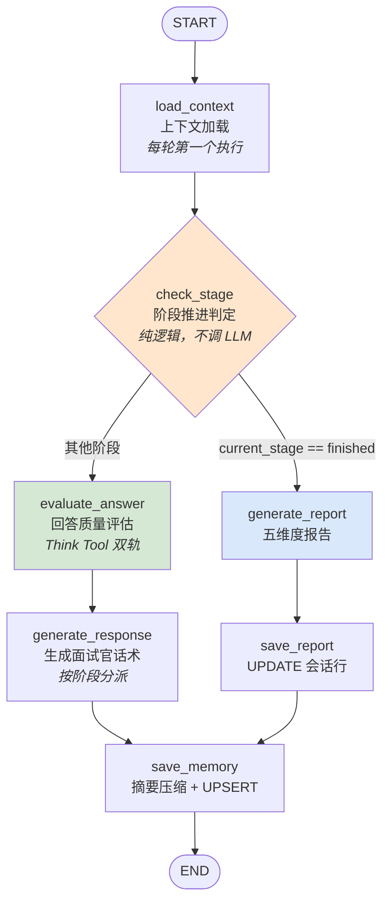
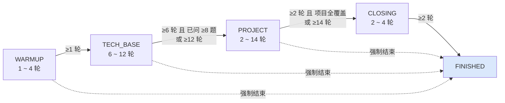
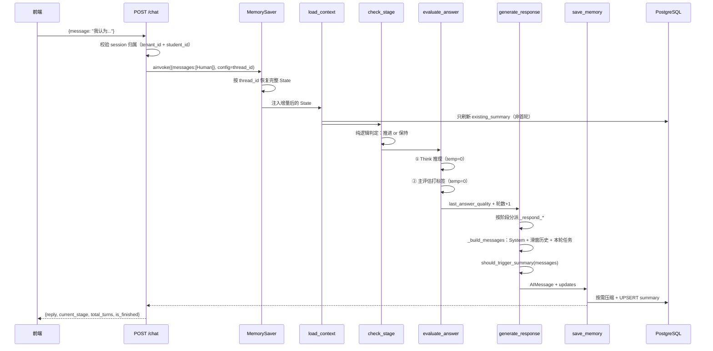

# 模拟面试 Agent（Interview）架构与实现详解

> 代码位置：`backend/agents/interview/` + `backend/api/v1/interview.py`
> 关联数据表：`interview_sessions` / `interview_questions`
> 文档版本：基于当前 `dev` 分支代码（对应课件第七章）

---

## 一、一句话定位

用一个 **LangGraph 状态机**驱动一场五阶段的技术模拟面试：面试官每轮读取学员回答 → 评估回答质量 → 决定「追问 / 换题 / 推进阶段」→ 生成面试官话术，面试结束后基于完整对话生成五维度加权评分报告。

与另外三个 Agent 最大的区别：**它是有状态的、跨多轮的长对话**，所以整个设计的重心在「状态持久化 + 阶段推进控制 + 上下文压缩」这三件事上。

---

## 二、文件职责

| 文件 | 行数 | 职责 |
|------|------|------|
| `state.py` | 87 | 定义 `InterviewStage` / `AnswerQuality` 两个枚举、`DimensionEval` / `InterviewReport` / `InterviewState` 三个 Pydantic/TypedDict 结构 |
| `graph.py` | 86 | 组装 `StateGraph`，注册 7 个节点 + 1 个条件路由，编译时挂 `MemorySaver` |
| `nodes.py` | 963 | 全部业务逻辑：7 个节点函数 + 5 个 `_respond_*` 阶段子函数 + 若干工具函数 |
| `prompts.py` | 269 | 全部提示词常量（系统人设 / 出题 / 各阶段对话 / 评估 / 报告） |
| `backend/api/v1/interview.py` | 350 | 5 个 HTTP 端点，负责会话生命周期、鉴权、SSE 流式 |

---

## 三、State 数据契约（22 个字段）

定义在 `state.py:48-87`，跨轮由 `MemorySaver` 持久化，`add_messages` 注解保证 `messages` 是**追加**而非覆盖。

### 3.1 请求上下文

| 字段 | 类型 | 说明 |
|------|------|------|
| `messages` | `Annotated[list[BaseMessage], add_messages]` | 完整对话历史，唯一带 reducer 的字段 |
| `student_id` | `str` | 学员 ID |
| `tenant_id` | `str` | 租户 ID（多租户隔离） |
| `session_id` | `str` | 会话 ID，API 层 `uuid4()` 生成 |
| `target_position` | `str` | 目标岗位，决定出题方向与面试官人设 |

### 3.2 简历联动数据（来自简历审查 Agent 的产出）

| 字段 | 类型 | 说明 |
|------|------|------|
| `resume_review_id` | `Optional[str]` | 关联的简历审查记录 ID；**非空才做项目深挖** |
| `resume_projects` | `list[dict]` | 简历项目列表（名称/角色/技术栈/亮点） |
| `resume_skills` | `list[str]` | 简历技能列表 |

### 3.3 阶段控制

| 字段 | 类型 | 说明 |
|------|------|------|
| `current_stage` | `str` | 当前阶段，取值见 `InterviewStage` |
| `stage_turn_count` | `int` | 当前阶段已进行轮数 |
| `total_turn_count` | `int` | 总轮数（跨阶段累计，同时是「是否首轮」的判据） |
| `max_turns` | `int` | 轮数上限，默认 40 |

### 3.4 题目管理

| 字段 | 类型 | 说明 |
|------|------|------|
| `question_bank` | `list[dict]` | 题库，每项 `{id, content, difficulty, tags, asked}` |
| `current_question` | `Optional[dict]` | 当前正在问/追问的题；TECH_BASE 存题库项，PROJECT 存动态构造的 dict |
| `projects_asked` | `list[str]` | 已深挖过的项目名（防重复深挖） |

### 3.5 回答质量与记忆

| 字段 | 类型 | 说明 |
|------|------|------|
| `last_answer_quality` | `str` | 上一条回答质量，取值见 `AnswerQuality` |
| `followup_count` | `int` | 当前问题已追问次数（上限 2） |
| `existing_summary` | `Optional[str]` | 历史对话摘要（DB 持久化） |
| `should_summarize` | `bool` | 本轮是否触发摘要压缩 |

### 3.6 产出与降级

| 字段 | 类型 | 说明 |
|------|------|------|
| `report` | `Optional[dict]` | 五维度报告，`InterviewReport.model_dump()` 结果 |
| `fallback_used` | `bool` | 是否用过兜底逻辑（**当前代码中只被初始化，未被写入**） |
| `structured_output` | `Optional[dict]` | 给 API 层直接读的结构化摘要（报告 + 轮数） |

### 3.7 两个枚举

```python
# state.py:11-25
class InterviewStage(str, Enum):
    WARMUP    = "warmup"      # 热身：邀请自我介绍
    TECH_BASE = "tech_base"   # 技术基础：题库问答
    PROJECT   = "project"     # 项目深挖：针对简历项目追问
    CLOSING   = "closing"     # 反问收尾：让学员提问
    FINISHED  = "finished"    # 终态：触发报告生成

class AnswerQuality(str, Enum):
    EXCELLENT = "excellent"   # 优秀：有技术细节/量化/原理
    ADEQUATE  = "adequate"    # 基本及格：方向对但缺深度
    WEAK      = "weak"        # 较弱：方向偏或太表面
    NO_ANSWER = "no_answer"   # 未作答：明说不知道或为空
```

---

## 四、图拓扑

### 4.1 节点与边（`graph.py:29-74`）



- **7 个节点**：`load_context` / `check_stage` / `evaluate_answer` / `generate_response` / `generate_report` / `save_report` / `save_memory`
- **1 个条件路由**：`_route_after_check_stage`（`graph.py:18-26`），只看 `current_stage` 是否等于 `finished`
- **两条路径共用出口**：`save_memory` → `END`，保证无论走对话还是报告路径，会话摘要都会落库

> 注意：`save_report` 已经在内部把 `status` 置为 `finished`，但**不写 summary**；`save_memory` 只写 summary。两者职责分离。

### 4.2 编译与单例

```python
# graph.py:72-74
checkpointer = get_memory_saver("interview")
return builder.compile(checkpointer=checkpointer)
```

```python
# api/v1/interview.py:20
_graph = build_interview_graph()   # 模块级单例：导入时编译一次，所有请求共用
```

---

## 五、阶段状态机（核心）

### 5.1 轮数上下限常量（`nodes.py:36-47`）

```python
STAGE_MIN_TURNS = {warmup: 1, tech_base: 6,  project: 2,  closing: 2}
STAGE_MAX_TURNS = {warmup: 4, tech_base: 12, project: 14, closing: 4}
DEFAULT_MAX_TURNS = 40            # 全场总轮数上限
MAX_FOLLOWUP_PER_QUESTION = 2     # 单题最多追问 2 次
```

### 5.2 推进规则

`check_stage_node`（`nodes.py:264`）的判定顺序：

1. **已经 FINISHED** → 直接 `return {}`，交给条件路由去生成报告
2. **强制结束判定** → 命中则直接跳 `FINISHED`（**跳过 CLOSING**）：
   - `total_turns >= max_turns - 2`（即 ≥ 38 轮），或
   - 学员最后一条消息包含关键词：`结束面试` / `不想继续` / `面试结束` / `结束吧` / `到此为止`
3. **CLOSING 特判** → `stage_turns >= 2` 即进 `FINISHED`
4. **常规推进** → `stage_turns >= stage_max` 强制推进；否则 `stage_turns >= stage_min` 时再问内容条件

内容条件（`_check_advance_condition`，`nodes.py:339-357`）：

| 阶段 | 内容条件 |
|------|---------|
| WARMUP | 恒 `True`（学员发了任意消息即视为完成自我介绍） |
| TECH_BASE | `已问题数 >= min(8, len(question_bank))` |
| PROJECT | `len(projects_asked) >= len(resume_projects)`；无简历项目时恒 `True` |
| 其他 | `False` |

推进时统一返回四个字段：

```python
# nodes.py:330-335
{
    "current_stage":    next_stage,
    "stage_turn_count": 0,        # 新阶段轮数归零
    "followup_count":   0,        # 追问计数归零
    "current_question": None,     # 清空当前题，让新阶段重新选题
}
```

### 5.3 阶段流转图



### 5.4 下一阶段映射（`_next_stage`，`nodes.py:360-373`）

按固定顺序数组 `[warmup, tech_base, project, closing, finished]` 取下一个；越界返回 `finished`；`current_stage` 不在表里（异常值）时兜底返回 `closing`。

---

## 六、单轮执行时序

以「学员在 TECH_BASE 阶段提交一条回答」为例：



**关键顺序**：`check_stage` 在 `evaluate_answer` **之前**执行，所以 `check_stage` 看到的 `stage_turn_count` 是**上一轮结束时的值**，而 `evaluate_answer` 负责 +1。这导致新阶段的 `generate_response` 一定会看到 `stage_turn_count == 1` —— 这正是「插入阶段过渡语」的触发条件（见 7.4.2）。

---

## 七、7 个节点逐一详解

### 7.1 load_context_node — 上下文加载（`nodes.py:107-261`）

**每轮都执行**：刷新 `existing_summary`。
**仅首轮额外执行**：初始化全部状态字段 + 并行加载简历 / 题库 / LLM 出题 / 历史摘要。

#### 实现步骤

1. **定位会话**：`student_id` 或 `session_id` 缺失 → 记 error 日志并 `return {}`（不抛异常）。
2. **拼 thread_id**：`build_thread_id(student_id, session_id)` → `student_{id}_session_{id}`。
3. **判首轮**：`state.get("total_turn_count", 0) == 0`。
4. **首轮初始化**（`nodes.py:211-224`）一次性写入：`current_stage=warmup`、三个计数归零、`projects_asked=[]`、`last_answer_quality=adequate`、`max_turns=40`、`report=None`、`should_summarize=False`、简历字段兜底空数组。
5. **四路 I/O 并行**（`nodes.py:232-242`）—— 这是本节点最核心的设计：

```python
resume_coro    = _fetch_resume(resume_review_id) if resume_review_id else _noop_resume()
questions_coro = _fetch_questions(target)          # DB 题库
llm_q_coro     = _generate_questions_by_llm(target)  # LLM 出题
summary_coro   = _fetch_summary()                  # 历史摘要
resume_data, db_questions, llm_questions, existing_summary = await asyncio.gather(
    resume_coro, questions_coro, llm_q_coro, summary_coro
)
```

四个协程各自开独立的 `AsyncSessionLocal()` 会话（避免共享 session 的并发问题）。总耗时 ≈ 最慢的那一路（LLM 出题），而不是四路之和。

**子函数细节**：

| 子函数 | 行号 | 做什么 | 失败处理 |
|--------|------|--------|---------|
| `_fetch_resume` | 137-158 | `SELECT structured_data FROM resume_reviews WHERE id=:id`，取出 `projects` 与 `skills_list` 两项 | 记 warning，返回 `{}` |
| `_fetch_questions` | 160-194 | `SELECT ... FROM interview_questions WHERE (target_position=:target OR target_position='general') AND is_active=TRUE ORDER BY (medium 优先), RANDOM() LIMIT 20` | 记 warning，返回 `[]` |
| `_generate_questions_by_llm` | 61-104 | 调 LLM 生成 8 道题（见下） | 记 warning，返回 `[]` |
| `_fetch_summary` | 196-208 | `SELECT summary FROM interview_sessions WHERE thread_id=:tid` | 记 warning，返回 `None` |

6. **题库合并策略**（`nodes.py:244-248`）：

```python
if llm_questions:
    question_bank = llm_questions + (db_questions if db_questions else [])  # LLM 题在前
else:
    question_bank = db_questions   # LLM 出题失败 → 纯 DB 题库兜底
```

> **LLM 题优先**的理由：LLM 按 `target_position` 现出题更贴岗位；DB 题库作为补充和兜底。

#### `_generate_questions_by_llm` 实现细节（`nodes.py:61-104`）

- 模型：`get_llm("interview", temperature=0.3)`（出题要一点多样性）
- Prompt：`TECH_BASE_GENERATE_PROMPT`，要求难度分布 中等 60% / 简单 20% / 困难 20%，每题 ≤60 字
- **AI/大模型方向强制题型**：Prompt 内硬编码要求包含 Transformer 架构、过拟合、自回归生成原理、RAG 流程、向量相似度检索、LoRA 等（`prompts.py:24-30`）
- **输出解析容错**：先按 ` ``` ` 切分，剥掉 `json` 语言标记，找到以 `[` 开头的那段；再 `json.loads`
- **逐题规整**：跳过非 dict 或无 `content` 的项；统一补 `id=f"llm_{i}"`、`difficulty` 缺省 `medium`、`tags` 缺省 `[target_position]`、`asked=False`
- 全程包在 `try/except` 里，失败返回 `[]`，**绝不让出题失败阻断面试**

#### 非首轮路径

```python
# nodes.py:258-259
else:
    updates["existing_summary"] = await _fetch_summary()
```

只做一次 DB 读，用于把（可能刚被压缩过的）摘要同步回 State。

---

### 7.2 check_stage_node — 阶段推进判定（`nodes.py:264-337`）

**纯逻辑节点，不调 LLM**（这是设计上的刻意选择：阶段推进要确定、可预测、零成本）。

- 读取：`current_stage` / `stage_turn_count` / `total_turn_count` / `max_turns` / `messages`
- 写入：推进时返回 4 字段（见 5.2）；不推进返回 `{}`

**取学员最后一条消息**（`nodes.py:292-297`）用于关键词检测：

```python
for msg in reversed(messages):
    if isinstance(msg, HumanMessage):
        latest_student_msg = _msg_text(msg)
        break
```

**返回值语义**：返回空 dict `{}` 是 LangGraph 允许的「本轮不改任何状态」，不是错误。

---

### 7.3 evaluate_answer_node — 回答质量评估（`nodes.py:383-475`）

这是面试 Agent 的「大脑」，采用 **Think Tool 双轨**设计。

#### 三条提前返回路径（省 LLM 调用）

| 条件 | 返回 |
|------|------|
| `total_turns == 0`（首轮） | `ADEQUATE`，但两个计数**照常 +1** |
| `current_stage == WARMUP` | 同上（自我介绍不打分） |
| 回答为空 或 精确等于 `不知道`/`不清楚`/`没学过` | `NO_ANSWER`，两个计数 +1 |

#### 双轨评估主流程

**第一轨：Think 推理**（`nodes.py:423-435`）

```python
think_prompt = EVALUATE_THINK_PROMPT.format(question=..., answer=...)
think_llm  = get_llm("qa", temperature=0)
think_resp = await think_llm.ainvoke([HumanMessage(content=think_prompt)])
reasoning_trace = _msg_text(think_resp).strip()
```

Prompt 要求 LLM 用 4-6 句分析四件事：① 说明了哪些技术要点 ② 哪些关键点未提及 ③ 是真实理解还是背模板（附判断依据）④ 深度与广度总体如何。

> **Think Tool 的意义**：先让模型把判断依据「写出来」，再让它下结论，能显著降低「拍脑袋打标签」的概率。这一轨的输出**不约束格式**，是模型的「内心独白」。
>
> 失败不影响主流程 —— `except` 里只记 warning，`reasoning_trace` 保持空串。

**第二轨：主评估打标签**（`nodes.py:437-462`）

```python
think_context = f"\n\n【评估前分析】\n{reasoning_trace}" if reasoning_trace else ""
prompt = EVALUATE_ANSWER_PROMPT.format(question=..., answer=...) + think_context
llm = get_llm("qa", temperature=0)
quality_str = _msg_text(await llm.ainvoke([HumanMessage(content=prompt)])).strip().lower()
```

即把第一轨的推理结论**拼接到主评估 Prompt 的末尾**，作为决策依据。

**标签解析用关键词包含匹配**（`nodes.py:451-459`），而不是精确相等 —— 因为 LLM 可能带空格/换行/多余文字：

```python
if   "excellent" in quality_str or "优秀"   in quality_str: EXCELLENT
elif "weak"      in quality_str or "较弱"   in quality_str: WEAK
elif "no_answer" in quality_str or "未作答" in quality_str: NO_ANSWER
else: ADEQUATE          # 兜底：模糊情况按基本及格
```

异常兜底同样是 `ADEQUATE`。

**Token 控制**：回答截断到 800 字（`answer_text = student_answer[:800]`，`nodes.py:421`）。

**返回**：

```python
{
    "last_answer_quality": quality,
    "total_turn_count":    total_turns + 1,
    "stage_turn_count":    state.get("stage_turn_count", 0) + 1,
}
```

---

### 7.4 generate_response_node — 生成面试官话术（`nodes.py:476-528`）

#### 7.4.1 分派结构

```python
if   current_stage == WARMUP:    response_text, updates = await _respond_warmup(state)
elif current_stage == TECH_BASE: response_text, updates = await _respond_tech_base(state)
elif current_stage == PROJECT:   response_text, updates = await _respond_project(state)
elif current_stage == CLOSING:   response_text, updates = await _respond_closing(state)
else:                            response_text = "感谢您参加本次模拟面试，请稍等，正在生成评估报告..."
```

每个 `_respond_*` 统一返回 `(回复文本, 要写回 state 的 updates)` 二元组。

#### 7.4.2 阶段过渡语注入（`nodes.py:496-501`）

```python
transition_prefix = ""
if stage_turns == 1 and current_stage not in (WARMUP, TECH_BASE):
    transition_prefix = STAGE_TRANSITION_PROMPTS.get(current_stage, "")
```

- 只对 **PROJECT** 和 **CLOSING** 生效
- TECH_BASE 的过渡（「评价自我介绍 + 问第一题」）由 `_respond_tech_base` 内部用自己的 Prompt 完成，更需要 LLM 的连贯表达
- 过渡语是**静态字符串**（`prompts.py:201-204`），拼在回复开头

#### 7.4.3 消息构造 `_build_messages`（`nodes.py:541-558`）

```python
result = [SystemMessage(content=system)]
windowed = trim_messages_to_window(history[:-1], window_size=window)
for msg in windowed:
    if not isinstance(msg, SystemMessage):   # 跳过历史里的 System，避免重复
        result.append(msg)
result.append(HumanMessage(content=current_prompt))
```

- `history[:-1]` **排除最后一条学员消息** —— 因为它已经通过 `.format(answer=...)` 显式嵌进了 `current_prompt`，再带上会重复
- System Prompt 由 `_build_system_with_summary`（`nodes.py:531-538`）构建：`SYSTEM_PROMPT.format(position=...)`，若有 `existing_summary` 则追加 `\n\n【学员面试历史摘要】\n{summary}`
- 各阶段 `window` 不同：热身/技术首问/反问 = 4，技术问答 = 8，项目 = 10

#### 7.4.4 `_respond_warmup`（`nodes.py:560-569`）

| 项 | 值 |
|----|----|
| Prompt | `WARMUP_PROMPT["opening"]` |
| 模型 | `get_llm("interview", temperature=0.7)` |
| window | 4 |
| updates | `{}` |

温度 0.7 是全场最高 —— 开场白要自然、有变化。

#### 7.4.5 `_respond_tech_base`（`nodes.py:571-664`）— 三条路径

**路径 1：刚进入 TECH_BASE**（`stage_turns == 1 and current_q is None`，`nodes.py:596-618`）

1. 取 `question_bank` 中第一道 `asked == False` 的题；题库空则返回兜底话术
2. 生成新题库列表（目标题 `asked=True`），写回 `question_bank`
3. 设 `current_question = first_q`、`followup_count = 0`
4. 用 `INTRO_EVAL_TECH_FIRST_PROMPT` 一条回复干三件事：**评价自我介绍（2-3 句）+ 过渡语 + 问第一题**
5. 模型 `temperature=0.5`，window=4

**追问判定**（`nodes.py:621-625`）——技术环节门槛最高：

```python
should_followup = (
    current_q is not None
    and followup_count < MAX_FOLLOWUP_PER_QUESTION   # < 2
    and quality == AnswerQuality.EXCELLENT.value     # 只有 EXCELLENT 才追问
)
```

**路径 2：追问当前题**（`nodes.py:627-635`）

- Prompt：`TECH_BASE_PROMPT["followup"]`，传入原题、学员回答（截断 600 字）、质量、技术栈标签
- Prompt 要求「基于候选人回答中提到的具体技术点追问，如『你提到了 X，能说说它的内部实现吗？』」
- `updates["followup_count"] = followup_count + 1`

**路径 3：出下一道题**（`nodes.py:636-660`）

- 题库问完 → 直接返回硬编码过渡话术 + `{"current_question": None}`
- 否则取下一道 `asked == False` 的题，标记 `asked=True`，重置 `followup_count = 0`
- Prompt：`TECH_BASE_PROMPT["ask_with_feedback"]` ——「反馈上一题 + 过渡 + 问下一题」，反馈话术**按 quality 分档**（excellent 肯定亮点并点出深化方向 / adequate 指出 1 个遗漏点 / weak 轻描淡写跳过 / no_answer 给简短提示后换题）

**统一收尾**：`get_llm("interview", temperature=0.4)`，window=8。

> ⚠️ `TECH_BASE_PROMPT` 里的 `weak_transition` 和 `no_answer_hint` 两个键**定义了但未被代码引用** —— 分档逻辑已内联进 `ask_with_feedback` 的 Prompt 描述里。

#### 7.4.6 `_respond_project`（`nodes.py:666-750`）— 四条路径

前提分叉：`if projects:`（有简历联动）→ 三条路径；`else:` → 第四条。

| 路径 | 触发条件 | Prompt | 关键 updates |
|------|---------|--------|-------------|
| 1 追问当前项目 | `current_q is not None` 且 `followup_count < 2` 且 quality ∈ {EXCELLENT, ADEQUATE} | `PROJECT_PROMPT["followup_with_feedback"]` | `followup_count += 1` |
| 2 切新项目 | 有未深挖的项目 | `PROJECT_PROMPT["new_project"]` | `current_question`（动态构造）、`projects_asked += [name]`、`followup_count = 0` |
| 3 综合题 | 所有项目都深挖完 | `PROJECT_PROMPT["synthesis"]` | `{}` |
| 4 无简历 | `projects` 为空 | `PROJECT_PROMPT["no_resume"]` | `{}` |

**追问门槛比技术环节低**（`nodes.py:698-703`）：`quality in (EXCELLENT, ADEQUATE)` —— 项目经历本来就该多聊几句，ADEQUATE 也值得追问。

**动态构造 `current_question`**（`nodes.py:730-734`）—— 项目阶段的「当前题」不是题库项：

```python
updates["current_question"] = {
    "content":      f"项目深挖：{next_project['name']}",
    "project_name": next_project["name"],
    "tech_stack":   next_project.get("tech_stack", []),
}
```

**追问方向是写死的技术清单**（`prompts.py:124-138`）——按项目类型分组，让 LLM 按技术栈挑选：

- RAG / 知识库检索类：数据量级、chunk 分块、PDF 图片表格解析、混合检索、Reranker
- LLM 微调类：LoRA 原理与可训练参数比例、数据集构建、前后效果对比
- 通用：最大技术难点、技术选型理由

模型 `temperature=0.5`，window=10（项目环节需要更多上下文）。

> ⚠️ `PROJECT_PROMPT["followup"]`（纯追问无反馈版）**定义了但未被引用**，代码统一走 `followup_with_feedback`。

#### 7.4.7 `_respond_closing`（`nodes.py:752-778`）

| stage_turns | Prompt | 说明 |
|-------------|--------|------|
| `<= 1` | `CLOSING_PROMPT["opening"]` | 静态文案，邀请学员提问 |
| `> 1` | `CLOSING_PROMPT["respond_question"]` | 回应学员的具体提问，带 `position` 上下文 |

模型 `temperature=0.6`，window=4，`updates = {}`（本阶段不改任何状态字段）。

#### 7.4.8 收尾

```python
# nodes.py:519-520
updates["messages"]         = [AIMessage(content=response_text)]
updates["should_summarize"] = should_trigger_summary(messages)
```

`should_summarize` 在这里计算，实际压缩动作发生在 `save_memory` 节点。

---

### 7.5 generate_report_node — 生成评估报告（`nodes.py:779-869`）

#### 输入组装（双层上下文）

```python
recent_messages = [m for m in messages[-40:] if isinstance(m, (HumanMessage, AIMessage))]
conversation_text = "\n".join(
    f"{'面试官' if isinstance(m, AIMessage) else '学员'}：{_msg_text(m)}" for m in recent_messages
)
```

- 取**最近 40 条**消息，格式化成「角色：内容」多行文本
- 早期对话用 `existing_summary` 兜底（`summary or "（无历史摘要）"`）
- `conversation` 截断到 4000 字

这套「**摘要管早期 + 原文管近期**」的组合，是长对话总结的标准做法。

#### 结构化输出 + 重试

```python
structured_llm = get_structured_llm("interview", InterviewReport)

report_dict = None
for attempt in range(2):
    try:
        result: InterviewReport = await structured_llm.ainvoke([
            SystemMessage(content=SYSTEM_PROMPT.format(position=position)),
            HumanMessage(content=prompt),
        ])
        if result is None:
            raise ValueError("structured output returned None")   # function_calling 偶发返回 None
        report_dict = result.model_dump()
        break
    except Exception as e:
        if attempt == 0:
            await asyncio.sleep(1)   # 退避 1 秒后重试
```

**两次都失败 → 硬编码保守报告**（`nodes.py:836-845`），`overall_score = 60`，这是三层兜底里的第二层（Agent 降级）。

#### 五维度与权重

| 维度 | 权重 |
|------|------|
| 技术深度 | 35% |
| 项目经验 | 25% |
| 表达逻辑 | 20% |
| 抗压反应 | 10% |
| 整体印象 | 10% |

Prompt 内还给了分档标准：90-100 远超初级期望 / 75-89 达到要求 / 60-74 基本达标 / 45-59 差距较大 / 0-44 未达门槛。

#### 产出

```python
closing_message = (
    f"好的，本次模拟面试到这里就结束了，感谢你的参与！\n\n"
    f"下面是你的整体表现总结：\n\n"
    f"**综合评分：{overall_score} / 100**\n\n"
    f"详细的各维度分析和改进建议可以在面试记录中查看。"
)
return {
    "report":            report_dict,
    "messages":          [AIMessage(content=closing_message)],
    "structured_output": {"session_id": ..., "report": report_dict, "total_turns": ...},
}
```

---

### 7.6 save_report_node — 报告落库（`nodes.py:870-906`）

```sql
UPDATE interview_sessions
SET report = :report,            -- JSON 字符串，ensure_ascii=False 保中文
    overall_score = :overall_score,
    status = 'finished',
    finished_at = NOW(),
    updated_at = NOW()
WHERE thread_id = :thread_id
```

- 行为 UPDATE 而非 INSERT —— 会话行已在 `POST /sessions` 时插入
- `json.dumps(report, ensure_ascii=False)` 手工序列化，中文不转义
- 失败 `rollback()` + `logger.error`，**不抛异常**，不阻断流程
- 返回 `{}`（不改 State）

---

### 7.7 save_memory_node — 摘要压缩与持久化（`nodes.py:908-964`）

```python
if state.get("should_summarize", False):
    summary = await compress_to_summary(messages, summary)   # 与旧摘要增量合并
```

UPSERT：

```sql
INSERT INTO interview_sessions
    (id, tenant_id, student_id, session_id, thread_id,
     target_position, resume_review_id, summary, status)
VALUES (..., 'in_progress')
ON CONFLICT (thread_id) DO UPDATE
    SET summary = EXCLUDED.summary, updated_at = NOW()
```

> `ON CONFLICT (thread_id)` 依赖表上 `thread_id VARCHAR(128) NOT NULL UNIQUE` 约束（`_03_init_db.sql:185`）。

设计要点：**只更新 summary 与 updated_at，绝不覆盖 status** —— 否则并行的 `save_report` 把 status 置为 `finished` 后可能被这里改回 `in_progress`。

---

## 八、记忆管理（本 Agent 的技术核心）

### 8.1 MemorySaver 按 Agent 隔离（`memory.py:14-33`）

```python
_memory_savers: dict[str, MemorySaver] = {}

def get_memory_saver(agent_type: str = "default") -> MemorySaver:
    if agent_type not in _memory_savers:
        _memory_savers[agent_type] = MemorySaver()
    return _memory_savers[agent_type]
```

> **为什么必须隔离**：不同 Agent 的 State schema 不同，共用一个 MemorySaver 会导致 msgpack 序列化时 schema 字段冲突。每个 Agent 一个实例。
>
> **已知局限**：`MemorySaver` 是**进程内内存存储**，后端重启后所有面试历史丢失。生产环境替换为 `AsyncPostgresSaver` 即可持久化，业务代码无需改动（`memory.py:22-24` 注释明确说明）。

### 8.2 thread_id 与调用配置（`memory.py:36-65`）

```python
build_thread_id("abc123", "xyz789")  # → "student_abc123_session_xyz789"
build_config(sid, sess)              # → {"configurable": {"thread_id": ...}}
```

同一学员的不同会话历史互相隔离。

### 8.3 滑动窗口裁剪（`memory.py:68-101`）

```python
def trim_messages_to_window(messages, window_size=10):
    system_messages   = [m for m in messages if isinstance(m, SystemMessage)]
    dialogue_messages = [m for m in messages if not isinstance(m, SystemMessage)]
    max_dialogue_messages = window_size * 2      # 1 轮 = 2 条消息
    if len(dialogue_messages) <= max_dialogue_messages:
        return messages                          # 未超窗口不裁剪
    return system_messages + dialogue_messages[-max_dialogue_messages:]
```

**SystemMessage 永远保留**，不受窗口限制。

### 8.4 摘要压缩触发（`memory.py:104-122`）

```python
def should_trigger_summary(messages, threshold=10) -> bool:
    dialogue_count = sum(1 for m in messages if isinstance(m, (HumanMessage, AIMessage)))
    return dialogue_count % (threshold * 2) == 0
```

**⚠️ 本函数在实际调用点永不返回 `True`（已确认，见 12.10）。**

从函数本身看，`dialogue_count` 每轮 +2，`% 20 == 0` 似乎「每 10 轮命中一次」。但**求值时机**破坏了这个前提：调用点在 `generate_response_node`（`nodes.py:520`），而 `api/v1/interview.py:146` 是先把本轮 `HumanMessage` 合并进 state 再 `ainvoke`，此时本轮面试官回复**尚未追加**，于是：

```
dialogue_count = 2×(N-1) + 1 = 2N - 1   →  恒为奇数
奇数 % 20 == 0                            →  永不成立
```

首轮同理（`start_session` 传的是 `[HumanMessage("[开始面试]")]`，count = 1）。因此摘要压缩在面试 Agent 里**从未触发过**。

### 8.5 增量压缩（`memory.py:125-182`）

`compress_to_summary(messages, existing_summary)` 的 Prompt 规则：

- **必须保留**：学员明确不理解的知识点 / 反复出现的薄弱点 / 项目背景新增信息
- **选择性保留**：已掌握知识点（简短标注）/ 学习进度
- **可以丢弃**：已在上次摘要记录的内容 / 闲聊 / 已解决且理解的问题

传入 `existing_summary` 是防止已记录内容被重复写入 —— 这是「增量」的关键。模型走 `get_llm("summarize")`。

---

## 九、API 层（`backend/api/v1/interview.py`）

| 方法 | 路径 | 说明 |
|------|------|------|
| POST | `/sessions` | 建会话 + 首轮开场白，返回 `201` |
| POST | `/sessions/{id}/chat` | 学员发消息，返回面试官回复（同步等 LLM） |
| POST | `/sessions/{id}/chat/stream` | **SSE 流式**，逐 token 推送 |
| GET | `/sessions/{id}/report` | 取完整报告（未结束返回 `400`） |
| GET | `/sessions` | 列出该学员最近 50 场，按创建时间倒序 |

### 9.1 `POST /sessions`（`interview.py:31-110`）

1. 从 `current_user` 取 `student_id` / `tenant_id`，`uuid4()` 生成 `session_id`
2. INSERT `interview_sessions`（`status='in_progress'`）
3. **构造完整 22 字段 `initial_state`**（`interview.py:71-94`）—— 首轮 MemorySaver 里没有存档，必须传全量，否则 TypedDict 字段缺失
4. 特殊消息 `HumanMessage(content="[开始面试]")` 作为图执行的触发器
5. `await _graph.ainvoke(initial_state, config=config)` **同步等待**，取最后一条 AIMessage 作为开场白
6. 返回 `{session_id, target_position, status, message}`

> 🔴 **注意**：第 2 步写入的 `req.resume_review_id` **没有做归属校验**（既不校验属于当前 `student_id`，也不校验同 `tenant_id`），配合 `_fetch_resume` 无过滤的 SQL，构成跨学员简历数据越读。详见 12.9。

### 9.2 `POST /sessions/{id}/chat`（`interview.py:112-176`）

**越权校验**（`interview.py:129-140`）：`WHERE session_id=:sid AND tenant_id=:tid AND student_id=:sid`，查不到 → `404 面试会话不存在`。

**只传增量**：

```python
state_update = {
    "messages":   [HumanMessage(content=req.message)],
    "student_id": student_id,      # 显式带上，防 MemorySaver 丢失时崩
    "session_id": session_id,
    "tenant_id":  tenant_id,
}
result = await _graph.ainvoke(state_update, config=config)
```

完整 State 由 MemorySaver 按 `thread_id` 自动恢复。显式重传四个 ID 字段是防御性写法。

**响应**：`{session_id, reply, current_stage, total_turns, is_finished}`；若 `is_finished` 则额外附 `report_summary`（`overall_score` / `strengths` / `improvements`）。

### 9.3 SSE 流式（`interview.py:253-338`）

```python
async for event in _graph.astream_events(state_update, config=config, version="v2"):
    evt  = event["event"]
    node = event.get("metadata", {}).get("langgraph_node", "")

    if evt == "on_chat_model_stream" and node == "generate_response":
        chunk = event["data"].get("chunk")
        if chunk and chunk.content:
            yield {"data": json.dumps({"type": "token", "content": chunk.content},
                                      ensure_ascii=False)}
```

**节点名过滤是关键设计**：只转发 `generate_response` 节点的 token，`check_stage` / `evaluate_answer` / `generate_report` 的 LLM 输出**全部对前端隐藏** —— 否则学员会看到「评估推理」和「评分」泄露。

流结束后用 `aget_state(config)` 读检查点拿最终 State，组装 `done` 事件（含 `reply` 兜底、`current_stage`、`total_turns`、`is_finished`，结束时附 `report_summary`）。

异常统一推 `{"type": "error", "message": "流式输出异常，请重试"}`。

### 9.4 `GET /sessions/{id}/report`（`interview.py:179-220`）

- 校验存在性与 `status == 'finished'`，未结束返回 `400 面试尚未结束，报告生成中`
- `report` 是 JSONB 列，**同时兼容 ORM 返回 dict 或 str 两种情况**
- 把 `report` 内部字段**摊平**到顶层返回给前端

---

## 十、数据库表

### `interview_sessions`（`scripts/_03_init_db.sql:180-200`）

| 列 | 类型 | 说明 |
|----|------|------|
| `id` | UUID PK | |
| `tenant_id` | VARCHAR(64) | 默认 `tenant_default` |
| `student_id` | UUID → users(id) | |
| `session_id` | VARCHAR(128) | API 层生成 |
| `thread_id` | VARCHAR(128) **UNIQUE** | `student_x_session_y`，UPSERT 的冲突键 |
| `target_position` | VARCHAR(128) | |
| `resume_review_id` | UUID → resume_reviews(id) | 简历联动外键 |
| `summary` | TEXT | 对话摘要 |
| `report` | JSONB | 五维度报告 |
| `overall_score` | INT | 综合分（单独存一列便于列表页排序/展示） |
| `status` | VARCHAR(16) | `in_progress` / `finished`（CHECK 约束） |
| `finished_at` | TIMESTAMPTZ | |
| `created_at` / `updated_at` | TIMESTAMPTZ | `updated_at` 由触发器自动维护 |

### `interview_questions`（`scripts/_03_init_db.sql:162-178`）

| 列 | 类型 | 说明 |
|----|------|------|
| `id` | UUID PK | |
| `tenant_id` | VARCHAR(64) | |
| `content` | TEXT | 题干 |
| `difficulty` | VARCHAR(8) | `easy`/`medium`/`hard`（CHECK） |
| `tags` | JSONB | 技术方向标签 |
| `target_position` | VARCHAR(128) | 岗位；`general` 为通用题 |
| `is_active` | BOOLEAN | 软删除标记 |
| `created_by` | UUID → users(id) | |

> `resume_reviews` 表上的 `structured_data` JSONB 列是本 Agent 读取简历联动的数据来源（由简历审查 Agent 写入）。

---

## 十一、降级与容错

| 环节 | 失败场景 | 兜底行为 |
|------|---------|---------|
| LLM 出题 | 调用失败 / JSON 解析失败 | 返回 `[]`，纯用 DB 题库 |
| 读简历 | DB 异常 | 记 warning，`resume_projects` 为空 → PROJECT 阶段走 `no_resume` 路径 |
| 读题库 | DB 异常 | 返回 `[]` → 若 LLM 出题也失败，TECH_BASE 给兜底话术并跳过 |
| 读摘要 | DB 异常 | 返回 `None`，不影响对话 |
| 回答评估 | LLM 异常 | 兜底 `ADEQUATE` |
| Think 推理 | LLM 异常 | `reasoning_trace` 为空，主评估照常进行 |
| 报告生成 | 结构化输出失败 | 重试 1 次（间隔 1s）；仍失败 → 硬编码保守报告（60 分） |
| 落库 | DB 异常 | `rollback()` + error 日志，不抛异常 |
| SSE | 任意异常 | 推 `type=error` 事件 |

**全程没有一处因外部依赖失败而中断面试** —— 学员总能拿到一个面试官回复。

---

## 十二、已知问题与风险点（接手必读）

### 12.1 SSE 可能不是真流式 ⚠️

`graph.py` 的节点内全部使用 `await llm.ainvoke(...)`，而 `LLMFactory.get_llm()` 的 `streaming` 参数默认 `False`（`llm_factory.py:91`）。在 LangChain 中，当模型 `streaming=False` 时 `astream_events` 通常只产出**一个**包含完整内容的 `on_chat_model_stream` 事件，而非逐 token。

**现象**：前端看起来「一次性刷出整段回复」，而不是打字机效果。
**修复方向**：把 `_respond_*` 里的 `get_llm("interview", temperature=X)` 改为 `get_llm("interview", temperature=X, streaming=True)`（注意 `LLMFactory` 的缓存键已包含 `streaming`，不会互相污染）。

> 建议实际跑一次 `POST /sessions/{id}/chat/stream`，数一下 `data:` 事件里的 `type=token` 条数来确认。

### 12.2 自我介绍的评估上下文不准确

第 2 轮（学员提交自我介绍）时：`check_stage` **先**把阶段推进到 `TECH_BASE`，随后 `evaluate_answer` 看到的是 `current_stage == tech_base`，于是**会真的调 LLM 评估自我介绍**，但 `current_question` 此时是 `None`，导致 `question_text` 退化成占位符 `"上一个问题"`（`nodes.py:420`）。

影响：评估结果偏不可靠，但只影响 `last_answer_quality` 一个字段（在 TECH_BASE 路径 1 中其实没被使用），**实际无害**，属于代码整洁度问题。

### 12.3 模型路由不一致

`evaluate_answer_node` 用 `get_llm("qa", ...)` 而不是 `get_llm("interview", ...)`（`nodes.py:430` 和 `nodes.py:447`）。

当前 `_AGENT_MODEL_ROUTING` 里两者都指向 `deepseek-chat`，所以**行为无差异**；但若将来给 `interview` 单独换模型，评估环节不会跟着变。建议统一改为 `"interview"`。

### 12.4 未使用的 Prompt 常量

| 常量 | 位置 | 状态 |
|------|------|------|
| `TECH_BASE_PROMPT["weak_transition"]` | `prompts.py:88` | 定义了未引用 |
| `TECH_BASE_PROMPT["no_answer_hint"]` | `prompts.py:89` | 定义了未引用 |
| `PROJECT_PROMPT["followup"]` | `prompts.py:142-165` | 定义了未引用 |

### 12.5 `fallback_used` 字段是死字段

`state.py:86` 定义了 `fallback_used`，`interview.py:92` 初始化为 `False`，但**代码中没有任何地方写入它**。报告生成走兜底时也未置 `True`。若需要「前端提示本次报告为兜底结果」，需要补上写入逻辑。

### 12.6 面试结束后重复调用会重复生成报告

会话 `status` 已是 `finished` 后再调 `/chat`，`check_stage` 因 `current_stage == FINISHED` 直接返回 `{}`，条件路由仍会走 `generate_report` → **再花一次 LLM 调用重新生成报告**。前端应据此做按钮禁用，后端也可加一道 `status` 校验。

### 12.7 MemorySaver 重启即丢

进程重启后 `thread_id` 对应的检查点消失，继续调 `/chat` 会因 State 字段缺失而异常（`student_id` 等显式重传能缓解一部分，但 `question_bank` / `current_stage` 会退回默认）。生产必须换 `AsyncPostgresSaver`。

### 12.8 `import asyncio` 重复导入

`nodes.py:3` 已在模块顶层导入，`nodes.py:238` 又在函数内 `import asyncio` 一次。无害但冗余。

### 12.9 简历联动存在跨学员 / 跨租户越读（IDOR）🔴 已确认

这是本 Agent 最严重的问题，**两处缺陷叠加**构成一条完整的数据越读链路：

**缺陷一：读取端不过滤归属**（`nodes.py:137-158`）

```python
async def _fetch_resume(resume_review_id: str) -> dict:
    try:
        async with AsyncSessionLocal() as s:
            result = await s.execute(
                text("SELECT structured_data FROM resume_reviews WHERE id = :id"),
                {"id": resume_review_id},
            )
```

SQL **只按主键 `id` 查，没有 `student_id` 或 `tenant_id` 条件**。对比同一个文件里其它查询（如 `_fetch_questions` 也没有租户过滤，但那是题库不算敏感数据），这里是直接读另一个学员的简历原文级数据。

**缺陷二：写入端不校验归属**（`api/v1/interview.py:23-26`、`:63`）

```python
class StartSessionRequest(BaseModel):
    target_position:  str                  # 目标岗位（必填）
    resume_review_id: str | None = None    # 简历审查记录 ID（可选，做项目联动）
```

```python
"resume_review_id": req.resume_review_id,   # 请求体原样透传进 INSERT
```

`POST /interview/sessions` 对 `resume_review_id` **零校验**：既不查该简历是否属于当前 `student_id`，也不查是否同 `tenant_id`，直接写进 `interview_sessions` 并进入 `initial_state`。

**完整攻击路径**

1. 攻击者（任意已登录学员）拿到或猜到他人的 `resume_review_id`（UUID v4，但会出现在自己的历史记录、日志、前端 URL、分享链接等位置）
2. `POST /api/v1/interview/sessions`，请求体带上该 ID
3. `load_context_node` 首轮调用 `_fetch_resume`，把受害者的 `projects` / `skills_list` 读进 `resume_projects` / `resume_skills`
4. 面试进入 PROJECT 阶段后，面试官会**主动追问受害者的项目**（`PROJECT_PROMPT["new_project"]` 会把项目名、角色、技术栈、亮点喂给 LLM）
5. 攻击者从面试官的话术里直接读到受害者的项目名称、技术栈、量化亮点 —— **数据泄露完成**

**影响面**：`docs/agent-resume.md` 第 15.21 节从简历侧独立发现了同一问题。两处叠加意味着不仅是面试 Agent，任何读取 `resume_reviews` 的路径都缺这道防线。

**修复方案**（三选一或叠加）：

```sql
-- 方案 A（推荐）：读取时带上归属条件
SELECT structured_data FROM resume_reviews
WHERE id = :id AND student_id = :student_id AND tenant_id = :tenant_id
```

```python
# 方案 B：建会话时先校验归属，不通过直接 404
async with AsyncSessionLocal() as s:
    row = await s.execute(
        text("""SELECT 1 FROM resume_reviews
                WHERE id = :rid AND student_id = :sid AND tenant_id = :tid"""),
        {"rid": req.resume_review_id, "sid": student_id, "tid": tenant_id},
    )
    if not row.fetchone():
        raise HTTPException(status_code=404, detail="简历记录不存在")
```

方案 A 是兜底（即使 API 层漏了也读不到），方案 B 体验更好（建会话时就报错，而不是等到 PROJECT 阶段才发现简历是空的）。**建议两者都做**。

> 同类问题在本项目里不是孤例 —— `api/v1/exam.py` 的多个端点都带了 `AND student_id = :student_id` 过滤，说明团队有这个意识，面试侧属于遗漏。

### 12.10 摘要压缩从未触发，`interview_sessions.summary` 恒为 `NULL` 🔴 已确认

第 8 章描述的摘要压缩机制**在实际运行中一次都没生效过**。

**根因**：`should_trigger_summary`（`core/memory.py:104-122`）的实现是 `dialogue_count % (threshold * 2) == 0`，即要求 `dialogue_count % 20 == 0`。而调用点 `nodes.py:520` 位于 `generate_response_node`，此时 state 里的 `messages` **已追加本轮学员的 `HumanMessage`、但本轮面试官回复尚未加入**（`updates["messages"]` 就是在此处才被赋值的）。于是：

```
第 N 轮 → dialogue_count = 2×(N-1) + 1 = 2N - 1   →  恒为奇数
奇数 % 20 == 0                                     →  永不成立
```

首轮同样落在奇数：`start_session` 传入的是 `[HumanMessage("[开始面试]")]`，count = 1。**所以 `should_summarize` 恒为 `False`**。

**表现与 QA 不同**：本 Agent 的 `save_memory_node`（`nodes.py:908`）缩进正确 —— UPSERT 写在 `if state.get("should_summarize", False):` **之外**，所以**每轮都会写库**，行是有的；但 `summary` 取自 `existing_summary`，它来自 `_fetch_summary()`（`nodes.py:198-207`，`SELECT summary FROM interview_sessions`），读回的本来就是 `NULL`，于是写回去还是 `NULL`。

更麻烦的是 `ON CONFLICT (thread_id) DO UPDATE SET summary = EXCLUDED.summary`：即使某次摘要真的生成了，下一轮也会被 `None` 重新覆盖掉。

**后果**：
- 学员画像摘要（「不理解的知识点 / 反复薄弱的维度 / 项目新信息」）从未累积，而这些正是 `EVALUATE_ANSWER_PROMPT` 和 `GENERATE_REPORT_PROMPT` 期望的全局视角输入
- 长面试（`DEFAULT_MAX_TURNS = 40`）中，早期轮次的信息在 `trim_messages_to_window` 掉出窗口后**彻底丢失**，没有任何摘要兜底
- `GET /interview/sessions` 返回的 `summary` 字段恒为空

**修复**（三处要一起改，只改一处无效）：
1. `should_trigger_summary` 改成「超过阈值」语义，如 `dialogue_count >= threshold * 2`
2. 或在调用点把 messages 补上本轮回复后再判断
3. `save_memory_node` 只在**本次压缩成功**时更新 `summary` 列，否则保留库中既有值（`COALESCE` 或条件 UPDATE）

**与 QA 的关联**：`agent-qa.md` 14.1 / 14.5 报告的 QA 侧问题（同一函数 + 缩进 bug）叠加后后果更重 —— QA 是**完全不写库**。两处同源，修的时候建议一并处理。

---

## 十三、本地调试指南

### 13.1 单独编译并导出流程图

```bash
cd /Users/chan/projects/EduAgent
python -m backend.agents.interview.graph
# 输出：图编译成功 / 节点数 / 节点列表，并在当前目录生成 interview.png
```

### 13.2 纯逻辑节点（不调 LLM）单测

`check_stage_node` 是纯函数，可直接构造 state dict 调用：

```python
from backend.agents.interview.nodes import check_stage_node

# 场景：学员说「结束面试」→ 应强制进入 FINISHED
print(check_stage_node({
    "current_stage": "tech_base", "stage_turn_count": 3, "total_turn_count": 5,
    "max_turns": 40, "messages": [HumanMessage(content="结束面试")],
}))
# → {'current_stage': 'finished'}
```

### 13.3 端到端验证脚本

仓库内已有现成的 E2E 校验接口：`backend/api/v1/verify_interview_e2e.py`，以及手工测试脚本 `scripts/manual_tests/itv_07_13_e2e.py`、`scripts/manual_tests/itv_07_02_state.py`。

### 13.4 走一遍真实流程

```bash
# 1. 启动后端
uvicorn backend.main:app --host 0.0.0.0 --port 8000

# 2. 登录拿 token（student / Student@123456）
# 3. 建会话
curl -X POST http://localhost:8000/api/v1/interview/sessions \
  -H "Authorization: Bearer $TOKEN" -H "Content-Type: application/json" \
  -d '{"target_position": "AI算法工程师"}'
# 4. 用返回的 session_id 连续发消息
curl -X POST http://localhost:8000/api/v1/interview/sessions/$SID/chat \
  -H "Authorization: Bearer $TOKEN" -H "Content-Type: application/json" \
  -d '{"message": "我叫小明，主要做RAG方向..."}'
# 5. 发「结束面试」触发报告，或直接查报告
curl http://localhost:8000/api/v1/interview/sessions/$SID/report \
  -H "Authorization: Bearer $TOKEN"
```

---

## 十四、设计要点速查（复习用）

| 机制 | 实现位置 | 一句话 |
|------|---------|--------|
| 五阶段状态机 | `check_stage_node` | 轮数上下限 + 内容条件双判据，纯逻辑零成本 |
| Think Tool 双轨评估 | `evaluate_answer_node` | 先写分析再打标签，降低拍脑袋概率 |
| 四路并行加载 | `load_context_node` | `asyncio.gather` 并起简历/题库/出题/摘要 |
| LLM 优先题库 | `load_context_node` | LLM 现出题贴岗位，DB 题库兜底 |
| 分层追问策略 | `_respond_tech_base` / `_respond_project` | 技术题只追 EXCELLENT，项目题 ADEQUATE 也追 |
| 静态过渡语 | `generate_response_node` | `stage_turns==1` 时拼接，PROJECT/CLOSING 专属 |
| 滑动窗口 + 增量摘要 | `memory.py` | 双轨上下文压缩，长对话不爆 token |
| Agent 级 Checkpointer 隔离 | `get_memory_saver` | 不同 State schema 必须用不同 MemorySaver |
| 报告双层上下文 | `generate_report_node` | 摘要管早期 + 最近 40 条原文管近期 |
| SSE 节点名过滤 | `chat_stream` | 只暴露面试官话术，不泄露评估过程 |
