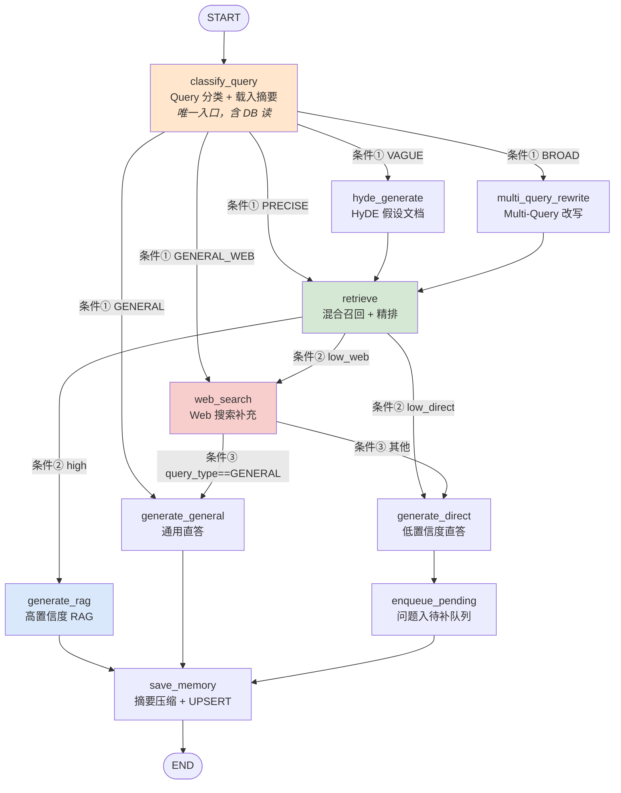
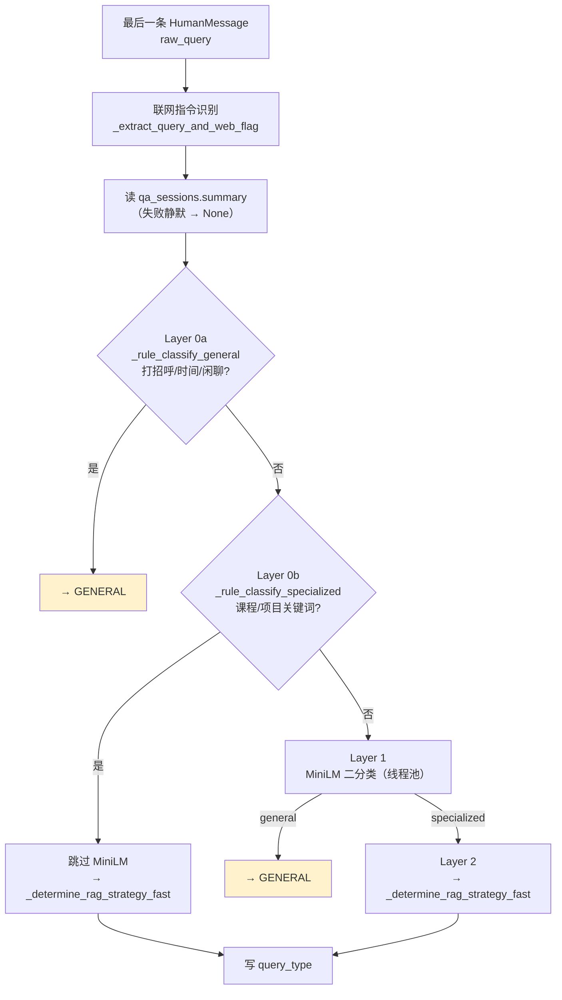
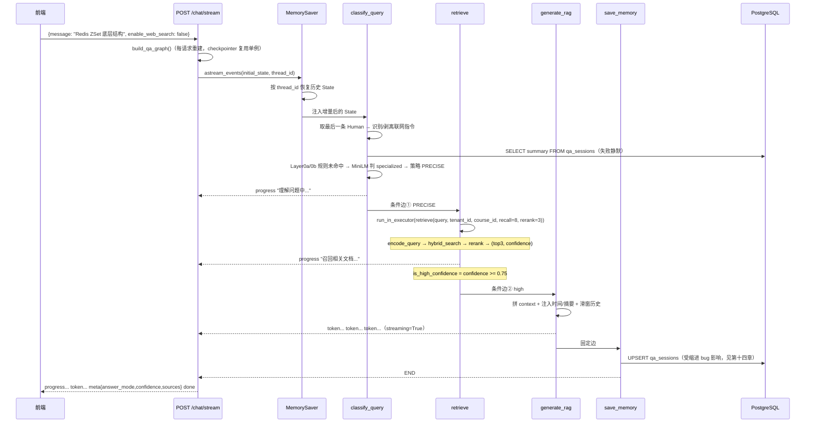

# 智能问答 Agent（QA）架构与实现详解

> 代码位置：`backend/agents/qa/` + `backend/api/v1/qa.py`
> 关联数据表：`qa_sessions` / `knowledge_pending_queue`
> 依赖公共层：`core/reranker.py` · `core/knowledge_base.py` · `core/query_classifier.py` · `core/memory.py` · `mcp/client.py`
> 文档版本：基于当前 `dev` 分支代码

---

## 一、一句话定位

把学员的一句自然语言提问判成「闲聊 / 精确 / 模糊 / 宽泛」四类，再分别走「直答 / 直接检索 / HyDE 扩充后检索 / Multi-Query 改写后并行检索」四条路径；检索结果经 BGE-Reranker 精排，取 Top-1 分数作为置信度 —— **≥ 0.75 走高置信度 RAG 生成，< 0.75 走 Web 搜索或 LLM 直答兜底**，同时把答不上来的问题写进 `knowledge_pending_queue` 交给教师补料。

与另外三个 Agent 最大的区别：**它是唯一一条「检索增强 + 多级降级」的流水线，也是唯一在 Agent 内部对 Query 做分类/改写、并把「检索质量」当作一等公民（confidence → 路由分支）的 Agent**。它不依赖 DB 题库、不生成报告、状态机极浅，但外部依赖最多（Milvus / BGE-M3 / BGE-Reranker / MiniLM / Web Search MCP / LLM），设计重心在「**Query 分流 + 混合检索 + 分层兜底**」三件事上。

---

## 二、文件职责

| 文件 | 行数 | 职责 |
|------|------|------|
| `state.py` | 46 | 定义唯一的 `QAState` TypedDict（15 个字段），本 Agent 全部状态契约 |
| `graph.py` | 143 | 组装 `StateGraph`，注册 10 个节点 + 3 个条件路由函数，编译时挂 `MemorySaver` |
| `nodes.py` | 899 | 全部业务逻辑：10 个节点 + 分类规则集 + 联网指令识别 + 时间注入等工具函数 |
| `prompts.py` | 135 | 7 个提示词常量（系统人设 / 策略判定 / HyDE / Multi-Query / RAG 生成 / 直答 / 通用问答） |
| `backend/api/v1/qa.py` | 252 | 3 个端点：`POST /chat`、`POST /chat/stream`（SSE）、`GET /sessions/{id}/history` |
| `core/reranker.py` | 186 | `BGEReranker` 精排 + `retrieve()` 一体化 Pipeline（QA 检索链路的实际入口） |
| `core/knowledge_base.py` | 407 | `BGEMEmbedder`（BGE-M3 双输出）+ `KnowledgeBaseClient._hybrid_search`（Milvus 混合检索） |
| `core/query_classifier.py` | 397 | MiniLM 微调模型 general / specialized 二分类器 |
| `mcp/client.py` | 188 | 通用 MCP 工具调用客户端（QA 只用其中的 `web_search` 一个工具） |

> 目录内没有 `__init__.py`，四个文件靠 `backend.agents.qa.xxx` 包路径直接 import。

---

## 三、State 数据契约（15 个字段）

定义在 `state.py:9-46`，跨轮由 `MemorySaver` 持久化。**只有 `messages` 带 reducer**（`add_messages`，追加不覆盖），其余字段全是「后写覆盖前写」的普通 channel。

### 3.1 消息历史

| 字段 | 类型 | 说明 |
|------|------|------|
| `messages` | `Annotated[list[BaseMessage], add_messages]` | 完整对话历史，唯一带 reducer 的字段 |

### 3.2 请求上下文（Orchestrator / API 注入，节点只读）

| 字段 | 类型 | 说明 |
|------|------|------|
| `student_id` | `str` | 学员 ID，用于拼 `thread_id` 与 `knowledge_pending_queue.student_id` |
| `tenant_id` | `str` | 租户 ID，Milvus filter 的第一条件（多租户隔离） |
| `session_id` | `str` | 会话 ID，与 `student_id` 一起拼 `thread_id` |
| `course_id` | `Optional[str]` | 课程 ID；`None` = 全库检索，非空则追加 `course_id == "..."` 过滤 |

### 3.3 Query 处理中间结果

| 字段 | 类型 | 说明 |
|------|------|------|
| `original_query` | `str` | 用户原始输入（联网指令已剥离），全程不变 |
| `query_type` | `str` | `GENERAL` / `PRECISE` / `VAGUE` / `BROAD`，决定路由分支 |
| `rewritten_queries` | `list[str]` | BROAD：Multi-Query 改写出的子 Query 列表 |
| `hyde_document` | `Optional[str]` | VAGUE：HyDE 生成的假设文档文本 |

### 3.4 检索与精排结果

| 字段 | 类型 | 说明 |
|------|------|------|
| `ranked_chunks` | `list[dict]` | 精排后 Top-K chunk，每项 `{content, score, metadata}` |
| `confidence` | `float` | 精排置信度 = Top-1 chunk 的 BGE 分数 [0, 1] |
| `is_high_confidence` | `bool` | `confidence >= 0.75`（阈值硬编码在 `nodes.py:468`） |
| `web_search_results` | `list[dict]` | Web Search MCP 返回结果（低置信度或 GENERAL_WEB 时填充） |

> 中间向量**不进 State**：BGE-M3 编码发生在 `retrieve()` 内部（`reranker.py:159-160`），State 从不需要承载 1024 维向量。

### 3.5 生成结果与控制标记

| 字段 | 类型 | 说明 |
|------|------|------|
| `answer` | `str` | 最终回答文本（含来源标注 / 免责提示） |
| `sources` | `list[str]` | 来源标注：RAG 时是 `source_name`，Web 时是 URL |
| `answer_mode` | `str` | 实际 4 种取值：`rag` / `web_augmented` / `llm_direct` / `general`（**`state.py:41` 注释只写 2 种，是陈旧注释**，见 14.10） |
| `existing_summary` | `Optional[str]` | 当前会话历史摘要，每轮从 `qa_sessions` 读出 |
| `should_summarize` | `bool` | 是否触发摘要压缩 |
| `enable_web_search` | `bool` | 低置信度时是否先走 Web Search 再兜底 |
| `fallback_used` | `bool` | 是否触发降级（**QA 图内无任何节点写入**，见 14.2） |
| `structured_output` | `Optional[dict]` | 给 API / Orchestrator 读的结构化摘要（answer + sources + confidence + answer_mode） |

### 3.6 枚举与常量清单

**`query_type` 的 4 个取值**（无 Enum 类，散落为字符串字面量）：

| 取值 | 语义 | 触发条件（任一层命中即定） |
|------|------|--------------------------|
| `GENERAL` | 闲聊 / 打招呼 / 问时间 / 自我介绍类 | 规则精确或关键词命中，或 MiniLM 判 general |
| `PRECISE` | 表达明确、含具体技术点 | 规则默认档 / LLM 策略判定 / 一切兜底 |
| `VAGUE` | 模糊、只给宽泛意图 | 规则 VAGUE（长度 ≤ 6 且命中模糊词）或 LLM 判 VAGUE |
| `BROAD` | 范围过宽 / 需拆多子问题 | 规则命中宽泛词 或 LLM 判 BROAD |

**检索相关常量**（`nodes.py:33-37`）：

```python
MAX_BROAD_QUERIES      = 3    # BROAD 分支最多并行的子 Query 数
RECALL_TOP_K_PRECISE   = 8    # PRECISE：直接检索召回数
RECALL_TOP_K_VAGUE     = 10   # VAGUE：HyDE 语义扩充后多召回些
RECALL_TOP_K_BROAD_PER = 4    # BROAD：每个子 Query 的召回数
RERANK_TOP_K           = 3    # 精排后保留的最终 chunk 数
```

**公共层常量**：

| 常量 | 位置 | 值 | 含义 |
|------|------|----|------|
| `GENERAL_CONFIDENCE_THRESHOLD` | `query_classifier.py:22` | `0.85` | `P(general)` 达此值才判 general（宁多走一 RAG） |
| `ANN_EF` | `knowledge_base.py:201` | `64` | HNSW 检索候选集大小 |
| `VECTOR_TOP_K` | `knowledge_base.py:273` | `10` | 类属性，**未被 `_hybrid_search` 使用**（它用入参 `top_k`） |
| `RERANK_MAX_INPUT_CHARS` | `reranker.py:13` | `512` | CrossEncoder 输入截断长度，对齐 `max_length=512` |
| 高置信度阈值 | `nodes.py:468` | `0.75` | 硬编码，未抽成常量或配置项 |

---

## 四、图拓扑

### 4.1 节点与边（`graph.py:69-129`）



- **10 个节点**：`classify_query` / `hyde_generate` / `multi_query_rewrite` / `retrieve` / `generate_rag` / `web_search` / `generate_direct` / `generate_general` / `enqueue_pending` / `save_memory`
- **3 组条件边** + 8 条固定边
- **`web_search` 是唯一被两条路径共用的节点**（GENERAL_WEB 与 low_web），所以它的出口必须再判一次来路 —— 这就是条件③存在的唯一理由
- **两条收尾路径**：`generate_rag` / `generate_general` 直接进 `save_memory`；`generate_direct` 先过 `enqueue_pending` 再进 `save_memory`。**只有低置信度直答才会入待补队列**

### 4.2 三个条件路由函数

**条件① `_route_by_query_type`（`graph.py:21-32`）**

```python
qt = state.get("query_type", "PRECISE").upper()
if qt == "GENERAL" and state.get("enable_web_search", False):
    return "GENERAL_WEB"      # 闲聊类 + 开了联网 → 先搜再说
return qt                     # GENERAL / PRECISE / VAGUE / BROAD 原样返回
```

> `GENERAL` 是「叠加态」：返回串 `GENERAL` 映射到 `generate_general`，而 `GENERAL_WEB` 是另造的 label。字典（`graph.py:90-96`）必须同时给出这两个键，否则运行期会报「目标节点不存在」。

**条件② `_route_by_confidence`（`graph.py:35-48`）**：`is_high_confidence` → `high`；否则 `enable_web_search` → `low_web`，再否则 → `low_direct`。

**条件③ `_route_after_web_search`（`graph.py:51-59`）**：用 `query_type` 回判来路，`GENERAL` → `generate_general`，其余 → `generate_direct`。

### 4.3 条件边映射表（汇总）

| 条件边 | 路由函数 | 分支取值 → 目标节点 |
|--------|---------|--------------------|
| `classify_query` 出口 | `_route_by_query_type` | `GENERAL_WEB`→`web_search`；`GENERAL`→`generate_general`；`PRECISE`→`retrieve`；`VAGUE`→`hyde_generate`；`BROAD`→`multi_query_rewrite` |
| `retrieve` 出口 | `_route_by_confidence` | `high`→`generate_rag`；`low_web`→`web_search`；`low_direct`→`generate_direct` |
| `web_search` 出口 | `_route_after_web_search` | `generate_general`→`generate_general`；`generate_direct`→`generate_direct` |

**固定边**（`graph.py:84,100-101,125-129`）：`START → classify_query`；`hyde_generate → retrieve`；`multi_query_rewrite → retrieve`；`generate_rag → save_memory`；`generate_general → save_memory`；`generate_direct → enqueue_pending → save_memory → END`。

### 4.4 编译与 Checkpointer（`graph.py:131-133`）

```python
checkpointer = get_memory_saver("qa")   # 按 Agent 隔离的 MemorySaver
return builder.compile(checkpointer=checkpointer)
```

`get_memory_saver("qa")`（`memory.py:17-33`）返回**进程内全局单例**，因此尽管 `build_qa_graph()` 每次调用都重建图对象，**checkpointer 指向的存储始终是同一个**，多轮历史不会因重建图而丢失（详见 14.6）。`graph.py:136-143` 的 `__main__` 会把图渲染成 `qa.png`：`python -m backend.agents.qa.graph`。

---

## 五、核心机制一：意图分类与查询分流

全部逻辑在 `classify_query_node`（`nodes.py:222-302`）内。它同时承担「载入历史摘要」的副作用（源码里本应独立的 `load_memory` 节点被合并了进来）。

### 5.1 四层判定链（自上而下，命中即返回）



| 层 | 实现 | 判据 | 成本 |
|----|------|------|------|
| 0a 规则 → GENERAL | `_rule_classify_general`（`nodes.py:160-165`） | 精确匹配 `_GENERAL_EXACT`（25 词）或包含 `_GENERAL_KEYWORDS`（24 词）任一 | ~0 |
| 0b 规则 → 专业 | `_rule_classify_specialized`（`nodes.py:169-172`） | 含 `_SPECIALIZED_KEYWORDS`（课程/实战/项目/老师/章节/训练营…）任一 → **跳过 MiniLM** | ~0 |
| 1 MiniLM 二分类 | `get_query_classifier().classify`（`nodes.py:282-293`） | `P(general) >= 0.85` → GENERAL，否则 specialized | 一次 CPU 前向（≤128 token） |
| 2 策略判定 | `_determine_rag_strategy_fast`（`nodes.py:199-211`） | 见 5.2 | 0 ~ 1 次 LLM |

**Layer 1 用线程池包装**（MiniLM 是同步 CPU 推理，直接调用会阻塞事件循环；`run_in_executor` 丢默认 `ThreadPoolExecutor`）：

```python
# nodes.py:282-285
loop = asyncio.get_running_loop()
label, confidence = await loop.run_in_executor(None, get_query_classifier().classify, original_query)
```

> **与 README 描述的区别**：README 说「MiniLM 意图识别」负责跨 Agent 路由，**已不是现状**。跨 Agent 路由由 `api/v1/unified_chat.py` 的 `get_llm("intent")` 完成；本处 MiniLM 只做 QA 内部 general / specialized 二分类。

### 5.2 检索策略判定：规则快判 + LLM 校正

```python
# nodes.py:199-211  _determine_rag_strategy_fast
strategy = _fast_rag_strategy(query)            # ① 规则快判（< 1ms）
if strategy == "PRECISE":
    return strategy                              # 规则判 PRECISE → 不调 LLM
if len(query.strip()) >= 18:
    return await _determine_rag_strategy(query)  # ② 规则判 VAGUE/BROAD 且较长 → LLM 校正
return strategy                                  # ③ 极短 → 相信规则
```

规则快判 `_fast_rag_strategy`（`nodes.py:174-181`）：`len(q) <= 6` 且命中模糊词 → `VAGUE`；命中宽泛词（不限长度）→ `BROAD`；否则 `PRECISE`。LLM 校正 `_determine_rag_strategy`（`nodes.py:184-196`）走 `get_llm("qa", temperature=0)` + `RAG_STRATEGY_PROMPT`，只接受三选一，否则兜底 `PRECISE`。

> **⚠️ 逻辑陷阱**（见 14.7）：规则判 VAGUE 的前提是 `len ≤ 6`，LLM 校正的前提是 `len ≥ 18`，两者互斥 → **VAGUE 分支的 LLM 校正永不执行**；长度 > 6 的模糊长句会一路落到 `PRECISE`。

### 5.3 四类 query_type 的检索参数对照

| query_type | 预处理节点 | 检索 Query 文本 | recall_top_k | rerank_top_k | 是否并行 |
|-----------|-----------|----------------|-------------|-------------|---------|
| `PRECISE` | 无 | `original_query` | 8 | 3 | 单路 |
| `VAGUE` | `hyde_generate` | `hyde_document`（缺则回退原 query） | 10 | 3 | 单路 |
| `BROAD` | `multi_query_rewrite` | 每个子 Query 各自检索 | 每路 4 | 3（合并后截断） | 最多 3 路并行 |
| `GENERAL` | 无（跳过检索） | — | — | — | — |

### 5.4 联网指令的识别与剥离

`_extract_query_and_web_flag`（`nodes.py:92-119`）返回 `(清洗后的问题, 是否启用联网)`。

**识别**：命中 `_WEB_SEARCH_HINTS`（`nodes.py:87-90`，含「联网 / 上网搜 / 帮我搜 / 百度一下 / 谷歌一下」等 11 个）任意一个即置位。

**剥离**：用一条正则把尾缀指令（「…如果不知道可以联网搜索」）从问题中去掉，防止被 LLM 当作问题内容：

```python
# nodes.py:112-119
clean = re.sub(
    r'[，,。.？?！!\s]*(?:如果不知道|不知道的话|不清楚|你可以)'
    r'?\s*(?:可以)?(?:联网|上网|网上)?(?:查询|搜索|搜一下|查一查|百度|谷歌).*$',
    '', raw,
).strip()
return (clean or raw), True     # 清洗后为空则回退原文，避免把问题清空
```

例：`"AI是什么，如果不知道可以联网搜索"` → `("AI 是什么", True)`。

**写入 State**（`nodes.py:266-268`）：只有「识别到联网 且 上一轮未开启」时才写 `enable_web_search=True` —— **只置 True，从不置 False**，默认值由 API 层 `req.enable_web_search` 决定。

### 5.5 节点的固定返回值

无论走哪条分支，都带上前缀 `_base`（`nodes.py:260-265`）：

```python
_base = {
    "original_query":    original_query,     # 已剥离联网指令
    "existing_summary":  existing_summary,   # 已从 DB 读出
    "rewritten_queries": [],                  # 每轮重置，防上一轮脏数据
    "hyde_document":     None,
}
```

刻意设计：`rewritten_queries` / `hyde_document` **不是持久化语义字段，而是单轮中间产物**，必须入口清空，否则 `retrieve_node` 会读到上一轮残留。

---

## 六、核心机制二：RAG 检索链路

链路一览：`query 文本 → BGEMEmbedder.encode_query（dense+sparse 双输出）→ Milvus hybrid_search → Reranker 精排 → Top-3 + confidence`。入口是 `retrieve()`（`reranker.py:132-178`），**QA 直接进程内调用，不经过任何 MCP**。

### 6.1 BGE-M3 双输出（`knowledge_base.py:20-127`）

`BGEMEmbedder.get_instance()` 是进程内单例（权重在 `models/`，`.gitignore` 忽略）。`encode_query(text)` 内部调 `encode([text], batch_size=1)`：

```python
output = self._model.encode(texts, batch_size=batch_size, max_length=8192,
                            return_dense=True, return_sparse=True, return_colbert_vecs=False)
dense_vecs  = output["dense_vecs"].tolist()
sparse_vecs = [{int(k): float(v) for k, v in d.items()} for d in output["lexical_weights"]]
```

两个已知约束：① **sparse 必须转 Python `float`**（`knowledge_base.py:107-111` 注释）—— `msgpack`（MemorySaver 序列化器）不支持 `numpy.float16`；② **fp16 仅在 CUDA 开启**（`knowledge_base.py:55-66`），MPS 在 BGE-M3 attention 上会触发 LLVM ERROR，CPU 用 fp32。

### 6.2 Milvus 混合检索（`knowledge_base.py:275-364`）

单 Collection `knowledge_domain`，两路 ANN 请求 + 服务端加权融合：

| 路 | `anns_field` | `metric_type` | 额外 param | `limit` | 含义 |
|----|-------------|---------------|-----------|---------|------|
| Dense（语义） | `embedding` | `COSINE` | `{"ef": 64}` | `top_k` | BGE-M3 稠密向量，L2 归一化后 COSINE 等价余弦 |
| Sparse（关键词） | `sparse_embedding` | `IP` | — | `top_k` | BGE-M3 lexical_weights，内积为标准度量 |

```python
# knowledge_base.py:332-338
results = self._client.hybrid_search(
    collection_name=COLLECTION_NAME,
    reqs=[dense_req, sparse_req],
    ranker=WeightedRanker(0.7, 0.3),   # 0.7 给 Dense，0.3 给 Sparse
    limit=top_k, output_fields=output_fields,
)
```

三个要点：① **`WeightedRanker` 权重顺序与 `reqs` 顺序一一对应**；② `output_fields` 只取 6 个展示/过滤小字段（`content / source_name / chunk_type / course_id / document_id / chunk_index`），**不取 `embedding`**；③ **返回的 `score` 是融合排序信号、不是概率**（`knowledge_base.py:296` 注释），置信度必须由 Reranker 重新打分。整个 hybrid_search 包在 `try/except` 里，**Milvus 异常返回 `[]`**（`knowledge_base.py:362-364`），最终导向低置信度路径。

### 6.3 多租户 / 课程过滤（`knowledge_base.py:366-377`）

```python
safe_tenant = tenant_id.replace('"', '\\"')          # 转义防 filter 表达式注入
expr = f'tenant_id == "{safe_tenant}"'
if course_id:
    expr += f' and course_id == "{course_id.replace(chr(34), chr(92)+chr(34))}"'
return expr
```

`course_id` 为 `None` 时不追加条件 → 全库检索（跨课程）。

### 6.4 Reranker 精排与 confidence（`reranker.py:69-127`）

```python
pairs  = [(query, (doc.get("content") or "")[:RERANK_MAX_INPUT_CHARS]) for doc in documents]
scores = self._model.predict(pairs).tolist()   # CrossEncoder 默认 sigmoid → 直接是 [0,1] 概率
ranked = sorted([RankedDocument(...) for i in range(len(documents))], key=lambda x: x.score, reverse=True)
confidence = ranked[:top_k][0].score if ranked else 0.0
```

- `BGEReranker.get_instance()` 也是进程内单例；**本地目录缺失时回退 HuggingFace `BAAI/bge-reranker-v2-m3`**（`reranker.py:48-54`）。
- 文档截断到 512 字符，与 `CrossEncoder(max_length=512)` 对齐。
- **confidence 就是 Top-1 的 BGE 相关性概率**，无需归一化。

### 6.5 0.75 阈值与三分支（`nodes.py:467-468`）

```python
confidence = ranked_chunks[0]["score"] if ranked_chunks else 0.0
is_high_confidence = confidence >= 0.75
```

| confidence | is_high_confidence | 后续 |
|-----------|-------------------|------|
| ≥ 0.75 | `True` | `generate_rag`（严格基于知识库） |
| < 0.75 且开联网 | `False` | `web_search` → `generate_direct`（web_augmented） |
| < 0.75 且未开联网 | `False` | `generate_direct`（llm_direct，附免责提示） |

### 6.6 三条检索路径的组装、并行与合并

**PRECISE / VAGUE（单路）**（`nodes.py:436-452`）：VAGUE 用 `hyde_document` 作检索文本 + `recall_top_k=10`；否则用 `original_query` + `8`。同样经 `loop.run_in_executor(None, lambda: retrieve(...))` 包装。

**BROAD（多路并行 + 合并去重）**（`nodes.py:408-433`）：

```python
broad_queries = state["rewritten_queries"][:MAX_BROAD_QUERIES]   # 最多 3 个子 query
async def retrieve_one(sub_query: str):
    return await loop.run_in_executor(None, lambda: retrieve(
        sub_query, tenant_id, course_id, recall_top_k=RECALL_TOP_K_BROAD_PER, rerank_top_k=RERANK_TOP_K))

results = await asyncio.gather(*[retrieve_one(q) for q in broad_queries])

# 合并去重：content 前 100 字符为 key，同一内容保留最高分
seen: dict[str, RankedDocument] = {}
for ranked_docs, _ in results:
    for doc in ranked_docs:
        key = doc.content[:100]
        if key not in seen or doc.score > seen[key].score:
            seen[key] = doc
merged = sorted(seen.values(), key=lambda x: x.score, reverse=True)[:RERANK_TOP_K]
```

三个设计点：① **去重键是内容前 100 字符**（不是 `id`），能容忍同一 chunk 被不同子 Query 召回，但对「前 100 字相同、后面不同」的两个 chunk 会误判为同一个 —— 属可接受的近似；② **同 key 保留最高分**而非取平均，让「某个子 Query 高度命中」的信号不被稀释；③ 合并后再 `[:RERANK_TOP_K]`，所以 BROAD 召回面变宽、**喂给 LLM 的量不变**。

**同步函数如何包 `run_in_executor`**：`retrieve()` 是同步函数（BGE-M3 阻塞推理 + Milvus 阻塞 IO），三处调用点（`nodes.py:411-421`、`nodes.py:443-452`）全部用 `loop.run_in_executor(None, lambda: retrieve(...))` 包装，避免阻塞事件循环；BROAD 下 `asyncio.gather` 会把最多 3 个任务并发投到默认线程池。

### 6.7 结果转换与 State 写入（`nodes.py:458-482`）

`RankedDocument`（dataclass）**必须转 dict 才能进 State**（LangGraph channel 只接受可序列化结构）：

```python
ranked_chunks = [{"content": d.content, "score": d.score, "metadata": d.metadata} for d in merged]
return {"ranked_chunks": ranked_chunks, "confidence": confidence, "is_high_confidence": is_high_confidence}
```

---

## 七、单轮执行时序

以「学员提一个专业问题、命中检索、走完 RAG」为例（`POST /api/v1/qa/chat/stream`）：



**关键顺序**：`classify_query` 是唯一入口且**内联了 DB 读摘要**，因此每轮第一个真实动作是一次 `SELECT`；`retrieve` 之后的路由**完全由 `confidence` 决定**，与 `query_type` 无关 —— 一个 PRECISE 问题若检索质量差，同样会掉进 `low_web` / `low_direct` 分支。

---

## 八、10 个节点逐一详解

### 8.1 classify_query_node — Query 分类 + 载入摘要（`nodes.py:222-302`）

| 项 | 内容 |
|----|------|
| ① 职责 | 取最后一条 HumanMessage → 联网识别/剥离 → 读 `qa_sessions.summary` → 四层分类 → 写 `query_type` |
| ② 读 State | `messages`, `student_id`, `session_id`, `enable_web_search` |
| ③ 写 State | `original_query`, `query_type`, `existing_summary`, `rewritten_queries=[]`, `hyde_document=None`，可选 `enable_web_search=True` |
| ⑥ LLM | 仅 Layer 2 且规则判 VAGUE/BROAD 且长度 ≥ 18 时调 `get_llm("qa", temperature=0)`（实际 VAGUE 不可达） |
| ⑦ 降级 | DB 读摘要失败 → warning + `existing_summary=None`；LLM 策略失败 → `PRECISE` |

④ 步骤：倒序扫 `messages` 取最后一条 `HumanMessage`（`nodes.py:235-240`）→ 识别/剥离联网指令 → 独立开 `AsyncSessionLocal()` 读 summary（整段 try/except）→ 构造 `_base` → 自动联网置位 → 依次过 Layer 0a → 0b → 1 → 2，命中即 `return {**_base, "query_type": ...}`。⑤ 关键片段见 5.1/5.4/5.5。

> `nodes.py:214-220` 有**两段完全重复的注释标题**，是删掉旧 `load_memory` 节点后留下的排版残迹。

---

### 8.2 hyde_generate_node — HyDE 假设文档生成（`nodes.py:309-334`）

| 项 | 内容 |
|----|------|
| ① 职责 | 针对 VAGUE 模糊 Query，让 LLM 生成一段「假设性技术文档」，用该文档向量代替原 Query 向量去检索 |
| ② 读 State | `original_query`, `messages` |
| ③ 写 State | `hyde_document` |
| ⑥ LLM | `get_llm("qa", temperature=0.3)`（**全场最高温**：要多样性以覆盖更多语义，但不能偏离主题） |
| ⑦ 降级 | **无 try/except**：LLM 异常直接冒泡到调用方（见 14.13） |

④ 步骤：取 `original_query` → `_format_history_for_prompt(messages[-6:])`（最近 3 轮）→ `HYDE_PROMPT.format(...)` → 调 LLM → `.strip()` 写 `hyde_document`。⑤ Prompt 要求输出 150-300 字专业文档片段、**不得含「假设/可能」等不确定语气**（因为要直接当检索向量源）。

---

### 8.3 multi_query_rewrite_node — Multi-Query 改写（`nodes.py:340-379`）

| 项 | 内容 |
|----|------|
| ① 职责 | 针对宽泛 Query，改写成最多 3 个具体子 Query，供 `retrieve` 并行检索 |
| ② 读 State | `original_query`, `messages` |
| ③ 写 State | `rewritten_queries` |
| ⑥ LLM | `get_llm("qa", temperature=0.3)` |
| ⑦ 降级 | 解析后为空 → 回退 `[original_query]`；**LLM 调用本身无 try/except** |

④ 步骤：倒序找最后一条 `AIMessage` 作 `last_ai_text`（推断「没懂」指什么，截 500 字，`nodes.py:349-353`）→ `MULTI_QUERY_REWRITE_PROMPT.format(...)` 调 LLM → 逐行解析：

```python
# nodes.py:364-370
raw = _get_message_content(response).strip()
print(f'raw: {raw}')                                   # ← 生产代码里的裸 print
rewritten = [line.lstrip("0123456789.-）)、 ").strip()
             for line in raw.split("\n") if line.strip() and len(line.strip()) > 3][:MAX_BROAD_QUERIES]
if not rewritten:
    rewritten = [query]                                # 改写失败回退原 query
```

`lstrip` 只剥行首字符集，能处理 `1. ` / `①` / `- ` 等前缀；`len > 3` 过滤噪音行；`[:3]` 截断（Prompt 要求 3-5 个，代码只取前 3）。

---

### 8.4 retrieve_node — 混合召回 + 精排（`nodes.py:386-482`）

| 项 | 内容 |
|----|------|
| ① 职责 | 按 `query_type` 组装检索 Query，调 `retrieve()` 完成「编码 → 混合检索 → 精排」，写三个检索字段 |
| ② 读 State | `query_type`, `tenant_id`, `course_id`, `original_query`, `hyde_document`, `rewritten_queries` |
| ③ 写 State | `ranked_chunks`, `confidence`, `is_high_confidence` |
| ⑥ LLM | **不调**（纯检索 + 本地模型推理） |
| ⑦ 降级 | `retrieve()` 内部已把所有外部依赖失败收敛为「返回空候选」；空候选 → `confidence=0.0` → 低置信度分支 |

④⑤ `retrieve` 在函数内**延迟导入**（`nodes.py:398`），避免模块顶层就把 torch / transformers / pymilvus 全拉起。三条路径的组装、并行与合并细节见 6.6。

---

### 8.5 generate_rag_node — 高置信度 RAG 生成（`nodes.py:488-551`）

| 项 | 内容 |
|----|------|
| ① 职责 | 把精排 Top-3 拼成 context，让 LLM 严格基于知识库内容回答，末尾附 📚 参考来源 |
| ② 读 State | `ranked_chunks`, `original_query`, `messages`, `existing_summary`, `confidence` |
| ③ 写 State | `answer`, `sources`, `answer_mode="rag"`, `messages=[AIMessage]`, `should_summarize`, `structured_output` |
| ⑥ LLM | `get_llm("qa", streaming=True)`，temperature 默认 0 |
| ⑦ 降级 | 无 try/except（异常冒泡到 API → 500 或 Orchestrator `with_retry`） |

④ 步骤：遍历 `ranked_chunks` 拼 `【参考i】\n{content}`，按 `metadata.source_name` 去重收集 `sources`（缺省 `"课程文档"`）→ 注入 System + 滑窗历史 → 追加 RAG Prompt → 调 LLM → 拼来源标注。

⑤ 关键片段（**排除最后一条 HumanMessage**）：

```python
# nodes.py:512-523
llm_messages = [SystemMessage(content=_build_system_content(summary))]
# 最后一条 HumanMessage 已拼入 RAG_ANSWER_PROMPT 的 {query}，再传一次会让问题出现两次
windowed = trim_messages_to_window(messages[:-1], window_size=10)
for msg in windowed:
    if not isinstance(msg, SystemMessage):    # 跳过历史里的 System，避免重复
        llm_messages.append(msg)
llm_messages.append(HumanMessage(content=RAG_ANSWER_PROMPT.format(context=context_text, query=query)))
```

**系统提示词构造**（`_build_system_content`，`nodes.py:72-81`，三个生成节点共用）：

```python
content = SYSTEM_PROMPT + f"\n\n【当前时间】{_current_datetime_str()}"
if summary:
    content += f"\n\n【学员历史学习摘要】\n{summary}"
```

`_current_datetime_str()`（`nodes.py:63-70`）用中文星期表 `_WEEKDAYS_CN` 拼出 `2026年10月03日 星期六 14:30`。**时间注入是关键**：`SYSTEM_PROMPT` 本身不含时间，而「今天几号」这类问题必须靠 SystemMessage 里的时间才能答对。

---

### 8.6 web_search_node — Web 搜索补充（`nodes.py:558-587`）

| 项 | 内容 |
|----|------|
| ① 职责 | 调 Web Search MCP Server 补充互联网信息，被 GENERAL_WEB 与低置信度两条路径共用 |
| ② 读 State | `original_query` |
| ③ 写 State | `web_search_results` |
| ⑥ LLM | **不调**；调 MCP（`call_mcp_tool`，`timeout=10.0`） |
| ⑦ 降级 | 配置缺失 → 返回 `[]`；MCP 异常 / 超时 → warning + `[]`，**不阻断后续生成** |

```python
# nodes.py:569-587
if not settings.web_search_mcp_url:          # 配置缺失直接短路
    return {"web_search_results": []}
try:
    results = await call_mcp_tool(server_url=settings.web_search_mcp_url, tool_name="web_search",
                                  arguments={"query": state["original_query"], "max_results": 3}, timeout=10.0)
    return {"web_search_results": results or []}
except Exception as e:
    logger.warning("web_search.failed", error=str(e))
    return {"web_search_results": []}
```

`settings.web_search_mcp_url` 默认 `http://localhost:8000/mcp/web-search`（`config.py:59`）。**它是本 Agent 中唯一通过 MCP 的外部调用** —— 知识库检索**不走 MCP**（见 14.4）。

---

### 8.7 generate_direct_node — 低置信度 LLM 直答（`nodes.py:594-667`）

| 项 | 内容 |
|----|------|
| ① 职责 | 知识库无足够相关内容时用 LLM 参数知识回答；有 Web 结果则注入为上下文 |
| ② 读 State | `original_query`, `messages`, `existing_summary`, `web_search_results`, `confidence` |
| ③ 写 State | `answer`, `sources`, `answer_mode`（`web_augmented` / `llm_direct`）, `messages`, `should_summarize`, `structured_output` |
| ⑥ LLM | `get_llm("qa", streaming=True)`，temperature 默认 0 |
| ⑦ 降级 | 无 try/except |

④ 两条子路径（`nodes.py:636-646`）：有 `web_sources` → `answer_mode="web_augmented"`，正文不含 URL（URL 通过 `sources` 字段给前端折叠面板）；无 → `answer_mode="llm_direct"`，正文追加 `⚠️ 说明：以上为 AI 基于通用知识的回答，课程知识库中暂无相关内容…`。⑤ Web 结果格式化为 `[i] title（url）\n snippet[:300]`，拼在 `DIRECT_ANSWER_PROMPT` **之后**（`nodes.py:628`）；System + 滑窗历史处理与 `generate_rag` 一致（`messages[:-1]` + `window_size=10`）。

---

### 8.8 generate_general_node — 通用问题直答（`nodes.py:674-730`）

| 项 | 内容 |
|----|------|
| ① 职责 | 处理打招呼 / 问时间 / 闲聊；联网模式下注入搜索结果 |
| ② 读 State | `original_query`, `messages`, `web_search_results` |
| ③ 写 State | `answer`, `sources`, `answer_mode`（`general` / `web_augmented`）, `messages`, `should_summarize`, `structured_output` |
| ⑥ LLM | `get_llm("qa", streaming=True)`，temperature 默认 0 |
| ⑦ 降级 | 无 try/except |

④⑤ **与其他生成节点最大的不同**：它**不用 `SYSTEM_PROMPT`**，而是把全部上下文（时间、历史、web 结果）一次性塞进单个 `GENERAL_ANSWER_PROMPT`（`prompts.py:122-135`），以**单条 HumanMessage** 调用（`nodes.py:697-706`）。`structured_output.confidence` 硬编码为 `1.0`（`nodes.py:727`）—— 通用问题不经检索，用 1.0 表示「确定」。

> **⚠️ 潜在重复**：`messages[-6:]`（`nodes.py:696`）**含本轮刚加入的 HumanMessage**，而 prompt 又单独有 `{query}` 位 —— 当前问题会在通用回答上下文里出现两次（见 14.11）。

---

### 8.9 enqueue_pending_node — 低置信度问题入队（`nodes.py:735-770`）

| 项 | 内容 |
|----|------|
| ① 职责 | 把低置信度问题写进 `knowledge_pending_queue`，供教师审查补料（纯副作用节点） |
| ② 读 State | `tenant_id`, `original_query`, `student_id`, `confidence` |
| ③ 写 State | **无**（固定返回 `{}`） |
| ⑥ LLM | **不调** |
| ⑦ 降级 | 整段 `try/except` → warning，**不影响已生成的回答** |

```python
# nodes.py:748-753
INSERT INTO knowledge_pending_queue
    (id, tenant_id, question, student_id, confidence, status)
VALUES (:id, :tenant_id, :question, :student_id, :confidence, 'pending')
ON CONFLICT DO NOTHING
```

> 每行 `id` 都是新 `uuid4()`，而表上除主键外无唯一约束 → `ON CONFLICT DO NOTHING` **形同虚设**（见 14.8）。

---

### 8.10 save_memory_node — 记忆保存（`nodes.py:776-830`）

| 项 | 内容 |
|----|------|
| ① 职责 | 条件触发摘要压缩 + UPSERT `qa_sessions`（纯副作用节点） |
| ② 读 State | `messages`, `student_id`, `session_id`, `tenant_id`, `existing_summary`, `should_summarize` |
| ③ 写 State | **无**（固定返回 `{}`） |
| ⑥ LLM | 仅当 `should_summarize=True` 时经 `compress_to_summary` 调 `get_llm("summarize")` |
| ⑦ 降级 | 压缩失败 try/except；UPSERT 失败 try/except，均只记 warning |

```python
# nodes.py:789-803
if state.get("should_summarize", False):
    msgs_to_compress = trim_messages_to_window(messages, window_size=10)
    try:
        summary = await compress_to_summary(messages=msgs_to_compress, existing_summary=summary)
    except Exception as e:
        logger.warning("save_memory.compress_failed", error=str(e))
```

**⚠️ UPSERT 缩进 bug**：`nodes.py:806` 的 `try:` 比 `if` 多一级缩进（8 空格），使整个 UPSERT 落进 `if should_summarize:` 块内部，**只有触发摘要压缩的那一轮才写库**。

```python
# nodes.py:805-818（缩进原样保留，注意 try 前的 8 空格）
    # ── UPSERT 到 qa_sessions 表 ──────────────────────────────────
        try:                                                            # ← 8 空格！
            async with AsyncSessionLocal() as session:
                async with session.begin():
                    await session.execute(text("""
                        INSERT INTO qa_sessions
                            (id, tenant_id, student_id, thread_id, summary, summary_version)
                        VALUES (:id, :tenant_id, :student_id, :thread_id, :summary, 1)
                        ON CONFLICT (thread_id) DO UPDATE
                            SET summary = EXCLUDED.summary,
                                summary_version = qa_sessions.summary_version + 1
                    """), {...})
```

> 设计亮点（若缩进正确）：`ON CONFLICT (thread_id) DO UPDATE` **只更新 summary 与 summary_version、不碰其它列**，依赖 `qa_sessions.thread_id` 的 `UNIQUE` 约束（`_03_init_db.sql:209`）。

---

## 九、Prompt 清单（`prompts.py`）

| 常量 | 行号 | 类型 | 用途 | 使用节点 |
|------|------|------|------|---------|
| `SYSTEM_PROMPT` | 7-18 | 字符串 | 智能助教人设 + 回答规范（代码块、先结论后解释、不编造） | `generate_rag` / `generate_direct`（经 `_build_system_content`） |
| `RAG_STRATEGY_PROMPT` | 25-40 | 格式化 | 让 LLM 三选一输出 `PRECISE`/`VAGUE`/`BROAD` | `_determine_rag_strategy` |
| `HYDE_PROMPT` | 47-57 | 格式化 | 依据历史 + 当前输入生成 150-300 字假设文档 | `hyde_generate` |
| `MULTI_QUERY_REWRITE_PROMPT` | 64-81 | 格式化 | 把模糊问题改写成 3-5 个具体子问题（每行一个） | `multi_query_rewrite` |
| `RAG_ANSWER_PROMPT` | 88-100 | 格式化 | 严格基于知识库 context 回答 | `generate_rag` |
| `DIRECT_ANSWER_PROMPT` | 107-115 | 格式化 | 基于通用知识直答，不声称来自课程资料 | `generate_direct` |
| `GENERAL_ANSWER_PROMPT` | 122-135 | 格式化 | 通用问答专用（内含时间 / 历史 / web 三个占位符） | `generate_general` |

**7 个常量全部被引用**，没有像面试 Agent 那样的未使用 Prompt 常量。另有一处**不在 `prompts.py` 里的内联 Prompt**：`compress_to_summary` 里的 `SUMMARY_PROMPT`（`memory.py:144-157`）—— 定义在公共层，四个 Agent 共用，属合理例外。

---

## 十、记忆管理

**thread_id**：两个端点都用 `build_thread_id(current_user["user_id"], req.session_id)`（`qa.py:55,94,205`）→ `student_{user_id}_session_{session_id}`（`memory.py:36-47`），并手写 `config = {"configurable": {"thread_id": thread_id}}`（未用 `build_config` 便捷函数）。

**MemorySaver 隔离**：`get_memory_saver("qa")`（`memory.py:17-33`）用模块级 dict 缓存，`"qa"` 与 `"interview"` / `"exam"` 互不干扰 —— `memory.py:11-14` 注释说明原因：不同 Agent 的 State schema 不同，共用会导致 msgpack 序列化字段冲突。

**滑动窗口**（`memory.py:68-101`）：保留最近 `window_size` 轮（1 轮 = 2 条），**SystemMessage 永远保留**，不受窗口限制。QA 三处用法：

| 位置 | 调用 | window_size |
|------|------|-------------|
| `generate_rag_node` | `trim_messages_to_window(messages[:-1], 10)` | 10 轮 |
| `generate_direct_node` | `trim_messages_to_window(messages[:-1], 10)` | 10 轮 |
| `save_memory_node` | `trim_messages_to_window(messages, 10)`（**不排除最后一条**） | 10 轮 |

> `save_memory` 传完整 `messages`（不切片），因为它要压缩的是「当前已有全部对话」，不是「喂给 LLM 的上下文」。

**摘要压缩触发条件 —— 取模判断**（`memory.py:104-122`）：

```python
dialogue_count = sum(1 for m in messages if isinstance(m, (HumanMessage, AIMessage)))
return dialogue_count % (threshold * 2) == 0    # 20 的倍数
```

设计意图是**每累计 10 轮触发一次**（`% 20 == 0`）。**但 QA 的求值时机让它永不命中**：`should_trigger_summary(messages)` 在三个生成节点里调用（`nodes.py:544/660/723`），此时 `messages` = 「历史完整对话 + 当前轮 HumanMessage」= `2N - 1` 条，**恒为奇数**，`% 20 == 0` 永不成立 → QA 的 `should_summarize` 实测恒为 `False`。详见 14.5。

**增量压缩**（`memory.py:125-182`）：`compress_to_summary(messages, existing_summary)` 把旧摘要与本次新增对话一起喂给 `get_llm("summarize")`，Prompt 为「必须保留 / 选择性保留 / 可以丢弃」三档。传旧摘要是为了**防止已记录内容被重复写入** —— 这是「增量」的关键。

**save_memory 落库**：见 8.10。压缩与落库都包了 try/except，任何一步失败都只记 warning，绝不让记忆保存影响已返回的回答。

---

## 十一、API 层（`backend/api/v1/qa.py`）

路由注册：`api_router.include_router(qa.router, prefix="/qa", tags=["智能问答"])`（`router.py:12`），业务前缀挂在 `/api/v1` 下 → 实际路径 `/api/v1/qa/*`。

### 11.1 端点总览

| 方法 | 路径 | 说明 | 流式 |
|------|------|------|------|
| POST | `/api/v1/qa/chat` | 发消息，同步等完整回答 | 否 |
| POST | `/api/v1/qa/chat/stream` | 同上入参，SSE 逐 token 推送 | 是 |
| GET | `/api/v1/qa/sessions/{session_id}/history` | 取会话历史消息 + 摘要 | 否 |

**鉴权**：三个端点全部 `Depends(get_current_user)`（`dependencies.py:42-73`），返回 `{"user_id", "role", "tenant_id"}`；Token 无效抛 401。

**请求** `ChatRequest`（`qa.py:20-24`）：`session_id`（必填）、`course_id`（可选）、`message`（1-2000 字）、`enable_web_search`（默认 `False`）。
**响应** `ChatResponse`：`session_id` / `answer` / `answer_mode`（缺省 `"llm_direct"`）/ `confidence`（缺省 `0.0`）/ `sources` / `fallback_used`（缺省 `False`）。
**历史响应** `HistoryResponse`：`session_id` / `messages`（`role` + `content` + `created_at`，但 `created_at` 恒为空串）/ `summary` / `total_turns`。

### 11.2 `POST /chat`（`qa.py:48-85`）

```python
graph     = build_qa_graph()                                  # 每次请求重建图
thread_id = build_thread_id(current_user["user_id"], req.session_id)
initial_state = {
    "messages":           [HumanMessage(content=req.message)],
    "student_id":         current_user["user_id"],
    "tenant_id":          current_user["tenant_id"],
    "session_id":         req.session_id,
    "course_id":          req.course_id,
    "query_type":         "PRECISE",      # 占位初始值，classify_query_node 内部会动态覆盖
    "enable_web_search":  req.enable_web_search,
    "web_search_results": [],             # 每轮重置，防上轮搜索结果污染本轮 sources
}
config = {"configurable": {"thread_id": thread_id}}
try:
    result = await graph.ainvoke(initial_state, config=config)
except Exception as e:
    logger.error("chat.invoke_error", error=str(e), exc_info=True)
    raise HTTPException(500, detail={"code": "AGENT_ERROR", "message": str(e)})
```

> **initial_state 只传 8 个字段**，远少于 `QAState` 的 15 个。这不是缺陷：LangGraph 允许部分初始化，节点用 `.get(...)` 读缺失字段，`MemorySaver` 会按 `thread_id` 把上一轮写入的字段带回。与面试 Agent（首轮必须传全量 22 字段）不同 —— QA 节点全部对缺字段容错。

### 11.3 SSE 流式（`qa.py:87-192`）

```python
_GENERATE_NODES = {"generate_rag", "generate_direct", "generate_general"}
_PROGRESS_LABELS = {
    "classify_query": "理解问题中...",      "hyde_generate":       "理解问题中...",
    "multi_query_rewrite": "改写查询中...", "retrieve":            "召回相关文档...",
    "web_search": "搜索互联网...",          "generate_general":    "思考中...",
}
```

**事件类型清单**（共 5 类）：

| 事件 `type` | 触发时机 | 字段 |
|------------|---------|------|
| `progress` | `on_chain_start` 且 node ∈ `_PROGRESS_LABELS` | `stage` |
| `token` | `on_chat_model_stream` 且 node ∈ `_GENERATE_NODES` | `content` |
| `meta` | 流结束后一次性推送 | `session_id` / `answer_mode` / `confidence` / `sources` |
| `done` | 最后 | 无 |
| `error` | 任意异常 | `message`（统一文案「流式输出异常，请使用普通接口重试」） |

**token 级过滤哪些节点**：`_GENERATE_NODES` 只有三个「对用户说话」的节点。`classify_query` / `hyde_generate` / `multi_query_rewrite` / `retrieve` 里的 LLM 输出（策略判定文本、假设文档、改写子问题）**全部对前端隐藏** —— 和面试 Agent 同款的关键设计。

**progress 事件**：只覆盖 6 个节点。`generate_rag` 与 `generate_direct` **不在进度表里**（直接推 token）；`generate_general` 同时在进度表和 `_GENERATE_NODES` 里（先推「思考中...」再推 token）。

**meta 字段回填**（`qa.py:154-165`）：在 `on_chain_end` 且 node ∈ `_GENERATE_NODES` 时读 `output.answer_mode`（仅非空时覆盖，防被后续空值冲掉）、`output.sources`（允许写空列表）、`output.structured_output.confidence`。`answer_mode` 初值来自 `event_generator` 顶部的 `answer_mode = "llm_direct"`（`qa.py:122`）。

### 11.4 `GET /sessions/{id}/history`（`qa.py:194-251`）

① 从 `qa_sessions` 读 `summary`（带 `AND student_id = :sid` 做归属校验），DB 异常 → warning + `None`；② 从 `MemorySaver` 读消息：`graph.aget_state(config)` → `state.values["messages"]`，`total_turns` = role 为 `user` 的条数。

> ②依赖**进程内 MemorySaver**，后端重启后历史为空；而 ①的 `summary` 又因 `save_memory` 缩进 bug 几乎不落库 —— 两者叠加导致该端点在正常使用下**大概率返回空历史 + 空摘要**。

---

## 十二、数据库表

### 12.1 `qa_sessions`（`scripts/_03_init_db.sql:205-217`）

| 列 | 类型 | 说明 |
|----|------|------|
| `id` | UUID PK | 默认 `uuid_generate_v4()`；UPSERT 时显式传新 `uuid4()`，冲突时该值被丢弃 |
| `tenant_id` | VARCHAR(64) | 默认 `tenant_default` |
| `student_id` | UUID → users(id) | |
| `thread_id` | VARCHAR(128) **NOT NULL UNIQUE** | `student_x_session_y`，**UPSERT 的冲突键** |
| `summary` | TEXT | 对话摘要（增量压缩结果） |
| `summary_version` | INT NOT NULL DEFAULT 0 | 压缩次数；UPSERT 冲突时 `+1`（初始 INSERT 硬编码 1） |
| `created_at` / `updated_at` | TIMESTAMPTZ | `updated_at` 由触发器自动维护 |

索引：`tenant_id` / `student_id` / `thread_id` 三个单列索引。

> 这张表**没有 `course_id`、没有 `status`、没有消息原文** —— 它只存摘要。消息原文完全依赖 `MemorySaver`（进程内）。

### 12.2 `knowledge_pending_queue`（`scripts/_03_init_db.sql:32-45`）

| 列 | 类型 | 说明 |
|----|------|------|
| `id` | UUID PK | 默认 `uuid_generate_v4()`；节点显式传 `uuid4()` |
| `tenant_id` | VARCHAR(64) | 默认 `tenant_default` |
| `question` | TEXT NOT NULL | 学员问题原文（`original_query`，已剥离联网指令） |
| `student_id` | UUID → users(id) | 提问学员 |
| `confidence` | FLOAT NOT NULL | 写入时的精排置信度（`state.get("confidence", 0.0)`） |
| `status` | VARCHAR(16) DEFAULT `'pending'` | CHECK ∈ (`pending`, `resolved`, `dismissed`)；节点固定写 `'pending'` |
| `resolved_by` | UUID → users(id) | 教师标记处理者 |
| `resolved_at` | TIMESTAMPTZ | 处理时间 |
| `created_at` | TIMESTAMPTZ DEFAULT NOW() | |

索引：`tenant_id` / `status`。

> **表中没有唯一约束**（除主键 `id`），因此 `enqueue_pending` 的 `ON CONFLICT DO NOTHING` 没有可冲突的目标（见 14.8）。

---

## 十三、降级与容错

| 环节 | 失败场景 | 兜底行为 | 代码位置 |
|------|---------|---------|---------|
| 读历史摘要 | DB 异常 / 无行 | warning，`existing_summary=None`，不影响分类 | `nodes.py:257-258` |
| 联网指令识别 | 正则清洗后为空 | `(clean or raw)` 回退原文 | `nodes.py:119` |
| LLM 策略判定 | 调用异常 / 输出非法 | warning，兜底 `PRECISE` | `nodes.py:194-196` |
| MiniLM 分类 | 标签名不匹配 | warning，保守返回 `("specialized", 0.5)` | `query_classifier.py:322-325` |
| BGE-M3 编码 | 模型异常 | **无兜底**，异常冒泡 | `reranker.py:159-160` |
| Milvus 混合检索 | 连接/查询异常 | error 日志，返回 `[]` | `knowledge_base.py:362-364` |
| 召回为空 | 无候选 | `([], 0.0)` → 低置信度分支 | `reranker.py:172-174` |
| Reranker | 空候选 | `([], 0.0)` | `reranker.py:90-91` |
| HyDE 生成 | LLM 异常 | **无兜底**（冒泡） | `nodes.py:324-326` |
| Multi-Query 改写 | 解析为空 | 回退 `[original_query]` | `nodes.py:369-370` |
| Web 搜索 | 配置缺失 | 直接返回 `[]` | `nodes.py:569-570` |
| Web 搜索 | MCP 异常 / 超时 | warning，返回 `[]`，不阻断生成 | `nodes.py:585-587` |
| RAG / 直答 / 通用生成 | LLM 异常 | **节点内无兜底**，冒泡到 API（→500）或 Orchestrator（`with_retry`） | — |
| 问题入队 | DB 异常 | warning，不影响回答 | `nodes.py:767-768` |
| 摘要压缩 | LLM 异常 | warning，跳过压缩 | `nodes.py:802-803` |
| 摘要落库 | DB 异常 | warning，不抛异常 | `nodes.py:827-828` |
| 非流式 `/chat` | 图执行异常 | `logger.error` + `HTTPException(500)` | `qa.py:71-76` |
| 流式 `/chat/stream` | 任意异常 | 推 `type=error` 事件后 `return` | `qa.py:167-175` |
| Orchestrator 路径 | 重试耗尽 | `with_retry` 三层兜底（`_qa_fallback` 提示语） | `retry.py:116-124` |

**总结**：**检索侧（Milvus / Reranker / Web MCP / DB 读写）全程兜底，靠「降级为低置信度路径」保证用户永远有回答**；但**生成侧（HyDE / Multi-Query / RAG / 直答）的 LLM 调用在节点内不设 try/except**，LLM 不可用时异常会穿透到调用方。这与项目「所有外部依赖调用都要兜底」的约定存在不一致（见 14.13）。

---

## 十四、已知问题与风险点（接手必读）

> 逐条**独立核实**了交接文档的说法并补充了自行发现的问题，每条标注「已确认」或「待验证」。

### 14.1 `save_memory_node` 的 UPSERT 缩进 bug —— 已确认 ⚠️⚠️

**核实结论：属实，且比交接文档描述的更严重。** `nodes.py:805-806` 的 UPSERT `try:` 缩进是 **8 空格**，而外层 `if state.get("should_summarize", False):`（`nodes.py:793`）的函数体缩进是 4 空格 → 这个 `try` **确实落进了 `if` 块内部**。

**后果（叠加 14.5 的取模问题后）**：① 由于 `should_summarize` 恒为 `False`（见 14.5），`if` 块整体从不进入 → **`save_memory_node` 实际从不执行任何 DB 写**，`qa_sessions` 表里**永远不会出现 QA 产生的行**；② 即使忽略 14.5，UPSERT 也**只在第 10/20/30… 轮执行**；③ 对 `GET /sessions/{id}/history` 的影响：读 `qa_sessions.summary` 永远读不到 → `None`，加上 MemorySaver 重启即丢，**该端点大概率返回空 `messages` + 空 `summary`**；④ 多轮连贯性：`classify_query` 每轮读的 `existing_summary` 恒为 `None` → **摘要机制整体失效**，只剩近 10 轮滑窗在起作用。

**修复方案**（最小改动）：把 UPSERT 块左移到 4 空格，与摘要压缩块平级：

```python
    if state.get("should_summarize", False):
        try:
            summary = await compress_to_summary(messages=msgs_to_compress, existing_summary=summary)
        except Exception as e:
            logger.warning("save_memory.compress_failed", error=str(e))

    # UPSERT 必须每轮都执行（4 空格缩进）
    try:
        async with AsyncSessionLocal() as session:
            ...
    except Exception as e:
        logger.warning("save_memory.db_write_failed", error=str(e))
```

> ⚠️ **修复时的第二个坑**：即便只改缩进，`should_summarize=False` 的轮次会用 `state["existing_summary"]`（通常为 `None`）**覆盖已存在的 summary**。非压缩轮次要么不写 `summary` 列，要么从 DB 读回现值。**别只改缩进**。

### 14.2 `fallback_used` 是死字段 —— 已确认

`state.py:45` 定义、`qa.py:84` 读取，但 **QA 的 10 个节点中没有任何一个写入它**。走 `POST /api/v1/qa/chat`（**不经 `with_retry`**）→ 响应里 `fallback_used` **恒为 `False`**；走 Orchestrator 时 `retry.py:121` 等降级分支会返回 `fallback_used: True`，但那是**图外的降级结果**，不是 State 字段。

**顺带发现的关联缺陷（在 `orchestrator.py`，非 QA 本体）**：`_run_single_agent` 拿到降级 dict 后执行 `result_state["messages"][-1]`（`orchestrator.py:203`）—— `_qa_fallback` 返回的 dict **没有 `messages` 键**（KeyError），`_system_fallback_response` 的 `messages` 是**空列表**（IndexError）。即 Orchestrator 的第二/三层兜底在 QA 上会二次抛异常。**已确认**。

### 14.3 生成节点确实传了 `streaming=True` —— 已确认（与面试 Agent 相反）

`generate_rag_node`（`nodes.py:525`）、`generate_direct_node`（`nodes.py:631`）、`generate_general_node`（`nodes.py:705`）三处均为 `get_llm("qa", streaming=True)`。对照：面试 Agent 的 `_respond_*` 全部**未传 `streaming=True`**（见 `docs/agent-interview.md` 12.1）。所以 **QA 的 SSE 是真流式**（逐 token 产出 `on_chat_model_stream`）。这一点 QA 是四个 Agent 里做得最对的。缓存键为 `deepseek-chat_0_True`，与批改类 `_0_False` 分开缓存，不互相污染。

### 14.4 知识库 MCP 在 QA 生产链路中确实没有调用点 —— 已确认

grep 全仓 `search_knowledge_base` 的调用点只有 `mcp/client.py:136`、`mcp/client.py:167`（都在 `__main__` 测试块）与 `mcp/check_kg_client.py:11`（独立调试脚本）。**QA 的 `retrieve_node` 直接 `from backend.core.reranker import retrieve` 进程内调用**（`nodes.py:398`）。即：**知识库检索走「进程内直调 BGE-M3 + Milvus」，不走 MCP**；QA 唯一使用的 MCP 是 **Web Search**（`nodes.py:573`）。**与 README / 交接文档里「知识库 MCP」的说法存在落差。已确认**。

### 14.5 `should_trigger_summary` 的取模判断：在 QA 中永不命中 —— 已确认

> 本节结论**已回写进交接文档 §11.3**（该处早先误写为「摘要只在第 10/20/30… 轮才落库」，现已修正）。同时确认面试 Agent 的 `nodes.py:520` 有同一缺陷，见 `agent-interview.md` §12.10。

**核实后的实际行为：连 10/20/30 都不会命中。**

推导：`should_trigger_summary(messages)` 在三个**生成节点**里调用（`nodes.py:544/660/723`），传入的 `messages` = 「此前完整对话（每轮 2 条）+ **本轮刚加入的 HumanMessage**」= `2×(N-1) + 1 = 2N - 1` 条，**恒为奇数**，而 `dialogue_count % 20 == 0` 要求是 20 的倍数（偶数）→ **永不成立**。逐轮验证：轮 1 → 1 条；轮 2 → 3 条；轮 3 → 5 条 …… 均为奇数。

**结论**：QA 的 `should_summarize` **恒为 `False`**，摘要压缩从未触发（这也是 14.1 中「UPSERT 从不执行」的直接原因之一）。修复 14.1 的缩进后还需修此处 —— 要么把 `should_trigger_summary` 改在**写入 AI 消息之后**求值（此时 `dialogue_count = 2N`，轮到 10/20/30 命中），要么改成显式轮次判断。

> 对比 `memory.py:219-226` 的自测：它用「10 条 Human + 10 条 AI = 20 条」构造偶数场景并断言命中 —— **自测恰好绕开了真实调用时机的奇数问题**，这就是 bug 能长期存活的原因。

### 14.6 每个请求都重新 `build_qa_graph()` —— 已确认

`qa.py:54`、`qa.py:93`、`qa.py:228` 都是**每请求现编译**，**不像面试 Agent 那样用模块级单例**（`interview.py:20`）。

- **性能**：`StateGraph` 构建 + `compile()` 是纯内存操作，微秒~毫秒级，相对 LLM/检索可忽略。**影响很小**。
- **Checkpointer**：`get_memory_saver("qa")` 返回**进程内单例**，重建图**不丢历史** —— 功能上安全。
- **真实风险**：同一进程里会同时存在**多个 QA 图实例**（直接 API 路径的临时图 + Orchestrator 路径的缓存图，`orchestrator.py:106`）。它们共享同一 MemorySaver，状态一致不错；但重建图是**无谓开销 + 潜在的不一致隐患**（若将来换需要按图注册的持久化 checkpointer，多次 compile 可能注册多份）。`unified_chat.py:408` 已经改成「复用编排器缓存的 QA 图（不重复 build）」，说明团队已意识到，只是 `qa.py` 没跟上。
- **建议**：`qa.py` 也改成模块级单例 `_graph = build_qa_graph()`。**已确认**。

### 14.7 （新发现）VAGUE 分支的 LLM 校正永远不可达 —— 已确认

`_determine_rag_strategy_fast`（`nodes.py:199-211`）的两个条件互相排斥：规则判 `VAGUE` 的前提是 `len(q) <= 6`（`nodes.py:177`），调 LLM 校正的前提是 `len >= 18`（`nodes.py:209`）。`len ≤ 6` 与 `len ≥ 18` 不可能同时成立 → **VAGUE 路径上 `_determine_rag_strategy` 是死代码**。实际能触发 LLM 校正的只有「规则判 BROAD 且长度 ≥ 18」一种。同时，长度 > 6 的模糊长句（如「这块我没太懂能不能再详细讲讲」）会被规则判为 `PRECISE`，与设计意图相悖。**已确认**。

### 14.8 （新发现）`enqueue_pending` 的 `ON CONFLICT DO NOTHING` 形同虚设 —— 已确认

`nodes.py:748-753` 每行都传**全新的 `str(uuid.uuid4())`** 作为主键 `id`，唯一冲突目标（主键）永远不冲突 → `ON CONFLICT DO NOTHING` 从不生效。且 `knowledge_pending_queue` 除主键外**没有其它 UNIQUE 约束**（`_03_init_db.sql:32-43`）→ **同一问题每次低置信度都会插一条新记录**。若想真正幂等，需在 `(tenant_id, question)` 上加唯一索引并把冲突目标写成该组合。**已确认**。

### 14.9 （新发现）生产代码里残留 `print` —— 已确认

| 位置 | 语句 | 说明 |
|------|------|------|
| `nodes.py:365` | `print(f'raw: {raw}')` | Multi-Query 改写原始输出，**未注释**，每轮 BROAD 都往 stdout 打 |
| `qa.py:77` | `print(f'response: {result}')` | `POST /chat` 的完整 State，**未注释**，每次非流式问答都打印整个 State（含完整回答与历史） |

二者都违反「日志用 `get_logger`、不要用 print」的约定。`qa.py:77` 更严重：把完整对话状态打到 stdout，既有噪音又有信息泄露风险。`nodes.py:896-897` 的 print 在 `__main__` 里，无害。**已确认**。

### 14.10 （新发现）`state.py:41` 的 `answer_mode` 注释与实际不符 —— 已确认

`state.py:41` 注释写 `"rag" / "llm_direct"`，实际会写入 **4 种**：`rag`（`nodes.py:542`）、`web_augmented`（`nodes.py:639,709`）、`llm_direct`（`nodes.py:646`）、`general`（`nodes.py:709`）。`qa.py:30` 的 `ChatResponse` 注释是对的（列了 4 种），只有 State 注释陈旧。**已确认**。

### 14.11 （新发现）`generate_general` 的历史上下文包含当前问题，造成重复 —— 已确认

`nodes.py:696` `history_text = _format_history_for_prompt(messages[-6:])` —— `messages[-6:]` 含**本轮刚加入的 HumanMessage**，而 `GENERAL_ANSWER_PROMPT` 又单独有 `【学员问题】{query}` 占位符 → 当前问题在通用回答上下文里**出现两次**。这与 `generate_rag` / `generate_direct` 里刻意 `messages[:-1]` 排除当前消息的做法（`nodes.py:517,608` 有明确注释）**不一致**，属遗漏。**已确认**。

### 14.12 （新发现）`unified_chat.py` 的 QA 进度表引用了不存在的节点 —— 已确认

`unified_chat.py:62-70` 的 `_PROGRESS_LABELS` 含 `load_memory_and_embed` 与 `rerank` 两个键，但**当前 QA 图里没有这两个节点**（`load_memory` 已并入 `classify_query`，`rerank` 已并入 `retrieve`）→ 永远不会命中，是重构遗留的死配置。同文件 `unified_chat.py:411-418` 的 QA `initial_state` 也**缺少 `enable_web_search` / `web_search_results`**（`qa.py` 版有）—— 但因节点用 `.get(..., False)` 兜底且自动联网识别不受影响，功能上暂无影响。**已确认**。

### 14.13 （新发现）生成类节点的 LLM 调用无节点内兜底 —— 已确认

`hyde_generate`、`multi_query_rewrite`、`generate_rag`、`generate_direct`、`generate_general` 的 LLM 调用**均未包 try/except**，与项目硬性约定第 9 条「所有外部依赖调用都要兜底……不向上抛异常，保证用户始终能拿到响应」不一致：走 `POST /api/v1/qa/chat` → 抛 `HTTPException(500)`，用户拿不到回答；走 Orchestrator → `with_retry` 会兜住，但兜底结果又有 14.2 提到的二次异常问题。**已确认**（代码事实明确）；实际发生概率取决于 DeepSeek 可用性，**待验证**。

### 14.14 （新发现）BROAD 并发检索下本地模型的线程安全 —— 待验证

`retrieve_node` 的 BROAD 分支用 `asyncio.gather` 把最多 3 个 `retrieve()` 投到默认线程池（`nodes.py:411-423`）。`BGEMEmbedder` 与 `BGEReranker` 都是**进程内单例、被多个线程同时 `encode` / `predict`**。PyTorch 推理本身多线程调用同一 module 通常安全（只读权重），但 `CrossEncoder.predict` / `BGE-M3.encode` 内部若含共享缓冲或非重入状态，理论上存在竞态。**待验证**（建议并发压测一次 BROAD 问题，观测是否偶发结果异常或崩溃）。

### 14.15 （新发现）其他零散问题 —— 已确认

| 问题 | 位置 | 说明 |
|------|------|------|
| 重复注释标题 | `nodes.py:214-220` | 「节点：classify_query」标题写了两遍 |
| 常量未使用 | `knowledge_base.py:273` | `VECTOR_TOP_K = 10` 类属性未被任何代码引用 |
| 函数内局部 import | `nodes.py:101` | `import re` 写在函数体内，可上提至模块顶层 |
| 阈值硬编码 | `nodes.py:468` | 高置信度阈值 `0.75` 直接内联，未抽常量/配置（对照 `query_classifier.py:22` 有具名常量） |
| 任务量截断不一致 | `prompts.py:72` vs `nodes.py:33` | Prompt 要求改写 3-5 个子问题，`MAX_BROAD_QUERIES=3` 只取前 3，多出的静默丢弃 |
| `history.created_at` 恒空 | `qa.py:239-241` | `SessionMessage.created_at` 固定传 `""`，前端拿不到时间戳 |
| 摘要 `None` 覆盖 | `nodes.py:824` | 若修复缩进，非压缩轮次会用 `None` 覆盖已有 summary（详见 14.1） |

---

## 十五、本地调试指南

### 15.1 单独编译并导出流程图

```bash
cd /Users/chan/projects/EduAgent
python -m backend.agents.qa.graph      # 输出图编译成功 / 节点列表，并生成 qa.png
```

### 15.2 纯逻辑函数单测（不依赖 LLM / DB）

`nodes.py:833-897` 的 `__main__` 里保留了大量被注释掉的调试入口，可直接取消注释逐段验证。规则层函数都是纯函数：

```python
from backend.agents.qa.nodes import (
    _rule_classify_general, _rule_classify_specialized, _fast_rag_strategy, _extract_query_and_web_flag)
print(_rule_classify_general("你好"))                     # → True
print(_rule_classify_specialized("AI课程怎么样"))          # → True
print(_fast_rag_strategy("全面的帮我概括下"))              # → BROAD
print(_extract_query_and_web_flag("什么是AI，如果不知道可以联网搜索"))  # → ("什么是AI", True)
```

### 15.3 验证检索链路（需 Milvus + 模型就绪）

`core/reranker.py:181-186` 有 `__main__`：`python -m backend.core.reranker` 直接用一条 query 跑 `retrieve()`，打印 `ranked_docs` 与 `confidence`。

### 15.4 单独跑某个节点

`nodes.py:888-895` 预留了 `save_memory_node` 的独立调用样例（`student_id` 必须是 `users` 表里存在的 UUID —— `knowledge_pending_queue.student_id` 有外键约束）；`nodes.py:846` 预留了 `_determine_rag_strategy` 的测试。

### 15.5 端到端验证

```bash
# 1. 启动后端（必须在项目根目录，模块路径是 backend.xxx）
uvicorn backend.main:app --host 0.0.0.0 --port 8000

# 2. 登录拿 token（student / Student@123456）
# 3. 非流式问答
curl -X POST http://localhost:8000/api/v1/qa/chat \
  -H "Authorization: Bearer $TOKEN" -H "Content-Type: application/json" \
  -d '{"session_id":"sess_001","message":"Redis ZSet 的底层数据结构是什么","enable_web_search":false}'

# 4. 流式问答（观察 token 事件是否为真流式）
curl -N -X POST http://localhost:8000/api/v1/qa/chat/stream \
  -H "Authorization: Bearer $TOKEN" -H "Content-Type: application/json" \
  -d '{"session_id":"sess_001","message":"你好"}'

# 5. 查历史（注意 14.1 —— 大概率返回空 summary / 空 messages）
curl http://localhost:8000/api/v1/qa/sessions/sess_001/history -H "Authorization: Bearer $TOKEN"
```

需要先起的基础设施：Milvus（`docker-compose --env-file .env up -d milvus etcd minio`）、PostgreSQL（5433）、Web Search MCP（`settings.web_search_mcp_url` 默认 `http://localhost:8000/mcp/web-search`，需另起 MCP Server）。

> 现有验证入口：`backend/api/v1/verify_*_e2e.py` 一类的 E2E 校验脚本、`scripts/manual_tests/`。`tests/` 目录**不存在**（README 声称 76 passed 与实现不符）。

---

## 十六、设计要点速查（复习用）

| 机制 | 实现位置 | 一句话 |
|------|---------|--------|
| 四层意图分流 | `classify_query_node` | 规则闲聊 → 规则专业 → MiniLM → 检索策略，逐层短路 |
| 联网指令识别/剥离 | `_extract_query_and_web_flag` | 命中提示词即置位，正则剥尾缀防止污染 Query |
| 三策略检索 | PRECISE / VAGUE / BROAD | 直接检索 / HyDE 扩充 / Multi-Query 并行 + 合并去重 |
| BGE-M3 双输出 | `BGEMEmbedder.encode_query` | 一次推理同出 dense(1024) + sparse(token:weight) |
| Milvus 混合检索 | `_hybrid_search` | Dense(COSINE, ef=64) + Sparse(IP) 双路，`WeightedRanker(0.7,0.3)` 融合 |
| Reranker 定置信度 | `rerank_with_confidence` | CrossEncoder 概率即 confidence，Top-1 分数说话 |
| 0.75 阈值分流 | `nodes.py:468` | ≥0.75 走 RAG，<0.75 走 Web/直答 |
| 同步函数异步化 | `run_in_executor` ×3 | BGE-M3 + Milvus 是阻塞调用，绝不阻塞事件循环 |
| 系统提示词构造 | `_build_system_content` | `SYSTEM_PROMPT` + 当前时间 + 历史摘要，三节点共用 |
| 低置信度入队 | `enqueue_pending_node` | 答不上来的问题写 `knowledge_pending_queue` 供教师补料 |
| 滑窗 + 增量摘要 | `memory.py` | 近 10 轮原文 + 压缩摘要（**当前因 bug 失效**） |
| 真流式 SSE | `generate_*` 的 `streaming=True` | 三个生成节点真逐 token，其余节点输出对前端隐藏 |
| Agent 级 Checkpointer 隔离 | `get_memory_saver("qa")` | 与 interview/exam 各一份 MemorySaver |
| 分层兜底 | 检索侧全兜底 | Milvus/MCP/DB 失败一律降级，不让用户空手 |
| 每请求重建图 | `qa.py` ×3 | 无谓开销，checkpointer 共享故功能安全（建议改单例） |

---

> **接手提示**：本 Agent 最该先修的三件事 —— ① `save_memory_node` 的 UPSERT 缩进（14.1）+ `should_trigger_summary` 的求值时机（14.5），这两处叠加导致「长期记忆」整体失效；② 生产代码里的两处裸 `print`（14.9）；③ `qa.py` 改为单例图（14.6）。其余为整洁度与边界问题。
