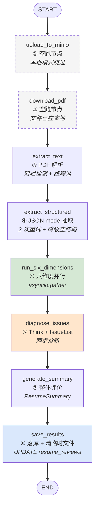
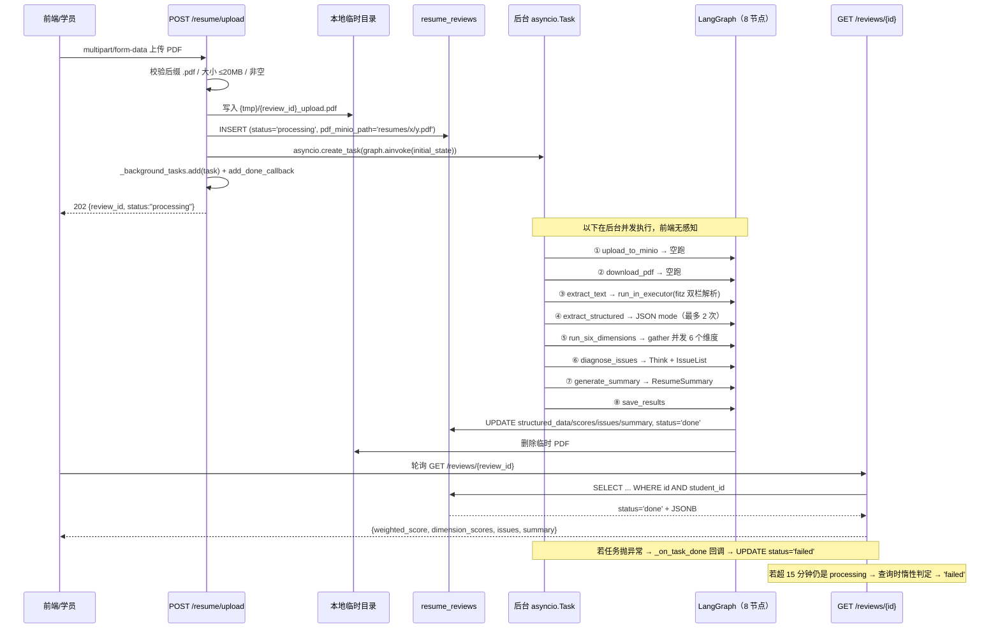
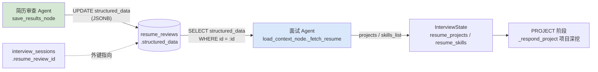

# 简历审查 Agent（Resume）架构与实现详解

> 代码位置：`backend/agents/resume/` + `backend/api/v1/resume.py`
> 关联数据表：`resume_reviews`
> 文档版本：基于当前 `dev` 分支代码（对应课件第四章）
> 本文所有 `file:line` 引用均已逐行核对，标注「待验证」的条目为无法从当前代码确定结论的点

---

## 一、一句话定位

把一份 PDF 简历**一次性**地跑完一条直线流水线：PDF 解析 → LLM 结构化抽取 → 六维度并行评分 → Think Tool 问题诊断 → 整体评价 → 落库，产出一份带加权总分、逐维度评分和逐条问题清单的审查报告。

它是四个 Agent 中**唯一没有 checkpointer、一次性执行**的：没有对话、没有跨轮状态、没有 `interrupt()`、没有条件边。整张图是一条直线（`graph.py:34-42`），编译时不传 checkpointer（`graph.py:45`）。因此它的设计重心不在「状态管理」，而在**三件事**：

1. **输入侧**——把排版千奇百怪的 PDF 尽量准确地还原成文本（双栏检测）；
2. **并发侧**——六个维度并行评审，把端到端耗时从「6 次 LLM 串行」压到「1 次最慢维度」（`nodes.py:242-243`）；
3. **降级侧**——任何一个维度、任何一次结构化输出失败，都不能让整份报告消失。

> **与另外三个 Agent 的关系**：它是**唯一被别的 Agent 消费产出**的 Agent。面试 Agent 会读 `resume_reviews.structured_data` 里的 `projects` / `skills_list` 来做项目深挖（`agents/interview/nodes.py:137-158`）。这条联动链路见第十二章。

---

## 二、文件职责

| 文件 | 行数 | 职责 |
|------|------|------|
| `backend/agents/resume/state.py` | 159 | 8 个 Pydantic 模型（5 个抽取/评分结构 + `IssueList` + `ResumeSummary` + `DimensionScore`）+ `ResumeState` 定义 |
| `backend/agents/resume/graph.py` | 57 | 组装 `StateGraph`，注册 8 个节点、连 9 条边，**编译时不传 checkpointer** |
| `backend/agents/resume/nodes.py` | 475 | 全部业务逻辑：8 个节点函数 + `SIX_DIMENSIONS` 常量 + 3 个工具函数 + 被注释保留的旧实现 |
| `backend/agents/resume/prompts.py` | 275 | 全部提示词常量（系统人设 / 抽取 / 六维度评审 / 诊断 / Think / 整体评价） |
| `backend/api/v1/resume.py` | 238 | 4 个 HTTP 端点，负责上传校验、异步任务编排、轮询查询、超时兜底 |

> 结构上完全符合项目的「每个 Agent 四文件」约定（`CLAUDE.md` 代码约定第 2 条）。与 Interview 相比少了「记忆管理」这一整层，因为本 Agent 无状态。

---

## 三、State 数据契约

`ResumeState` 定义在 `state.py:99-129`，是 15 个字段的 `TypedDict`。**注意：虽然它带 `add_messages` reducer 的 `messages` 字段（`state.py:103`），但整张图从头到尾没有任何节点读或写它**——这是从 Interview 复制模板留下的死字段（见第十五章 15.10）。

### 3.1 请求上下文

| 字段 | 类型 | 说明 |
|------|------|------|
| `messages` | `Annotated[list[BaseMessage], add_messages]` | **死字段**：全图无人读写，API 层初始化为 `[]`（`api/v1/resume.py:90`） |
| `student_id` | `str` | 学员 ID，`save_results_node` 写进 `structured_output`（`nodes.py:386`） |
| `tenant_id` | `str` | 租户 ID，API 层写入（`api/v1/resume.py:90`）但**图内无任何节点读取**（死字段） |
| `review_id` | `str` | `resume_reviews` 行 UUID，四个节点都在读（`nodes.py:44`、`:50`、`:382` 等） |
| `pdf_minio_path` | `str` | **死字段**：注释自称「遗留」（`state.py:107`），API 层固定传 `""`（`api/v1/resume.py:91`），无人读 |
| `pdf_local_path` | `str` | 本地临时 PDF 的绝对路径，**真正被使用的输入**（`nodes.py:95`、`:427`） |

### 3.2 解析中间结果

| 字段 | 类型 | 说明 |
|------|------|------|
| `raw_text` | `str` | `extract_text` 产出：PDF 全文，页间以 `\n\n---PAGE BREAK---\n\n` 连接 |
| `page_count` | `int` | PDF 页数。**写了但没人读**（`nodes.py:103` 返回，全项目无消费方），API 响应里也不返回 |

### 3.3 结构化提取结果

| 字段 | 类型 | 说明 |
|------|------|------|
| `structured` | `Optional[dict]` | `ResumeStructured.model_dump()` 的结果（`nodes.py:206`） |

### 3.4 六维度评审结果

| 字段 | 类型 | 说明 |
|------|------|------|
| `dimension_scores` | `list[dict]` | 6 条 `DimensionScore` dict，代码层额外补了 `key` 字段（`nodes.py:232`） |
| `weighted_score` | `float` | 加权总分，`round(..., 2)`（`nodes.py:247`） |

### 3.5 逐条问题诊断

| 字段 | 类型 | 说明 |
|------|------|------|
| `issues` | `list[dict]` | `IssueItem.model_dump()` 列表，按 `high > medium > low` 排序（`nodes.py:327-328`） |

### 3.6 整体评价与降级

| 字段 | 类型 | 说明 |
|------|------|------|
| `summary` | `Optional[dict]` | `ResumeSummary.model_dump()`（`nodes.py:376`） |
| `fallback_used` | `bool` | **死字段**：`save_results_node` 硬编码返回 `False`（`nodes.py:432`），无任何写入分支 |
| `structured_output` | `Optional[dict]` | `save_results_node` 组装的汇总 dict（`nodes.py:385-392`）——**但图返回值被 API 层丢弃，无人消费**（见 15.7） |

### 3.7 八个 Pydantic 模型

#### `EducationItem`（`state.py:12-18`）

| 字段 | 类型 | 默认 | 说明 |
|------|------|------|------|
| `school` | `str` | 必填 | 学校名称 |
| `major` | `str` | 必填 | 专业名称 |
| `degree` | `str` | 必填 | 学历：本科/专科/硕士等 |
| `duration` | `str` | 必填 | 在校时间，如 `2020.09 - 2024.06` |
| `gpa` | `str` | `""` | GPA 或成绩（可选） |

#### `ProjectItem`（`state.py:21-29`）

| 字段 | 类型 | 默认 | 说明 |
|------|------|------|------|
| `name` | `str` | 必填 | 项目名称 |
| `role` | `str` | 必填 | 担任角色 |
| `duration` | `str` | 必填 | 项目时间 |
| `tech_stack` | `list[str]` | 必填 | 技术栈列表 |
| `description` | `str` | 必填 | 项目描述原文（保留原始表述） |
| `highlights` | `list[str]` | `factory` | 量化亮点句子列表 |

> `highlights` 用 `default_factory=list`（`state.py:29`）而非 `default=[]`——这是 Python「可变默认参数共享」经典坑的正确写法，注释也点明了（`state.py:28`）。

#### `WorkItem`（`state.py:32-38`）

| 字段 | 类型 | 默认 | 说明 |
|------|------|------|------|
| `company` | `str` | 必填 | 公司名称 |
| `position` | `str` | 必填 | 职位名称 |
| `duration` | `str` | 必填 | 工作时间 |
| `tech_stack` | `list[str]` | `factory` | 涉及技术栈 |
| `description` | `str` | 必填 | 工作内容原文 |

#### `ResumeStructured`（`state.py:41-59`）—— 抽取总结构

| 字段 | 类型 | 默认 | 说明 |
|------|------|------|------|
| `name` | `str` | **必填（唯一必填）** | 姓名 |
| `phone` | `str` | `""` | 手机号 |
| `email` | `str` | `""` | 邮箱 |
| `target_position` | `str` | `""` | 求职意向岗位 |
| `education` | `list[EducationItem]` | `factory` | 教育经历 |
| `skills_raw` | `str` | `""` | 技能栏原始文本 |
| `skills_list` | `list[str]` | `factory` | 解析后的技术标签列表 |
| `projects` | `list[ProjectItem]` | `factory` | 项目经历 |
| `work_experience` | `list[WorkItem]` | `factory` | 工作/实习经历 |
| `certificates` | `list[str]` | `factory` | 证书列表 |
| `self_intro` | `str` | `""` | 个人简介/自我评价原文 |

> **只有 `name` 是必填字段**。这意味着：LLM 只要漏掉 `name`，`ResumeStructured(**raw_dict)` 就会抛 `ValidationError`，触发重试/降级（`nodes.py:184`）；而漏掉其他任何字段都会静默补默认值。这是「降级空结构 `ResumeStructured(name="未能提取")`」能成立的依据（`nodes.py:201`）。

#### `DimensionScore`（`state.py:65-72`）

| 字段 | 类型 | 默认 | 说明 |
|------|------|------|------|
| `dimension` | `str` | `""` | 维度名称——**LLM 给的值会被代码覆盖**（`nodes.py:232`） |
| `score` | `int` | 必填 | 得分 0-100 |
| `weight` | `float` | `0.0` | 权重——同样被代码覆盖 |
| `issues` | `list[str]` | `factory` | 该维度问题列表 |
| `suggestions` | `list[str]` | `factory` | 改进建议列表 |

> 注释（`state.py:67`）明确写了：`dimension` / `weight` 由代码层从 `SIX_DIMENSIONS` 回填，LLM 留空即可——好处是**LLM 不需要知道也不被信任来提供权重**，权重永远来自代码常量。
>
> ⚠️ `score` 没有任何范围约束（`Field(description="得分 0-100")` 里 `0-100` 只是描述文字，不是校验），LLM 若返回 `150` 或 `-10` 会被原样采纳并计入加权分（见 15.9）。

#### `IssueItem`（`state.py:75-81`）

| 字段 | 类型 | 说明 |
|------|------|------|
| `priority` | `str` | 优先级：`high` / `medium` / `low` |
| `dimension` | `str` | 所属维度 |
| `description` | `str` | 问题描述（1 句话） |
| `location` | `str` | 问题在简历中的定位，如「项目经历-电商系统-第2句」 |
| `suggestion` | `str` | 具体修改建议（可操作） |

#### `IssueList`（`state.py:84-88`）—— 为什么必须包一层

```python
class IssueList(BaseModel):
    """IssueItem 列表的包装类。
    为什么要包一层：with_structured_output 要求顶层是「对象」而非「裸列表」，
    所以不能直接让 LLM 返回 list[IssueItem]，要包成 {items: [...]}。"""
    items: list[IssueItem]
```

这是本 Agent 里唯一一处「为了迁就工具链而扭曲数据模型」的设计：

- `get_structured_llm()` 最终调用的是 `llm.with_structured_output(schema, method="function_calling")`（`llm_factory.py:134`）。Function Calling 的入参 schema 必须是 **JSON Schema 的 `object` 类型**。
- JSON Schema 的标准顶层就是对象；一个裸数组（`{"type": "array", "items": {...}}`）虽然合法，但部分模型/网关对顶层数组的支持不稳定，容易被包成 `{"items": [...]}` 或直接失败。
- 因此代码选择**主动包一层固定字段名 `items`**，把不确定性消灭在 Prompt/Schema 侧：模型只需要填一个已知的 `items` 数组。

代价是消费侧要多写一次 `.items`（`nodes.py:318`：`issues = [item.model_dump() for item in result.items]`），以及降级路径必须自己构造同样形状的 dict（`nodes.py:321-325`，那里其实直接构造的是「扁平 issues 列表」而非 `IssueList`，因为 State 里存的本来就是扁平列表）。

#### `ResumeSummary`（`state.py:91-96`）

| 字段 | 类型 | 说明 |
|------|------|------|
| `highlights` | `list[str]` | 2-3 条核心亮点 |
| `core_improvements` | `list[str]` | 2-3 条最重要的改进方向 |
| `overall_comment` | `str` | 1-2 句综合评语 |
| `fit_assessment` | `str` | 对目标岗位的匹配度评估（1 句话） |

---

## 四、图拓扑

### 4.1 节点与边（`graph.py:24-42`）



- **8 个节点**，但 ①② 是空跑（`nodes.py:42-51` 只打一条日志就 `return {}`），实际干活的只有 6 个。
- **9 条边全是 `add_edge`**，没有一条 `add_conditional_edges`——所以整张图**没有任何路由决策**。

### 4.2 为什么无分支、无条件路由

这是由业务语义决定的，不是偷懒：

1. **步骤天然有序且必做**。从「PDF → 文本 → 结构 → 评分 → 诊断 → 评价 → 落库」，每一步的输入都是上一步的输出，没有「如果 A 则跳过 B」的场景。
2. **降级策略是「就地兜底」而不是「改道」**。项目约定要求外部依赖失败不抛异常（`CLAUDE.md` 代码约定第 9 条），所以本 Agent 的处理方式是：**每个节点内部自己 try/except，失败时返回一个合法的降级值，继续往下走**，而不是新增一条「失败分支」边。比如抽取失败就返回 `ResumeStructured(name="未能提取")`（`nodes.py:201`），维度失败就返回 50 分（`nodes.py:270-273`）。既然失败不改变拓扑，条件边就没有存在意义。
3. **没有 HitL**。对比 Exam 用 `interrupt()` 做教师确认；简历审查是纯机器产出，无需人工介入，因此也不需要 `Command(resume=...)` 和断点恢复。

### 4.3 为什么不需要 checkpointer

```python
# graph.py:44-45
# ③ 编译。不传 checkpointer：一次性任务，不需要断点恢复
return builder.compile()
```

| 判据 | 本 Agent | 有状态 Agent（如 Interview） |
|------|---------|---------------------------|
| 是否跨多次 `ainvoke` 复用 State | 否，一次 `ainvoke` 跑完全图 | 是，每轮对话一次 `ainvoke` |
| 是否需要跨进程/跨重启恢复 | 否 | 需要（所以才要求 `AsyncPostgresSaver`） |
| 是否需要 `thread_id` | 否 | 是（`build_thread_id`） |
| 是否需要 msgpack 序列化 State | 否 | 是 |

**结论**：本 Agent 的 State 只活在**单次 `ainvoke` 调用的内存里**，函数返回即释放。这也带来一个副作用——`graph.ainvoke(...)` 的返回值是唯一的结果出口，而 API 层恰恰把它丢掉了（见 15.7）。持久化完全靠 `save_results_node` 里那条 `UPDATE`。

> 与 `CLAUDE.md` 的约定呼应：既然不用 checkpointer，就完全绕开了「不同 Agent 的 State schema 必须用不同 `MemorySaver`」那个坑（`memory.py:11-14`）。

### 4.4 编译细节

```python
# graph.py:21-31
builder = StateGraph(ResumeState)  # 用 ResumeState 作为图的状态类型
builder.add_node("upload_to_minio", upload_to_minio_node)
builder.add_node("download_pdf", download_pdf_node)
builder.add_node("extract_text", extract_text_node)
builder.add_node("extract_structured", extract_structured_node)
builder.add_node("run_six_dimensions", run_six_dimensions_node)
builder.add_node("diagnose_issues", diagnose_issues_node)
builder.add_node("generate_summary", generate_summary_node)
builder.add_node("save_results", save_results_node)
```

- 节点名与函数名一一对应，`add_edge` 用**字符串节点名**（`graph.py:34-42`），不是函数引用——这是 LangGraph 的 API 约定。
- `graph.py:48-57` 有一个 `__main__` 块：编译图、打印节点列表、并把 `draw_mermaid_png()` 写成本地 `resume.png`。
- API 层没有用模块级单例，而是用 `threading.local()` 惰性编译（`api/v1/resume.py:19-26`），动机与实际情况的偏差见 15.17。

---

## 五、核心机制一：PDF 解析（`nodes.py:55-106`）

这是本 Agent 唯一一处「跟 LLM 无关但技术含量最高」的代码。核心矛盾：**简历 PDF 大量使用双栏排版**（左栏个人信息/技能，右栏项目经历），而 PyMuPDF 的 `get_text("blocks")` 只保证给出块的坐标，不保证阅读顺序。

### 5.1 同步实现跑在线程池里

```python
# nodes.py:93-106
async def extract_text_node(state: ResumeState) -> dict:
    """异步节点：线程池跑同步解析，避免阻塞事件循环。"""
    pdf_path = state["pdf_local_path"]
    try:
        loop = asyncio.get_running_loop()
        result = await loop.run_in_executor(None, _sync_extract_text, pdf_path)
        raw_text, page_count = result["raw_text"], result["page_count"]
        if len(raw_text.strip()) < 200:               # 疑似扫描件/图片 PDF，仅告警
            logger.warning("extract_text.text_too_short", text_length=len(raw_text.strip()))
        logger.info("extract_text.done", page_count=page_count, text_length=len(raw_text))
        return {"raw_text": raw_text, "page_count": page_count}
    except Exception as e:
        logger.error("extract_text.failed", error=str(e))
        raise
```

三个要点：

1. **`run_in_executor(None, ...)`** —— `None` 表示用 asyncio 默认的 `ThreadPoolExecutor`。PyMuPDF 是纯 CPU + C 扩展的同步库，直接 `await` 不了；如果就地同步调用，会把整个事件循环卡住（一份几十页 PDF 解析可达数百毫秒到数秒），期间所有其他 HTTP 请求、后台任务全部停顿。丢到线程池是最小成本的解法。
2. **单次调用而非分页并行**。整个文档在一路 executor 里顺序解析。这是有意的：`fitz.Document` 不是线程安全的，跨线程共享 `doc` 会崩；分页并行需要每页独立 `open`，收益不抵复杂度。
3. **<200 字仅告警，不失败**（`nodes.py:100-101`）—— 这在下面 5.5 详述。

### 5.2 双栏排版检测算法（`nodes.py:62-85`）

```python
# nodes.py:62-74
for page in doc:
    blocks = page.get_text("blocks")              # 每块 (x0,y0,x1,y1,text,no,type)
    text_blocks = [b for b in blocks if b[6] == 0]   # type==0 文字块
    if not text_blocks:
        continue
    page_width = page.rect.width
    midpoint   = page_width / 2
    left_blocks  = [b for b in text_blocks if b[0] <  midpoint - 20]
    right_blocks = [b for b in text_blocks if b[0] >= midpoint - 20]
    is_two_column = (
        len(left_blocks) >= 2 and len(right_blocks) >= 2
        and len(right_blocks) / max(len(text_blocks), 1) > 0.3
    )
```

**块的数据结构**：`page.get_text("blocks")` 返回 `(x0, y0, x1, y1, text, block_no, block_type)`（`nodes.py:63` 注释）。`block_type == 0` 表示文字块，`1` 表示图片块——图片块被过滤掉（`nodes.py:64`），因为图片里没有可解析文字（也就是说**扫描件里的图完全不会被处理**）。

**判定条件逐项拆解**：

| 条件 | 含义 | 为什么需要 |
|------|------|-----------|
| `b[0] < midpoint - 20` | 块的**左边界**落在「页宽中点左侧 20pt」以外 → 归为左栏 | 用 `x0`（左边界）而不是中心点，是因为栏内的块通常左对齐；用左边界能稳定区分栏位 |
| `b[0] >= midpoint - 20` | 不含上面那 20pt 的缓冲 → 归为右栏 | `-20` 是**容差**：居中标题、带缩进的段落其左边界可能略偏中心左侧，若严格以 `midpoint` 切分会把居中块误判为左栏 |
| `len(left_blocks) >= 2` | 左栏至少 2 个块 | 单栏简历也可能有一个左侧块；≥2 才排除掉 |
| `len(right_blocks) >= 2` | 右栏至少 2 个块 | 同上。这一条是**防误判的关键**：单栏简历里右对齐的日期、页码可能形成 1 个「右栏块」，但只要右栏不足 2 块就不判双栏 |
| `len(right_blocks) / max(len(text_blocks), 1) > 0.3` | 右栏块数占比 > 30% | 最后一道闸：即使左右各 ≥2 块，如果右栏只占极少数（如顶部一个日期块 + 一个页码），仍不算双栏。`max(..., 1)` 防除零 |

三个条件**同时成立**才判定为双栏——这是典型的「宁可漏判，不可误判」策略：漏判双栏的后果是文本顺序略乱但内容完整（LLM 仍能读懂），误判单栏为双栏的后果是把正常的段落拦腰截断成两半、语序彻底打乱。**代价不对称，所以阈值偏保守。**

### 5.3 两种排序策略（`nodes.py:75-85`）

```python
# nodes.py:75-85
if is_two_column:                             # 双栏：左栏读完读右栏
    left_sorted  = sorted(left_blocks,  key=lambda b: b[1])
    right_sorted = sorted(right_blocks, key=lambda b: b[1])
    page_text = (
        "\n".join(b[4].strip() for b in left_sorted  if b[4].strip())
        + "\n"
        + "\n".join(b[4].strip() for b in right_sorted if b[4].strip())
    )
else:                                         # 单栏：按 y 从上到下
    sorted_blocks = sorted(text_blocks, key=lambda b: b[1])
    page_text = "\n".join(b[4].strip() for b in sorted_blocks if b[4].strip())
```

- **双栏**：`b[1]` 是 `y0`（上边界）。策略是**严格的「左栏整体读完，再读右栏整体」**，两栏之间不做 y 交叉合并。对简历这种「左栏是静态信息、右栏是叙述性内容」的排版是对的；但如果遇到「跨双栏的表格」或「左右栏内容需要逐行对照」的排版，顺序会错。
- **单栏**：所有文字块按 `y0` 升序。`sorted` 是稳定排序，`y0` 相同的块保持 PyMuPDF 给出的原始顺序（通常即阅读顺序），所以同一行内的多个块不会被随机打乱。
- `if b[4].strip()` 过滤掉纯空白块——避免输出里出现大片空行。

### 5.4 页间分隔符（`nodes.py:89`）

```python
raw_text = "\n\n---PAGE BREAK---\n\n".join(all_text_parts)
```

用一个显式标记分隔页，而不是简单拼 `\n`。理由：下游全部是「把整段文本塞给 LLM」的用法，如果页与页之间只隔一个换行，模型无法判断「上一页末尾」和「下一页开头」是否属于同一条目。`---PAGE BREAK---` 给了模型一个明确的断点信号，也让人类在调试 `raw_text` 时能一眼看出分页位置。

> 注意：下游对文本一律 `raw_text[:3000]` 或 `[:4000]` 截断（`nodes.py:145`、`:222`、`:309`）。也就是说**只有前 1-2 页的内容会真正进入 LLM**，`---PAGE BREAK---` 主要服务于这段截断窗口内的阅读体验。

### 5.5 文本过短告警：疑似扫描件，无 OCR

```python
# nodes.py:100-101
if len(raw_text.strip()) < 200:               # 疑似扫描件/图片 PDF，仅告警
    logger.warning("extract_text.text_too_short", text_length=len(raw_text.strip()))
```

这是本 Agent **最脆弱的一环，而且是有意为之**：

- **不做 OCR**。项目依赖里没有 OCR 库（`requirements.txt:31` 只有 `pymupdf==1.24.14`），也没有对接口的封装。扫描件/图片型 PDF 的结局是：`raw_text` 几乎为空。
- **不失败**。告警之后流程照常往下走，`extract_text_node` 返回一个近乎空的 `raw_text`。
- **下游后果**：`extract_structured_node` 会把空文本喂给 LLM → LLM 抽不出任何东西 → `ResumeStructured(name="未能提取")`（或 JSON 解析失败重试后降级）→ 六维度拿到「（结构化提取失败，请基于原文评审）」的摘要 + 空原文 → 六个维度大概率都给低分 → 最终用户拿到一份**看起来正常但毫无意义**的报告，`status='done'`。

**这是设计上最值得商榷的地方**：一个上传了扫描件的学员，会得到一份「综合 30 分、项目深度极差」的报告，而不是「您的简历无法解析，请上传文字版 PDF」的明确提示。`error_msg` 列存在（`_03_init_db.sql:151`）但只用于真正的异常，扫描件不会触发它。

### 5.6 一个次要的资源问题

`fitz.open(pdf_path)` 在 `_sync_extract_text` 里（`nodes.py:58`），`doc.close()` 在函数末尾（`nodes.py:88`），但**中间没有 `try/finally`**。如果 `page.get_text("blocks")` 或 `page.rect` 在中途抛异常，`doc` 不会被 `close()`，文件句柄要等 GC 才释放。对一次性任务影响有限，但属于可以顺手修掉的瑕疵（见 15.14）。

---

## 六、核心机制二：六维度并行评分（`nodes.py:211-247`）

### 6.1 六个维度与权重

定义在 `nodes.py:24-38` 的模块级常量 `SIX_DIMENSIONS`：

| 顺序 | `key` | 名称 | 权重 | `focus`（评审侧重） |
|------|-------|------|------|---------------------|
| 1 | `project_depth` | 项目深度 | **0.30** | 项目描述是否有量化数据、技术选型理由、个人贡献、难点解决 |
| 2 | `tech_match` | 技术匹配度 | **0.25** | 技术栈是否与目标岗位匹配，技能描述是否有层次（熟练/了解/掌握） |
| 3 | `expression` | 表达规范性 | **0.15** | 动词开头、STAR 结构、无错别字、无主语省略歧义 |
| 4 | `structure` | 简历结构 | **0.15** | 模块完整性、排版逻辑、信息密度、重要内容是否放前面 |
| 5 | `quantification` | 量化程度 | **0.10** | 性能指标、用户量、优化幅度等量化数据的使用情况 |
| 6 | `authenticity` | 真实可信度 | **0.05** | 表述是否夸大、技术深度描述是否与经验年限匹配、时间线是否合理 |

> 权重之和 = 1.00。设计取向很明确：**项目深度 + 技术匹配度占 55%**——对 IT 教培机构的学员简历来说，这两项直接决定 HR 通过率；而「真实可信度」只占 5%，因为它是「减法项」（不夸大就行），不该成为主要得分来源。
>
> ⚠️ 注意 `prompts.py:167` 里 `authenticity` 维度的标题写的是「**描述一致性**」，而 `SIX_DIMENSIONS` 里叫「**真实可信度**」（`nodes.py:36`）。最终落库的是 `SIX_DIMENSIONS` 的 `name`（因为 `nodes.py:232` 覆盖了 LLM 给的值），所以前端看到的是「真实可信度」。这两个名字不一致是遗留痕迹（见 15.13）。

### 6.2 `asyncio.gather` 并发 6 个协程

```python
# nodes.py:211-247（节选）
async def run_six_dimensions_node(state: ResumeState) -> dict:
    """六维度并行评审：asyncio.gather 同时评，算加权综合分。"""
    raw_text   = state["raw_text"]
    structured = state.get("structured") or {}
    structured_summary = _build_structured_summary(structured)

    async def review_one_dimension(dim: dict) -> dict:
        prompt_template = DIMENSION_REVIEW_PROMPTS.get(dim["key"], "")
        if not prompt_template:
            return _empty_dimension_score(dim)
        prompt = prompt_template.format(
            resume_text=raw_text[:3000], structured_summary=structured_summary, focus=dim["focus"],
        )
        for attempt in range(2): # 最多 2 次尝试
            try:
                structured_llm = get_structured_llm("resume", DimensionScore)
                result: DimensionScore = await structured_llm.ainvoke([
                    SystemMessage(content=SYSTEM_PROMPT),
                    HumanMessage(content=prompt),
                ])
                d = result.model_dump()
                d["dimension"], d["weight"], d["key"] = dim["name"], dim["weight"], dim["key"]
                return d
            except Exception as e:
                if attempt == 0:
                    logger.warning("six_dimensions.dimension_retry", dimension=dim["name"], error=str(e))
                    await asyncio.sleep(1)
                else:
                    logger.warning("six_dimensions.dimension_failed", dimension=dim["name"], error=str(e))
                    return _empty_dimension_score(dim)

    tasks = [review_one_dimension(dim) for dim in SIX_DIMENSIONS]
    dimension_scores = await asyncio.gather(*tasks)              # 并行
    weighted_score = sum(d["score"] * d["weight"] for d in dimension_scores)
    logger.info("six_dimensions.done", weighted_score=round(weighted_score, 2),
                scores={d["key"]: d["score"] for d in dimension_scores})
    return {"dimension_scores": list(dimension_scores), "weighted_score": round(weighted_score, 2)}
```

**这是整个 Agent 的性能关键路径**（`graph.py:20` 的 docstring 原话）。

| 环节 | 实现 | 说明 |
|------|------|------|
| 并发方式 | `asyncio.gather(*tasks)`（`nodes.py:243`） | 6 个协程同时发起，总耗时 ≈ 最慢的那一个维度，而不是 6 个之和 |
| 维度定义 | 遍历 `SIX_DIMENSIONS`（`nodes.py:242`） | 加维度只需改常量表 |
| 每维度输入截断 | `raw_text[:3000]`（`nodes.py:222`） | 6 个协程各带一份 3000 字原文，token 消耗 = 6 × 3000 字量级 |
| Prompt 来源 | `DIMENSION_REVIEW_PROMPTS.get(dim["key"], "")`（`nodes.py:218`） | 按 `key` 取模板；**取不到就静默返回 50 分降级**（`nodes.py:219-220`） |
| 结构化输出 | `get_structured_llm("resume", DimensionScore)`（`nodes.py:226`） | 走 Function Calling；`temperature` 用默认 `0` |
| 独立重试 | 每个维度各自 `for attempt in range(2)`（`nodes.py:224`） | 一个维度重试不影响其他维度；退避 1 秒（`nodes.py:237`） |
| 单维度失败降级 | `_empty_dimension_score(dim)` → 50 分（`nodes.py:270-273`） | 见 6.4 |

### 6.3 加权总分公式

```python
# nodes.py:244
weighted_score = sum(d["score"] * d["weight"] for d in dimension_scores)
```

$$\text{weighted\_score} = \sum_{i=1}^{6} \text{score}_i \times \text{weight}_i$$

其中权重全部来自代码常量 `SIX_DIMENSIONS`（**不是** LLM 返回的 `weight`）：

```python
# nodes.py:232
d["dimension"], d["weight"], d["key"] = dim["name"], dim["weight"], dim["key"]
```

这一行是「不信任 LLM 提供的元数据」原则的体现——LLM 只被允许决定 `score` / `issues` / `suggestions`，维度名与权重由代码强制覆盖。理论上加权分应落在 `[0, 100]`；但由于 `DimensionScore.score` 无范围校验（见 15.9），实际上可能越界。

### 6.4 单维度失败的降级分

```python
# nodes.py:270-273
def _empty_dimension_score(dim: dict) -> dict:
    """维度评审失败时的降级结果。"""
    return {"key": dim["key"], "dimension": dim["name"], "score": 50, "weight": dim["weight"],
            "issues": ["该维度评审失败，建议人工复核"], "suggestions": []}
```

**50 分**——正好是 0-100 区间的中点，即「不奖不罚」。这个选择让一次 LLM 失败对总分的影响是**中性**的（不拉低也不抬高），而不是把总分打成 0。设计意图是：一份 6 个维度里挂了 1 个的报告，仍然能反映另外 5 个维度的真实水平。

但有两个副作用：

1. **失败被完全隐藏**。50 分进入加权分后，与一个「真的是 50 分」的维度无法区分；`fallback_used` 又是死字段（15.2），前端拿不到任何「本次有维度降级」的信号。唯一的痕迹是 `issues` 里那句「该维度评审失败，建议人工复核」出现在该维度的 `issues` 数组里。
2. **降级问题会流进诊断**。`diagnose_issues_node` 会把每个维度的 `issues` 拼成 `all_raw_issues`（`nodes.py:283-287`），所以「该维度评审失败，建议人工复核」会作为一条候选问题送给诊断 LLM，甚至可能出现在最终报告的问题清单里（走降级路径时必然出现，见 `nodes.py:321-325`）。

> **注意 `asyncio.gather` 没有传 `return_exceptions=True`**（`nodes.py:243`）。这在当前代码下**基本安全**，但安全边界很窄——详见 15.6 的逐路径分析。

---

## 七、核心机制三：结构化抽取与问题诊断

### 7.1 结构化抽取：为什么用 JSON mode 而不是 structured output

**这是本 Agent 唯一一处「刻意偏离项目统一写法」的地方，且代码里同时保留了新旧两版实现**。

#### 旧实现（已注释保留，`nodes.py:109-138`）

```python
# # ── 节点④：extract_structured —— LLM 结构化提取 ──
# async def extract_structured_node(state: ResumeState) -> dict:
#     """用 LLM Function Calling 把文本提取成结构化简历。"""
#     raw_text = state["raw_text"]
#     text_for_llm = raw_text[:4000] if len(raw_text) > 4000 else raw_text   # 超长截断
#     prompt = EXTRACT_STRUCTURED_PROMPT.format(resume_text=text_for_llm)
#     structured_llm = get_structured_llm("resume", ResumeStructured)
#     structured_dict = None
#     for attempt in range(2):                           # 结构化输出偶发返回 None → 判空+重试
#         try:
#             result = await structured_llm.ainvoke([...])
#             if result is None:
#                 raise ValueError("structured output returned None")
#             structured_dict = result.model_dump()
#             break
#         except Exception as e:
#             ...
#     if structured_dict is None:
#         structured_dict = ResumeStructured(name="未能提取").model_dump()   # 降级空结构
```

旧版走的是和 `run_six_dimensions` / `generate_summary` 一样的路子：`get_structured_llm("resume", ResumeStructured)`，即 `with_structured_output(..., method="function_calling")`。

#### 为什么弃用：`ResumeStructured` 太大了

代码没有留下书面解释，但从 Schema 规模可以反推。`ResumeStructured`（`state.py:41-59`）是一个**三层嵌套**结构：

- 顶层 11 个字段；
- `education` 是 `list[EducationItem]`（5 字段）；
- `projects` 是 `list[ProjectItem]`（6 字段，其中 `highlights` 还是 `list[str]` 的二级数组）；
- `work_experience` 是 `list[WorkItem]`（5 字段）。

Function Calling 的实现方式是**把整个 JSON Schema 作为 tools 参数发给模型**，并要求模型逐字段生成严格符合 schema 的 arguments。Schema 越深、数组越嵌套，模型在生成过程中「越界」概率越高——典型故障是：数组项漏字段、层级串位、返回 `None`（旧版注释 `nodes.py:123` 明确提到「structured output 偶发返回 None」，这是 function_calling 在参数过长/过复杂时的已知失效模式）。

#### 新实现（`nodes.py:142-206`）：JSON mode + 手工解析

```python
# nodes.py:141-147
# ── 节点④：extract_structured —— LLM 通过提示词结构化提取 ──
async def extract_structured_node(state: ResumeState) -> dict:
    """用 JSON mode 把文本提取成结构化简历，比 Function Calling 更稳定。"""
    raw_text = state["raw_text"]
    text_for_llm = raw_text[:4000] if len(raw_text) > 4000 else raw_text

    prompt = EXTRACT_STRUCTURED_PROMPT.format(resume_text=text_for_llm)
    llm = get_llm("resume", temperature=0)
```

关键差异：用**普通模型**（`get_llm`）而不是结构化模型，把「要什么格式」的全部约束**下沉到 Prompt 里**——`EXTRACT_STRUCTURED_PROMPT`（`prompts.py:23-75`）直接给出了完整的 JSON 示例，包括所有嵌套层级：

```python
# prompts.py:35-38（节选）
【输出格式】
只返回 JSON，不要有任何解释、前缀、markdown 代码块。

{{
  "name": "姓名",
  ...
```

> 注意 `{{` 和 `}}`（`prompts.py:38`、`:44` 等）——因为这段常量要经过 `.format(resume_text=...)`（`nodes.py:147`），所有字面花括号都必须双写转义，否则 `.format` 会把 JSON 里的 `{` 当成占位符并抛 `KeyError`。这是本文件里最容易踩的坑，作者处理得是对的。

#### 手工解析链路（`nodes.py:153-198`）

```python
# nodes.py:153-184（节选）
for attempt in range(2):
    try:
        response = await llm.ainvoke([
            SystemMessage(content=SYSTEM_PROMPT),
            HumanMessage(content=prompt),
        ])

        # 取出文本内容
        content = (
            response.content
            if hasattr(response, "content")
            else str(response)
        ).strip()

        # 记录原始返回，方便排查
        logger.debug("extract_structured.raw_response",
                     attempt=attempt, content_preview=content[:200])

        # 清理 markdown 代码块（```json ... ```）
        if "```" in content:
            blocks = content.split("```")
            # 取第一个代码块内容
            for block in blocks[1::2]:
                block = block.strip()
                if block.startswith("json"):
                    block = block[4:].strip()
                content = block
                break

        raw_dict = json.loads(content)
        # Pydantic 验证 + 补全缺失字段
        structured_dict = ResumeStructured(**raw_dict).model_dump()
        break
```

四层防御：

1. **取文本**：`hasattr(response, "content")` 兜底成 `str(response)`——防止某些版本返回非标准消息对象（`nodes.py:161-165`）。
2. **剥代码围栏**：Prompt 已经写了「不要 markdown 代码块」，但代码仍然防御性处理。`blocks[1::2]` 取所有**奇数索引**片段——因为 `` a```b```c `` 按 ``` ``` `` 切分后，`[1]` 和 `[3]` 才是围栏内容，`[0]/[2]/[4]` 是围栏外的散文。取**第一个**匹配的块（`break`），并剥掉 `json` 语言标记（`block[4:]`）。
3. **`json.loads`**：失败抛 `json.JSONDecodeError`，走专属 except（`nodes.py:187-191`），日志里带上 `raw={content[:300]}` 方便排查。
4. **Pydantic 校验**：`ResumeStructured(**raw_dict)`（`nodes.py:184`）——这一步同时完成「类型校验」和「缺失字段补默认值」。Pydantic v2 默认 `extra='ignore'`，所以 LLM 多给的字段会被静默丢弃，不会报错。

#### 两级降级

```python
# nodes.py:199-201
if structured_dict is None:
    logger.warning("extract_structured.fallback", last_error=last_error)
    structured_dict = ResumeStructured(name="未能提取").model_dump()
```

- 第 1 级：`attempt == 0` 失败 → `await asyncio.sleep(1)` 后重试一次（`nodes.py:190-197`）。
- 第 2 级：两次都失败 → `ResumeStructured(name="未能提取")`，即一个**只有姓名、其余全默认值**的结构（`nodes.py:201`）。

这个降级值是刻意「可辨识」的：`name == "未能提取"` 是前端和调试者一眼能识别的哨兵值。而下游 `_build_structured_summary` 会因为 `structured.get("name")` 非空而输出「姓名：未能提取」，随后各维度评审看到的就是一份近乎空的简历——它们会给出低分，这是符合预期的（简历确实没解析出来）。

> 值得注意的一致性问题：`state.py:9` 的注释仍然写着「结构化提取结果（LLM Function Calling 的输出目标）」——描述的是**已被弃用的旧实现**（见 15.15）。

### 7.2 问题诊断：Think Tool 前置推理 + `IssueList` 结构化输出

`diagnose_issues_node`（`nodes.py:277-331`）是一个**两步 LLM 流程**，和 Interview 的 `evaluate_answer` 用的是同一套「先想后答」范式。

#### 第一步：汇总各维度原始问题（纯逻辑，无 LLM）

```python
# nodes.py:283-287
all_raw_issues = []
for dim in dimension_scores:
    for issue_text in dim.get("issues", []):
        all_raw_issues.append(f"[{dim['dimension']}] {issue_text}")
raw_issues_text = "\n".join(f"- {i}" for i in all_raw_issues) or "（暂无）"
```

把六个维度各自的 `issues` 拉平成一个带维度前缀的列表，作为诊断的**候选素材**。`or "（暂无）"` 保证 prompt 里不会出现空的占位区。

#### 第二步：Think 前置推理（可失败）

```python
# nodes.py:289-306
reasoning_trace = ""                              # Think 前置推理（可失败）
try:
    dimension_scores_summary = "\n".join(
        f"- {d['dimension']}：{d['score']}分 — 问题：{', '.join(d.get('issues', [])[:2])}"
        for d in dimension_scores
    )
    think_prompt = DIAGNOSE_THINK_PROMPT.format(
        dimension_scores_summary=dimension_scores_summary, raw_issues=raw_issues_text)
    think_llm = get_llm("resume", temperature=0)
    think_resp = await think_llm.ainvoke([HumanMessage(content=think_prompt)])
    reasoning_trace = (
        think_resp.text if hasattr(think_resp, "text") and not callable(think_resp.text)
        else str(think_resp.content)
    ).strip()
except Exception as e:
    logger.warning("diagnose_think.failed", error=str(e))

think_context = f"\n\n【诊断前宏观分析】\n{reasoning_trace}" if reasoning_trace else ""
```

- Prompt 是 `DIAGNOSE_THINK_PROMPT`（`prompts.py:243-257`），要求模型用 5-8 句话分析四件事：① 最核心的短板（最多 2 个）② 各维度问题之间是否存在共同模式/根本原因 ③ 声称的技能与实际项目描述是否有落差 ④ 哪些问题最影响第一印象、应列为高优先级。
- 模型 `get_llm("resume", temperature=0)`——**没有带 `SystemMessage`**，只有一条 `HumanMessage`。与 `extract_structured` / 六维度都不同（那两处都带 `SYSTEM_PROMPT`）。这是个小不一致。
- 输出**不约束格式**，是模型的「内心独白」。
- 失败只记 warning，`reasoning_trace` 保持空串，主流程照常继续——**Think 是增益项，不是必需项**。
- 取值写法用了 `think_resp.text` 优先、`str(think_resp.content)` 兜底（`nodes.py:299-302`），和 `extract_structured` 里的 `hasattr(response, "content")` 写法不相同。功能等价，风格不统一。

#### 第三步：结构化诊断（`IssueList`）

```python
# nodes.py:308-325
prompt = DIAGNOSE_ISSUES_PROMPT.format(
    resume_text=raw_text[:3000],
    structured_summary=_build_structured_summary(structured),
    raw_issues=raw_issues_text,
) + think_context

try:
    structured_llm = get_structured_llm("resume", IssueList)
    result: IssueList = await structured_llm.ainvoke([
        SystemMessage(content=SYSTEM_PROMPT), HumanMessage(content=prompt)])
    issues = [item.model_dump() for item in result.items]
except Exception as e:
    logger.warning("diagnose_issues.failed", error=str(e))
    issues = [                                    # 降级：用维度问题，统一 medium
        {"priority": "medium", "dimension": dim["dimension"], "description": issue,
         "location": "简历全文", "suggestion": "请参考评审建议修改"}
        for dim in dimension_scores for issue in dim.get("issues", [])
    ]
```

三个要点：

1. **Think 结果以字符串拼接的方式进入主 Prompt 末尾**（`nodes.py:312`，`+ think_context`）——和 Interview 的 `evaluate_answer` 做法完全一致。这是「先想后答」的标准实现：推理不进入结构化 schema，只作为上下文影响最终判断。
2. **这里用的是 `get_structured_llm`（Function Calling），而不是 JSON mode**。与 `extract_structured` 的选择相反。原因：`IssueList` 只有两层（`items` → `IssueItem` 的 5 个**全是标量**的字段），schema 简单，Function Calling 能稳定处理；而 `ResumeStructured` 是三层嵌套含二级数组。**「schema 复杂度决定用 JSON mode 还是 Function Calling」是本 Agent 的一条隐含经验规则。**
3. **这里没有重试**。`extract_structured` / 六维度 / `generate_summary` 都有 2 次重试，唯独诊断只有一次。失败直接落到降级分支——把各维度的 `issues` 直接改造成 `IssueItem` 形状，`priority` 统一 `medium`，`location` 填「简历全文」，`suggestion` 填模板话术（`nodes.py:321-325`）。这是合理的取舍：诊断只是「锦上添花」的清单，而维度评分是核心产出，重试预算应该优先给后者。

#### 排序

```python
# nodes.py:327-330
priority_order = {"high": 0, "medium": 1, "low": 2}          # 按优先级排序
issues.sort(key=lambda x: priority_order.get(x.get("priority", "low"), 2))
logger.info("diagnose_issues.done", total=len(issues),
            high=sum(1 for i in issues if i.get("priority") == "high"))
```

用 `dict.get(..., 2)` 兜底任何非 `high`/`medium`/`low` 的返回值，保证排序不会因 LLM 乱填优先级而抛 `KeyError`。

### 7.3 摘要生成：`ResumeSummary` 与降级模板

```python
# nodes.py:335-351（节选）
async def generate_summary_node(state: ResumeState) -> dict:
    """综合结构化信息、评分、问题，生成面向学员的整体评价。"""
    ...
    high_issues = [i["description"] for i in issues if i.get("priority") == "high"][:5]
    high_issues_text = "\n".join(f"- {i}" for i in high_issues) or "（无高优先级问题）"
    scores_text = "\n".join(
        f"- {d['dimension']}：{d['score']}分（权重{int(d['weight'] * 100)}%）" for d in dimension_scores)

    prompt = GENERATE_SUMMARY_PROMPT.format(
        structured_summary=_build_structured_summary(structured),
        scores_summary=scores_text, weighted_score=round(weighted_score, 1),
        high_issues=high_issues_text, target_position=structured.get("target_position", "后端开发"),
    )
```

- 输入是**四份摘要的再组合**：结构化摘要、各维度分数、前 5 条 `high` 问题、目标岗位。注意只取 `high` 优先级问题（`nodes.py:342`）——整体评价要「讲重点」，不能把 15 条问题全塞进去。
- **`target_position` 兜底硬编码 `"后端开发"`**（`nodes.py:350`）。当抽取失败（`structured` 为空）时，模型会拿「后端开发」去评估匹配度——对一个实际投前端/测试岗位的学员，这句 `fit_assessment` 就是错的（见 15.13）。
- 流程与 `run_six_dimensions` 同构：`get_structured_llm("resume", ResumeSummary)` + 2 次重试 + 判空重试（`nodes.py:352-367`）。

#### 降级模板

```python
# nodes.py:368-374
if summary_dict is None:
    summary_dict = {                              # 降级默认评价
        "highlights": ["简历内容已完整提交"],
        "core_improvements": high_issues[:2] if high_issues else ["请参考各维度建议修改"],
        "overall_comment": f"综合评分 {round(weighted_score, 1)} 分，请参考各维度详细反馈。",
        "fit_assessment": "与目标岗位匹配度评估暂不可用",
    }
```

这个降级模板质量相当高，值得单独说：

- `highlights` 用「简历内容已完整提交」——**不编造优点**。宁可给一句正确的废话，也不让 LLM 降级后凭空夸。
- `core_improvements` **复用已有的 `high_issues[:2]`**（`nodes.py:371`）——这部分信息是真实算出来的（来自诊断节点），降级时不该丢。
- `overall_comment` 里带上真实的加权分（`round(weighted_score, 1)`），所以这一句仍然是有效信息。
- `fit_assessment` 诚实地写「暂不可用」，而不是硬套「后端开发」。

对比之下，`nodes.py:350` 硬编码的 `"后端开发"` 和这里的诚实降级形成了明显反差——前者是瑕疵，后者是范本。

---

## 八、单次审查完整时序

以「学员上传一份双栏 PDF 简历 → 轮询到结果」为例：



**关键顺序说明**：

1. **上传端点是「写文件 → 写 DB → 起任务 → 立即返回」**，全程不 `await` 图执行，所以响应极快（202 Accepted）。
2. **临时文件的删除有两道保险**：正常路径由 `save_results_node` 删（`nodes.py:427-430`），异常路径由 `_on_task_done` 删（`api/v1/resume.py:100-104`）。
3. **`status` 的三种终态**：`done`（save_results 写的）、`failed`（回调或超时写的）、永远停在 `processing`（进程被硬杀时）。查询端点在 `processing` 时做惰性超时判定。
4. **图执行期间的 10 次 LLM 调用**：1（抽取）+ 6（维度）+ 1（Think）+ 1（诊断）+ 1（摘要）= 10 次，这是「预计 30-60 秒」的来源。

---

## 九、8 个节点逐一详解

### 9.1 `upload_to_minio_node` —— 空跑节点（`nodes.py:41-45`）

```python
# ── 节点①②：本地模式空跑（保留以对齐结构 / 预留对象存储扩展点）──
async def upload_to_minio_node(state: ResumeState) -> dict:
    """文件已在本地，无需上传对象存储，直接跳过。"""
    logger.info("upload_to_minio.skip", review_id=state["review_id"], reason="local_mode")
    return {}
```

| 项 | 内容 |
|----|------|
| ① 职责 | **无**。只打一条 `skip` 日志 |
| ② 读 state | 仅 `review_id`（为了日志） |
| ③ 写 state | 无（`return {}`） |
| ④ 实现步骤 | 一步：记日志 |
| ⑤ 关键代码 | 见上，`nodes.py:44` |
| ⑥ 调 LLM | 否 |
| ⑦ 失败降级 | 不适用——没有可失败的操作 |

**实际状态：确认为空跑节点。** 文件从不上传到对象存储。这是「预留扩展点」——如果将来接入 MinIO，这个节点就是实现上传的位置，图的拓扑无需改动。

### 9.2 `download_pdf_node` —— 空跑节点（`nodes.py:48-51`）

```python
async def download_pdf_node(state: ResumeState) -> dict:
    """文件已在 pdf_local_path，无需下载，直接跳过。"""
    logger.info("download_pdf.skip", review_id=state["review_id"], reason="local_file_exists")
    return {}
```

| 项 | 内容 |
|----|------|
| ① 职责 | **无**。只打一条 `skip` 日志 |
| ② 读 state | 仅 `review_id` |
| ③ 写 state | 无 |
| ④ 实现步骤 | 一步：记日志 |
| ⑤ 关键代码 | 见上，`nodes.py:50` |
| ⑥ 调 LLM | 否 |
| ⑦ 失败降级 | 不适用 |

**实际状态：确认为空跑节点。** 它对称于 `upload_to_minio`：如果对象存储接通了，`download_pdf` 会把对象存储里的 PDF 拉回 `pdf_local_path` 供 `extract_text` 使用。当前 PDF 从上传时就一直在本地，**不存在「下载」这一步**。

> **这两个空跑节点合计占用了 8 个节点中的 2 个**，实际有业务逻辑的是 6 个。它们在 `graph.py:34-36` 的边链里被保留下来，纯粹是为了「结构对齐 + 预留扩展点」，这也是 `nodes.py:41` 注释的原话。

### 9.3 `extract_text_node` —— PDF 文本提取（`nodes.py:93-106`）

| 项 | 内容 |
|----|------|
| ① 职责 | 把本地 PDF 解析为纯文本 + 页数 |
| ② 读 state | `pdf_local_path`（`nodes.py:95`） |
| ③ 写 state | `raw_text`、`page_count`（`nodes.py:103`） |
| ④ 实现步骤 | ① 取 `pdf_local_path` ② `asyncio.get_running_loop()` ③ `run_in_executor(None, _sync_extract_text, path)` ④ 拿到 `raw_text` / `page_count` ⑤ 若 `len(raw_text.strip()) < 200` 记 warning（疑似扫描件）⑥ 记 info 日志 ⑦ 返回两个字段 |
| ⑤ 关键代码 | `nodes.py:98`：`result = await loop.run_in_executor(None, _sync_extract_text, pdf_path)` |
| ⑥ 调 LLM | **否**。纯本地 CPU 工作 |
| ⑦ 失败降级 | **不降级，直接 `raise`**（`nodes.py:104-106`）——这是全 Agent 唯一违反「不向上抛异常」约定的地方（见 15.3） |

同步子函数 `_sync_extract_text`（`nodes.py:55-90`）的细节见第五章。要点复述：`fitz.open` → 逐页 `get_text("blocks")` → 过滤 `type==0` → 按 `x0` 分左右栏 → 三条件判双栏 → 排序 → 页间 `---PAGE BREAK---` 连接。

### 9.4 `extract_structured_node` —— 结构化抽取（`nodes.py:142-206`）

| 项 | 内容 |
|----|------|
| ① 职责 | 用 LLM 把 PDF 全文抽成 `ResumeStructured` |
| ② 读 state | `raw_text`（`nodes.py:144`） |
| ③ 写 state | `structured`（`nodes.py:206`） |
| ④ 实现步骤 | ① 截断 `raw_text[:4000]` ② `.format(resume_text=...)` 填模板 ③ `get_llm("resume", temperature=0)` ④ 循环 2 次：`ainvoke([System, Human])` → 取 content → 剥 ``` 围栏 → `json.loads` → `ResumeStructured(**raw_dict).model_dump()` ⑤ 失败则 `sleep(1)` 重试 ⑥ 两次全败 → `ResumeStructured(name="未能提取")` |
| ⑤ 关键代码 | `nodes.py:184`：`structured_dict = ResumeStructured(**raw_dict).model_dump()`（一把完成校验 + 补默认值） |
| ⑥ 调 LLM | 是。`get_llm("resume", temperature=0)`（**普通模型，JSON mode**），带 `SystemMessage(SYSTEM_PROMPT)`，**无 Think 推理** |
| ⑦ 失败降级 | 两级：重试 1 次（`sleep(1)`）→ 降级 `ResumeStructured(name="未能提取")` |

旧实现被完整注释保留在 `nodes.py:109-138`，是 Function Calling 版本。演进的完整解读见 7.1。

### 9.5 `run_six_dimensions_node` —— 六维度并行评审（`nodes.py:211-247`）

| 项 | 内容 |
|----|------|
| ① 职责 | 并发评 6 个维度，算加权总分 |
| ② 读 state | `raw_text`、`structured`（`nodes.py:213-214`） |
| ③ 写 state | `dimension_scores`、`weighted_score`（`nodes.py:247`） |
| ④ 实现步骤 | ① 构建 `_build_structured_summary(structured)` 供各维度复用 ② 定义内部协程 `review_one_dimension(dim)` ③ 对 6 个维度各起一个协程 ④ `asyncio.gather(*tasks)` ⑤ `sum(score * weight)` ⑥ 记日志（含六维度分数 dict） ⑦ 返回两字段 |
| ⑤ 关键代码 | `nodes.py:243`：`dimension_scores = await asyncio.gather(*tasks)`；`nodes.py:244`：加权求和 |
| ⑥ 调 LLM | 是，**6 次并发**。每次 `get_structured_llm("resume", DimensionScore)`（Function Calling，`temperature` 默认 0），带 `SystemMessage(SYSTEM_PROMPT)`，**无 Think** |
| ⑦ 失败降级 | 每个维度独立重试 1 次 → 仍失败 `_empty_dimension_score` = 50 分 + 「建议人工复核」 |

完整解读见第六章。

### 9.6 `diagnose_issues_node` —— 问题诊断（`nodes.py:277-331`）

| 项 | 内容 |
|----|------|
| ① 职责 | 汇总维度问题 → Think 推理 → 生成结构化问题清单 → 排序 |
| ② 读 state | `dimension_scores`、`raw_text`、`structured`（`nodes.py:279-281`） |
| ③ 写 state | `issues`（`nodes.py:331`） |
| ④ 实现步骤 | ① 把各维度 `issues` 拉平成 `raw_issues_text` ② Think 调用（try/except 包围，失败留空）③ 拼 `think_context` 到主 Prompt 末尾 ④ `get_structured_llm("resume", IssueList)` ⑤ `.items` → `model_dump` 列表 ⑥ 失败则用维度问题构造降级清单 ⑦ 按 `high/medium/low` 排序 ⑧ 记 `total` / `high` 计数 |
| ⑤ 关键代码 | `nodes.py:312`：`+ think_context`（推理注入）；`nodes.py:318`：`[item.model_dump() for item in result.items]` |
| ⑥ 调 LLM | 是，**2 次**：Think（`get_llm("resume", temperature=0)`，**只有 HumanMessage，无 System**，无结构化）+ 主诊断（`get_structured_llm`，带 System，无 Think） |
| ⑦ 失败降级 | Think 失败 → 空串，主流程继续。主诊断失败 → **不重试**，直接用维度问题构造 `priority=medium` / `location="简历全文"` 的清单 |

### 9.7 `generate_summary_node` —— 整体评价（`nodes.py:335-376`）

| 项 | 内容 |
|----|------|
| ① 职责 | 生成面向学员的四字段整体评价 |
| ② 读 state | `structured`、`dimension_scores`、`issues`、`weighted_score`（`nodes.py:337-340`） |
| ③ 写 state | `summary`（`nodes.py:376`） |
| ④ 实现步骤 | ① 取前 5 条 `high` 问题拼文本 ② 拼各维度分数文本（含权重百分比）③ `.format` 填 5 个占位符 ④ `get_structured_llm("resume", ResumeSummary)` ⑤ 2 次重试 + 判空 ⑥ 全败 → 降级模板 |
| ⑤ 关键代码 | `nodes.py:352-360`：结构化调用与重试；`nodes.py:369-374`：降级模板 |
| ⑥ 调 LLM | 是，1 次。`get_structured_llm("resume", ResumeSummary)`，带 `SystemMessage(SYSTEM_PROMPT)`，**无 Think** |
| ⑦ 失败降级 | 2 次重试 → 硬编码模板（亮点不编造、改进复用 `high_issues[:2]`、评语带真实分数） |

### 9.8 `save_results_node` —— 落库（`nodes.py:380-432`）

| 项 | 内容 |
|----|------|
| ① 职责 | 把全部结果写进 `resume_reviews`，删临时 PDF |
| ② 读 state | `review_id`、`student_id`、`structured`、`weighted_score`、`dimension_scores`、`issues`、`summary`、`pdf_local_path` |
| ③ 写 state | `fallback_used`（硬编码 `False`）、`structured_output` |
| ④ 实现步骤 | ① 组装 `structured_output` dict（给「上层」用，实际无人读）② `AsyncSessionLocal()` ③ `UPDATE ... SET structured_data/scores/issues/summary/status='done'/updated_at=NOW()` ④ `commit` ⑤ 删本地临时 PDF ⑥ 返回两字段 |
| ⑤ 关键代码 | `nodes.py:409-415`：四个 JSONB 列的 `json.dumps(..., ensure_ascii=False)` 序列化 |
| ⑥ 调 LLM | 否 |
| ⑦ 失败降级 | **不降级，直接 `raise`**（`nodes.py:421-424`）——`rollback()` + error 日志后重新抛出 |

#### SQL 与序列化

```sql
-- nodes.py:397-406
UPDATE resume_reviews
SET structured_data = :structured_data,
    scores          = :scores,
    issues          = :issues,
    summary         = :summary,
    status          = 'done',
    updated_at      = NOW()
WHERE id = :review_id
```

```python
# nodes.py:408-416
{
    # JSONB 列：先 json.dumps 转 JSON 字符串；ensure_ascii=False 保留中文原文
    "structured_data": json.dumps(state.get("structured"), ensure_ascii=False),
    "scores": json.dumps(
        {"dimension_scores": state.get("dimension_scores", []),
         "weighted_score": state.get("weighted_score", 0)},
        ensure_ascii=False),
    "issues":  json.dumps(state.get("issues", []), ensure_ascii=False),
    "summary": json.dumps(state.get("summary"), ensure_ascii=False),
    "review_id": review_id,
}
```

四个刻意的设计：

1. **`scores` 是一个复合列**，同时装 `dimension_scores` 和 `weighted_score`——所以查询端要 `scores_data.get("weighted_score")`（`api/v1/resume.py:178`），列表页要 `(scores::jsonb ->> 'weighted_score')::float`（`api/v1/resume.py:208`）。
2. **`ensure_ascii=False`** —— 不加这个参数，中文会被转义成 `张三`，虽然 JSONB 语义等价，但直接 `SELECT` 看到的是一坨转义码，极难排查。项目里 Interview 的 `save_report` 也是同样处理。
3. **行为 `UPDATE` 而非 `INSERT`** —— 记录行已在上传时插入（`api/v1/resume.py:77-86`），这里只更新。
4. **`status='done'` 与业务数据同一条 SQL 写入** —— 原子性：不会出现「分数写了但状态还是 processing」。这也意味着**只要这条 UPDATE 成功，前端就能看到完整结果**。

#### 临时文件清理

```python
# nodes.py:426-430
# 清理本地临时 PDF
local_path = state.get("pdf_local_path", "")
if local_path and os.path.exists(local_path):
    os.remove(local_path)
    logger.info("save_results.tmp_cleaned", path=local_path)
```

注意这一步在 `UPDATE` **之后**——顺序是对的：先把结果落库，再删输入文件。如果 `os.remove` 抛异常（比如文件被占用），会不会影响结果？不会：清理代码在 try 块之外，异常会向上传播导致节点失败——但此时 DB 已经 `commit` 了，前端查到的是 `status='done'` 的完整结果。**这是「静默不一致」的隐患**：任务被标记为失败（`_on_task_done` 的 `t.exception()` 非空 → 会执行 `_mark_review_failed`），但那条 UPDATE 有 `AND status = 'processing'` 条件（`api/v1/resume.py:41`），此时 status 已是 `done`，所以**不会**被改回 failed——数据保住了，只是临时文件残留 + 一条刺眼的 error 日志。这个设计（幂等标记）意外地救了场。

---

## 十、Prompt 清单（`prompts.py`）

| 常量 | 行号 | 类型 | 占位符 | 用于节点 | 用途 |
|------|------|------|--------|---------|------|
| `SYSTEM_PROMPT` | 4-5 | `str` | 无 | 除 Think 外全部 LLM 调用 | 系统人设：「经验丰富的 IT 行业职业顾问……严格、客观、可操作」 |
| `EXTRACT_STRUCTURED_PROMPT`（旧版） | 11-21 | 注释掉的 `str` | `{resume_text}` | —— | 已弃用的抽取 Prompt，被 JSON schema 版取代 |
| `EXTRACT_STRUCTURED_PROMPT` | 23-75 | `str` | `{resume_text}` | `extract_structured` | 抽取 Prompt，**内嵌完整 JSON 示例**（含 `{{ }}` 转义），明确要求「只返回 JSON，不要 markdown 代码块」 |
| `DIMENSION_REVIEW_PROMPTS` | 80-183 | `dict[str, str]` | `{focus}` `{structured_summary}` `{resume_text}` | `run_six_dimensions` | 六份维度评审 Prompt，**按 `SIX_DIMENSIONS[i]["key"]` 索引** |
| ├ `project_depth` | 82-97 | `str` | 同上 | 维度 ① | 项目深度，5 档评分标准 |
| ├ `tech_match` | 99-114 | `str` | 同上 | 维度 ② | 技术匹配度 |
| ├ `expression` | 116-131 | `str` | 同上 | 维度 ③ | 表达规范性 |
| ├ `structure` | 133-148 | `str` | 同上 | 维度 ④ | 简历结构 |
| ├ `quantification` | 150-165 | `str` | 同上 | 维度 ⑤ | 量化程度 |
| └ `authenticity` | 167-182 | `str` | 同上 | 维度 ⑥ | 提示词标题写「描述一致性」（与 `SIX_DIMENSIONS` 的「真实可信度」不一致，见 15.13） |
| `DIAGNOSE_ISSUES_PROMPT` | 190-209 | `str` | `{structured_summary}` `{resume_text}` `{raw_issues}` | `diagnose_issues` | 主诊断 Prompt，5 条输出要求（定位到句、优先级判据、建议可操作、去重、5-15 条） |
| `GENERATE_SUMMARY_PROMPT` | 217-236 | `str` | `{structured_summary}` `{scores_summary}` `{weighted_score}` `{high_issues}` `{target_position}` | `generate_summary` | 整体评价，4 条生成要求 |
| `DIAGNOSE_THINK_PROMPT` | 243-257 | `str` | `{dimension_scores_summary}` `{raw_issues}` | `diagnose_issues`（第一步） | Think 前置推理，要求 5-8 句分析 4 个问题 |

### `SIX_DIMENSIONS` ↔ `DIMENSION_REVIEW_PROMPTS` 的对应关系

两者的关联**只靠 `key` 字符串**，没有任何编译期或运行期的强校验：

```
nodes.py:26   {"key": "project_depth",  "name": "项目深度",   "weight": 0.30}  →  prompts.py:82   DIMENSION_REVIEW_PROMPTS["project_depth"]
nodes.py:28   {"key": "tech_match",     "name": "技术匹配度", "weight": 0.25}  →  prompts.py:99   DIMENSION_REVIEW_PROMPTS["tech_match"]
nodes.py:30   {"key": "expression",     "name": "表达规范性", "weight": 0.15}  →  prompts.py:116  DIMENSION_REVIEW_PROMPTS["expression"]
nodes.py:32   {"key": "structure",      "name": "简历结构",   "weight": 0.15}  →  prompts.py:133  DIMENSION_REVIEW_PROMPTS["structure"]
nodes.py:34   {"key": "quantification", "name": "量化程度",   "weight": 0.10}  →  prompts.py:150  DIMENSION_REVIEW_PROMPTS["quantification"]
nodes.py:36   {"key": "authenticity",   "name": "真实可信度", "weight": 0.05}  →  prompts.py:167  DIMENSION_REVIEW_PROMPTS["authenticity"]
```

运行时的连接点是 `nodes.py:218`：

```python
prompt_template = DIMENSION_REVIEW_PROMPTS.get(dim["key"], "")
if not prompt_template:
    return _empty_dimension_score(dim)
```

用 `.get(..., "")` 而非 `[...]` 索引——**键写错不会报错，会静默降级成 50 分**。这是一把双刃剑（见 15.12）。

---

## 十一、API 层（`backend/api/v1/resume.py`）

| 方法 | 路径 | 状态码 | 说明 |
|------|------|--------|------|
| POST | `/resume/upload` | 202 | 上传 PDF，触发后台审查，立即返回 `review_id` |
| GET | `/resume/reviews/{review_id}` | 200 | 查询状态/结果（`processing` / `done` / `failed` / 404） |
| DELETE | `/resume/reviews/{review_id}` | 204 | 删除本人记录 |
| GET | `/resume/reviews` | 200 | 列出本人最近 50 条（摘要） |

注册在 `backend/api/router.py:14`（`prefix="/resume"`，`tags=["简历审查"]`），总前缀 `/api/v1` 由 `main.py:98` 挂载。

### 11.1 `POST /upload`（`api/v1/resume.py:48-131`）

#### 上传校验规则（按执行顺序）

| 顺序 | 校验 | 代码 | 失败响应 |
|------|------|------|---------|
| 1 | 文件名后缀必须是 `.pdf` | `resume.py:54-55`（`file.filename.lower().endswith(".pdf")`） | `400 仅支持 PDF 格式` |
| 2 | 大小 ≤ 20MB | `resume.py:62-65`（`MAX_PDF_SIZE = 20 * 1024 * 1024`） | `413 文件过大，最大支持 20MB` |
| 3 | 内容非空 | `resume.py:66-67`（`if not file_bytes`） | `400 上传文件为空` |

> ⚠️ 校验 1 只看**扩展名**，不校验 MIME 类型或文件魔数——一个改了后缀的 `.txt` 会通过校验，然后在 `fitz.open` 阶段抛异常（走 15.3 的失败路径）。校验 2 在 `await file.read()` **之后**（`resume.py:63`），即**整个文件已经被读进内存**才判断超限——20MB 以上的文件仍会占用一次完整读取的内存。这是「先读后判」的常见写法，严格来说应该用 `Content-Length` 预检。

#### 临时文件的生命周期

```python
# resume.py:69-74
# 暂存到临时目录
import tempfile
tmp_path = os.path.join(tempfile.gettempdir(), f"{review_id}_upload.pdf")
with open(tmp_path, "wb") as f:
    f.write(file_bytes)
logger.info("upload_resume.file_saved", review_id=review_id, tmp_path=tmp_path)
```

完整生命周期：

| 阶段 | 动作 | 代码 |
|------|------|------|
| 出生 | 上传时写入 `{tempdir}/{review_id}_upload.pdf` | `resume.py:71-73` |
| 使用 | `initial_state["pdf_local_path"] = tmp_path` → `extract_text` 读取 | `resume.py:91` → `nodes.py:95` |
| 正常消亡 | `save_results_node` 在落库后删除 | `nodes.py:427-430` |
| 异常消亡 | `_on_task_done` 回调兜底删除（**无条件删除，不看成功与否**） | `resume.py:100-104` |
| **泄漏路径** | 若 `INSERT`（`resume.py:78-86`）抛异常，HTTP 500 直接返回，**任务从未创建 → 回调永不执行 → 文件永久残留** | 见 15.11 |
| 泄漏路径 2 | 进程被硬杀（SIGKILL/OOM），回调不执行 → 文件残留 | 见 15.5 |

> 路径用 `review_id`（`uuid4`）命名（`resume.py:57`），不会与其他请求撞名，也不会被用户控制——文件名注入风险为零。

#### 后台任务编排（核心）

```python
# resume.py:88-126
# 3. 准备初始 State，后台启动图执行
initial_state = {
    "messages": [], "student_id": student_id, "tenant_id": tenant_id,
    "review_id": review_id, "pdf_minio_path": "", "pdf_local_path": tmp_path,
    "raw_text": "", "page_count": 0, "structured": None,
    "dimension_scores": [], "weighted_score": 0.0, "issues": [],
    "summary": None, "fallback_used": False, "structured_output": None,
}

def _on_task_done(t: asyncio.Task):
    """任务结束回调：移除引用、清理临时文件、失败则标记 failed。"""
    _background_tasks.discard(t)  # 从集合移除（释放强引用）
    if os.path.exists(tmp_path):  # 清理临时 PDF
        try:
            os.remove(tmp_path)
        except OSError:
            pass
    mark_failed_msg = None
    if t.cancelled():  # 任务被取消（如服务重启）
        mark_failed_msg = "审查任务被服务重启中断，请重试。"
        logger.warning("resume.background_task_cancelled", review_id=review_id)
    else:
        exc = t.exception()  # 任务抛了异常
        if exc:
            mark_failed_msg = f"审查任务执行失败：{exc}"
            logger.error("resume.background_task_failed", review_id=review_id,
                         error=str(exc), exc_info=exc)
    if mark_failed_msg:  # 异步把记录标记为 failed
        try:
            loop = asyncio.get_running_loop()
            loop.create_task(_mark_review_failed(review_id, mark_failed_msg))
        except RuntimeError:
            pass  # 循环已关闭：下次查询走超时兜底

graph = _get_graph()  # 拿线程本地图
task = asyncio.create_task(graph.ainvoke(initial_state))  # 后台执行
_background_tasks.add(task)  # GC 保护：持有强引用
task.add_done_callback(_on_task_done)  # 注册完成回调
logger.info("upload_resume.task_started", review_id=review_id)
```

四个关键设计点：

**（1）`initial_state` 必须传全量 15 个字段**

因为无 checkpointer，State 没有任何默认值来源——`TypedDict` 在运行时不做校验，缺字段会在节点里变成 `KeyError`。注意 `resume.py:90` 显式传了 `messages` / `tenant_id` / `pdf_minio_path` 三个**死字段**，纯粹是为了「字段列表完整」的形式对齐。

**（2）模块级 `_background_tasks` 持强引用防 GC**

```python
# api/v1/resume.py:29-31
# ── GC 保护：模块级集合持有后台任务的强引用，防止被垃圾回收 ──
_background_tasks: set[asyncio.Task] = set()
RESUME_REVIEW_TIMEOUT_SECONDS = 15 * 60  # 审查超时阈值：15 分钟
```

这不是多余的：**Python 的事件循环对 `Task` 只持有弱引用**（asyncio 官方文档明确警告：保存 `create_task` 的返回值，否则任务可能在执行途中被 GC）。一份审查要跑 10 次 LLM 调用、几十秒，中途被 GC 回收的概率并不为零。`_background_tasks.add(task)`（`resume.py:124`）持有强引用，`_on_task_done` 里 `discard`（`resume.py:99`）释放——**生命周期管理是配对的**。

**（3）`_on_task_done` 回调的三种终态处理**

| 情况 | 判定 | 动作 |
|------|------|------|
| 正常完成 | `not t.cancelled()` 且 `t.exception() is None` | 只清临时文件 + `discard` |
| 被取消 | `t.cancelled()` 为真 | 清文件 + 标记 failed（`"审查任务被服务重启中断，请重试。"`） |
| 抛异常 | `t.exception()` 非空 | 清文件 + 标记 failed（`"审查任务执行失败：{exc}"`），并记 `exc_info=exc` |

注意 `t.cancelled()` 与 `t.exception()` 是**互斥**的：对已取消的任务调 `exception()` 会抛 `CancelledError`，所以代码用 `if/else` 分开处理（`resume.py:106-114`）——这是正确的 asyncio 用法。

**（4）`loop.create_task(_mark_review_failed(...))` 的强引用缺口**

```python
# resume.py:115-120
if mark_failed_msg:  # 异步把记录标记为 failed
    try:
        loop = asyncio.get_running_loop()
        loop.create_task(_mark_review_failed(review_id, mark_failed_msg))
    except RuntimeError:
        pass  # 循环已关闭：下次查询走超时兜底
```

这里 `create_task` 的返回值**没有被 `_background_tasks` 收集**——按照第（2）点的同一条理由，这个「标记 failed」的小任务理论上可能在执行途中被 GC。实际影响小（它只是一条 UPDATE，通常毫秒级完成），但代码自身的注释承认了 GC 风险却又在此处留下缺口，属于**一致性瑕疵**（见 15.8）。

`except RuntimeError: pass` 处理的是「事件循环已关闭」（服务正在关闭时回调触发）——此时无法调度异步 UPDATE，只能依赖查询时的惰性超时兜底（`resume.py:151-159`）。

**（5）`threading.local()` 每线程一份编译图**

```python
# api/v1/resume.py:16-26
# ── 线程本地图：每个线程一份独立的图实例，避免并发竞争 ──
import threading

_graph_local = threading.local()


def _get_graph():
    """获取线程本地的图实例（当前线程没有就编译一个）。"""
    if not hasattr(_graph_local, "graph"):
        _graph_local.graph = build_resume_graph()
    return _graph_local.graph
```

**动机与实际的偏差**（见 15.17）：注释说「避免并发竞争」，但

- 这是一个 **async 端点**，FastAPI 下所有请求都在**同一个事件循环线程**里执行（`threading.local()` 在这个场景下等价于一个普通模块级单例）；
- 更关键的是，**编译后的图本来就是无状态、可重入的**——它没有 checkpointer，不持有任何可变状态，`ainvoke(initial_state)` 的 State 是每次调用传入的局部对象。多个请求并发调用同一个图实例完全安全。
- 因此 `threading.local()` 在这里**没有实际收益**，反而是「看起来在解决一个不存在的问题」。用模块级单例（像 Interview 的 `_graph = build_interview_graph()`）会更直白。

> 唯一的实际差异：`threading.local()` 会**惰性编译**（第一次请求时才 `build_resume_graph()`），而模块级单例是导入时编译。对一个无外部依赖的 `StateGraph.compile()` 来说两者都无所谓。

### 11.2 `GET /reviews/{review_id}`（`api/v1/resume.py:134-182`）

```python
# resume.py:137-149
async with AsyncSessionLocal() as session:
    result = await session.execute(
        text("""
            SELECT id, status, scores, issues, summary, error_msg, created_at, updated_at
            FROM resume_reviews
            WHERE id = :review_id AND student_id = :student_id
        """),
        {"review_id": review_id, "student_id": current_user["user_id"]},
    )
    row = result.mappings().fetchone()

if not row:  # 不存在或不属于自己
    raise HTTPException(status_code=404, detail="审查记录不存在")
```

- **越权防护在 SQL 里**：`WHERE id = :review_id AND student_id = :student_id`。查别人的记录 → 查不到 → 404（而不是 403，不泄露「这条记录存在」的信息）。
- 注意 `SELECT` 里**没有 `structured_data`**——查询接口不返回结构化数据，因为它体积大且是面试 Agent 联动的内部格式。

#### `processing` 分支 + 惰性超时

```python
# resume.py:151-160
if row["status"] == "processing":
    # 超时兜底：防止后台任务中断后长期卡 processing
    last_ts = row["updated_at"] or row["created_at"]
    if isinstance(last_ts, datetime):
        elapsed = (datetime.now(timezone.utc) - last_ts).total_seconds()
        if elapsed >= RESUME_REVIEW_TIMEOUT_SECONDS:
            timeout_msg = "审查任务超时或被中断，请重新上传后重试。"
            await _mark_review_failed(review_id, timeout_msg)
            return {"review_id": review_id, "status": "failed", "error_msg": timeout_msg}
    return {"review_id": review_id, "status": "processing"}
```

**这是被动/惰性的超时判定**（见 15.4）：

- 只有在**有人查询且状态是 processing** 时才计算 `elapsed`；
- 超时后**顺手**把 DB 改成 `failed` 再返回（写回 DB 是为了后续查询不再重复计算，也为了 `GET /reviews` 列表能给出一致的状态）；
- `updated_at` 在 `processing` 期间不会被刷新（上传后没有任何 UPDATE 更新它），所以 `elapsed` 实际是从**上传时刻**算起——语义正确；
- `isinstance(last_ts, datetime)` 是防御：JSONB/驱动返回可能是字符串（虽然这两列是 `TIMESTAMPTZ`，正常应返回 `datetime`）；
- **`GET /reviews` 列表端点没有这段超时逻辑**——所以一条卡死的记录在详情里显示 `failed`，在列表里仍显示 `processing`，直到有人点进详情一次。

#### `done` 分支与 JSONB 反序列化

```python
# resume.py:166-182
# status == done：JSONB 列已被 asyncpg 自动反序列化为 dict/list，无需 json.loads
def _to_dict(v):
    if v is None:
        return {}
    if isinstance(v, (dict, list)):
        return v
    import json as _json
    return _json.loads(v)

scores_data = _to_dict(row["scores"])
return {
    "review_id": review_id, "status": "done",
    "weighted_score": scores_data.get("weighted_score", 0),
    "dimension_scores": scores_data.get("dimension_scores", []),
    "issues": _to_dict(row["issues"]) if not isinstance(row["issues"], list) else row["issues"],
    "summary": _to_dict(row["summary"]),
}
```

- 注释断言「asyncpg 自动反序列化为 dict/list」，但 `_to_dict` 又同时兼容 `str`（做 `json.loads`）——**两种说法只有一种是对的**，代码用双分支把不确定性兜住了（见 15.16，标「待验证」）。
- `issues` 这一行有个**类型不一致**：如果 `row["issues"]` 是 `None`（理论上不会，`save_results` 一定写非空值，但降级早期的记录可能为 NULL），走 `_to_dict(None)` → `{}`，于是 `issues` 字段返回**空字典而不是空数组**。前端若直接 `.forEach` 会崩（见 15.19）。
- `weighted_score` 从 `scores` 里取，**不是**单独的列——符合 9.8 的存储设计。

### 11.3 `DELETE /reviews/{review_id}`（`api/v1/resume.py:185-198`）

```python
# resume.py:188-198
async with AsyncSessionLocal() as session:
    result = await session.execute(
        text("""
            DELETE FROM resume_reviews
            WHERE id = :review_id AND student_id = :student_id
        """),
        {"review_id": review_id, "student_id": current_user["user_id"]},
    )
    await session.commit()
if result.rowcount == 0:  # 没删到任何行 = 不存在/无权限
    raise HTTPException(status_code=404, detail="记录不存在")
```

- 同样是「`student_id` 进 WHERE」的越权防护。
- 用 `rowcount == 0` 判断是否存在——`DELETE` 不报错，只能靠影响行数。
- **删除记录不会中断正在跑的后台任务**。如果审查还在进行中，任务会在完成后执行 `UPDATE`（`nodes.py:397-406`）——此时行已不存在，`UPDATE` 影响 0 行，但 **`save_results_node` 不会因此报错**（SQLAlchemy 对 0 行影响的 `execute` 不抛异常），`commit` 也照常成功。结果是：一条幽灵任务白跑 10 次 LLM 调用，然后静默结束。

### 11.4 `GET /reviews`（`api/v1/resume.py:201-224`）

```python
# resume.py:205-216
result = await session.execute(
    text("""
        SELECT id, status, created_at,
               (scores::jsonb ->> 'weighted_score')::float AS weighted_score
        FROM resume_reviews
        WHERE student_id = :student_id
        ORDER BY created_at DESC
        LIMIT 50
    """),
    {"student_id": current_user["user_id"]},
)
rows = result.mappings().all()
```

- 只返回摘要（4 个字段），不返回大 JSONB 内容。
- **`ORDER BY created_at DESC` + `LIMIT 50`** —— 取最近 50 条。`scripts/_03_init_db.sql:155-157` 上没有 `(student_id, created_at DESC)` 的复合索引，但**迁移补了**：`backend/db/migrations.py:35-37` 创建了 `idx_resume_reviews_student_created`。
- `(scores::jsonb ->> 'weighted_score')::float` —— 从复合 `scores` JSONB 里抽标量并从文本转浮点，供列表页排序/展示。`scores` 列本身就是 JSONB，`::jsonb` 是冗余的但无害。
- `created_at.isoformat()`（`resume.py:220`）把 `datetime` 转成 ISO 字符串——`created_at` 为 `None` 时返回 `None`（分支已处理）。
- **没有超时判定**（同 11.2 末尾所述）。

---

## 十二、与面试 Agent 的联动接口

这是本项目**唯一一条跨 Agent 的数据链路**，也是简历审查 Agent 存在「下游价值」的证据。

### 12.1 链路总览



### 12.2 写入端：`structured_data` 的 JSONB 结构

由 `save_results_node` 写入（`nodes.py:399`、`:409`）：

```jsonc
// resume_reviews.structured_data  =  ResumeStructured.model_dump()
{
  "name": "张三",
  "phone": "138...",
  "email": "...",
  "target_position": "后端开发",
  "education":     [ { "school": "...", "major": "...", "degree": "...", "duration": "...", "gpa": "" } ],
  "skills_raw":    "熟悉 Java、Spring Boot...",
  "skills_list":   ["Java", "Spring Boot", "MySQL", "Redis"],
  "projects": [
    {
      "name": "电商系统",
      "role": "后端开发",
      "duration": "2023.06 - 2023.12",
      "tech_stack": ["Spring Boot", "Redis"],
      "description": "做了下单与库存...",
      "highlights": ["QPS 提升 30%"]
    }
  ],
  "work_experience": [ { "company": "...", "position": "...", "duration": "...", "tech_stack": [], "description": "..." } ],
  "certificates":  [],
  "self_intro":    "..."
}
```

注意：`save_results_node` 存的是 `state.get("structured")`，即 **`ResumeStructured.model_dump()` 的原始结构**——它和 `ResumeSummary` / `DimensionScore` / `issues` 是分开存储的（后者进 `scores` / `issues` / `summary` 列，`structured_data` 只装结构化简历本身）。所以面试 Agent 读 `structured_data` 拿到的是**纯简历结构化数据，不含任何评分信息**。

### 12.3 读取端：`_fetch_resume`（`agents/interview/nodes.py:137-158`）

```python
# backend/agents/interview/nodes.py:137-158
async def _fetch_resume(resume_review_id: str) -> dict:
    # 按 resume_review_id 去 resume_reviews 表读简历结构化数据（第4章简历Agent写的）
    try:
        async with AsyncSessionLocal() as s:     # 独立 DB 会话
            result = await s.execute(
                text("SELECT structured_data FROM resume_reviews WHERE id = :id"),
                {"id": resume_review_id},
            )
            row = result.mappings().fetchone()
        if row and row["structured_data"]:       # 读到数据
            structured = (                       # structured_data 可能已是 dict 或 JSON 字符串
                row["structured_data"]
                if isinstance(row["structured_data"], dict)
                else json.loads(row["structured_data"])
            )
            return {                             # 只取项目和技能两项
                "resume_projects": structured.get("projects", []),
                "resume_skills":   structured.get("skills_list", []),
            }
    except Exception as e:                       # 读失败不影响面试，记日志返回空
        logger.warning("load_context.resume_load_failed", error=str(e))
    return {}
```

### 12.4 字段名如何对应

| 简历侧（`structured_data` 的 key） | 面试侧（`InterviewState` 的 key） | 代码位置 | 类型 |
|-----------------------------------|----------------------------------|---------|------|
| `projects` | `resume_projects` | `interview/nodes.py:153` | `list[dict]`（`ProjectItem` 形状） |
| `skills_list` | `resume_skills` | `interview/nodes.py:154` | `list[str]` |

**只有这两个 key 被读取**。`education` / `work_experience` / `self_intro` / `certificates` 等结构虽然存了，但**面试 Agent 完全不用**。这是有意的取舍：面试的项目深挖阶段（PROJECT）只需要「有哪些项目」和「用了什么技术」。

### 12.5 触发条件

面试侧的读取是**条件性**的（`interview/nodes.py:233`，`load_context_node` 内）：

```python
# interview/nodes.py:233
resume_coro    = _fetch_resume(resume_review_id) if resume_review_id else _noop_resume()
```

没有 `resume_review_id` 时走 `_noop_resume()`（`interview/nodes.py:229`，返回空的占位协程），保证四路 `asyncio.gather`（`interview/nodes.py:241`）的协程数恒定。

即：只有 `InterviewState.resume_review_id` 非空时才真的去查。而这个字段来自 `interview_sessions.resume_review_id`（建会话时传入），其外键指向 `resume_reviews(id)`（`scripts/_03_init_db.sql:187`）。所以完整的联动前置条件是：

1. 学员先跑过一次简历审查（`resume_reviews` 里有行）；
2. **审查成功**（`status='done'`，`structured_data` 非空）；
3. 建面试会话时把该 `review_id` 传进来（`interview_sessions.resume_review_id` 非空）。

### 12.6 这条链路上如果简历审查失败会怎样

**结论：整条链路静默降级，面试照常进行，不报错、不提示。** 逐种失败情形：

| 简历侧情形 | `structured_data` | `_fetch_resume` 的行为 | 面试侧后果 |
|-----------|-------------------|----------------------|-----------|
| 审查还在 `processing` | `NULL` | `if row and row["structured_data"]` 为假 → 走到函数末尾 `return {}` | `resume_projects=[]`、`resume_skills=[]` → PROJECT 阶段走 `PROJECT_PROMPT["no_resume"]` 分支 |
| 审查 `failed` | `NULL`（`save_results` 从未执行） | 同上 → `return {}` | 同上，**无任何错误提示** |
| 抽取节点降级（`name="未能提取"`） | 非空但内容近乎空 | `structured.get("projects", [])` → `[]` | PROJECT 阶段因 `projects` 为空走 `no_resume` 分支 |
| `resume_review_id` 指向不存在的行 | —— | `row` 为 `None` → `return {}` | 同上 |
| DB 异常 / 网络问题 | —— | `except` → warning 日志 → `return {}` | 同上 |
| **一切正常** | 完整 JSON | 返回两个非空列表 | PROJECT 阶段用真实项目做深挖 |

**关键结论**：`_fetch_resume` **没有任何「简历不可用」的反馈通道**——所有失败情形都归约成「返回空 dict」，面试 Agent 无法区分「学员没传简历」和「简历审查失败了」。对学员的观感是：明明上传了简历，面试官却一条项目都没问。

这是设计上的取舍（符合「不向上抛异常」的约定），但**可观测性差**：唯一线索是 `interview/nodes.py:157` 的 `load_context.resume_load_failed` warning 日志——而这条日志只在**抛异常**时打；`structured_data` 为 `NULL`（审查失败/未完成）走的是「正常但空」路径，**连 warning 都不会有**。

> ⚠️ 另一个隐患：面试建会话时 `resume_review_id` 若是随机 UUID 或指向别人的记录，`_fetch_resume` 不做 `student_id` / `tenant_id` 归属校验（对比 `api/v1/resume.py` 的查询都带 `student_id`）——即**面试 Agent 可以读到任意学员的 `structured_data`**（只要能猜/拿到那个 UUID）。在当前架构下 `review_id` 是 `uuid4`，猜测难度极高，但缺少归属校验本身是**跨租户越读的潜在风险**（见 15.21）。

---

## 十三、数据库表

### `resume_reviews`（`scripts/_03_init_db.sql:140-157`）

| 列 | 类型 | 约束/默认 | 说明 |
|----|------|-----------|------|
| `id` | `UUID` | PK, `DEFAULT uuid_generate_v4()` | 审查记录 ID，也是 `review_id` |
| `tenant_id` | `VARCHAR(64)` | `NOT NULL DEFAULT 'tenant_default'` | 多租户隔离 |
| `student_id` | `UUID` | `REFERENCES users(id)` | 学员 ID（API 的越权校验字段） |
| `pdf_minio_path` | `VARCHAR(512)` | **`NOT NULL`** | **假路径**：上传时写入 `resumes/{student_id}/{review_id}.pdf`（`api/v1/resume.py:84`），从不用于任何读写。因为列 `NOT NULL`，必须填一个值 |
| `structured_data` | `JSONB` | —— | `ResumeStructured.model_dump()`，**面试 Agent 的联动数据源** |
| `scores` | `JSONB` | —— | `{dimension_scores: [...], weighted_score: float}` 复合结构 |
| `issues` | `JSONB` | —— | `IssueItem` 列表 |
| `summary` | `JSONB` | —— | `ResumeSummary` 对象 |
| `status` | `VARCHAR(16)` | `NOT NULL DEFAULT 'pending'`, CHECK `IN ('pending','processing','done','failed')` | 上传时写 `processing`，成功写 `done`，失败写 `failed` |
| `error_msg` | `TEXT` | —— | 失败原因，`_mark_review_failed` 写入（截断到 1000 字，`api/v1/resume.py:43`） |
| `created_at` | `TIMESTAMPTZ` | `NOT NULL DEFAULT NOW()` | 超时判定的兜底时间基准 |
| `updated_at` | `TIMESTAMPTZ` | `NOT NULL DEFAULT NOW()` | 超时判定的主基准；`save_results` 会刷新它 |

**索引**（`_03_init_db.sql:155-157` + 迁移 `db/migrations.py:35-37`）：

| 索引 | 定义位置 | 服务于 |
|------|---------|--------|
| `idx_resume_reviews_tenant_id` | `_03_init_db.sql:155` | 租户级统计 |
| `idx_resume_reviews_student_id` | `_03_init_db.sql:156` | `GET /reviews` 的 WHERE |
| `idx_resume_reviews_status` | `_03_init_db.sql:157` | 运维查询卡住的记录 |
| `idx_resume_reviews_student_created` | `migrations.py:35-37` | `(student_id, created_at DESC)`，服务于 `GET /reviews` 的排序 + LIMIT |

> **`status` 的 `pending` 是个从未被使用的取值**：CHECK 约束允许它，`DEFAULT` 也是它，但 API 层 INSERT 时显式传 `'processing'`（`api/v1/resume.py:81`）。所以 `pending` 只存在于 schema 里，实际永远不会出现（见 15.20）。

### 关联表（面试侧）

`interview_sessions.resume_review_id UUID REFERENCES resume_reviews(id)`（`scripts/_03_init_db.sql:187`）——这条外键是 12 章联动链路在数据库层的锚点。

---

## 十四、降级与容错

| # | 环节 | 失败场景 | 兜底行为 | 代码位置 |
|---|------|---------|---------|---------|
| 1 | 上传校验 | 非 PDF 后缀 | `400 仅支持 PDF 格式` | `api/v1/resume.py:54-55` |
| 2 | 上传校验 | 文件 >20MB | `413` | `api/v1/resume.py:64-65` |
| 3 | 上传校验 | 空文件 | `400` | `api/v1/resume.py:66-67` |
| 4 | 写临时文件 | 磁盘满 / 权限 | **不处理**，异常向上抛 → 500（临时文件可能残留） | `api/v1/resume.py:72-73` |
| 5 | 写初始记录 | DB 异常 | **不处理**，异常向上抛 → 500，**临时文件泄漏** | `api/v1/resume.py:78-86`（见 15.11） |
| 6 | PDF 解析 | 文件损坏 / 非 PDF / 加密 | 记 error 日志后 **`raise`** | `nodes.py:104-106`（见 15.3） |
| 7 | PDF 解析 | 疑似扫描件（文本 <200 字） | **仅 warning**，继续用近乎空的文本走完全流程 → 低分报告 | `nodes.py:100-101` |
| 8 | 结构化抽取 | JSON 解析失败 | `sleep(1)` 重试 1 次；日志带 `raw` 前 300 字 | `nodes.py:187-191` |
| 9 | 结构化抽取 | 其他异常（含 Pydantic 校验失败） | 同上 | `nodes.py:193-197` |
| 10 | 结构化抽取 | 两次都失败 | 降级 `ResumeStructured(name="未能提取")` | `nodes.py:199-201` |
| 11 | 六维度评审 | 单维度 LLM 异常 | 该维度 `sleep(1)` 重试 1 次 | `nodes.py:234-237` |
| 12 | 六维度评审 | 单维度两次都失败 | 降级 50 分 + 「该维度评审失败，建议人工复核」 | `nodes.py:239-240`、`:270-273` |
| 13 | 六维度评审 | `DIMENSION_REVIEW_PROMPTS` 缺对应 key | **静默**降级 50 分（`.get(..., "")` 返回空） | `nodes.py:218-220`（见 15.12） |
| 14 | 六维度评审 | 某一维度协程抛出未捕获异常 | **整个节点失败**（`gather` 无 `return_exceptions`） | `nodes.py:243`（见 15.6） |
| 15 | 问题诊断 | Think 推理失败 | 记 warning，`reasoning_trace=""`，主流程继续 | `nodes.py:303-304` |
| 16 | 问题诊断 | 结构化诊断失败 | **不重试**，用各维度 `issues` 构造 `priority=medium` 降级清单 | `nodes.py:319-325` |
| 17 | 整体评价 | 结构化输出失败 / 返回 `None` | `sleep(1)` 重试 1 次 | `nodes.py:362-365` |
| 18 | 整体评价 | 两次都失败 | 降级模板（不编造亮点、复用 `high_issues[:2]`、带真实分数） | `nodes.py:368-374` |
| 19 | 落库 | DB 异常 | `rollback()` + error 日志后 **`raise`** | `nodes.py:421-424`（见 15.3） |
| 20 | 清临时文件 | `os.remove` 失败 | **不处理**，异常向上抛（但 DB 已 commit，结果已保住） | `nodes.py:427-430`（见 9.8） |
| 21 | 后台任务 | 抛异常 | 回调记 error + 异步 `UPDATE status='failed'` | `api/v1/resume.py:110-118` |
| 22 | 后台任务 | 被取消（优雅关闭） | 回调标记 failed（`"审查任务被服务重启中断，请重试。"`） | `api/v1/resume.py:106-108` |
| 23 | 后台任务 | 进程被硬杀 | 回调不执行 → 记录卡 `processing` → 靠查询时惰性超时兜底 | `api/v1/resume.py:151-159` |
| 24 | 查询 | 记录卡 `processing` 超 15 分钟 | 查询时判定并改 `failed` | `api/v1/resume.py:151-159` |
| 25 | 查询 | 查询别人的记录 | `404`（WHERE 带 `student_id`） | `api/v1/resume.py:148-149` |
| 26 | 查询 | `issues` 列疑似为 NULL | 返回 `{}` 而非 `[]`（类型不一致） | `api/v1/resume.py:180`（见 15.19） |
| 27 | 面试联动 | 简历不存在 / 未完成 / 失败 | `_fetch_resume` 返回 `{}` → 面试走 `no_resume` 分支，**无任何提示** | `interview/nodes.py:156-158` |
| 28 | 面试联动 | 读 `structured_data` 抛异常 | warning 日志，返回 `{}` | `interview/nodes.py:156-157` |

**与 Interview 的对比**：Interview 能做到「全程没有一处因外部依赖失败而中断面试」；**Resume 做不到**——第 6 项（PDF 解析）和第 19 项（落库）会直接把任务打成 `failed`。前者是合理的（没有文本就没法审查），后者则是可以改进的（落库失败至少应该让日志和 `error_msg` 更明确）。

---

## 十五、已知问题与风险点（接手必读）

> 本章的每一节都经过独立核实。标注「**已确认**」= 已从当前代码得到确定结论；标注「**待验证**」= 需要实际运行或依赖外部环境才能确定。

### 15.1 MinIO 上传/下载确实未实现，`pdf_minio_path` 是假路径 —— **已确认**

**这是交接文档已有说法的核实结果：结论成立，且比文档描述的更彻底。**

| 核查项 | 结论 | 证据 |
|--------|------|------|
| `upload_to_minio_node` 是否空跑 | **是** | `nodes.py:42-45`：只 `logger.info` + `return {}` |
| `download_pdf_node` 是否空跑 | **是** | `nodes.py:48-51`：同上 |
| 后端是否有任何 MinIO SDK 调用 | **完全没有** | 全项目 `grep -rn "minio" backend/` 只命中这两个节点名 + `pdf_minio_path` 字段名 + SQL 列名，**无任何 `minio` 客户端导入** |
| README 声称的 `scripts/init_minio.py` 是否存在 | **不存在** | `ls scripts/ \| grep -i minio` 无输出，但 `README.md:137` 写着 `python scripts/init_minio.py # 创建 MinIO Bucket` |
| PDF 实际从哪来 | 上传请求体 | `api/v1/resume.py:63` `file_bytes = await file.read()` |
| PDF 实际存在哪 | **本地临时目录**：`{tempfile.gettempdir()}/{review_id}_upload.pdf` | `api/v1/resume.py:71` |
| PDF 什么时候删 | ① 正常：`save_results_node` 落库后删（`nodes.py:427-430`）；② 异常：`_on_task_done` 回调兜底删（`api/v1/resume.py:100-104`） | 见上 |
| `pdf_minio_path` 是不是假路径 | **是** | `api/v1/resume.py:84` 写入 `f"resumes/{student_id}/{review_id}.pdf"`，从不读、从不写对象存储。因为列是 `NOT NULL`（`_03_init_db.sql:144`），必须给个值 |
| State 里的 `pdf_minio_path` | 固定 `""`，无人读 | `api/v1/resume.py:91`、`state.py:107` 注释自称「遗留字段」 |

**多实例部署的问题**（这是本项最严重的后果）：

- 后台任务在**进程内**（`asyncio.create_task`，`api/v1/resume.py:123`），临时 PDF 也在**该进程所在的机器**上。
- 如果 uvicorn 起了多个 worker（或容器水平扩容），上传请求会被负载均衡到 worker A，任务在 A 内跑；后续 `GET /reviews/{id}` 可能打到 worker B。
- **查询本身没问题**：状态和结果都在 PostgreSQL 里，任何 worker 都能读到。
- **真正的问题是两个**：① worker A 重启/被驱逐 → 任务丢失 → 记录卡 `processing`（靠 15.4 的超时兜底）；② 如果将来真的接了 MinIO，`download_pdf` 必须实现，否则 worker B 上根本无法访问 worker A 的本地临时文件。**当前「本地文件 + 进程内任务」的组合天然只支持单实例部署。**

> 补充：`docker-compose` 里起了 MinIO 服务、`README.md:48` 把 MinIO 列为数据层组件——但**简历 Agent 一行 MinIO 代码都没有**。这是 README 与实际实现不符的又一处（README 还说 `scripts/init_minio.py` 能建 Bucket，该脚本不存在）。

### 15.2 `fallback_used` 确实是死字段，且 `structured_output` 也没人消费 —— **已确认**

**交接文档说法的核实结果：成立，且发现了更严重的问题。**

```python
# nodes.py:432
return {"fallback_used": False, "structured_output": structured_output}
```

- `save_results_node` 是**唯一**写入 `fallback_used` 的地方，且**硬编码 `False`**。
- 全 Agent 没有任何分支会把它置为 `True`——即使六个维度全部降级、抽取完全失败、摘要走了兜底模板，返回值仍然是 `False`。
- State 里的定义（`state.py:128`）和 API 的初始化（`api/v1/resume.py:94`）都只是摆设。

**更严重的是第二半（交接文档没提到的）**：`structured_output` 同样是**死字段，而且整个图的返回值都被丢弃**。

```python
# api/v1/resume.py:123-125
task = asyncio.create_task(graph.ainvoke(initial_state))  # 后台执行
_background_tasks.add(task)  # GC 保护：持有强引用
task.add_done_callback(_on_task_done)  # 注册完成回调
```

`_on_task_done`（`api/v1/resume.py:97-120`）只做了三件事：`discard`、删临时文件、`t.cancelled()` / `t.exception()` 判断。**它从头到尾没有调用 `t.result()`**。也就是说：

- `graph.ainvoke(...)` 的最终 State **被直接丢弃**；
- `save_results_node` 精心组装的 `structured_output`（`nodes.py:385-392`）**没有任何消费者**；
- 前端能看到的一切**完全来自数据库**（`GET /reviews/{id}` 的 SELECT）。

**影响**：`fallback_used` 想要上报的「本次是否降级」信息，即使被正确写入，也**没有任何通道能到达前端**——除非再补一条 API 路径或把标记写进 DB。要修的话，最小改动是：在 `_on_task_done` 里读 `t.result()`，或让 `save_results_node` 把降级标记写进 `resume_reviews` 的某一列（比如复用 `error_msg` 或新增一列）。

### 15.3 `extract_text_node` 与 `save_results_node` 会 `raise`，违反「所有外部依赖调用都要兜底」的约定 —— **已确认**

**这是全 Agent 最值得警惕的一处约定冲突。**

两处 `raise`：

```python
# nodes.py:104-106（extract_text_node）
    except Exception as e:
        logger.error("extract_text.failed", error=str(e))
        raise
```

```python
# nodes.py:421-424（save_results_node）
        except Exception as e:
            await session.rollback()
            logger.error("save_results.db_failed", error=str(e))
            raise
```

其余所有节点都遵守约定（记 warning + 返回降级值），唯独这两个不：

| 节点 | 是否 raise | 是否有降级返回值 |
|------|-----------|----------------|
| `extract_text` | **是**（`nodes.py:106`） | 无 |
| `extract_structured` | 否 | `ResumeStructured(name="未能提取")` |
| `run_six_dimensions` | 否 | 50 分/维度 |
| `diagnose_issues` | 否 | 维度问题转 `medium` 清单 |
| `generate_summary` | 否 | 降级模板 |
| `save_results` | **是**（`nodes.py:424`） | 无 |

**raise 之后的完整链路**：

1. `graph.ainvoke()` 抛出异常 → Task 以异常结束；
2. 事件循环调用 `_on_task_done(t)`；
3. `t.cancelled()` 为 `False` → 走 `else` 分支 → `t.exception()` 返回该异常（`api/v1/resume.py:110`）；
4. `mark_failed_msg = f"审查任务执行失败：{exc}"`，记 `logger.error(..., exc_info=exc)`（`api/v1/resume.py:112-114`）；
5. `loop.create_task(_mark_review_failed(review_id, mark_failed_msg))`（`api/v1/resume.py:118`）；
6. `_mark_review_failed` 执行 `UPDATE ... SET status='failed', error_msg=... WHERE id=... AND status='processing'`（`api/v1/resume.py:37-45`）；
7. **DB 状态变成 `failed`**，`error_msg` = `"审查任务执行失败：<异常信息>"`（截断 1000 字）；
8. 前端轮询到 `{"status": "failed", "error_msg": ...}`（`api/v1/resume.py:162-164`）。

**所以对用户是「可见的失败」，不是崩溃**——这一点比约定本身更重要：虽然违反了「不向上抛异常」的字面约定，但**三层兜底里的「Agent 降级」层没生效，「任务失败」路径生效了**，UX 上是可接受的（明确告知失败 + 可重试）。

**但仍有实际问题**：

- `error_msg` 会把**原始异常字符串**直接暴露给前端（`f"审查任务执行失败：{exc}"`）——如果是 DB 异常，异常信息里可能包含表名、SQL 片段甚至连接信息。**信息泄露风险**。
- 对 `extract_text` 来说，一个损坏的 PDF / 加密 PDF / 改了后缀的非 PDF 文件，都会走到这里 → 用户看到 `failed`，这其实是**合理且必要**的（没有文本确实无法审查）。**这一处 raise 我认为是对的**，只是不该以「裸异常字符串」的形式暴露。
- 对 `save_results` 来说，DB 写入失败意味着**所有 LLM 工作白费**（10 次调用），而且此时**前面 5 个节点的降级努力全部作废**。更合理的做法是至少把失败原因写进 `error_msg` 时做脱敏，并考虑重试一次 DB 写入。

**结论**：约定冲突「**已确认**」，但对 `extract_text` 是**有意为之的合理例外**（无文本无法降级），对 `save_results` 则是**可以改进的**（应做脱敏 + 考虑重试）。

### 15.4 15 分钟超时是「惰性判定」，只在查询详情时生效 —— **已确认**

**交接文档说「`processing` 超 15 分钟视为失败」——这句话只对了一半。**

```python
# api/v1/resume.py:151-159（只在 get_review 里出现）
if row["status"] == "processing":
    # 超时兜底：防止后台任务中断后长期卡 processing
    last_ts = row["updated_at"] or row["created_at"]
    if isinstance(last_ts, datetime):
        elapsed = (datetime.now(timezone.utc) - last_ts).total_seconds()
        if elapsed >= RESUME_REVIEW_TIMEOUT_SECONDS:
            timeout_msg = "审查任务超时或被中断，请重新上传后重试。"
            await _mark_review_failed(review_id, timeout_msg)
            return {"review_id": review_id, "status": "failed", "error_msg": timeout_msg}
    return {"review_id": review_id, "status": "processing"}
```

**没有主动检查机制**：

- 没有定时任务、没有 `asyncio` 后台轮询、没有 DB 定时器。
- **如果没有人查询，那条记录会永远停在 `processing`**，`updated_at` 也不会变。
- 唯一的触发点是 `GET /reviews/{review_id}`——**用户（或前端轮询）主动来问**，才会算出 `elapsed >= 900` 并把状态改成 `failed`。
- **`GET /reviews` 列表端点没有这段逻辑**（`api/v1/resume.py:201-224`）：所以一条卡死的记录可能在详情页显示 `failed`，在列表页仍然显示 `processing`——**同一个资源在两个接口上状态不一致**，直到有人查过一次详情。

**所以准确的说法应该是**：「记录可能永远停留在 `processing`，直到被查询时才被判定为超时失败。」

**修复方向**：在 `GET /reviews` 里也应用同样的判定（顺手把过期的批量标记掉），或加一个轻量的后台清理协程。前者改动最小。

### 15.5 `asyncio.create_task` 起的后台任务在进程重启时丢失 —— **已确认**

| 重启方式 | 回调是否执行 | DB 状态 | 依赖的兜底 |
|---------|-------------|---------|-----------|
| 优雅关闭（uvicorn 收到 SIGTERM，事件循环正常收尾） | 执行 → `t.cancelled()` 为真 | `failed`（`"审查任务被服务重启中断，请重试。"`） | 无（已被正确处理） |
| **硬杀**（SIGKILL / OOM Killer / 容器被 `kill -9`） | **不执行**（进程直接消失） | **卡在 `processing`** | 15.4 的惰性超时 |
| 代码重载（开发模式 `--reload`） | 视情况 | 同硬杀 | 同上 |

关键点在于：**DB 状态和任务状态没有任何「一致性保证」**——任务活在进程内存里，DB 状态是持久化的，进程消失时没有任何机制去同步这两者。唯一的补救是「查询时发现记录太老了就判失败」，而这**需要有人来查**（见 15.4）。

**缓解**：临时 PDF 也会随之残留（`_on_task_done` 没执行 → 文件没删）——见 15.11。

> 交接文档已经正确记录了这个限制（`docs/项目交接文档.md:522` 提到本地 `tempfile` 且处理完即删），但没提「硬杀导致文件残留」这一面。

### 15.6 `asyncio.gather` 没有 `return_exceptions=True`：**基本安全，但边界很窄** —— **已确认**

```python
# nodes.py:242-243
tasks = [review_one_dimension(dim) for dim in SIX_DIMENSIONS]
dimension_scores = await asyncio.gather(*tasks)              # 并行
```

**逐路径分析 `review_one_dimension`（`nodes.py:217-240`）的异常逃逸可能性**：

```python
async def review_one_dimension(dim: dict) -> dict:
    prompt_template = DIMENSION_REVIEW_PROMPTS.get(dim["key"], "")   # ① 不会抛
    if not prompt_template:
        return _empty_dimension_score(dim)                          # ② 提前返回
    prompt = prompt_template.format(                                # ③ 可能抛 KeyError/IndexError
        resume_text=raw_text[:3000], structured_summary=structured_summary, focus=dim["focus"],
    )
    for attempt in range(2):
        try:
            structured_llm = get_structured_llm("resume", DimensionScore)   # ④ 在 try 内
            result: DimensionScore = await structured_llm.ainvoke([...])    # ⑤ 在 try 内
            d = result.model_dump()                                        # ⑥ 在 try 内
            d["dimension"], d["weight"], d["key"] = dim["name"], dim["weight"], dim["key"]
            return d
        except Exception as e:
            if attempt == 0:
                logger.warning(...); await asyncio.sleep(1)     # ⑦ attempt=0 → 继续循环
            else:
                logger.warning(...); return _empty_dimension_score(dim)  # ⑧ attempt=1 → 返回降级值
```

| 潜在异常点 | 是否逃逸 | 说明 |
|-----------|---------|------|
| ④⑤⑥ LLM 调用 / 结构化输出 / `model_dump` | **不会** | 都在 `try` 内，`except Exception` 全覆盖 |
| ⑦ `await asyncio.sleep(1)` | **会逃逸**（如果它抛） | `sleep` 在 `except` 块里，但没有嵌套 try——`CancelledError` 会穿透（这是**正确**行为，取消应该传播）。`sleep(1)` 本身在正常情况下不抛 |
| ③ `prompt_template.format(...)` | **会逃逸** | **在 `for`/`try` 之外**。如果某个维度模板缺占位符（比如新增维度时手误漏了 `{focus}`），`.format` 抛 `KeyError` → 直接冲出协程 |
| ① `DIMENSION_REVIEW_PROMPTS.get(...)` | 不会 | `dict.get` 不抛 |
| ⑧ `_empty_dimension_score(dim)` | 不会 | 纯字典构造，`dim` 的三个 key 都已校验存在（`SIX_DIMENSIONS` 是常量） |

**每种 `gather` 行为的后果**：

- **正常情况**：6 个协程全部返回 dict → `gather` 返回 6 元素列表。**这是绝大多数情况，安全。**
- **③ 触发时**：`gather` 在**第一个**异常处立即向上抛（默认 `return_exceptions=False`）。**其余 5 个协程不会被取消**——它们继续在后台跑完（因为 `gather` 只是不等待，不取消），但**它们的结果会被丢弃**。异常向上传播 → `run_six_dimensions_node` 失败 → 整个 graph 失败 → 任务 `failed`。
- **关键后果**：**一个维度的模板笔误，会让整份审查报告消失**，而不是只丢一个维度。这与「单维度失败降级为 50 分」的设计意图**直接矛盾**——降级机制存在，但守不住这个缺口。

**结论**：当前 6 个模板格式都正确（已在 `prompts.py:82-182` 逐一核对三个占位符齐全），所以**运行时安全**。但这是一个**脆弱的安全边界**：防御只靠「模板写对了」，而不是靠代码结构。加 `return_exceptions=True` + 逐结果判 `isinstance(r, Exception)` 也就几行代码，能把边界从「依赖人工正确」升级为「结构化保证」。

### 15.7 图的返回值被完全丢弃，`structured_output` 无人消费 —— **已确认**

**（与 15.2 是同一处代码，但这是独立的一个问题，因此单列。）**

```python
# api/v1/resume.py:123
task = asyncio.create_task(graph.ainvoke(initial_state))
```

`_on_task_done`（`api/v1/resume.py:97-120`）**从不调用 `t.result()`**。因此：

- `graph.ainvoke(...)` 的最终 State（含 `structured_output`、`weighted_score`、`dimension_scores`、`issues`、`summary`）被 GC 回收；
- `save_results_node` 里那段「留一份完整结果给上层（API 可直接用）」的注释（`nodes.py:384`）**是失效的**——没有「上层」在读它；
- 唯一的结果出口是 DB，所以 `GET /reviews/{id}` 的 SELECT 必须把每个字段都覆盖到——它确实覆盖了 `scores`（含 `weighted_score` + `dimension_scores`）、`issues`、`summary`（`api/v1/resume.py:139-140`）。

**这不是功能性 bug**（数据确实到了前端），但它是「设计意图未落地」的典型：写了 `structured_output` 通道，却忘了接线。要落地只需在回调里 `res = t.result()`，或干脆删掉 `structured_output` 以免误导接手人。

### 15.8 `_on_task_done` 里 `create_task` 的返回值未被 `_background_tasks` 收集 —— **已确认**

```python
# api/v1/resume.py:115-120
if mark_failed_msg:  # 异步把记录标记为 failed
    try:
        loop = asyncio.get_running_loop()
        loop.create_task(_mark_review_failed(review_id, mark_failed_msg))
    except RuntimeError:
        pass  # 循环已关闭：下次查询走超时兜底
```

**代码自己在 `resume.py:29-30` 用 `_background_tasks` 集合解决了「Task 只被弱引用、可能被 GC」的问题，但这个 `create_task` 又留下了同一个缺口**——返回值是匿名的，没有任何强引用持有它。

- **实际影响小**：`_mark_review_failed` 只做一条 UPDATE + commit，通常毫秒级完成。GC 恰好在它完成前触发的概率很低。
- **但这是真实存在的风险**：在 GC 压力大（大量并发的失败任务同时触发回调）时可能命中。
- **修复**：`t2 = loop.create_task(...)` + `_background_tasks.add(t2)` + `t2.add_done_callback(_background_tasks.discard)`，或复用同一个递归模式。

**已确认**（代码事实清晰，无需运行验证）。

### 15.9 `DimensionScore.score` 没有范围校验，越界分数会直接进加权总分 —— **已确认**

```python
# state.py:69
score:       int       = Field(description="得分 0-100")               # LLM 真正要给的
```

`0-100` 只写在 `description` 里——**那是给 LLM 看的提示，不是给 Pydantic 的校验约束**。要做校验必须写 `Field(ge=0, le=100)` 或加 `field_validator`。

**后果链**：

1. LLM 返回 `score: 150`（Prompt 里的评分标准只到 100，但模型可能越界） → Pydantic 接受（`int` 类型校验通过）；
2. `nodes.py:232` 只覆盖 `dimension` / `weight` / `key`，**不动 `score`**；
3. `nodes.py:244` `sum(d["score"] * d["weight"])` → 加权分可能 > 100；
4. 最终落库的 `weighted_score` 可能显示「综合得分 118 / 100」（验证脚本 `verify_resume_e2e.py:82` 直接打印这个值）。

同理负数会让总分偏低。**没有任何一处做 clamp**。

**建议**：在 `nodes.py:231` 之后加一行 `d["score"] = max(0, min(100, d["score"]))`，或在 Pydantic 层加 `ge=0, le=100`（后者更好，因为校验失败会走重试/降级路径）。

### 15.10 四个 State 字段是死字段 —— **已确认**

| 字段 | 定义 | 写入方 | 读取方 | 结论 |
|------|------|--------|--------|------|
| `messages` | `state.py:103` | 只有 API 初始化 `[]`（`api/v1/resume.py:90`） | **无** | 死字段（从 Interview 模板复制而来） |
| `tenant_id` | `state.py:105` | 只有 API 初始化（`api/v1/resume.py:90`） | **无**（图内不查租户） | 死字段 |
| `pdf_minio_path` | `state.py:107` | 只有 API 初始化 `""`（`api/v1/resume.py:91`） | **无** | 死字段（注释自称「遗留」） |
| `page_count` | `state.py:112` | `extract_text` 写入（`nodes.py:103`） | **无**（API 也不返回） | 「算了但没人用」 |

**核实方法**：`grep -n "messages\|tenant_id\|pdf_minio_path\|page_count" backend/agents/resume/nodes.py` 只命中写侧（`nodes.py:59, 90, 99, 102, 103` 是 `page_count` 的局部变量与返回值，其余是日志/SQL 里的局部变量）——**没有任何一处是「从 state 读出来用」**。

**影响**：`tenant_id` 缺失意味着**图本身不做租户隔离**（隔离完全靠 API 层的 `student_id` WHERE 条件）；`page_count` 本可以展示「共 N 页」这一有用信息，但既没落库也没返回。

### 15.11 上传路径的临时文件泄漏 —— **已确认**

```python
# api/v1/resume.py:71-86
tmp_path = os.path.join(tempfile.gettempdir(), f"{review_id}_upload.pdf")
with open(tmp_path, "wb") as f:
    f.write(file_bytes)                       # ← 文件已落盘
logger.info("upload_resume.file_saved", review_id=review_id, tmp_path=tmp_path)

# 2. 写入 resume_reviews 初始记录（status=processing）
async with AsyncSessionLocal() as session:
    await session.execute(text("""INSERT INTO resume_reviews ..."""), {...})
    await session.commit()                    # ← 若这里抛异常，任务从未创建
```

**泄漏路径**：`INSERT`（或 `commit`）抛异常 → 端点直接向上抛 → FastAPI 返回 500 → **`asyncio.create_task` 从未执行 → `_on_task_done` 永不注册 → 临时文件永久残留**。

触发条件：DB 连接池耗尽、DB 短暂不可用、表结构不匹配等——都属于「偶发但真实」的场景。**每个这样的请求泄漏一个 20MB 以内的 PDF**，长期运行会累积占满 `/tmp` 或容器临时层。`study` 的 `/tmp` 通常是 `tmpfs`（占内存），后果更严重。

**同类泄漏路径**（进程侧）：

- 进程被硬杀（15.5）→ 任务没跑完 → `_on_task_done` 不执行 → 文件残留；
- 审查卡在某个 LLM 调用上超时被人为 kill → 同上。

**修复方向**：把「写文件」移到「INSERT 之前或用 try/finally 包裹」，或在 `upload_resume` 的外层加 `try/except` 兜底删文件。更彻底的做法是让 `upload_resume` 用一个 `try` 包住「写文件 → INSERT → 起任务」，异常时删文件再抛。

### 15.12 `SIX_DIMENSIONS` 与 `DIMENSION_REVIEW_PROMPTS` 的键无一一对应校验 —— **已确认**

```python
# nodes.py:218-220
prompt_template = DIMENSION_REVIEW_PROMPTS.get(dim["key"], "")
if not prompt_template:
    return _empty_dimension_score(dim)
```

两者定义在**两个不同的模块**里（`nodes.py:25-38` 与 `prompts.py:80-183`），通过裸字符串 `key` 关联。如果：

- 新增维度时 `SIX_DIMENSIONS` 写了 `"authenticity_v2"` 但模板仍是 `"authenticity"`；
- 或重命名时只改了一边；

那么 `.get(..., "")` **静默返回空串** → 该维度直接拿 50 分 + 「建议人工复核」，**没有任何报警日志**（对比 15.6 里 `prompt_template.format` 失败会抛异常——那是响的；这个静默降级是哑的）。

**更危险的是反向情况**：`DIMENSION_REVIEW_PROMPTS` 里多出的 key（比如写了 7 个模板但 `SIX_DIMENSIONS` 只有 6 个）**根本不会被执行**，纯死代码——而 `prompts.py:264` 的自测只打印 `len(DIMENSION_REVIEW_PROMPTS)`，不做交叉校验。

**建议**：在模块导入时加一句断言 `assert set(d["key"] for d in SIX_DIMENSIONS) == set(DIMENSION_REVIEW_PROMPTS)`，让这类错误在启动时炸掉而不是静默降级。

### 15.13 两处命名/默认值不一致 —— **已确认**

**（1）第六个维度有两个名字**

| 位置 | 名称 |
|------|------|
| `nodes.py:36`（`SIX_DIMENSIONS.name`） | 「**真实可信度**」 |
| `prompts.py:167`（Prompt 标题） | 「**描述一致性**」 |

最终落库/返回给前端的是 `SIX_DIMENSIONS` 的 name（因为 `nodes.py:232` 用 `dim["name"]` 覆盖了 LLM 的输出），所以用户看到「真实可信度」。Prompt 里叫「描述一致性」是**从 LLM 视角更准确的表述**（评审标准全是「技术描述与经验年限是否一致」），但用户看到的标题和评审标准对不上。

**（2）`generate_summary` 硬编码兜底岗位**

```python
# nodes.py:350
high_issues=high_issues_text, target_position=structured.get("target_position", "后端开发"),
```

当抽取失败（`structured` 里没有 `target_position`）时，模型会拿「**后端开发**」去评估匹配度。如果学员实际投的是前端、测试、算法岗，这句 `fit_assessment` 就是错的——而且它是**报告里唯一体现「与目标岗位匹配度」的字段**。

**对比之下**，同一个节点的降级模板（`nodes.py:373`）写的是诚实的 `"与目标岗位匹配度评估暂不可用"`——说明作者是意识到了这个问题的，只是漏改了 `:350` 这一处。

**建议**：`structured.get("target_position") or "未填写"`，或在 Prompt 里说明「若未知则跳过匹配度评估」。

### 15.14 `_sync_extract_text` 缺少 `try/finally`，`fitz` 文档句柄可能不释放 —— **已确认**

```python
# nodes.py:58（打开）
doc = fitz.open(pdf_path)
...
# nodes.py:88（关闭）
doc.close()
```

中间是 `for page in doc:` 的循环（`nodes.py:62-86`），内部会调 `page.get_text("blocks")` 和 `page.rect.width`——两者都可能对畸形 PDF 抛异常。异常时 `doc.close()` 被跳过，**文件句柄要等 `doc` 对象被 GC 才释放（CPython 引用计数下通常很快，但不保证）**。

对一次性任务影响有限，但属于「顺手能修」的瑕疵：

```python
doc = fitz.open(pdf_path)
try:
    ...
finally:
    doc.close()
```

> 注意：这个异常最终会被 `extract_text_node` 的 `except` 捕获并 `raise`（15.3），所以对用户的表现是「审查失败」，不是资源泄漏导致的崩溃。

### 15.15 `state.py:9` 的注释描述的是已被弃用的旧实现 —— **已确认**

```python
# state.py:8-10
# ──────────────────────────────────────────────────────────────
# 一、结构化提取结果（LLM Function Calling 的输出目标）
# ──────────────────────────────────────────────────────────────
```

`extract_structured_node` 现在走的是 **JSON mode**（`nodes.py:148` `get_llm("resume", temperature=0)` + 手工 `json.loads`），**不再使用 `get_structured_llm`**。所以「LLM Function Calling 的输出目标」这个区块标题**描述的是 `nodes.py:109-138` 那段被注释掉的旧实现**。

`ResumeStructured` 同时也**确实**被 Function Calling 之外的方式使用（`ResumeStructured(**raw_dict)`），所以这个模型本身没有作废，只是「输出目标」这个说法过时了。

**建议**：改成「结构化提取结果（JSON mode 解析目标）」。

### 15.16 JSONB 列的读写形态存疑 —— **待验证**

两处注释给出了不完全一致的说法：

```python
# nodes.py:408（写侧）
# JSONB 列：先 json.dumps 转 JSON 字符串；ensure_ascii=False 保留中文原文
"structured_data": json.dumps(state.get("structured"), ensure_ascii=False),
```

```python
# api/v1/resume.py:166（读侧）
# status == done：JSONB 列已被 asyncpg 自动反序列化为 dict/list，无需 json.loads
```

- **写侧**：把 `json.dumps(...)` 得到的 **`str`** 传给 JSONB 列。这对原生 asyncpg 是必要的（asyncpg 默认的 json/jsonb codec 要求传入 `str`）；但如果 SQLAlchemy 的 `JSONB` 类型介入，则会期望传 `dict`——本项目用的是 `text()` 原生 SQL，所以传 `str` 应该是对的。
- **读侧**：注释说「已自动反序列化为 dict/list」。asyncpg 的默认 jsonb decoder 行为依版本/配置而异——**这一点我无法从静态代码确定**。
- **代码的防御**：`_to_dict`（`api/v1/resume.py:167-173`）**同时兼容 `dict` / `list` / `str`**，所以**无论驱动返回哪种形态，API 都能正常工作**。
- **面试侧同样防御**：`interview/nodes.py:147-151` 也写了 `if isinstance(..., dict) ... else json.loads(...)`。

**所以：功能上无风险，但两处注释至少有一处是错的。** 需要实际跑一次（或查 asyncpg 版本的 codec 行为）才能确定哪一处对。**标记为待验证。**

### 15.17 `threading.local()` 的注释动机与实际不符 —— **已确认**

```python
# api/v1/resume.py:16-26
# ── 线程本地图：每个线程一份独立的图实例，避免并发竞争 ──
_graph_local = threading.local()
```

**两个层面的偏差**：

1. **async 端点全在同一个线程**。`upload_resume` 是 `async def`（`api/v1/resume.py:49`），FastAPI 对 `async def` 端点直接在事件循环线程里执行，不会丢到线程池。所以 `threading.local()` 在实际运行中**等价于一个单例**——所有请求共享同一个图实例（这恰好也说明它是安全的）。
2. **「避免并发竞争」的前提不成立**。编译后的 `StateGraph` **本身就是无状态、可重入的**：它没有 checkpointer（`graph.py:45` 不传），不持有任何跨调用的可变状态；每次 `ainvoke(initial_state)` 的 State 都是调用者传入的独立对象。**多个并发请求共用同一个图实例是完全安全的**，不存在需要「每线程一份」的竞争。

**对比**：Interview 用的是最直白的模块级单例 `_graph = build_interview_graph()`（`api/v1/interview.py:20`），那才是这个场景下的正确写法。

**唯一的实际差异**：`threading.local()` 让编译**延迟到第一次请求**，而模块级单例在导入时编译。对一个纯内存的 `compile()` 来说两者毫无区别。

### 15.18 `resume.py` 的 `__main__` 块是坏的调试残留 —— **已确认**

```python
# api/v1/resume.py:227-238
if __name__ == '__main__':
    # 测试代码
    import uvicorn
    from fastapi import FastAPI
    import auth                                    # ← 坏导入

    app = FastAPI()
    app.include_router(router, prefix="/api/v1/resume")
    app.include_router(auth.router, prefix="/api/v1/auth")
    uvicorn.run(app, host="0.0.0.0", port=8000)
```

- `import auth` 是**顶层模块名**，只有在 CWD 恰好是 `backend/api/v1/` 时才可能成功；从项目根目录执行 `python -m backend.api.v1.resume` 会 `ModuleNotFoundError: No module named 'auth'`。正确写法是 `from backend.api.v1 import auth`。
- 这个块还会**另起一个 FastAPI 应用**，挂载同一批路由——与 `backend/main.py` 的正式应用重复，容易让人误以为可以直接这样启动。
- 对比 `nodes.py:436-475` 的 `__main__`（一段真实的端到端 DB 自测）和 `graph.py:48-57`（编译 + 导出 PNG）——那两处是有价值的，这一处是纯残留。

**已确认**（静态可判定；实际运行会立即报错）。

### 15.19 `GET /reviews/{id}` 的 `issues` 在 NULL 时返回 `{}` 而非 `[]` —— **已确认**

```python
# api/v1/resume.py:180
"issues": _to_dict(row["issues"]) if not isinstance(row["issues"], list) else row["issues"],
```

- 若 `row["issues"]` 是 `list`（正常情况）→ 直接返回。
- 若 `row["issues"]` 是 `None` → `not isinstance(None, list)` 为真 → `_to_dict(None)` → **返回 `{}`**（`api/v1/resume.py:169`）。
- 前端拿到 `"issues": {}` 而不是 `"issues": []`。任何 `issues.map(...)` / `issues.length` 的用法都会出错或得到错误结果。

`row["issues"]` 为 `None` 的场景：`save_results_node` 一定写非空值（`json.dumps([], ...)` → `[]`），所以**只要成功落库就不会出现**。但理论上还有：`status='done'` 的行被手工改过、或未来某个新路径漏写了该列。

**修复**：`_to_dict` 的 `None` 分支返回值应按调用点区分，或在 `:180` 显式写 `_to_dict(row["issues"]) or []`（但 `{}` 是 truthy，`or` 不生效——正确写法是 `_to_dict(row["issues"]) if not isinstance(row["issues"], list) and row["issues"] is not None else (row["issues"] or [])`）。最简单的修法是把 `_to_dict(None)` 的返回值改成 `[]`，并给 `summary` 单独处理。

### 15.20 `status` 的 `pending` 取值永远不会出现 —— **已确认**

`resume_reviews.status` 的 CHECK 允许 `('pending','processing','done','failed')`，`DEFAULT` 也是 `'pending'`（`_03_init_db.sql:149-150`）。但 API 层 INSERT 时**显式传 `'processing'`**（`api/v1/resume.py:81`），全项目**没有任何地方写入 `pending`**。

所以 `pending` 是一个「schema 允许、代码从不产生」的僵尸取值——它会让接手人误以为存在「已入队未开始」的中间态（实际上从上传那一刻就是 `processing`）。**无害，但是理解上的噪音。**

### 15.21 面试侧读取简历数据不做归属校验 —— **已确认**

```python
# backend/agents/interview/nodes.py:141-144
result = await s.execute(
    text("SELECT structured_data FROM resume_reviews WHERE id = :id"),
    {"id": resume_review_id},
)
```

**只有 `id` 条件，没有 `student_id` 也没有 `tenant_id`**。对比 API 层同一张表的每一次查询都带 `student_id`（`api/v1/resume.py:142`、`:192`、`:210`）。

**含义**：只要能构造一个 `resume_review_id`，面试 Agent 就会把**任意学员、任意租户**的简历结构化数据读进面试上下文。

**建会话侧同样不校验**（已核实 `api/v1/interview.py:39-68`）：

```python
# api/v1/interview.py:50-66
INSERT INTO interview_sessions
    (id, tenant_id, student_id, session_id, thread_id,
     target_position, resume_review_id, status)
VALUES
    (:id, :tenant_id, :student_id, :session_id, :thread_id,
     :target_position, :resume_review_id, 'in_progress')
...
"resume_review_id": req.resume_review_id,     # ← 请求体原样透传，无归属查询
```

`resume_review_id` 来自请求体（`api/v1/interview.py:25` 的字段声明），**直接 INSERT，既没有校验这行 `resume_reviews` 存在、也没有校验其 `student_id` / `tenant_id` 是否与当前用户一致**。于是完整的可利用链路是：

1. 攻击者从任意渠道拿到一个 `resume_review_id`（UUID，难猜但可能通过日志、分享链接、API 响应泄漏等途径获得）；
2. `POST /api/v1/interview/sessions` 时把它填进 `resume_review_id`；
3. 建会话成功（外键约束只要求该 id 在 `resume_reviews` 里存在，不要求归属）；
4. 面试进入 PROJECT 阶段后，面试官会**基于受害者的项目名称和技术栈提问**——受害者的简历内容经此**侧信道泄漏**给攻击者。

**结论：已确认**——Agent 层查询不带归属条件（`interview/nodes.py:141-144`），且建会话 API 也不校验归属（`api/v1/interview.py:50-66`），两处叠加构成**跨学员/跨租户的简历数据越读风险**（对比简历自己的 API 每次查询都带 `student_id`，`api/v1/resume.py:142`、`:192`、`:210`）。修复应该在建会话时加一道 `SELECT 1 FROM resume_reviews WHERE id=:id AND student_id=:sid` 的校验。

### 15.22 汇总：本章问题清单

| # | 问题 | 性质 | 状态 |
|---|------|------|------|
| 15.1 | MinIO 上传/下载未实现，`pdf_minio_path` 是假路径，PDF 走本地临时文件；多实例部署不安全；README 声称的 `scripts/init_minio.py` 不存在 | 实现缺失 + 文档不符 | 已确认 |
| 15.2 | `fallback_used` 死字段（硬编码 `False`），且 `structured_output` 也无人消费 | 死代码 | 已确认 |
| 15.3 | `extract_text` / `save_results` 直接 `raise`，违反「不向上抛异常」约定；最终表现为 `status='failed'`；`error_msg` 暴露原始异常字符串 | 约定冲突 + 信息泄露 | 已确认 |
| 15.4 | 15 分钟超时是惰性判定，只在查询详情时生效；无人查询则永久卡 `processing`；列表端点无此逻辑 | 兜底不完整 | 已确认 |
| 15.5 | `create_task` 后台任务随进程消失；优雅关闭有处理，硬杀则靠超时兜底 | 架构限制 | 已确认 |
| 15.6 | `gather` 无 `return_exceptions`；LLM 侧安全，但 `prompt.format` 在 try 之外，模板笔误会导致整份报告失败 | 脆弱边界 | 已确认 |
| 15.7 | `graph.ainvoke` 返回值被丢弃，`structured_output` 无消费者 | 设计未落地 | 已确认 |
| 15.8 | `_on_task_done` 里 `create_task(_mark_review_failed)` 未被 `_background_tasks` 保护 | GC 风险 | 已确认 |
| 15.9 | `DimensionScore.score` 无范围校验，越界分数直接进加权总分 | 数据校验缺失 | 已确认 |
| 15.10 | `messages` / `tenant_id` / `pdf_minio_path` / `page_count` 四个死字段 | 死代码 | 已确认 |
| 15.11 | 上传路径的临时文件泄漏（INSERT 失败 / 进程硬杀） | 资源泄漏 | 已确认 |
| 15.12 | `SIX_DIMENSIONS` 与 `DIMENSION_REVIEW_PROMPTS` 键无交叉校验，不匹配时静默降级 50 分 | 静默失败 | 已确认 |
| 15.13 | 维度名「真实可信度」vs Prompt 标题「描述一致性」；`generate_summary` 硬编码兜底岗位「后端开发」 | 命名/默认值 | 已确认 |
| 15.14 | `_sync_extract_text` 无 `try/finally`，异常时 `fitz` 句柄不关闭 | 资源管理 | 已确认 |
| 15.15 | `state.py:9` 注释仍写「Function Calling 的输出目标」，实际已改 JSON mode | 注释过时 | 已确认 |
| 15.16 | JSONB 读写形态的两处注释互相矛盾（一处说 str、一处说已反序列化） | 文档矛盾 | 待验证 |
| 15.17 | `threading.local()` 的注释动机（避免并发竞争）与实际不符，图为无状态可重入 | 注释误导 | 已确认 |
| 15.18 | `api/v1/resume.py` 的 `__main__` 块有坏导入 `import auth` | 调试残留 | 已确认 |
| 15.19 | `issues` 为 NULL 时 API 返回 `{}` 而非 `[]` | 类型不一致 | 已确认 |
| 15.20 | `status` 的 `pending` 取值永远不会出现 | 僵尸取值 | 已确认 |
| 15.21 | 面试侧读 `structured_data` 不带 `student_id` / `tenant_id` 条件，且建会话 API 也不校验 `resume_review_id` 归属 | 跨租户越读 | 已确认 |

---

## 十六、本地调试指南

### 16.1 单独编译并导出流程图

```bash
cd /Users/chan/projects/EduAgent
python -m backend.agents.resume.graph
# 输出：图编译成功 / 节点数 / 节点列表，并在当前目录生成 resume.png
# 预期：节点数 8，列表按注册顺序
```

代码见 `graph.py:48-57`。

### 16.2 验证 Prompt 占位符（不调 LLM）

```bash
python -m backend.agents.resume.prompts
# 输出：六维度数量 / 维度键 / 提取提示填充后开头 / project_depth 是否含评审重点与评分标准
```

代码见 `prompts.py:263-275`。**但注意它不做「`SIX_DIMENSIONS` 的 key 是否都有对应模板」的交叉校验**（15.12），要手工比对。

### 16.3 验证 Pydantic 模型

```bash
python -m backend.agents.resume.state
# 输出「④ 缺必填字段校验: 3 个错误（major/degree/duration 必填）」
# 随后会因末尾的 raise 打印 traceback —— 这是脚本的预期行为，不是崩溃
```

代码见 `state.py:131-159`。注意 `① ② ③` 三个 print 已被注释掉（`state.py:143-153`），只有 `④` 是活的；末尾 `raise`（`state.py:160`）会把捕获到的 `ValidationError` 重新抛出。

### 16.4 单独实测 PDF 解析（不走 LLM）

这是排查「简历解析出来是乱的」的最快路径：

```python
# 在项目根目录的 Python 里
from backend.agents.resume.nodes import _sync_extract_text
r = _sync_extract_text("/Users/chan/projects/EduAgent/samples/个人简历.pdf")
print("页数:", r["page_count"], "| 字符数:", len(r["raw_text"]))
print(r["raw_text"][:1500])          # 看双栏排序是否正确
print("双栏痕迹：左栏内容是否整体先于右栏")
```

仓库里有现成的样本：`samples/个人简历.pdf`、`samples/sample1.pdf`。**建议专门拿一份单栏 PDF 和一份双栏 PDF 各跑一次**，确认 `is_two_column` 判定符合预期（阈值逻辑见 5.2）。

### 16.5 端到端验证脚本

仓库内已有现成的 E2E 脚本：`backend/api/v1/verify_resume_e2e.py`。它把参数直接写在文件头部（`FILE_PATH` / `BASE_URL` / `USERNAME` / `PASSWORD` / `POLL_INTERVAL` / `POLL_TIMEOUT`，`verify_resume_e2e.py:12-17`），**跑之前先确认 `FILE_PATH` 指向存在的 PDF**：

```bash
# 1. 先启动后端
uvicorn backend.main:app --host 0.0.0.0 --port 8000
# 2. 另开一个终端
python backend/api/v1/verify_resume_e2e.py
```

脚本流程：登录 → 上传 → 每 3 秒轮询（最长 180 秒）→ 打印六维度分数 / 问题诊断 / 整体评价（`verify_resume_e2e.py:113-121`）。

> 失败时脚本会提示「请检查后端日志（搜 `resume.background_task_failed` / 是否配了可用的 `DEEPSEEK_API_KEY`）」——因为 10 次 LLM 调用里任何一个环节的配置错误都会让任务 `failed`。

### 16.6 手工走一遍 HTTP

```bash
# 1. 登录拿 token（student01 / Student@123456）
TOKEN=$(curl -s -X POST http://localhost:8000/api/v1/auth/login \
  -H "Content-Type: application/json" \
  -d '{"username":"student01","password":"Student@123456"}' | python -c "import sys,json;print(json.load(sys.stdin)['access_token'])")

# 2. 上传（202）
curl -X POST http://localhost:8000/api/v1/resume/upload \
  -H "Authorization: Bearer $TOKEN" \
  -F "file=@samples/个人简历.pdf"

# 3. 记下返回的 review_id，轮询
curl http://localhost:8000/api/v1/resume/reviews/$RID -H "Authorization: Bearer $TOKEN"

# 4. 列表 / 删除
curl "http://localhost:8000/api/v1/resume/reviews" -H "Authorization: Bearer $TOKEN"
curl -X DELETE "http://localhost:8000/api/v1/resume/reviews/$RID" -H "Authorization: Bearer $TOKEN"
```

### 16.7 验证已知问题最快的方式

| 想验证的问题 | 做法 |
|-------------|------|
| 15.2 `fallback_used` 恒为 False | 故意让 LLM key 失效 → 全维度降级 → 查 DB `select scores from resume_reviews where id=...`，`weighted_score` 应等于 `50*0.3+50*0.25+...=50.0`，但没有任何字段标记降级 |
| 15.3 raise 路径 | 上传一个改了后缀的 `.txt`（内容非 PDF）→ `fitz.open` 失败 → 查 `select status, error_msg from resume_reviews`，应为 `failed` 且 `error_msg` 里有异常原文 |
| 15.4 惰性超时 | 手工 `UPDATE resume_reviews SET status='processing', updated_at=NOW()-interval '20 minutes' WHERE id=...` → 调 `GET /reviews/{id}`，应返回 `failed`；再调 `GET /reviews`，该条应显示 `failed`（因为详情已把它改掉了）；换成先只调 `GET /reviews`，则显示 `processing` |
| 15.5 硬杀丢任务 | 上传后立刻 `kill -9` uvicorn → 记录卡 `processing` → 15 分钟后查询才转 `failed` |
| 15.9 分数越界 | 在 `nodes.py:231` 后临时加 `d["score"] = 999` 打印，观察 `weighted_score` 会不会 > 100 |
| 15.11 临时文件泄漏 | 上传时手动让 DB INSERT 失败（如临时停掉 PG）→ 检查 `ls /tmp/*_upload.pdf` 是否残留 |
| 15.16 JSONB 形态 | 在 `api/v1/resume.py:167` 的 `_to_dict` 里打一行 `print(type(v))`，看驱动实际返回什么 |
| 15.21 归属校验 | 用学员 A 的 token 建面试会话，`resume_review_id` 填学员 B 的 review_id → 建会话会成功（`api/v1/interview.py:65` 不校验），进 PROJECT 阶段应能看到面试官问起 B 的项目 |

---

## 十七、设计要点速查（复习用）

| 机制 | 实现位置 | 一句话 |
|------|---------|--------|
| 无 checkpointer 的一次性图 | `graph.py:45` | 8 节点纯直线、9 条 `add_edge`、零条件路由 |
| 双栏排版检测 | `nodes.py:69-74` | 按 `x0` 以页宽中点分左右栏，三条件（左右各 ≥2 块 + 右栏占比 >30%）防误判 |
| 双栏阅读顺序 | `nodes.py:75-82` | 左栏按 `y0` 读完再读右栏，不做跨栏 y 交叉 |
| 页间分隔符 | `nodes.py:89` | `\n\n---PAGE BREAK---\n\n`，给 LLM 明确的分页信号 |
| PDF 解析线程池化 | `nodes.py:98` | `run_in_executor(None, ...)` 避免 SyncAPI 阻塞事件循环 |
| 扫描件仅告警 | `nodes.py:100-101` | 文本 <200 字只记 warning，**无 OCR**，会产出无意义报告 |
| JSON mode 抽取 | `nodes.py:142-206` | 弃用 Function Calling（三层嵌套 schema 不稳定），改 Prompt 内嵌 JSON + 手工解析 + Pydantic 校验 |
| 六维度并行 | `nodes.py:242-243` | `asyncio.gather` 6 协程，耗时 ≈ 最慢维度而非 6 倍之和 |
| 权重代码化 | `nodes.py:232` | 维度名/权重由代码覆盖，**不信任 LLM 提供的元数据** |
| 维度失败降级 | `nodes.py:270-273` | 失败给 50 分（中性）+「建议人工复核」 |
| Think 前置推理 | `nodes.py:289-306` | 先宏观分析（可失败），结论拼进主 Prompt 末尾 |
| `IssueList` 包一层 | `state.py:84-88` | `with_structured_output` 要求顶层是对象，不能是裸数组 |
| 诊断降级 | `nodes.py:319-325` | 不重试，直接用各维度 issues 造 `medium` 清单 |
| 摘要降级模板 | `nodes.py:368-374` | 不编造亮点、复用 `high_issues[:2]`、评语带真实分数 |
| 后台任务 GC 保护 | `api/v1/resume.py:30`、`:124` | 模块级 `set` 持强引用，事件循环只持弱引用 |
| 完成回调三态 | `api/v1/resume.py:97-120` | 正常/取消(`cancelled()`)/异常(`exception()`)，后两者标记 failed |
| 惰性超时兜底 | `api/v1/resume.py:151-159` | 只在查询详情时判定，无人查则永久 `processing` |
| 越权防护 | `api/v1/resume.py:142` 等 | 每次查询/删除都把 `student_id` 放进 WHERE |
| 临时文件双保险删除 | `nodes.py:427-430` + `api/v1/resume.py:100-104` | 正常路径 + 回调兜底；但 INSERT 失败/硬杀会泄漏 |
| 跨 Agent 联动 | `nodes.py:409` → `interview/nodes.py:137-158` | `structured_data` 的 `projects` / `skills_list` 被面试 Agent 读作 `resume_projects` / `resume_skills` |
| 联动失败静默 | `interview/nodes.py:156-158` | 简历缺失/失败/未完成一律返回 `{}`，面试走 `no_resume` 分支，**无提示** |
