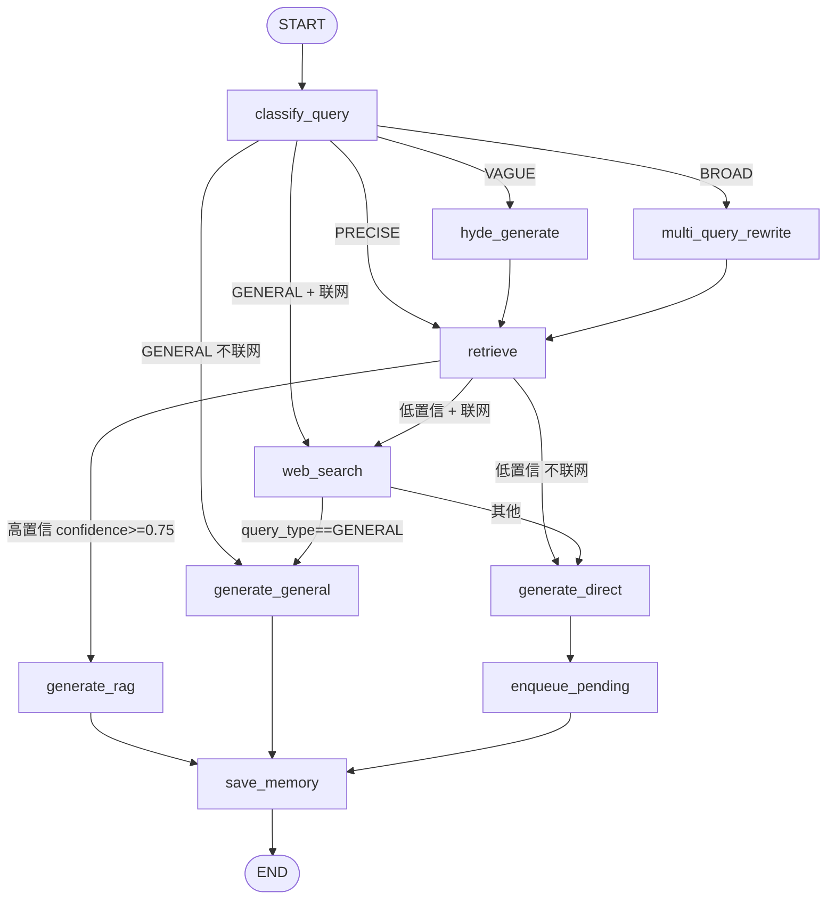
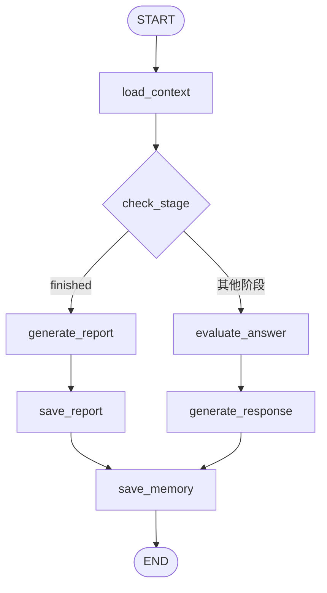

# EduAgent 项目交接文档

> 面向接手本项目的人。读完这一份 + `docs/agent-*.md`，就能上手改代码。
> 本文基于 `dev` 分支当前工作区代码实测整理，**所有行号引用均已核对**。
> 文档与 README 冲突之处，以本文为准（差异见第 12 章）。

---

## 目录

1. [项目概览](#1-项目概览)
2. [快速上手](#2-快速上手)
3. [目录结构](#3-目录结构)
4. [技术栈](#4-技术栈)
5. [架构分层](#5-架构分层)
6. [四大 Agent 概览](#6-四大-agent-概览)
7. [公共层详解](#7-公共层详解)
8. [数据层](#8-数据层)
9. [API 清单](#9-api-清单)
10. [编码约定](#10-编码约定)
11. [已知问题与技术债](#11-已知问题与技术债)
12. [README 勘误：文档与实现的差异](#12-readme-勘误文档与实现的差异)
13. [验证与调试入口](#13-验证与调试入口)
14. [后续演进建议](#14-后续演进建议)

---

## 1. 项目概览

**EduAgent** 是面向 IT 教育培训机构的 AI 多智能体教学辅助平台，把四类重复性教学业务各自封装成一个独立 Agent：

| Agent | 业务 | 技术范式（实际实现） |
|-------|------|---------------------|
| **QA** 智能问答 | 基于课程知识库实时答疑 | 四类意图分流 + 混合检索（BGE-M3 dense+sparse）+ Reranker 精排 + 低置信度联网兜底 + SSE 流式 |
| **Exam** 试卷批改 | 批改选择/判断/简答/编程题 | 三轨并行（规则 / LLM / LLM）+ 薄弱点分析 + `interrupt()` 驱动的教师确认环 |
| **Resume** 简历审查 | 六维度评分 + 问题诊断 | PDF 解析 + JSON 抽取 + 六维度并行评分 + Think Tool 诊断 |
| **Interview** 模拟面试 | 五阶段全程技术面试陪练 | LangGraph 状态机 + Think Tool 双轨质量评估 + 跨轮记忆压缩 |

四个之上有 **Orchestrator 编排层**（`core/orchestrator.py`）负责单 Agent 调度与 pipeline 串联，但目前 HTTP 层并未接入它（见 11.7）。

---

## 2. 快速上手

### 2.1 环境

| 项 | README 说的 | **实际情况** |
|----|------------|-------------|
| Python | 3.11 严格锁定 | 本机与 `.venv` 都是 **3.13.5**（`.venv/lib/python3.13`）。`pyproject.toml` 写 `requires-python = ">=3.13"`，`requirements.txt` 却按 3.11 锁版本 —— 两套依赖清单版本还对不上（如 torch 2.7.0 vs 2.5.1、pymilvus 3.0.1 vs 2.4.9）。**以能跑起来的环境为准，动依赖前先确认。** |
| 配置文件 | `.env.local` | `backend/config.py:10` 读的是项目根目录的 **`.env`**。`extra = "ignore"`，多余字段不报错。两个文件名都在 `.gitignore` 里。 |
| 依赖安装 | `pip install -r requirments.txt`（README 里这个文件名拼错了） | 实际文件叫 `requirements.txt`；也有 `uv.lock` + `pyproject.toml` 可用 uv 安装。 |

### 2.2 启动顺序

```bash
# 1. 基础设施
docker-compose --env-file .env up -d postgres redis minio etcd milvus langfuse

# 2. 首次初始化（只需一次）
python scripts/_01_init_milvus.py         # 建 Milvus Collection（schema 定义就在这里）
# 建表 SQL 需要手工执行 scripts/_03_init_db.sql
python scripts/_04_seed_data.py           # 测试用户 + 试卷数据
python scripts/_05_seed_standard_exam.py  # 标准试卷

# 3. 导入知识库（QA 用）
python scripts/_02_build_knowledge_base.py --file <文档路径> --course_id <课程UUID>

# 4. 启动后端（务必在项目根目录，模块路径是 backend.xxx）
uvicorn backend.main:app --host 0.0.0.0 --port 8000

# 5. 前端
cd frontend && npm install && npm run dev
```

### 2.3 端口

| 服务 | 端口 |
|------|------|
| FastAPI | 8000（Swagger: `/docs`） |
| Vue3 | 3000 |
| PostgreSQL | 5433 |
| Redis | 6380 |
| MinIO API / 控制台 | 9002 / 9003 |
| Milvus | 19531 |
| Langfuse | 3001 |

### 2.4 测试账号

`student` / `Student@123456`，`teacher` / `Teacher@123456`，`admin` / `Admin@123456`

---

## 3. 目录结构

```
EduAgent/
├── backend/
│   ├── main.py              FastAPI 入口 + lifespan（迁移 → 模型预热 → MCP lifespan 嵌套）
│   ├── config.py            pydantic-settings 配置中心（唯一读 .env 的地方）
│   ├── dependencies.py      AsyncSessionLocal / get_db / get_current_user（JWT）
│   ├── new_main.py          精简版入口（挂载点与 main.py 不一致，疑似实验残留）
│   ├── api/
│   │   ├── router.py        总路由，聚合 6 个子路由
│   │   └── v1/
│   │       ├── auth.py             登录鉴权
│   │       ├── unified_chat.py     统一对话入口（LLM 意图路由 + SSE）
│   │       ├── qa.py               智能问答
│   │       ├── exam.py             试卷批改（含教师端接口）
│   │       ├── resume.py           简历审查
│   │       ├── interview.py        模拟面试
│   │       └── verify_*_e2e.py     四个 E2E 自查接口（非业务）
│   ├── agents/             四大 Agent，每个都是 state/graph/nodes/prompts 四文件
│   │   ├── qa/  exam/  resume/  interview/
│   ├── core/
│   │   ├── llm_factory.py       LLM 统一入口（按 agent_type 路由 + 实例缓存）
│   │   ├── orchestrator.py      编排层（AgentRequest/Response、pipeline）
│   │   ├── memory.py            MemorySaver 隔离 / thread_id / 滑窗 / 摘要压缩
│   │   ├── retry.py             with_retry 装饰器（三层兜底）
│   │   ├── knowledge_base.py    BGE-M3 嵌入 + Milvus 混合检索
│   │   ├── reranker.py          BGE-Reranker 精排 + 一体化 retrieve()
│   │   ├── query_classifier.py  MiniLM 二分类（QA 内部用）+ 训练脚本
│   │   ├── logger.py            结构化日志
│   │   └── exceptions.py        自定义异常
│   ├── db/migrations.py     启动时执行的幂等 DDL 补丁
│   └── mcp/                 知识库 MCP + 联网搜索 MCP + 手写 JSON-RPC 客户端
├── scripts/
│   ├── _01_init_milvus.py        Milvus Collection schema（**权威定义在这**）
│   ├── _02_build_knowledge_base.py  知识库导入
│   ├── _03_init_db.sql           PostgreSQL 建表 SQL（**权威定义在这**）
│   ├── _04_seed_data.py          测试数据
│   ├── _05_seed_standard_exam.py 标准试卷
│   ├── init_db.sql/              ⚠️ 是个空目录，别被名字骗了
│   └── manual_tests/             手工测试脚本
├── review/                  课件配套的复习 demo（async / pydantic / langgraph 等），非业务代码
├── samples/                 样例文件
├── models/                  本地模型权重（.gitignore，需自行下载）
├── frontend/                Vue3 前端（本次交接未覆盖）
├── CLAUDE.md                给 Claude Code 的项目引导
└── docs/                    本目录
```

---

## 4. 技术栈

| 层面 | 选型 | 备注 |
|------|------|------|
| 语言 | Python 3.13（实际） | 见 2.1 |
| Web | FastAPI + sse-starlette | |
| Agent | LangChain 1.2.10 + LangGraph 1.0.9 | 版本锁定，勿随意升级 |
| LLM | DeepSeek（走 OpenAI 兼容接口） | 所有 agent_type 目前都映射到 `deepseek-chat`，再二次映射为 `deepseek-v4-flash`，且强制 `thinking.type=disabled` |
| 向量库 | Milvus（`pymilvus`） | Collection `knowledge_domain` |
| 关系库 | PostgreSQL + SQLAlchemy 异步（asyncpg） | |
| 缓存 | Redis | 已在 docker-compose，代码中未见使用 |
| 对象存储 | MinIO | **已部署但未接入**（见 11.5） |
| 嵌入 | BGE-M3（进程内，dense 1024 维 + sparse 双输出） | |
| 精排 | BGE-Reranker（进程内，CrossEncoder） | 本地缺权重时回退 `BAAI/bge-reranker-v2-m3` |
| 分类 | MiniLM-L6-v2（进程内，含微调版） | 仅 QA 内部二分类 |
| 可观测 | Langfuse | 已部署，代码中未见埋点 |
| 前端 | Vue3 + TS + Element Plus | |

---

## 5. 架构分层

```
┌──────────────────────────────────────────────────┐
│  前端层  Vue3 SPA (:3000)                          │
└───────────────────────┬──────────────────────────┘
                        │ HTTP / SSE
┌───────────────────────▼──────────────────────────┐
│  API 层  FastAPI (:8000)                          │
│  /api/v1/{auth, chat, qa, exam, resume, interview}│
│  JWT 鉴权 · SSE 流式 · 文件上传                     │
└───────────────────────┬──────────────────────────┘
                        │
┌───────────────────────▼──────────────────────────┐
│  编排层  Orchestrator                              │
│  AgentRequest → AgentResponse · pipeline 串联      │
│  ⚠️ HTTP 层当前未接入（unified_chat 只用其图缓存）   │
└──┬──────────┬──────────┬──────────┬──────────────┘
   │          │          │          │
┌──▼───┐ ┌───▼──┐ ┌─────▼──┐ ┌─────▼────┐
│  QA  │ │ Exam │ │ Resume │ │Interview │  ← LangGraph × 4
└──────┘ └──────┘ └────────┘ └──────────┘
                        │
┌───────────────────────▼──────────────────────────┐
│  公共层                                            │
│  LLM Factory · MemorySaver · Retry 三层兜底        │
│  BGE-M3 / Reranker / MiniLM（进程内）              │
│  MCP Server（知识库检索 + Web 搜索）                │
└───────────────────────┬──────────────────────────┘
                        │
┌───────────────────────▼──────────────────────────┐
│  数据层  PostgreSQL · Milvus · (Redis/MinIO 未用)  │
└──────────────────────────────────────────────────┘
```

**启动流程**（`backend/main.py:34-74`）：
1. `configure_logging()`
2. `run_migrations()` —— 幂等 DDL 补丁，失败只告警不拦启动
3. 并行预热三个本地模型（`asyncio.gather` + `run_in_executor`，各跑在线程池）
4. 手动嵌套进入两个 MCP 子应用的 `lifespan_context`（mount 不会自动调用子应用 lifespan）
5. 关闭时 `LLMFactory.clear_cache()`

---

## 6. 四大 Agent 概览

> 每个 Agent 的逐节点详解见 `docs/agent-*.md`（interview 已完成，其余待补）。

### 6.0 一览对比

| | QA | Exam | Resume | Interview |
|---|---|---|---|---|
| 节点数 | 10 | 9 | 8 | 7 |
| 拓扑 | 3 组条件边，多分支 | **纯线性链** | **纯直线** | 1 组条件边，两路径 |
| Checkpointer | ✅ qa | ✅ exam | ❌ 无 | ✅ interview |
| 多轮有状态 | ✅ | 用 interrupt 暂停 | ❌ 一次性 | ✅ |
| 并行点 | BROAD 分支多查询并行检索 | **三轨 gather** | **六维度 gather** | 首轮四路 I/O gather |
| LLM 输出方式 | 流式（`streaming=True`） | 结构化输出 | 结构化输出 | 流式未启用（见 11.2） |
| 降级层数 | 节点级 + retry 装饰器 | 节点级 | 节点级 | 节点级 |
| 是否走 Orchestrator | ❌ | ❌ | ❌ | ❌ |

> **重要事实**：四个 Agent 的 API 层**全部直接调用自己的图**，没有走 `Orchestrator.handle`。Orchestrator 的三层兜底装饰器 `with_retry` 目前只在它自己内部生效（全仓唯一调用点：`orchestrator.py:196`）。

### 6.1 QA 智能问答

**图拓扑**（`agents/qa/graph.py`）：



**核心机制**：

- **意图分类三层**（`classify_query_node`）：规则集（闲聊/时间/打招呼）→ 关键词快速通道 → MiniLM 二分类（阈值 `P(general) >= 0.85`）→ 专业问题再判检索策略。
- **四类查询策略**：`GENERAL`（不用检索，直接答）/ `PRECISE`（原 query 检索，recall 8）/ `VAGUE`（HyDE 生成假设文档后检索，recall 10）/ `BROAD`（Multi-Query 拆 3 条子查询并行检索合并去重，每条 recall 4）。精排统一取 Top-3。
- **检索链路**：BGE-M3 编码 → Milvus 混合检索（dense HNSW/COSINE + sparse IP，`WeightedRanker(0.7, 0.3)`）→ BGE-Reranker 精排 → `confidence = Top-1 分数`。
- **低置信兜底**：`confidence < 0.75` 时若开启联网则走 Web Search MCP 后直答，否则纯 LLM 直答（回答尾部加 `⚠️ 说明`），同时把问题写入 `knowledge_pending_queue` 供后续补进知识库。
- **联网指令自动识别**：用户话里带「联网搜一下」这类词会自动剥离该指令并置 `enable_web_search=True`。
- **SSE 流式**：只转发 `generate_rag` / `generate_direct` / `generate_general` 三个节点的 token；另有 `progress` 进度事件与流末 `meta` 事件。生成节点确实传了 `streaming=True`。

**端点**：`POST /qa/chat`、`POST /qa/chat/stream`、`GET /qa/sessions/{id}/history`

### 6.2 Exam 试卷批改

**图拓扑**（`agents/exam/graph.py`）—— 纯线性，唯一「分支」是 `interrupt()`：


**核心机制**：

- **三轨并行批改**（`run_three_tracks_node`，`asyncio.gather(..., return_exceptions=True)`）：
  - **第一轨 客观题**：纯规则引擎，无 LLM。答案标准化（大写 + 去空格逗号 + 字符排序）后全等才给满分。
  - **第二轨 简答题**：Think Tool 推理 + 结构化评分。`GROUP_SIZE=3` 分组，**组内并行、组间串行**，目的是避免触发 API 限速。单题异常降级为 0 分 + `needs_review=True`。
  - **第三轨 代码题**：顺序逐题（题目少不必并行），手工 `json.loads` + 剥离 ```json 围栏。
  - `needs_review = confidence < 0.7`。
- **HitL 教师确认环**：用 LangGraph **原生 `interrupt()` + `Command(resume=...)`**，不是数据库标记。图在 `teacher_review` 冻结，State 存 MemorySaver；教师端 `GET /exam/submissions/{id}/review` 通过 `aget_state` 读暂停态，`POST .../confirm` 用 `Command(resume=decision)` 恢复。`action` 只接受 `approve` / `modify`。
- **薄弱点分析**：有 `knowledge_tag` 的失分题规则聚合 + 全部失分题交 LLM 推断，两路按 tag 去重合并，按 `wrong_count` 降序。
- **降级**：Word 解析失败 → 空题目列表交人工；某轨异常 → 该轨置 `[]` 其余继续；薄弱点分析失败 → 固定文案。

**端点**：`POST /exam/submit`（202，后台任务）、`GET /exam/my-submissions`、`GET /exam/my-submissions/{id}`、`GET /exam/submissions/{id}/review`（教师）、`GET /exam/pending-reviews`（教师）、`POST /exam/submissions/{id}/confirm`（教师）

### 6.3 Resume 简历审查

**图拓扑**（`agents/resume/graph.py`）—— 8 节点纯直线，**无 checkpointer**：

```
START → upload_to_minio → download_pdf → extract_text → extract_structured
      → run_six_dimensions → diagnose_issues → generate_summary → save_results → END
```

> ⚠️ `upload_to_minio` 与 `download_pdf` 两个节点是**空跑**（直接 `return {}`，只留注释「本地模式跳过」）。

**核心机制**：

- **PDF 解析**：PyMuPDF（`fitz`），跑在 `run_in_executor` 里。**有双栏排版检测**：按文字块以页宽中点分左右栏，若 `len(left)>=2 and len(right)>=2 and right/total>0.3` 判为双栏，则左栏读完读右栏，否则按 y 排序。页间用 `---PAGE BREAK---` 连接。文本 <200 字仅告警（疑似扫描件），**无 OCR**。
- **结构化抽取**：用 **JSON mode 而非 structured output** —— Prompt 里给出完整 JSON 示例，手工解析 + 剥离代码围栏 + Pydantic 校验补全。代码里有注释说明「JSON mode 比 Function Calling 更稳定」，旧版实现被注释保留在 `nodes.py:110-138`。
- **六维度并行评分**：`asyncio.gather` 并发 6 个协程。权重：项目深度 0.30 / 技术匹配度 0.25 / 表达规范性 0.15 / 简历结构 0.15 / 量化程度 0.10 / 真实可信度 0.05。每维度独立 2 次重试，失败降级为 50 分 + 「建议人工复核」。输入截断 `raw_text[:3000]`。
- **问题诊断**：Think Tool 前置推理 + 结构化 `IssueList` 输出（包一层 `items` 字段，因为 `with_structured_output` 要求顶层是对象）。
- **后台执行**：API 层 `asyncio.create_task` + 模块级 `_background_tasks` 集合持强引用防 GC + `_on_task_done` 回调清理临时文件并标记失败。`processing` 超 15 分钟视为失败。用 `threading.local()` 每线程一份编译图。

**端点**：`POST /resume/upload`（202）、`GET /resume/reviews/{id}`、`DELETE /resume/reviews/{id}`、`GET /resume/reviews`

### 6.4 Interview 模拟面试

**图拓扑**（`agents/interview/graph.py`）：



**五阶段状态机**：`WARMUP(1-4轮)` → `TECH_BASE(6-12轮)` → `PROJECT(2-14轮)` → `CLOSING(2-4轮)` → `FINISHED`；总轮数上限 40，命中「结束面试」等关键词或 ≥38 轮则强制结束。

**核心机制**：Think Tool 双轨评估（先写分析再打标签）、首轮四路 I/O 并行加载（简历/DB题库/LLM出题/摘要）、LLM 现出题优先于 DB 题库、技术题只追 EXCELLENT 而项目题 ADEQUATE 也追、滑动窗口 + 增量摘要双轨上下文压缩、SSE 只暴露面试官话术不泄露评估过程。

> 📖 **完整详解见 `docs/agent-interview.md`**（含逐节点实现、Prompt 清单、已知问题 8 项）。

---

## 7. 公共层详解

### 7.1 LLM Factory（`core/llm_factory.py`）

全项目获取模型的**唯一入口**，禁止直接 `init_chat_model`。

- **两层映射**：`_AGENT_MODEL_ROUTING`（agent_type → 模型标识符，`:32-40`）→ `_MODEL_ID_MAP`（标识符 → API 实际模型名，`:43-46`）。目前 `qa` / `exam_subjective` / `exam_code` / `resume` / `interview` / `intent` / `summarize` **全部指向 `deepseek-chat`**，再映射为 `deepseek-v4-flash`。换模型只改这两张表。
- **实例缓存**：缓存键 = `模型_温度_是否流式`（`:103`），命中即复用。
- **自定义 httpx 客户端**：`trust_env=False` 绕过系统代理（Windows 代理会导致 TLS 握手失败），超时 120s / 连接 15s（`:21-28`）。
- **默认 `temperature=0`**，并强制 `extra_body={"thinking": {"type": "disabled"}}` 关闭思考模式（`:111-112`）。
- **结构化输出**必须 `method="function_calling"`（DeepSeek 的要求，`:134`）。
- `max_retries=0` —— 重试统一交给 `retry.py`。

### 7.2 Memory（`core/memory.py`）

| 函数 | 作用 |
|------|------|
| `get_memory_saver(agent_type)` | 按 Agent 返回**独立**的 `MemorySaver` 单例。不同 Agent 的 State schema 不同，共用会导致 msgpack 序列化冲突。 |
| `build_thread_id(student_id, session_id)` | `student_{id}_session_{id}` |
| `build_config(...)` | `{"configurable": {"thread_id": ...}}` |
| `trim_messages_to_window(msgs, window_size)` | 保留最近 `window_size` 轮（每轮 2 条），**SystemMessage 永远保留** |
| `should_trigger_summary(msgs, threshold=10)` | `dialogue_count % 20 == 0`。**⚠️ 但它在两个 Agent 里都永不返回 True** —— 调用点（QA `nodes.py:544/660/723`、Interview `nodes.py:520`）都在生成节点，此时 `messages` 已含本轮 HumanMessage 却尚无本轮 AI 回复，`dialogue_count` 恒为奇数，`% 20 == 0` 恒不成立。门槛值本身也有语义缺陷：它要的是「刚好第 10 轮」而非「超过 10 轮」。 |
| `compress_to_summary(msgs, existing)` | 增量压缩为学员画像摘要（必须保留不理解的知识点/反复薄弱点/项目新信息） |

> `MemorySaver` 是**进程内内存**，重启即丢。生产要换 `AsyncPostgresSaver`，业务代码无需改动。

### 7.3 Retry 三层兜底（`core/retry.py`）

**装饰器工厂** `@with_retry(agent_type="...")`，只支持 async 函数。

| 层 | 实现 | 行为 |
|----|------|------|
| 第一层 自动重试 | `asyncio.wait_for(func(), timeout=120.0)` | 白名单异常（`InvalidInputError`/`AuthenticationError`）立即抛；其余按 1s / 3s 退避重试，最多 2 次 |
| 第二层 Agent 降级 | `AgentFallbackHandler.handle()` 内的**硬编码字典** `fallback_map`（`:104-110`） | `qa`/`exam_code`/`exam_subjective`/`resume`/`interview` 各有降级函数，返回带 `fallback_used=True` 的 dict |
| 第三层 系统兜底 | `_system_fallback_response()` | 按 agent_type 取固定文案，**永不失败** |

⚠️ **两个实现细节与注释不符**：
- `TIMEOUT_PER_ATTEMPT = 120.0`，但注释写「最多等 30 秒」（`:32-34`）。
- `RETRYABLE_ERRORS` 元组（`:20-25`）**定义了但未参与判断**，实际逻辑是「白名单异常立即抛、其余全当可重试」。

⚠️ **`with_retry` 全仓只有一个调用点**：`orchestrator.py:196`。四个 Agent 的 API 层都是直接 `graph.ainvoke`，**没有套三层兜底**。

### 7.4 知识库与检索

**BGE-M3（`core/knowledge_base.py:20-127`）**
- 单例 `get_instance()`；`FlagEmbedding.BGEM3FlagModel`
- `use_fp16` **仅 CUDA 可用时为 True** —— 注释说明 BGE-M3 在 Apple MPS 上会触发 LLVM ERROR
- 加载前给 `transformers.utils.import_utils` 打补丁补 `is_torch_fx_available`（兼容性 hack）
- **单次推理同时出 dense + sparse**：`encode(..., return_dense=True, return_sparse=True, max_length=8192)`；dense 1024 维；sparse 的 `lexical_weights` **强制转 `{int: float}`**（msgpack 不支持 numpy.float16）
- 查询接口 `encode_query(text) -> (list[float], dict)`

**Milvus 混合检索（`_hybrid_search`，`:275-364`）**
- Collection：`knowledge_domain`（**单 Collection + `tenant_id` 字段过滤**做多租户）
- Dense：`anns_field="embedding"`，`COSINE`，`ef=64`
- Sparse：`anns_field="sparse_embedding"`，`IP`
- 融合：服务端 `hybrid_search(..., ranker=WeightedRanker(0.7, 0.3))`
- 过滤：`_build_filter()` 做引号转义防注入
- Schema 与索引的**权威定义在 `scripts/_01_init_milvus.py`**（HNSW + COSINE，M=16/efConstruction=256；sparse 用 SPARSE_INVERTED_INDEX + IP）

**Reranker（`core/reranker.py`）**
- `sentence_transformers.CrossEncoder`，`max_length=512`
- 本地路径缺失或缺权重文件时回退 HuggingFace `BAAI/bge-reranker-v2-m3`
- `rerank_with_confidence()` 返回 `(top_results, confidence)`，**confidence 即 Top-1 分数**，`>= 0.75` 为高置信
- 文档截断 512 字符

**一体化入口 `retrieve()`（`reranker.py:132-178`）**：BGE-M3 编码 → Milvus 混合检索 → Reranker 精排，一步到位。QA 直接用它。

**QueryClassifier（`core/query_classifier.py`）**
- **用途是 QA 内部的 `general` / `specialized` 二分类**，不是跨 Agent 意图分类
- 阈值 `GENERAL_CONFIDENCE_THRESHOLD = 0.85`（偏高，宁可多走 RAG）
- 默认加载**微调后**的模型（`FINETUNED_CLASSIFIER_PATH`），传 `model_path` 才用基座
- 同文件内含完整训练脚本（HF `Trainer` + EarlyStopping，按 `f1_macro` 选最优）

### 7.5 MCP

| Server | 挂载点 | Tool | 说明 |
|--------|--------|------|------|
| EducationBase | `/mcp/kb` | `search_knowledge_base(query, tenant_id, course_id, top_k)` | 返回 content/source_name/score/confidence |
| WebSearch | `/mcp/web-search` | `web_search(query, max_results)` | Tavily 优先，失败降级 DuckDuckGo |

- 两个都是 `FastMCP(stateless_http=True, json_response=True)`
- **客户端是手写的 JSON-RPC 2.0 POST**（`mcp/client.py:13-100`），未用官方 MCP SDK。要点：必须带 `Accept: application/json` 否则 -32600；响应必须遍历**全部** `content` 条目而不能只取 `[0]`（FastMCP 对 list[dict] 的序列化行为不一致）；`trust_env=False` 绕代理。
- ⚠️ **`search_knowledge_base` 在生产链路中没有调用点** —— QA 直接 `import retrieve` 走进程内检索。这个 MCP tool 属于对外暴露/预留。**只有 Web Search MCP 被真正接入**（QA 低置信度分支）。
- 服务端在 `main.py:100-101` 挂载；`new_main.py` 里挂载点不同，疑似实验残留。

### 7.6 鉴权与 DB 会话（`dependencies.py`）

- 引擎：`create_async_engine(database_url, pool_size=10, max_overflow=20)`；**未配置 `pool_pre_ping` / `pool_recycle`**（长连接场景可能踩到连接失效）
- `AsyncSessionLocal = async_sessionmaker(engine, expire_on_commit=False)`
- `get_db()`：FastAPI 依赖，正常 `commit` / 异常 `rollback` 并 raise
- `get_current_user()`：`HTTPBearer` 解析 → `jose.jwt.decode` → 返回 **`{"user_id": str, "role": str, "tenant_id": str}`**。`tenant_id` 取自 JWT，缺省 `tenant_default`。

---

## 8. 数据层

建表 SQL 权威定义在 **`scripts/_03_init_db.sql`**（248 行）。增量补丁在 `backend/db/migrations.py`。

| 表 | 用途 | 关键列 |
|----|------|--------|
| `users` | 用户 | 三种角色 |
| `exams` | 试卷 | |
| `questions` / `scoring_points` | 题目与评分点 | |
| `exam_submissions` | 学员提交 | `status`、`weak_points`、`weak_points_summary` |
| `exam_reviews` | 逐题批改结果 | `ai_raw_result` JSONB、`knowledge_tag` |
| `resume_reviews` | 简历审查 | **`structured_data` JSONB**（面试 Agent 的联动数据源） |
| `interview_questions` | 面试题库 | `target_position`（`general` 为通用题）、`difficulty`、`tags`、`is_active` |
| `interview_sessions` | 面试会话 | **`thread_id` UNIQUE**（UPSERT 冲突键）、`summary`、`report` JSONB、`overall_score`、`status` |
| `qa_sessions` | 问答会话 | `thread_id` UNIQUE、`summary`、`summary_version` |
| `knowledge_pending_queue` | 低置信问题待补队列 | |

- 所有表都有 `tenant_id` + `created_at` / `updated_at`，且 `updated_at` 由触发器 `trg_*_updated_at` 自动维护。
- `interview_sessions.resume_review_id` 外键指向 `resume_reviews(id)` —— 这是「简历 → 面试」联动的数据库基础。

---

## 9. API 清单

全部挂在 `/api/v1` 下（`main.py:98`），子路由注册在 `api/router.py:10-15`。

| 前缀 | 标签 | 文件 | 章节 |
|------|------|------|------|
| `/auth` | 认证 | `auth.py` | — |
| `/chat` | AI助手 | `unified_chat.py` | 第 8 章 |
| `/qa` | 智能问答 | `qa.py` | 第 5 章 |
| `/exam` | 试卷批改 | `exam.py` | 第 6 章 |
| `/resume` | 简历审查 | `resume.py` | 第 4 章 |
| `/interview` | 模拟面试 | `interview.py` | 第 7 章 |

另有：`GET /health`（健康检查）、`/docs`（Swagger）、`/mcp/kb` 与 `/mcp/web-search`（MCP 子应用）。

**统一对话入口 `POST /api/v1/chat/stream`**（SSE）值得单独说明：
1. **规则前置拦截**：问候 / 感谢 / 道别 / 问身份 / 问功能五类零 Token 模板直接回，不调模型
2. **LLM 路由**：`get_llm("intent", temperature=0)` 输出 6 个标签之一 —— `qa` / `exam` / `resume` / `interview` / `multi_agent` / `clarify`；非法值或异常降级为 `qa`；`confidence` 恒为 0.85（无实际语义，仅供前端展示）
3. 推 `routing_decision` 事件
4. 分发：`qa` 真正流式执行；`exam`/`resume`/`interview` **只推引导跳转文案**，不在统一入口执行；`multi_agent` 只推 pipeline 计划，**不真正触发执行**
5. 统一 `done` 收尾

---

## 10. 编码约定

1. **模型只能通过 `core/llm_factory.py` 获取**，禁止直接 `init_chat_model`。未知 `agent_type` 会 `raise ValueError`（早暴露问题）。
2. **每个 Agent 四文件**：`state.py` / `graph.py` / `nodes.py` / `prompts.py`。
3. **Prompt 放 `prompts.py`**，用模块级常量。现有写法混用 dict（按场景取键）与纯字符串。
4. **Checkpointer 按 Agent 隔离**：`get_memory_saver("interview")`。
5. **thread_id 统一 `build_thread_id()`**。
6. **API 放 `api/v1/` 并注册到 `router.py`**。
7. **改表必须走幂等迁移**（`db/migrations.py` 的 `_MIGRATIONS`），只写 `ADD COLUMN IF NOT EXISTS` / `CREATE INDEX IF NOT EXISTS`，**禁止 `DROP` / `TRUNCATE`**。同步更新 `_03_init_db.sql`。
8. **外部依赖一律兜底**：LLM / DB / MCP 失败记 warning 后走降级，**不向上抛异常**，保证用户始终有响应。这是全项目最一致的风格。
9. **日志用 `get_logger(__name__)`**，结构化写法 `logger.info("event.name", key=value)`。
10. **新增 State 字段要三处同步**：`state.py` 定义、`api/v1/*.py` 的 `initial_state`（**首轮必须传全量** —— MemorySaver 里还没有存档，字段缺失会崩）、以及写入该字段的节点。
11. 注释与文档全部中文，风格是「关键代码上方一行短注释」。

---

## 11. 已知问题与技术债

> 按影响面排序。「是否已确认」列标注了问题是我实测确认的、还是需要进一步验证的。

### 11.1 `MemorySaver` 是进程内内存 🔴 架构级

**影响**：后端一重启，所有会话历史（QA / Exam / Interview）全部丢失；多 worker 部署时 HitL 的 `/confirm` 会路由不到持有 checkpoint 的进程，直接失效。

**修复方向**：换 `AsyncPostgresSaver`（`memory.py:22-24` 注释已说明业务代码无需改动，只需替换 `get_memory_saver` 的实现并提供 PG 连接）。

### 11.2 面试 SSE 可能不是真流式 🟠 待验证

`agents/interview/nodes.py` 里所有 `get_llm("interview", temperature=X)` 都**没传 `streaming=True`**，而 `LLMFactory` 默认 `streaming=False`。LangChain 在模型未启用流式时，`astream_events` 通常只产出一个包含完整内容的 `on_chat_model_stream` 事件，而非逐 token。

**对照**：QA 的生成节点明确传了 `streaming=True`（`agents/qa/nodes.py:525` 等），所以 QA 流式正常。

**验证方法**：调 `POST /api/v1/interview/sessions/{id}/chat/stream`，数 `data:` 帧里 `type=token` 的条数 —— 只有 1 条即为确诊。

**修复**：给 `_respond_*` 里的 `get_llm` 加 `streaming=True`（缓存键已含该维度，不会互相污染）。

### 11.3 QA 长期记忆完全失效：缩进 bug + 取模永假（两个缺陷叠加）🔴 已确认

**缺陷一 —— UPSERT 缩进错误（`agents/qa/nodes.py:806`）**

UPSERT 语句的 `try:` 缩进为 8 空格，**被误嵌进了 `if state.get("should_summarize", False):` 块内部**（该 `if` 在 `:793`，是 4 空格）。上面那行注释「── UPSERT 到 qa_sessions 表 ──」是 4 空格，视觉上掩盖了问题。

**缺陷二 —— `should_summarize` 恒为 `False`**

`should_summarize` 由 `should_trigger_summary(messages)` 赋值（`nodes.py:544` / `:660` / `:723`，三个生成节点），该函数实现是 `dialogue_count % (threshold*2) == 0`，即要求 `dialogue_count % 20 == 0`。

关键在于**求值时机**：`api/v1/qa.py:58` 把本轮的 `HumanMessage` 放进 `initial_state["messages"]` 之后才 `ainvoke`，而节点内 `messages = state.get("messages", [])` 拿到的是**本轮 AI 回复尚未追加**的列表。设这是第 N 轮：

```
dialogue_count = 2×(N-1) + 1 = 2N - 1   →  恒为奇数
奇数 % 20 == 0                            →  永不成立
```

**后果**：`should_summarize` 恒为 `False`，配合缺陷一，**UPSERT 一次都不会执行 —— `qa_sessions` 表永远没有 QA Agent 写入的行**。三处生成节点各自的 `summary` 也从不产生。`GET /qa/sessions/{id}/history` 因此永远读不到摘要更新。

> ⚠️ 早期版本的本文档写的「只在第 10/20/30… 轮落库」是**错误**的。那个说法默认 `dialogue_count` 是偶数，只有在 `messages` 已包含本轮 AI 回复时才成立 —— 而调用点并非如此。

**面试 Agent 同源问题（表现不同）**：`agents/interview/nodes.py:520` 用同样的 `should_trigger_summary(messages)`，且 `api/v1/interview.py:146` 同样是先塞 `HumanMessage` 再 invoke，所以同样恒为 `False`。但面试的 `save_memory_node` 缩进正确（UPSERT 在 `if` 之外），因此每轮都写库 —— 表现为**行存在、但 `summary` 列恒为 `NULL`**（`existing_summary` 来自 `_fetch_summary()`，读回的本来就是 NULL）。更糟的是 `ON CONFLICT DO UPDATE SET summary = EXCLUDED.summary`，等于每轮都用 `None` 覆盖一次。详见 `agent-interview.md` 第 8 章。

**修复**（缺陷一、二需同时修，只修一个无效）：

1. 把 `nodes.py:805` 之后的整块 `try/except` 减少 4 个空格；
2. `should_trigger_summary` 改为 `dialogue_count >= threshold * 2` 之类的「超过阈值」语义；
3. **额外注意**：修好缩进后，非压缩轮次会用 `summary = state.get("existing_summary")`（可能为 `None`）覆盖已有摘要，需一并处理为「仅在压缩成功时更新 summary 列」。

### 11.4 `fallback_used` 是死字段 🟡 已确认

`qa` / `exam` / `interview` / `resume` 四个 State 都定义了 `fallback_used`，但**没有任何节点写入它**（resume 的 `save_results` 甚至硬编码返回 `False`）。API 层却把它返回给前端（`api/v1/qa.py:84`、`api/v1/exam.py:139` 等），所以前端永远看到 `false`，降级状态无法上报。

**修复**：在各降级分支补写 `fallback_used=True`。

### 11.5 MinIO 未接入 🟡 已确认

`docker-compose` 起了 MinIO，`config.py` 也没配 MinIO 相关项，`agents/resume/nodes.py:42-51` 的 `upload_to_minio_node` / `download_pdf_node` 是**空跑节点**（直接 `return {}`），DB 里写的 `pdf_minio_path` 是假路径。简历 PDF 实际走本地 `tempfile`，且处理完即删。

**后果**：单机可用，多实例部署不可用（上传的临时文件在 A 实例，处理可能落到 B 实例）。

### 11.6 Exam 的 Judge0 沙箱未实现 🟡 已确认

README 与技术范式表提到「批改跳过 Judge0」的降级路径，但**代码中完全没有 Judge0 集成**（仅 `core/retry.py:8` 的注释提了一句「已去掉 Judge0 的 Sandbox 异常」）。代码题批改**完全依赖 LLM 静态阅读**学员提交的代码，不执行、不跑单测。

**风险**：学员交一段「看起来对但运行会错」的代码，LLM 大概率给高分。

### 11.7 Orchestrator 的 pipeline 能力在 HTTP 层没有入口 🟡 已确认

- `Orchestrator.handle()` 实现了完整的单 Agent 调度 + pipeline 串联（`job_preparation` = RESUME → INTERVIEW，带 `weighted_score < 60` 门槛终止）
- `with_retry` 三层兜底也只在这里生效
- **但**：四个 Agent 的 API 层全部直接调自己的图；`unified_chat.py:408` 只调用了 orchestrator 的私有方法 `_get_agent_graph` 来复用图缓存，**没有调 `handle`**；`multi_agent` 分支只推 `pipeline_plan` 事件，不真正执行。

**结论**：编排层目前是「写好了但没接线」的状态。

另有一个隐患：`_run_single_agent` 构造的通用 `initial_state` 不含 `review_id` / `pdf_local_path`，**若真从编排器调 Resume 图会 KeyError**（这两个字段在 `resume/nodes.py:44`、`:95` 是必需读的）。

### 11.8 `ExecutionMode.CLARIFY` 在 Orchestrator 内未实现 🟢

枚举定义了 `clarify`（`orchestrator.py:24-28`），但 `handle` 只判断 `pipeline_mode`，没有该分支。澄清逻辑实际由 `unified_chat.py:383-391` 自己处理。

### 11.9 面试结束后重复调用会重复生成报告 🟢 已确认

会话 `status` 已是 `finished` 后再调 `/chat`，`check_stage` 因 `current_stage == FINISHED` 直接返回 `{}`，条件路由仍走 `generate_report` → **再花一次 LLM 调用重新生成报告**。前端应禁用按钮，后端也可加 `status` 校验。

### 11.10 面试评估用了错误的 agent_type 🟢 已确认

`agents/interview/nodes.py:430` 和 `:447` 用的是 `get_llm("qa", ...)` 而非 `get_llm("interview", ...)`。当前两者都映射到同一个模型所以**行为无差异**，但将来给 interview 单独换模型时评估环节不会跟着变。

### 11.11 未使用的 Prompt 常量 🟢 已确认

`TECH_BASE_PROMPT["weak_transition"]`、`TECH_BASE_PROMPT["no_answer_hint"]`、`PROJECT_PROMPT["followup"]` 定义了但未被引用（相关逻辑已内联进其他 Prompt）。

### 11.12 其他小问题 🟢

- `retry.py` 的 `TIMEOUT_PER_ATTEMPT` 注释与实际值不符（注释 30 秒 / 实际 120 秒）；`RETRYABLE_ERRORS` 定义了未使用。
- `dependencies.py` 的引擎未配 `pool_pre_ping`。
- `main.py:8-13` 有一段 Windows conda 专用的 DLL 路径 hack，非 Windows 会跳过。
- `backend/new_main.py` 疑似实验残留，挂载点与 `main.py` 不一致。
- `agents/interview/nodes.py:238` 函数内重复 `import asyncio`（顶层 `:3` 已导入）。
- 当前工作区有大量 `__pycache__/*.pyc` 被 `git add` 进了暂存区，建议提交前 `git reset` 掉。
- `scripts/init_db.sql` 是个**空目录**，容易与 `scripts/_03_init_db.sql` 混淆。

### 11.13 简历数据跨学员 / 跨租户越读（IDOR）🔴 已确认（安全）

面试 Agent 的「简历联动」功能存在完整的数据越读链路，**任意已登录学员可读取他人简历内容**。

**缺陷一 —— 读取端无归属过滤**（`agents/interview/nodes.py:137-158`）

```python
async def _fetch_resume(resume_review_id: str) -> dict:
    async with AsyncSessionLocal() as s:
        result = await s.execute(
            text("SELECT structured_data FROM resume_reviews WHERE id = :id"),
            {"id": resume_review_id},
        )
```

只按主键查，**无 `student_id` / `tenant_id` 条件**。

**缺陷二 —— 写入端零校验**（`api/v1/interview.py:23-26`、`:63`）

`StartSessionRequest.resume_review_id` 由请求体直接透传进 `INSERT`，既不校验属于当前 `student_id`，也不校验同 `tenant_id`。

**攻击路径**：拿到他人 `resume_review_id`（出现在历史记录、日志、前端 URL 等）→ `POST /api/v1/interview/sessions` 带上该 ID → `load_context_node` 首轮读入受害者的 `projects` / `skills_list` → 进入 PROJECT 阶段后面试官**主动追问受害者的项目名、技术栈、量化亮点** → 攻击者从对话中直接读走。

**修复**：读取 SQL 补 `AND student_id = :sid AND tenant_id = :tid`（兜底），并在建会话时先查归属、不通过返回 404（体验更好）。**建议两者都做。** 详见 `agent-interview.md` 12.9 与 `agent-resume.md` 15.21（简历侧独立发现同一问题）。

### 11.14 全项目无角色鉴权：教师端端点对学员开放 🔴 已确认（安全）

`grep -c "role" backend/api/v1/exam.py` → **0**。`api/v1/exam.py` 的教师端端点只校验「已登录」，不校验角色：

| 端点 | 问题 |
|------|------|
| `GET /exam/pending-reviews`（`:384`） | 任何学员都能列出**全租户**待确认批改 |
| `GET /exam/submissions/{id}/review`（`:338`） | 任何学员能读他人批改详情 |
| `POST /exam/submissions/{id}/confirm`（`:450`） | **任何学员都能调用 `/confirm` 自己发布成绩** |

`current_user["role"]` 在整个 `api/v1/` 目录里**从未被用于判断** —— 只有 `auth.py:87` 把 role 写进了 JWT。也就是说这**不是 Exam 漏了既有约定，而是这条约定在全项目范围内都不存在**（`dependencies.py` 的 `get_current_user` 只解析身份、不校验角色）。

**修复**：在 `dependencies.py` 加一个 `require_role("teacher")` 依赖工厂，教师端端点统一挂上；不要在每个端点里手写判断。

---

## 12. README 勘误：文档与实现的差异

接手时**以代码为准**。以下是已核实的差异：

| README 的说法 | 实际情况 |
|--------------|---------|
| 「基于 MiniLM 意图识别做 Agent 路由」 | 跨 Agent 路由现在由 `unified_chat.py` 的 **LLM** 完成（`get_llm("intent")`，6 标签）。MiniLM（`query_classifier.py`）只用于 QA 内部的 `general`/`specialized` 二分类。原 `IntentRouter` 已被移除。 |
| 「批改跳过 Judge0」的降级 | 代码中**没有 Judge0**，见 11.6。 |
| 「MinIO 对象存储」 | 已部署但**未接入代码**，见 11.5。 |
| 「Python 3.11 严格锁定」 | 实际跑在 **3.13.5**，`pyproject.toml` 也写 `>=3.13`。 |
| 「`pip install -r requirments.txt`」 | 文件名拼错，实际是 `requirements.txt`。且 `pyproject.toml` 的依赖版本与之冲突。 |
| 「`.env.example` → `.env.local`」 | `config.py` 读的是 **`.env`**。 |
| 「测试 76 passed / 1 skipped」 | **`tests/` 目录不存在**。现有验证靠 `backend/api/v1/verify_*_e2e.py` 与 `scripts/manual_tests/`。 |
| 「BGE-Reranker-large（进程内）」 | 本地权重缺失时会**回退到 HuggingFace `BAAI/bge-reranker-v2-m3`**。 |
| 「MCP Server（知识库检索 + Web 搜索）」 | 知识库 MCP **在生产链路中无调用点**，只有 Web 搜索真正接入。 |
| 「Langfuse 可观测性平台」 | 容器已起，但代码中**未见任何 Langfuse 埋点**。 |
| 目录结构里的 `backend/agents/*/` 注释 | 与实际一致 ✅ |
| 「Redis 缓存」 | 容器已起，代码中未见使用。 |
| FAQ：「试卷批改超 15 分钟未完成，记录将自动标记为 `failed`」 | **该超时机制不存在于 Exam**。全仓库唯一的超时常量是 `RESUME_REVIEW_TIMEOUT_SECONDS`（`api/v1/resume.py:31`），属于**简历审查**。`grep -rn TIMEOUT_SECONDS backend/` 只有 `resume.py` 两处命中，Exam 无任何超时兜底 → 后台挂死则状态永卡 `ai_processing`。（本文档 §6.3 对该常量的归属是正确的，此处纠正的是 README。） |

---

## 13. 验证与调试入口

| 入口 | 用途 |
|------|------|
| `GET /docs` | Swagger，手工点测所有接口 |
| `backend/api/v1/verify_{qa,exam,resume,interview}_e2e.py` | 四个 Agent 的 E2E 自查接口 |
| `scripts/manual_tests/itv_07_13_e2e.py` | 面试端到端手工脚本 |
| `scripts/manual_tests/itv_07_02_state.py` | 面试 State 结构检查 |
| `scripts/manual_tests/test_exam.py` | 试卷批改手工测试 |
| `python -m backend.agents.interview.graph` | 编译面试图、打印节点、导出 `interview.png` |
| `python -m backend.core.memory` | 跑 `memory.py` 自带的 4 组断言（thread_id 格式 / 滑窗 / 摘要触发 / Saver 隔离） |
| `python -m backend.core.llm_factory` | 验证 LLM 工厂 + 结构化输出 |
| `python -m backend.agents.exam.review_hitl` | 用最小图单独验证 HitL 的 approve / modify 两条路径 |
| `python check_env.py` / `scripts/verify_env.py` | 环境自检 |

**调试建议**：多数节点都是纯函数式的「读 state dict → 返回 updates dict」，可以直接构造 dict 调用，不必起服务。例如 `check_stage_node` 完全不调 LLM，适合快速验证状态机逻辑。

---

## 14. 后续演进建议

按投入产出排序：

**先做安全项（如果这套系统已对真实师生开放，前两条应在任何功能迭代之前修）**

1. **补角色鉴权**（11.14）—— 学员当前可以自己调 `/exam/confirm` 发布成绩、可看全租户待确认批改。在 `dependencies.py` 加 `require_role()` 工厂，改动集中。
2. **修简历联动 IDOR**（11.13）—— 补两条 SQL 归属条件 + 建会话时校验，约 10 行。
3. **修长期记忆失效**（11.3）—— 缩进 + 取模语义，两个 Agent 同源，一起修。这条既是 bug 也是数据正确性问题（学员画像从未累积）。

**再做功能与架构**

4. **确认并修复面试流式**（11.2）—— 用户体验问题，改动很小。
5. **补 `fallback_used` 写入**（11.4）—— 让降级状态可观测（四个 Agent 都是死字段）。
6. **Checkpointer 换 Postgres**（11.1）—— 生产化前提，业务代码基本不用动；同时解决 11.14 之外的多 worker HitL 失效问题。
7. **接通 Orchestrator**（11.7）—— 让 pipeline 与三层兜底真正生效；同时修 Resume 的 state 字段缺失。
8. **给 Exam 加超时兜底**（exam §14.11、第 12 章勘误条目）—— 参考 `resume.py:156` 的写法，避免后台挂死后状态永卡 `ai_processing`。
9. **MinIO 落地**（11.5）—— 多实例部署前提。
10. **代码题接入沙箱**（11.6）—— 提升批改可信度；当前代码题纯靠 LLM 静态阅读，`correct_answer` 里的测试用例从不执行。
8. **统一依赖清单** —— `pyproject.toml` 与 `requirements.txt` 版本对齐，明确 Python 版本。
9. **补测试** —— 优先覆盖纯逻辑节点（`check_stage_node`、判分规则 `_normalize_answer`、检索过滤构造等）。
10. **文档同步** —— 按第 12 章修正 README。
